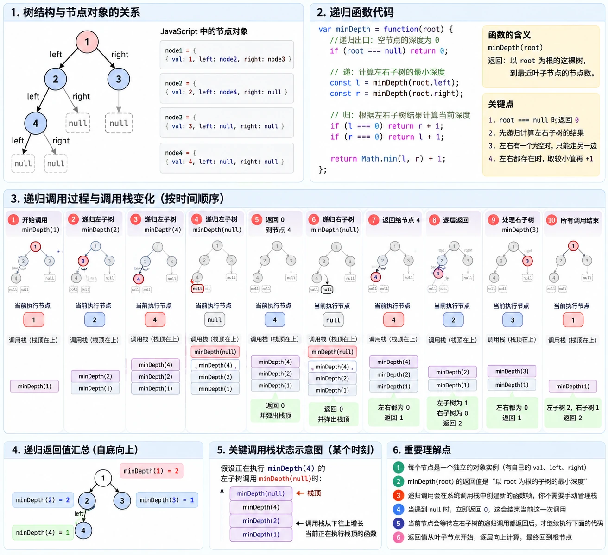

# 二叉树与递归 - 深入理解

> 来源：[基础算法精讲](https://space.bilibili.com/206214/channel/collectiondetail?sid=842776) by [灵茶山艾府](https://space.bilibili.com/206214)

|题目|代码|备注|
|---|---|---|
|[104. 二叉树的最大深度](https://leetcode.cn/problems/maximum-depth-of-binary-tree/)|[代码](https://leetcode.cn/problems/maximum-depth-of-binary-tree/solution/kan-wan-zhe-ge-shi-pin-rang-ni-dui-di-gu-44uz/)|两种方法|
|[111. 二叉树的最小深度](https://leetcode.cn/problems/minimum-depth-of-binary-tree/)|[代码](https://leetcode.cn/problems/minimum-depth-of-binary-tree/solution/liang-chong-fang-fa-zi-ding-xiang-xia-zi-0sxz/)|*课后作业|
|[404. 左叶子之和](https://leetcode.cn/problems/sum-of-left-leaves/)|[代码](https://leetcode.cn/problems/sum-of-left-leaves/solution/jian-dan-ti-jian-dan-zuo-pythonjavaccgoj-w8st/)|*课后作业|
|[112. 路径总和](https://leetcode.cn/problems/path-sum/)|[代码](https://leetcode.cn/problems/path-sum/solution/jian-ji-xie-fa-pythonjavacgojsrust-by-en-icwe/)|*课后作业|
|[129. 求根节点到叶节点数字之和](https://leetcode.cn/problems/sum-root-to-leaf-numbers/)|[代码](https://leetcode.cn/problems/sum-root-to-leaf-numbers/solution/jian-ji-xie-fa-pythonjavacgojsrust-by-en-gbu9/)|*课后作业|
|[1448. 统计二叉树中好节点的数目](https://leetcode.cn/problems/count-good-nodes-in-binary-tree/)|[代码](https://leetcode.cn/problems/count-good-nodes-in-binary-tree/solution/jian-ji-xie-fa-pythonjavacgojs-by-endles-gwxt/)|*课后作业|
|[987. 二叉树的垂序遍历](https://leetcode.cn/problems/vertical-order-traversal-of-a-binary-tree/)|[代码](https://leetcode.cn/problems/vertical-order-traversal-of-a-binary-tree/solution/si-chong-xie-fa-dfsha-xi-biao-shuang-shu-tg6q/)|*课后作业|

## 题目

### 104. 二叉树的最大深度

[题目链接](https://leetcode.cn/problems/maximum-depth-of-binary-tree/)：求从根节点到最远叶子节点的最长路径包含多少个节点。

> 示例：输入 `root = [3,9,20,null,null,15,7]`，输出 `3`。

```js
/**
 * Definition for a binary tree node.
 * function TreeNode(val, left, right) {
 *     this.val = (val===undefined ? 0 : val)
 *     this.left = (left===undefined ? null : left)
 *     this.right = (right===undefined ? null : right)
 * }
 */
/**
 * @param {TreeNode} root
 * @return {number}
 */
var maxDepth = function(root) {
    //使用递归
    //归的时候要加自己的深度？

    //boudary
    if(!root) return 0;
    const l = maxDepth(root.left);
    const r = maxDepth(root.right);
    return Math.max(l,r) + 1;
};
```


## 习题

### 111. 二叉树的最小深度

[题目链接](https://leetcode.cn/problems/minimum-depth-of-binary-tree/)：求从根节点到最近叶子节点的最短路径包含多少个节点。

> 示例：输入 `root = [3,9,20,null,null,15,7]`，输出 `2`。

```js
/**
 * @param {TreeNode} root
 * @return {number}
 */
var minDepth = function(root) {
    /**
     * 核心思路：宏观递归思维
     *
     * 1. 把每个子节点都看作一棵子树的根节点。
     * 2. 相信 minDepth(root) 能返回当前子树的最小深度。
     * 3. 当前层不需要关心子树内部如何计算，
     *    只需要拿到左右子树的结果，再组合出自己的答案。
     */

    // 0. 递归出口：空树没有根节点，深度为 0
    if (root === null) return 0;

    /**
     * 1. 递阶段：向左右子树索取答案
     *
     * 假设递归调用能够正确返回左右子树的最小深度。
     * 注意：0 也是合法答案，表示当前子树为空。
     *
     * 调用栈：
     * - 当前函数执行到递归调用时，会等待子函数返回。
     * - 每次调用都有独立的 root 和局部变量。
     * - 子函数返回后，当前函数才继续向下执行。
     */
    const leftDepth = minDepth(root.left);
    const rightDepth = minDepth(root.right);

    /**
     * 2. 归阶段：根据左右子树的答案，计算当前树的答案
     *
     * 情况一：左子树深度为 0（左子树为空）
     *         只能从右子树寻找叶子节点。
     *
     * 情况二：右子树深度为 0（右子树为空）
     *         只能从左子树寻找叶子节点。
     *
     * 注意：前面已经计算过左右子树的深度，
     *       不要再次调用 minDepth，否则会重复递归。
     */
    if (leftDepth === 0) return rightDepth + 1;
    if (rightDepth === 0) return leftDepth + 1;

    /**
     * 情况三：左右子树都存在
     *         取较小深度，再加上当前根节点这一层。
     *
     * 特殊情况：如果左右子树都为空，说明当前节点是叶子节点。
     *         此时 leftDepth 和 rightDepth 都为 0，
     *         已经被上面的第一个 if 处理，直接返回 1。
     */
    return Math.min(leftDepth, rightDepth) + 1;
};
```
#### 深入最小深度与调用栈
GPT6-medium:
你现在应该能快速判断：
- minDepth(4) 返回 1
- minDepth(2) 返回 2
- minDepth(3) 返回 1
- minDepth(1) 返回 2
```
        1
       / \
      2   3
     /
    4
```



### 404. 左叶子之和

[题目链接](https://leetcode.cn/problems/sum-of-left-leaves/)：计算二叉树中所有左叶子节点的值之和。

> 示例：输入 `root = [3,9,20,null,null,15,7]`，左叶子为 `9` 和 `15`，输出 `24`。

- 如何判断一个节点是叶子
- 思路：递归，函数返回sum，递到叶子，再拿和，通过return进行传递

```js
/**
 * Definition for a binary tree node.
 * function TreeNode(val, left, right) {
 *     this.val = (val===undefined ? 0 : val)
 *     this.left = (left===undefined ? null : left)
 *     this.right = (right===undefined ? null : right)
 * }
 */
/**
 * @param {TreeNode} root
 * @return {number}
 */
var sumOfLeftLeaves = function(root) {

    // 0. 边界条件：如果不是树了，就返回0
    if(root === null) return 0

    // 1. 递：计算两个子树的左节点值之和
    // 比如站在3的角度，左边9是一个整体，右边20是一个整体，
    let sum = sumOfLeftLeaves(root.left) + sumOfLeftLeaves(root.right)

    // 需要想清楚，左叶子，其实也相当于整个树以及多个子树的左叶子；如果我站在叶子节点的角度，那我就不知道我是不是叶子节点
    // 所以要在叶子节点的父节点去求和判断
    // 2.1 归：正常树的父节点的话，直接return sum了，
    // 2.2 归：如果root不是正常树，比如是叶子节点，应当返回0；如果是叶子节点的父节点，应当加上左叶子节点
    // 右边叶子节点不需要管
    if(!root.left)  return sum // 如果当前节点连左孩子都没有，那自然不可能存在「以当前节点为父节点的左叶子」，所以不用额外加任何值，直接返回左右子树已经算好的 sum。
    if(root.left.left === null && root.left.right === null) return root.left.val + sum //叶子节点的父节点

    // 想象一下结果来反推：sumOfLeftLeaves（3）= 9 + 15；f(9) = 0; f(20) = 15;
    return sum
};
```

### 112. 路径总和

[题目链接](https://leetcode.cn/problems/path-sum/)：判断是否存在一条节点值之和等于 `targetSum` 的根到叶路径。

> 示例：输入 `root = [5,4,8,11,null,13,4,7,2,null,null,null,1]`、`targetSum = 22`，路径 `5 → 4 → 11 → 2` 满足条件，输出 `true`。

- 递的时候，形参带进去了targetSum改完后的实际值，
- 也就是每条路径上每个新建的函数调用栈的targetSum值都是不一样的
- 思路：到达叶子节点的时候进行判断是否为0，那如果是多个路径，return判断是同事进行return吗？不会有先后吗？
- 归的时候看成，往root节点冒泡，传递 true/false，但是最终怎么确定？？是有true就true吗？全false就false？

```js
var hasPathSum = function(root, targetSum) {
    //思路：路径的话，通过递进的时候形成；每次递进减去值；判断答案，归的时候传递true/false
    //节点校验
    if(!root) return false;
    //减去值
    targetSum -= root.val;

    //判断叶子节点和答案
    if(root.left===null && root.right === null){
        return targetSum === 0;
    }
    //值传递
    return hasPathSum(root.left,targetSum) || hasPathSum(root.right,targetSum);
};
```

### 129. 求根节点到叶节点数字之和

[题目链接](https://leetcode.cn/problems/sum-root-to-leaf-numbers/)：把每条根到叶路径上的数字依次拼成整数，并求这些整数之和。

> 示例：输入 `root = [1,2,3]`，两条路径组成 `12` 和 `13`，输出 `25`。

### 1448. 统计二叉树中好节点的数目

[题目链接](https://leetcode.cn/problems/count-good-nodes-in-binary-tree/)：统计根到该节点的路径上不存在更大节点值的节点数量。

> 示例：输入 `root = [3,1,4,3,null,1,5]`，好节点为 `3、3、4、5`，输出 `4`。

```js
/**
 * Definition for a binary tree node.
 * function TreeNode(val, left, right) {
 *     this.val = (val===undefined ? 0 : val)
 *     this.left = (left===undefined ? null : left)
 *     this.right = (right===undefined ? null : right)
 * }
 */
/**
 * @param {TreeNode} root
 * @return {number}
 */
var goodNodes = function(root) {
    // 思路：dfs遍历，递进维护最大值，归求答案
    let dfs = (root, maxnum) => {
        // 1. 递归出口，如果不是节点，返回0，父级不要+cnt
        if(!root) return 0;
        // 2.1 归：叶子节点，照非叶子节点一样判断就行
        let cnt = root.val >= maxnum ? 1 : 0;
        maxnum = Math.max(maxnum, root.val)

        let leftSum = dfs(root.left, maxnum);
        let rightSum = dfs(root.right, maxnum);

        // 2.2 归：假设两边子节点都返回了子树的好节点个数，那我们直接求和往上归
        return  cnt + leftSum + rightSum
    }
    return dfs(root, -Infinity)
};
```

### 987. 二叉树的垂序遍历

[题目链接](https://leetcode.cn/problems/vertical-order-traversal-of-a-binary-tree/)：按列从左到右、列内从上到下遍历二叉树，同位置的节点按值升序排列。

> 示例：输入 `root = [3,9,20,null,null,15,7]`，输出 `[[9],[3,15],[20],[7]]`。
