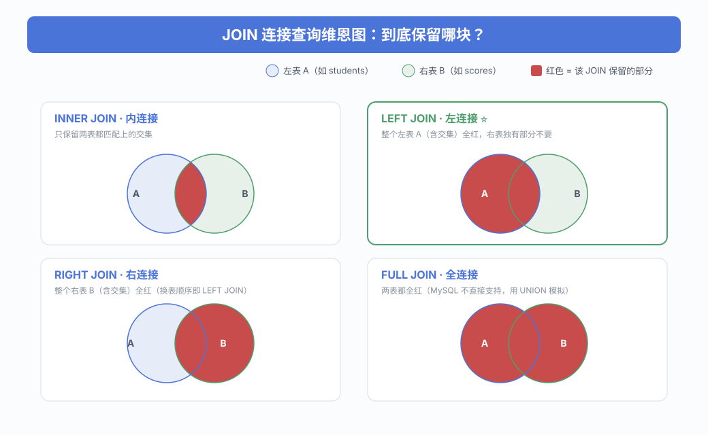
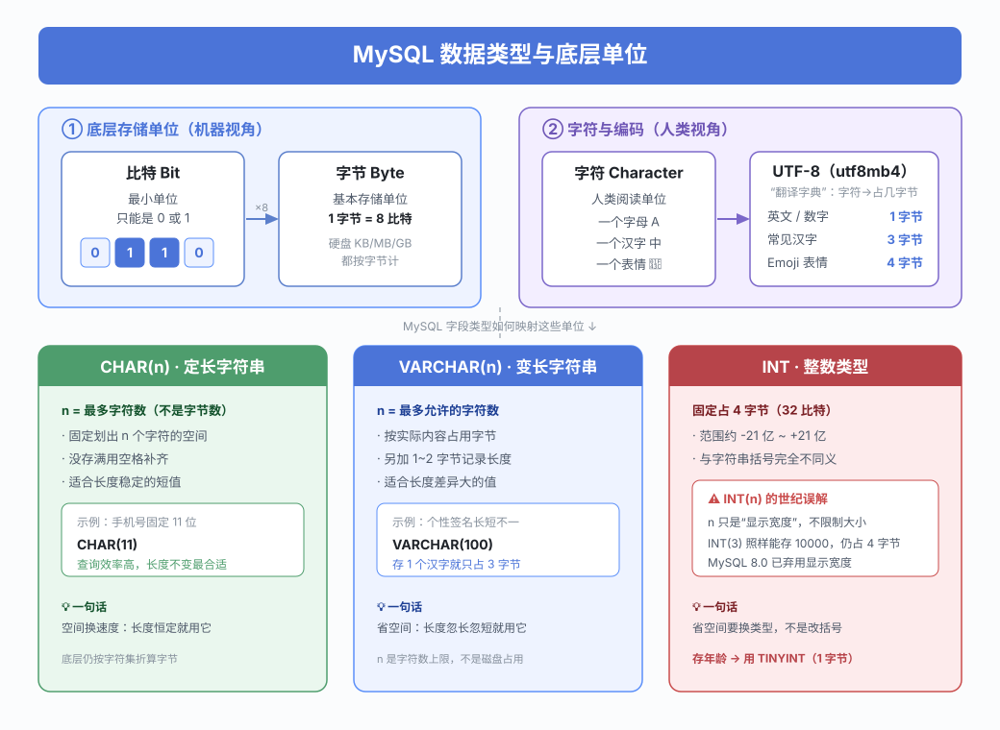
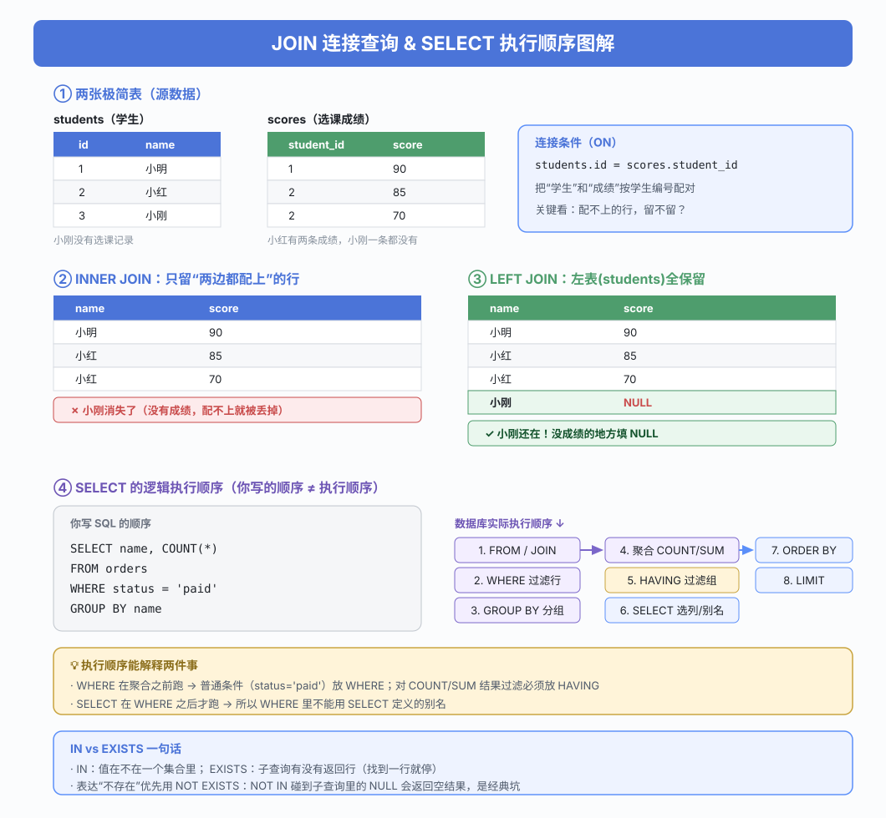

## SQL 数据库和 NoSQL 数据库有什么区别？

### 回答重点

SQL 数据库以关系模型组织数据，通常具有明确的表结构、约束和关联关系，并通过 SQL 查询。MySQL、PostgreSQL 和 Oracle 都属于关系型数据库。

NoSQL 是对非关系型数据库的统称，常见类型包括键值数据库、文档数据库、列族数据库和图数据库。Redis、MongoDB 分别是键值与文档数据库的代表。

选型时应从业务约束出发：

- 需要复杂关联查询、强一致事务和完整性约束时，关系型数据库通常更合适。
- 数据模型变化频繁、访问模式简单，或需要按特定模型水平扩展时，可以考虑 NoSQL。
- 扩展能力和一致性不是 SQL、NoSQL 的绝对分界。关系型数据库可以分片，部分 NoSQL 也支持事务，应结合具体产品和部署方式判断。

实际系统经常组合使用，例如用 MySQL 保存订单真相数据，用 Redis 承担缓存、计数或临时状态。

## 第一范式、第二范式和第三范式分别是什么？

### 回答重点

- **第一范式（1NF）**：每个字段在当前业务语义下都是不可再分的原子值，不能在一个字段中混放多个独立属性。
- **第二范式（2NF）**：在满足 1NF 的基础上，每个非主属性都完全依赖整个候选键，不能只依赖联合键的一部分。
- **第三范式（3NF）**：在满足 2NF 的基础上，非主属性不能通过另一个非主属性传递依赖候选键。

例如订单明细以 `(order_id, product_id)` 为联合主键时，商品数量依赖整个联合主键，而订单时间只依赖 `order_id`。把订单时间重复放在明细表会违反 2NF，应拆到订单表。若学生表同时保存 `teacher_id` 和由 `teacher_id` 决定的教师年龄，则存在传递依赖，应把教师信息拆到教师表。

### 扩展知识

范式可以减少冗余和更新异常，但并非层级越高越好。读多写少、查询链路敏感的场景可能有意反范式化。前提是明确冗余数据的唯一来源、同步方式和一致性要求。

## MySQL 中常见的连接查询有哪些？

### 回答重点

- `INNER JOIN` 只返回两侧满足连接条件的行。
- `LEFT JOIN` 保留左表全部行，右表没有匹配时对应列为 `NULL`。
- `RIGHT JOIN` 保留右表全部行，通常可交换表顺序改写成 `LEFT JOIN`。
- `CROSS JOIN` 返回笛卡尔积，缺少连接条件的普通 `JOIN` 也可能产生笛卡尔积。

用维恩图理解各类连接“保留哪一块”最直观（红色为该连接保留的部分）：



> 小结：`LEFT JOIN` = 交集 + 左表独有的行（整个左表全保留，右表缺失处填 `NULL`）。所以凡是“查出**所有**左表记录，哪怕没有关联数据也要列出来”的需求，都用 `LEFT JOIN`。

```sql
SELECT e.name, d.name AS department_name
FROM employees AS e
LEFT JOIN departments AS d
  ON d.id = e.department_id;
```

MySQL 不直接支持 `FULL OUTER JOIN`。需要保留重复行时，可以用“左连接 + 右侧反连接”模拟：

```sql
SELECT e.id AS employee_id, d.id AS department_id
FROM employees AS e
LEFT JOIN departments AS d
  ON d.id = e.department_id

UNION ALL

SELECT e.id AS employee_id, d.id AS department_id
FROM departments AS d
LEFT JOIN employees AS e
  ON e.department_id = d.id
WHERE e.id IS NULL;
```

第二段只补充右表未匹配的行，避免用 `UNION` 无意去重。

## MySQL 如何避免重复插入数据？

### 回答重点

可靠做法是在数据库中建立主键或唯一约束，而不是先查询再插入。后者存在并发竞态：两个请求可能同时判断“数据不存在”，随后都执行插入。

```sql
CREATE TABLE users (
  id BIGINT UNSIGNED PRIMARY KEY AUTO_INCREMENT,
  email VARCHAR(255) NOT NULL,
  name VARCHAR(100) NOT NULL,
  UNIQUE KEY uk_users_email (email)
);
```

根据冲突后的业务语义选择写法：

```sql
-- 抛出错误 (如果有重复键的话)
INSERT INTO users (email, name)
VALUES ('alice@example.com', 'Alice');

-- 更新选定列 (如果有重复键的话)
INSERT INTO users (email, name)
VALUES ('alice@example.com', 'Alice')
ON DUPLICATE KEY UPDATE name = 'Alice';

-- 忽略这行 (如果有重复键的话，直接静默忽略)
INSERT IGNORE INTO users (email, name)
VALUES ('alice@example.com', 'Alice');
```

`INSERT IGNORE` 还可能把部分数据错误降级为警告，不能把它当成通用的异常屏蔽手段。

## `CHAR` 和 `VARCHAR` 有什么区别？长度表示什么？

### 回答重点

- `CHAR(n)` 是定长字符串，适合长度稳定的短值。
- `VARCHAR(n)` 是变长字符串，按实际内容保存，并额外记录长度，适合长度差异明显的值。
- `n` 表示最多可保存的**字符数**，不是字节数。实际字节数取决于字符集，例如 `utf8mb4` 中一个字符最多占 4 字节。

选择类型时还要考虑 MySQL 单行大小限制、字符集、索引键长度和尾随空格比较规则。不能只根据 `n` 推断磁盘占用，也不要笼统认为 `CHAR` 一定比 `VARCHAR` 快。

## `INT(1)` 和 `INT(10)` 有什么区别？

### 回答重点

二者都是 4 字节的 `INT`，取值范围和计算能力没有区别。括号中的数字是历史上的显示宽度，不限制可保存的数字位数。

显示宽度主要曾与 `ZEROFILL` 配合影响客户端展示，例如把 `1` 展示为 `0001`，但不改变真实值。整数显示宽度和 `ZEROFILL` 已在 MySQL 8.0 中被弃用，新表应直接写 `INT`，业务展示格式交给应用层。

`TINYINT(1)` 也不是独立的布尔存储类型，只是经常被驱动或 ORM 映射为布尔值。

下图把「比特 / 字节 / 字符 / UTF-8」这些底层单位，与 `CHAR`、`VARCHAR`、`INT` 的实际映射关系串在一起，帮助理解这些常见误区：



## `TEXT` 类型可以无限存储文本吗？

### 回答重点

不可以。MySQL 的文本类型都有长度上限，且上限按字节计算：

- `TINYTEXT`：最多 255 字节。
- `TEXT`：最多 65,535 字节。
- `MEDIUMTEXT`：最多 16,777,215 字节。
- `LONGTEXT`：最多 4,294,967,295 字节。

可保存的字符数受字符集影响，实际还会受到最大数据包、客户端、内存和业务接口等限制。超大内容通常不适合直接放进数据库；文件和富媒体更常存入对象存储，表中只保存地址与元数据。

## IP 地址应该如何存储？

### 回答重点

如果系统只处理 IPv4，可以用 `INT UNSIGNED` 配合 `INET_ATON()` 和 `INET_NTOA()`：

```sql
CREATE TABLE ipv4_access_log (
  id BIGINT UNSIGNED PRIMARY KEY AUTO_INCREMENT,
  ip_address INT UNSIGNED NOT NULL
);

INSERT INTO ipv4_access_log (ip_address)
VALUES (INET_ATON('192.168.1.10'));

SELECT INET_NTOA(ip_address)
FROM ipv4_access_log;
```

同时支持 IPv4 和 IPv6 时，优先使用 `VARBINARY(16)`：

```sql
CREATE TABLE access_log (
  id BIGINT UNSIGNED PRIMARY KEY AUTO_INCREMENT,
  ip_address VARBINARY(16) NOT NULL
);

INSERT INTO access_log (ip_address)
VALUES (INET6_ATON('2001:db8::1'));

SELECT INET6_NTOA(ip_address)
FROM access_log;
```

二进制存储更紧凑，也便于比较和索引。使用 `VARCHAR(39)` 更直观，但同一个 IPv6 地址可能有多种文本写法，规范化和比较更麻烦。

## 外键约束有什么作用？

### 回答重点

外键用于保证引用完整性：子表中的引用值必须在父表中存在，并可声明父记录更新或删除时的行为。多对多关系通常通过中间表表达：

```sql
CREATE TABLE students (
  id BIGINT UNSIGNED PRIMARY KEY,
  name VARCHAR(100) NOT NULL
);

CREATE TABLE courses (
  id BIGINT UNSIGNED PRIMARY KEY,
  name VARCHAR(100) NOT NULL
);

CREATE TABLE enrollments (
  student_id BIGINT UNSIGNED NOT NULL,
  course_id BIGINT UNSIGNED NOT NULL,
  PRIMARY KEY (student_id, course_id),
  CONSTRAINT fk_enrollments_student
    FOREIGN KEY (student_id) REFERENCES students(id),
  CONSTRAINT fk_enrollments_course
    FOREIGN KEY (course_id) REFERENCES courses(id)
);
```

外键能阻止孤儿数据，但也会增加写入检查、迁移和跨库拆分的复杂度。是否使用外键取决于架构约束；不使用数据库外键时，应用层仍必须承担完整性校验、删除顺序和数据修复责任。

## `IN` 和 `EXISTS` 有什么区别？

### 回答重点

`IN` 判断表达式是否属于一个值集合；`EXISTS` 只判断相关子查询是否至少返回一行。

```sql
SELECT *
FROM customers
WHERE country IN ('Germany', 'France');

SELECT *
FROM customers AS c
WHERE EXISTS (
  SELECT 1
  FROM orders AS o
  WHERE o.customer_id = c.id
);
```

不存在“子查询大就一定用 `EXISTS`”的固定规则。MySQL 优化器可能把两种写法改写成半连接，应结合索引、数据分布和 `EXPLAIN` 选择更清晰、代价更低的方案。

### 扩展知识

`NOT IN` 遇到子查询结果中的 `NULL` 时，比较结果可能变成 `UNKNOWN`，最终返回空结果。表达反连接时，`NOT EXISTS` 通常更不易出错：

```sql
SELECT *
FROM customers AS c
WHERE NOT EXISTS (
  SELECT 1
  FROM orders AS o
  WHERE o.customer_id = c.id
);
```

## MySQL 常用函数有哪些？

### 回答重点

- 字符串：`CONCAT()`、`SUBSTRING()`、`REPLACE()`、`TRIM()`。
- 数值：`ABS()`、`ROUND()`、`POWER()`。
- 日期时间：`NOW()`、`CURDATE()`、`DATE_ADD()`、`TIMESTAMPDIFF()`。
- 聚合：`COUNT()`、`SUM()`、`AVG()`、`MAX()`、`MIN()`。
- 空值与条件：`COALESCE()`、`NULLIF()`、`IF()`、`CASE`。

```sql
SELECT
  COUNT(*) AS order_count,
  SUM(amount) AS total_amount,
  AVG(amount) AS average_amount
FROM orders
WHERE created_at >= CURDATE();
```

需要特别区分：`LENGTH(str)` 返回字节数，`CHAR_LENGTH(str)` 返回字符数；`COUNT(*)` 统计行数，`COUNT(column)` 只统计该列非 `NULL` 的行。

## `SELECT` 查询的逻辑执行顺序是什么？

### 回答重点

常见的逻辑顺序是：

1. `FROM` 和 `JOIN`
2. `ON`
3. `WHERE`
4. `GROUP BY`
5. 聚合计算
6. `HAVING`
7. `SELECT`
8. `DISTINCT`
9. `ORDER BY`
10. `LIMIT` 和 `OFFSET`

这解释了为什么聚合后的过滤要写在 `HAVING`，以及为什么同层 `WHERE` 通常不能直接引用 `SELECT` 别名。

其中两个容易混淆的关键字值得单独说明：

- **`ON`**：出现在 `JOIN` 中，定义**两张表怎么配对**（连接条件）。它在连接阶段执行，决定哪些行能拼到一起。注意 `ON` 和 `WHERE` 的区别——在 `LEFT JOIN` 中，写在 `ON` 里的条件只影响“能否匹配”（匹配不上仍保留左表行并填 `NULL`），写在 `WHERE` 里的条件则会在连接之后把整行过滤掉（可能把左表行也滤没）。
- **`HAVING`**：对 `GROUP BY` 分组聚合**之后**的结果做过滤，可以直接用 `COUNT()`、`SUM()` 等聚合值。它和 `WHERE` 的分工是：`WHERE` 过滤“行”（聚合前），`HAVING` 过滤“组”（聚合后）。例如“只保留订单数大于 5 的用户”就必须用 `HAVING COUNT(*) > 5`，因为 `WHERE` 执行时 `COUNT()` 还没算出来。

```sql
SELECT user_id, COUNT(*) AS order_count   -- 第6步：选列、起别名
FROM orders                               -- 第1步：取数据源
WHERE status = 'paid'                     -- 第2步：按“行”过滤（聚合前，不能用 COUNT）
GROUP BY user_id                          -- 第3步：按用户分组；第4步：每组算 COUNT(*)
HAVING COUNT(*) > 5                        -- 第5步：按“组”过滤（聚合后，可以用 COUNT）
ORDER BY order_count DESC;                -- 第7步：排序
```

下图用两张极简表演示 `INNER JOIN` 与 `LEFT JOIN` 的结果差异，并把“书写顺序”与“实际执行顺序”对照起来：



这里说的是帮助理解语义的逻辑顺序，不是存储引擎实际逐步执行的物理顺序。优化器可以在保证结果等价的前提下做谓词下推、连接重排和子查询改写。

## 如何查询“未选 01 课程但选了 02 课程”的学生成绩？

### 回答重点

使用 `EXISTS` 与 `NOT EXISTS` 可以直接表达“存在”和“不存在”：

```sql
SELECT s.id, s.name, sc.score
FROM students AS s
JOIN scores AS sc                   -- 第1步：先把学生和“02 课的成绩”配对
  ON sc.student_id = s.id           --        配对条件：同一个学生
 AND sc.course_id = '02'            --        且这条成绩是 02 课的 → 筛出“选了 02 课”的人
WHERE NOT EXISTS (                  -- 第2步：再排除“选过 01 课”的人
  SELECT 1                          --        子查询只看“有没有”，返回什么不重要
  FROM scores AS excluded
  WHERE excluded.student_id = s.id  --        这个学生
    AND excluded.course_id = '01'   --        有没有 01 课的成绩？有就被 NOT EXISTS 排除
);
```

执行步骤拆解：

1. `JOIN ... ON ... AND course_id = '02'`：先得到“选了 02 课”的学生及其成绩。
2. `NOT EXISTS (...)`：对每个候选学生，检查他是否选过 01 课；选过则排除，没选过才保留。

建议为 `scores` 建立与访问模式匹配的联合索引，例如 `(student_id, course_id)`。如果每名学生每门课只能有一条成绩，还应把它设为唯一索引。

## 如何查询总分排名第 5 到第 10 的学生？

### 回答重点

MySQL 8.0 可以先聚合，再使用窗口函数排名：

```sql
WITH student_totals AS (                    -- 第1步：按学生聚合，算出每人总分
  SELECT
    student_id,
    SUM(score) AS total_score
  FROM student_scores
  GROUP BY student_id
),
ranked_students AS (                        -- 第2步：按总分从高到低排名
  SELECT
    student_id,
    total_score,
    RANK() OVER (ORDER BY total_score DESC) AS ranking  -- 窗口函数：给每人打名次
  FROM student_totals
)
SELECT student_id, total_score, ranking
FROM ranked_students
WHERE ranking BETWEEN 5 AND 10              -- 第3步：只取第 5 到第 10 名
ORDER BY ranking, student_id;
```

执行步骤拆解：

1. 第一个 CTE `student_totals`：先 `GROUP BY student_id` 把每个学生的分数 `SUM` 成总分。
2. 第二个 CTE `ranked_students`：用窗口函数 `RANK()` 按总分降序给每个学生编名次。
3. 最外层查询：用 `WHERE ranking BETWEEN 5 AND 10` 过滤出目标名次区间。

`RANK()` 会为并列成绩保留名次空缺（如 1、2、2、4）；`DENSE_RANK()` 不留空缺（1、2、2、3）；`ROW_NUMBER()` 强制每行名次唯一（1、2、3、4）。面试时应先确认并列成绩采用哪种规则。

## 如何查询某个班级所有学生的选课情况？

### 回答重点

题目强调“所有学生”，因此学生到选课记录之间要用 `LEFT JOIN`，否则没有选课的学生会被过滤掉：

```sql
SELECT
  s.id AS student_id,
  s.name AS student_name,
  cs.course_id
FROM classes AS c
JOIN students AS s                  -- 第1步：班级 → 学生，每个班都有学生，用内连接
  ON s.class_id = c.id
LEFT JOIN course_selections AS cs   -- 第2步：学生 → 选课，可能没选课，必须用左连接
  ON cs.student_id = s.id
WHERE c.name = 'Class A'            -- 第3步：只看指定班级
ORDER BY s.id, cs.course_id;
```

执行步骤拆解：

1. `classes JOIN students`：班级和学生用内连接，因为每个学生一定属于某个班。
2. `LEFT JOIN course_selections`：学生和选课用左连接——没选课的学生也要保留，这是“所有学生”的关键。
3. `WHERE c.name = 'Class A'`：限定到目标班级。

没有选课的学生仍会出现，其 `course_id` 为 `NULL`。假如这里误用 `JOIN`（内连接），没选课的学生就会被整行过滤掉，不符合“所有学生”的要求。

## 能否只用 MySQL 实现可重入锁？

### 回答重点

MySQL 提供连接级命名锁 `GET_LOCK()`。同一连接可以重复获得同名锁，但必须对应次数地释放；事务提交或回滚不会自动释放它，连接断开才会释放。

```sql
SELECT GET_LOCK('settlement:order:1001', 5);
SELECT RELEASE_LOCK('settlement:order:1001');
```

命名锁适合范围有限的互斥任务，不适合作为通用分布式锁：它绑定数据库连接，连接池切换、超时、故障转移和锁名管理都容易造成语义偏差。

基于锁表实现时，`SELECT ... FOR UPDATE` 只在当前事务内锁住记录；提交后行锁立即释放。若要让锁状态跨事务存在，还需设计唯一键、持有者令牌、重入计数、过期时间和原子的获取/释放条件。生产系统通常优先采用成熟的协调组件或基于业务唯一约束的幂等方案。

## 一条 `SELECT` 语句在 MySQL 中如何执行？

### 回答重点

以 MySQL 8.0 为例，主要经过以下阶段：

1. **连接与认证**：连接器建立会话、验证身份并加载权限相关信息。
2. **解析**：解析器进行词法、语法分析并生成内部语法结构。
3. **预处理**：解析表和列，展开 `SELECT *`，检查对象是否存在及语义是否合法。
4. **优化**：优化器根据统计信息和成本模型选择访问路径、索引和连接顺序，生成执行计划。
5. **执行**：执行器按计划调用存储引擎接口读取记录，完成过滤、聚合或排序，并向客户端返回结果。

MySQL 5.7 及更早版本曾有 Server 层查询缓存，但一致性维护成本较高，MySQL 8.0 已将其移除。它不应出现在现代 MySQL 查询链路中。

## MySQL 常见存储引擎有哪些？

### 回答重点

- **InnoDB**：MySQL 默认引擎，支持事务、崩溃恢复、行级锁、MVCC 和外键，是通用业务表的首选。
- **MyISAM**：不支持事务和外键，主要使用表级锁，崩溃恢复能力有限。现代在线业务很少把它作为默认选择。
- **MEMORY**：表数据主要位于内存，进程重启后数据丢失；支持 `HASH` 和 `BTREE` 索引，适合体量受控的临时数据，不等同于持久化缓存系统。

存储引擎负责数据和索引的具体组织、读写、锁与恢复能力。可以通过 `SHOW ENGINES` 查看当前实例支持的引擎。

## 为什么 InnoDB 成为默认存储引擎？它和 MyISAM 有什么区别？

### 回答重点

InnoDB 更适合需要并发写入和数据可靠性的在线事务处理：

- InnoDB 支持事务、MVCC、行级锁和外键；MyISAM 不支持事务和外键，主要使用表级锁。
- InnoDB 通过 redo log、undo log 等机制支持崩溃恢复；MyISAM 的恢复能力较弱。
- InnoDB 使用聚簇索引组织表数据，二级索引叶子节点保存主键值；MyISAM 的索引与数据文件分离，索引叶子节点保存数据记录位置。
- InnoDB 主键会被所有二级索引引用，因此主键长度会影响全部二级索引的体积。

MyISAM 可以快速返回无 `WHERE` 条件的精确 `COUNT(*)`，因为它维护了表行数。InnoDB 为了遵守 MVCC 可见性，需要读取索引统计当前事务可见的行，不能简单复用一个全局精确计数。

## MySQL 的表结构、数据和日志通常存在哪里？

### 回答重点

文件布局与 MySQL 版本、配置和存储引擎有关，不能把旧版本的目录结构当成固定规则。

在常见的 MySQL 8.0 与 InnoDB 配置中：

- 数据字典是事务化的，表结构元数据不再保存为 MySQL 5.7 时代的 `.frm` 文件。
- 开启 `innodb_file_per_table` 后，每张 InnoDB 表通常有独立的 `.ibd` 表空间，其中包含该表的数据和索引。
- 系统表空间、undo 表空间、临时表空间和 redo log 分别承担内部元数据、回滚版本、临时数据和崩溃恢复等职责。
- binlog 属于 MySQL Server 层，主要用于复制和基于时间点恢复，不属于某张表的 `.ibd` 文件。

数据目录也不一定是 `/var/lib/mysql`，应通过系统配置或 `SHOW VARIABLES LIKE 'datadir'` 确认：

```sql
SHOW VARIABLES LIKE 'datadir';
SHOW VARIABLES LIKE 'innodb_file_per_table';
```

## 本篇复习要点

按“必须记住”和“看懂即可”两类自测，点击展开查看答案。

<details>
<summary>🔴 必须记住：面试要能张口就答的结论</summary>

- **三范式**：1NF 字段不可再分；2NF 消除部分依赖；3NF 消除传递依赖。
- **CHAR vs VARCHAR**：CHAR 定长、VARCHAR 变长；括号里 `n` 是字符数不是字节数。
- **INT(n)**：`INT(1)` 和 `INT(10)` 完全一样，都占 4 字节；`n` 只是显示宽度，8.0 已弃用；省空间该换 `TINYINT`。
- **TEXT 上限**：有上限、按字节算；`TEXT` 最大 65535 字节；超大内容存对象存储只留 URL。
- **防重复插入**：建唯一索引 + `ON DUPLICATE KEY UPDATE` / `INSERT IGNORE`；别用“先查再插”。
- **JOIN 区别**：INNER=交集；LEFT=左表全保留（右缺填 `NULL`）；“所有 / 每个”就用 `LEFT JOIN`。
- **IN vs EXISTS**：没有“大用 EXISTS 小用 IN”的死规则；`NOT IN` 碰 `NULL` 返回空，反连接优先 `NOT EXISTS`。
- **执行顺序**：`FROM → WHERE → GROUP BY → 聚合 → HAVING → SELECT → ORDER BY → LIMIT`。
- **WHERE vs HAVING**：WHERE 过滤行（聚合前）、HAVING 过滤组（聚合后能用 `COUNT`）。
- **命名锁 vs 行锁**：`GET_LOCK` 跟连接走；`FOR UPDATE` 跟事务走，提交即释放。
- **SQL 执行流程**：连接器 → 解析器 → 预处理 → 优化器 → 执行器；⚠️ 8.0 删了查询缓存。
- **InnoDB vs MyISAM**：InnoDB 支持事务 / 行锁 / MVCC / 外键 / 崩溃恢复；MyISAM 表锁、不支持事务、能快速 `COUNT(*)`。
- **默认存储引擎**：InnoDB。

</details>

<details>
<summary>🟡 看懂即可：理解原理，不用背字句</summary>

- **SQL vs NoSQL 选型**：关系型强在事务 / 关联，NoSQL 强在灵活 / 扩展，实际常组合用。开放题，不用背。
- **为什么 LEFT JOIN 保留左表**：配合维恩图理解“交集 + 左表独有”即可。
- **FULL JOIN 模拟**：MySQL 不支持，可用 `LEFT JOIN ... UNION ALL ...` 模拟，不用背代码。
- **IP 地址存储**：IPv4 用 `INT` + `INET_ATON` 省空间、IPv6 用 `VARBINARY(16)`，函数名忘了能查。
- **外键利弊**：保证引用完整性，但增加写入 / 拆库复杂度；大厂常不用外键、改应用层保证。
- **三道实战 SQL**：理解解题套路（`NOT EXISTS` 表达“不存在”、窗口函数排名、`LEFT JOIN` 保留全体），会分析就能现场写。
- **文件存哪**：`.ibd` 存表数据索引、binlog 属 Server 层、`SHOW VARIABLES` 能查目录，记个大概。
- **常用函数**：`COUNT(*)` vs `COUNT(列)`、`LENGTH` vs `CHAR_LENGTH` 的区分点记住，其余查文档。

</details>

> 时间紧时，优先把这 5 个最高频刻进肌肉记忆：INT(n) 的 n 是显示宽度、VARCHAR 的 n 是字符数、SELECT 执行顺序 + WHERE/HAVING 分工、JOIN 四种区别、InnoDB vs MyISAM。
