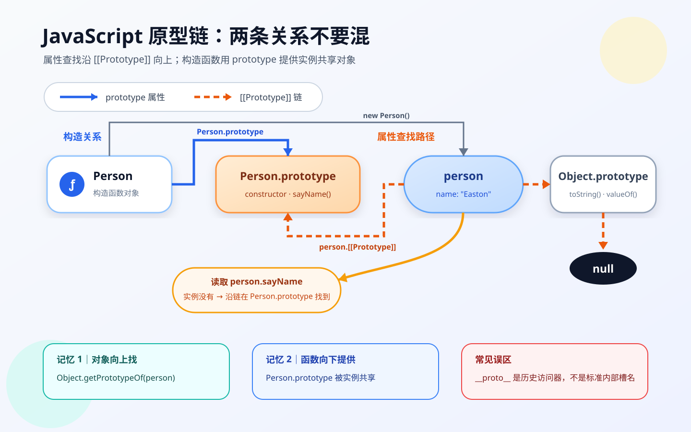
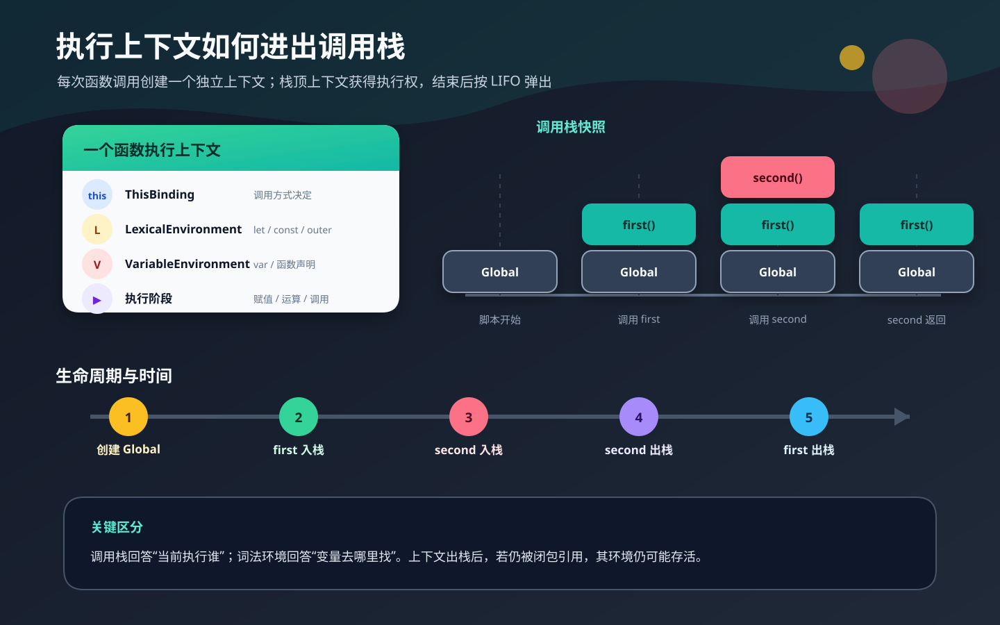
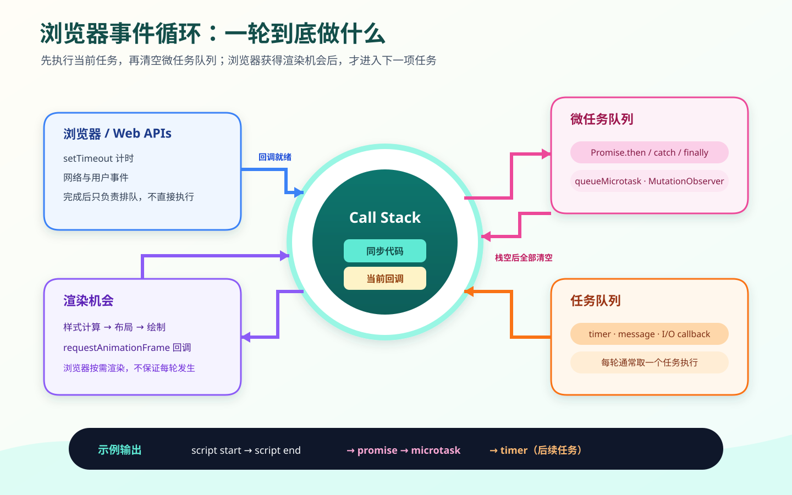
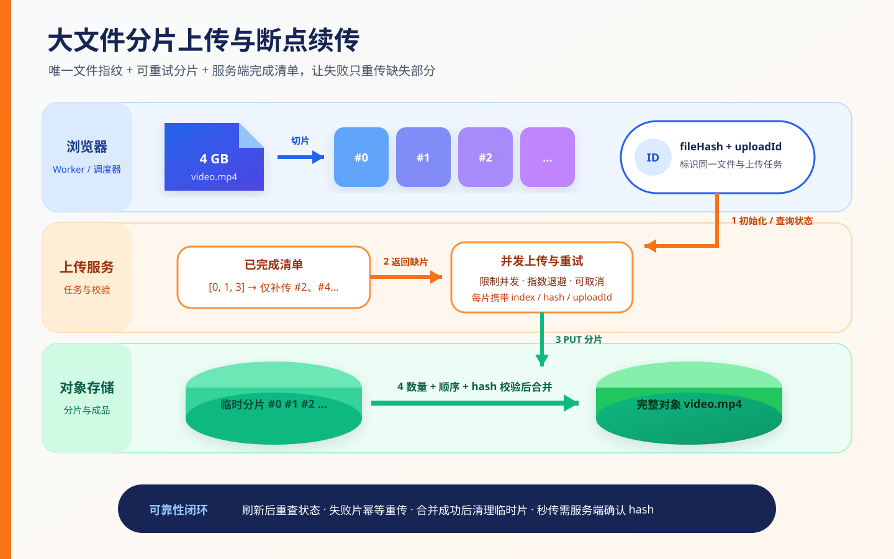
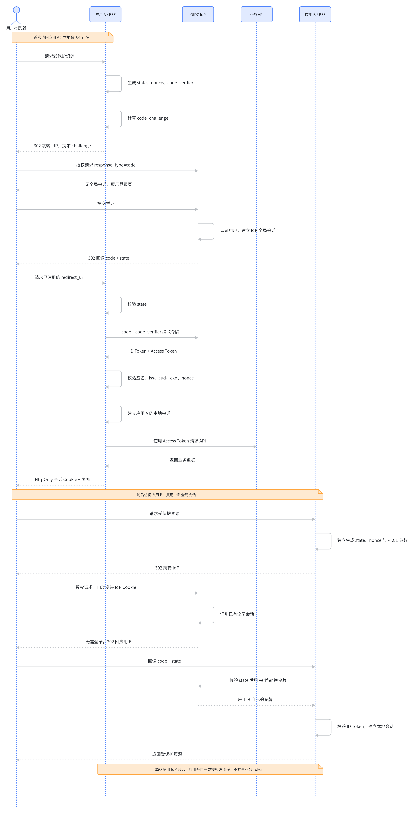
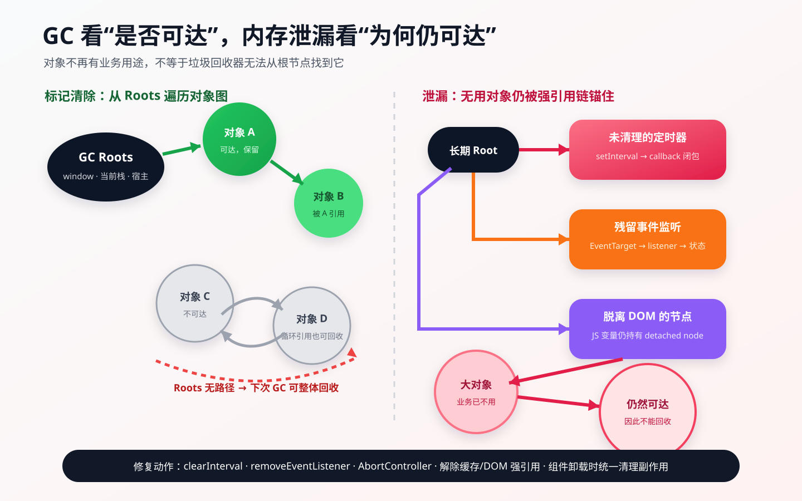
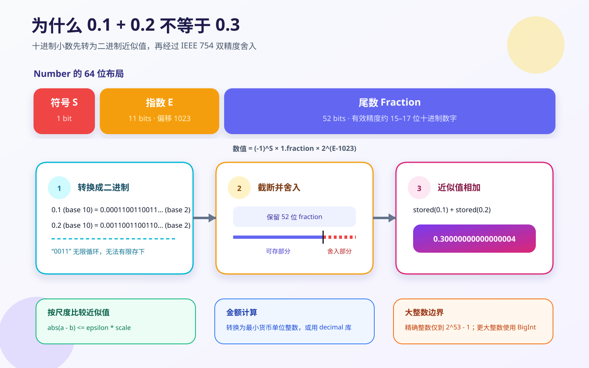

## 1. 说说 JavaScript 中的数据类型，以及它们在赋值上的区别？

### 回答重点

JavaScript 有 8 种语言类型：

- 7 种原始类型：`undefined`、`null`、`boolean`、`number`、`bigint`、`string`、`symbol`。
- 1 种对象类型：`object`。普通对象、数组、函数、日期、正则、`Map`、`Set` 等都属于对象；函数是可调用的对象。

原始值不可变，变量赋值时复制值；对象赋值时复制对象引用，多个变量可能指向同一个对象。这里描述的是语言层面的可观察语义，不应把“原始值一定在栈上、对象一定在堆上”当作 ECMAScript 规范保证，具体内存布局由引擎决定。

### 常见类型

`number` 使用 IEEE 754 双精度浮点数表示整数和小数，还包含 `NaN`、`Infinity`、`-Infinity` 与 `-0`。安全整数范围是 `Number.MIN_SAFE_INTEGER` 到 `Number.MAX_SAFE_INTEGER`。

```js
console.log(Number.MAX_SAFE_INTEGER); // 9007199254740991
console.log(Number.isNaN(0 / 0)); // true
console.log(Object.is(-0, 0)); // false
```

`bigint` 用于表示任意精度整数，字面量以 `n` 结尾。它不能表示小数，通常也不能与 `number` 直接做算术运算，避免发生隐式精度丢失。

```js
const orderId = 9007199254740993n;
console.log(orderId + 1n); // 9007199254740994n
console.log(typeof orderId); // "bigint"

// orderId + 1; // TypeError: Cannot mix BigInt and other types
```

`string` 是不可变的 UTF-16 码元序列。重新赋值会让变量指向新字符串，不会修改原字符串。

```js
let language = "Java";
language += "Script";
console.log(language); // "JavaScript"
```

`undefined` 通常表示“缺少值”或“尚未赋值”，`null` 通常由开发者主动表示“空值”。`typeof null` 返回 `"object"` 是历史兼容行为，并不表示 `null` 是对象。

```js
let pending;
const selected = null;

console.log(pending); // undefined
console.log(selected); // null
console.log(typeof null); // "object"
```

`symbol` 创建唯一的原始值，常用于避免对象属性名冲突。`Symbol.for` 是例外：相同键会从全局 Symbol 注册表中取得同一个值。

```js
const first = Symbol("id");
const second = Symbol("id");
const sharedA = Symbol.for("id");
const sharedB = Symbol.for("id");

console.log(first === second); // false
console.log(sharedA === sharedB); // true
```

### 赋值语义

原始值赋值后，两个变量互不影响：

```js
let countA = 1;
let countB = countA;
countB = 2;

console.log(countA); // 1
console.log(countB); // 2
```

对象赋值复制的是引用。通过任一引用修改对象，其他引用都能观察到变化；但给变量重新赋值不会修改原对象。

```js
const userA = { name: "Alice" };
let userB = userA;

userB.name = "Bob";
console.log(userA.name); // "Bob"

userB = { name: "Carol" };
console.log(userA.name); // "Bob"
```

JavaScript 的参数也按值传递。传入对象时，被复制的值是对象引用，因此函数可以修改对象内容，却不能通过重新给形参赋值来替换调用方的变量。

```js
function update(profile) {
  profile.name = "Bob";
  profile = { name: "Carol" };
}

const profile = { name: "Alice" };
update(profile);
console.log(profile.name); // "Bob"
```

### 面试易错点

- `const` 限制的是变量重新赋值，不会自动冻结对象；需要浅冻结时可使用 `Object.freeze`。
- `NaN` 不等于自身，判断它优先使用 `Number.isNaN`。
- `bigint` 与 `number` 表示范围和运算规则不同，跨类型转换要显式进行并考虑精度。
- “栈和堆”可以作为常见实现的辅助理解，但面试时应先回答值复制、引用共享这些可观察语义。

## 2. 说说你了解的 JavaScript 数据结构？

### 回答重点

数据结构描述数据的组织方式及其支持的操作。JavaScript 内置了数组、普通对象、`Map`、`Set`、`WeakMap`、`WeakSet`、类型化数组等容器；栈、队列、链表、树、堆和图通常根据业务需要自行封装。

选择数据结构时应关注访问模式、时间复杂度、键的类型、顺序要求和内存生命周期，不能只看语法是否方便。

### 内置容器

**Array**

数组是有序、可变长的索引集合，适合按索引访问和顺序遍历。规范没有要求 JavaScript 数组必须采用连续内存，引擎可根据元素形态选择不同实现。

- 按索引访问通常可视为 `O(1)`。
- 尾部 `push`、`pop` 通常为摊销 `O(1)`。
- 头部 `shift`、`unshift` 以及中间插入、删除通常需要移动或重排元素，可视为 `O(n)`。

```js
const tasks = ["read", "code"];
tasks.push("review");
console.log(tasks[1]); // "code"
```

**Object 与 Map**

普通对象适合表示字段固定的记录，属性键只能是字符串或 `symbol`。`Map` 更适合动态键值集合，键可以是任意值，并直接提供 `size`、迭代和增删 API。

```js
const user = { id: 1, name: "Alice" };
const cache = new Map();
const request = { url: "/api/users" };

cache.set(request, "pending");
console.log(cache.get(request)); // "pending"
console.log(user.name); // "Alice"
```

**Set**

`Set` 保存唯一值，适合去重和成员判断。

```js
const uniqueIds = new Set([1, 1, 2]);
uniqueIds.add(3);

console.log([...uniqueIds]); // [1, 2, 3]
console.log(uniqueIds.has(2)); // true
```

**WeakMap 与 WeakSet**

二者弱持有对象或非全局注册的 Symbol 键，不阻止键被垃圾回收，也不可枚举。它们适合给对象关联私有元数据，而不适合需要遍历或统计大小的场景。

**TypedArray**

`Uint8Array`、`Float32Array` 等类型化数组基于 `ArrayBuffer` 访问固定类型的二进制数据，常用于文件、音视频、Canvas、WebGL 和网络协议处理。它们与普通 `Array` 的语义不同。

### 常见抽象结构

**栈**

栈遵循后进先出（LIFO），可用数组尾部操作实现，典型场景有撤销、表达式求值和深度优先遍历。

```js
const stack = [];
stack.push("page-a");
stack.push("page-b");
console.log(stack.pop()); // "page-b"
```

**队列**

队列遵循先进先出（FIFO），用于任务调度、消息处理和广度优先遍历。小规模场景可用数组实现；频繁 `shift` 时更适合用头尾索引或双端队列，避免反复移动元素。

```js
class Queue {
  #items = new Map();
  #head = 0;
  #tail = 0;

  enqueue(value) {
    this.#items.set(this.#tail++, value);
  }

  dequeue() {
    if (this.#head === this.#tail) return undefined;
    const value = this.#items.get(this.#head);
    this.#items.delete(this.#head++);
    return value;
  }
}

const queue = new Queue();
queue.enqueue("first");
queue.enqueue("second");
console.log(queue.dequeue()); // "first"
```

**链表、树、图与堆**

- 链表通过节点引用连接元素，已知节点处插入、删除可为 `O(1)`，但按位置查找为 `O(n)`；它不天然比 JavaScript 数组更快。
- 树适合表达层级关系，如 DOM、目录和抽象语法树；二叉搜索树在平衡时可高效查找。
- 图由顶点和边组成，适合社交关系、依赖关系和路线规划，常用邻接表表示。
- 堆通常指满足堆序性质的完全二叉树，常用于优先队列；不要与描述内存区域的“堆”混淆。

## 3. DOM 常见的操作有哪些？

### 回答重点

DOM（Document Object Model，文档对象模型）把 HTML/XML 文档表示为节点树，并提供查询、创建、更新、插入、删除节点以及事件处理等 API。`document` 是当前文档的入口。

### 查询与遍历

```js
const main = document.querySelector("main");
const cards = document.querySelectorAll(".card");
const title = document.getElementById("title");

console.log(main, cards.length, title);
```

- `querySelector` 返回第一个匹配元素或 `null`。
- `querySelectorAll` 返回静态 `NodeList`。
- `getElementsByClassName`、`getElementsByTagName` 返回动态 `HTMLCollection`。
- `parentElement`、`children`、`firstElementChild`、`nextElementSibling` 用于遍历元素关系；`childNodes` 等节点 API 还会包含文本、注释等非元素节点。
- 对可能不存在的元素操作前，要先处理 `null`。

### 创建与插入

```js
const list = document.createElement("ul");
const item = document.createElement("li");
item.textContent = "JavaScript";
item.dataset.language = "js";

list.append(item);
document.body.append(list);
```

常用插入方法包括：

- `append`、`prepend`：在内部末尾或开头插入节点或字符串。
- `before`、`after`：在当前节点前后插入。
- `replaceWith`：替换当前节点。
- `appendChild`、`insertBefore`：较早但仍广泛使用的节点 API。

一个节点同一时刻只能位于文档树中的一个位置。插入已有节点会移动它，而不是复制它；复制可使用 `cloneNode(true)`。

批量构建大量节点时，可以先放入 `DocumentFragment`，再一次插入：

```js
const fragment = document.createDocumentFragment();

for (const name of ["HTML", "CSS", "JavaScript"]) {
  const item = document.createElement("li");
  item.textContent = name;
  fragment.append(item);
}

document.body.append(fragment);
```

### 更新内容、属性和样式

```js
const button = document.createElement("button");

button.textContent = "提交";
button.setAttribute("aria-label", "提交表单");
button.classList.add("primary");
button.style.setProperty("--progress", "50%");
button.hidden = false;
```

- 设置纯文本优先使用 `textContent`。
- `innerHTML` 会解析 HTML，适合可信模板；把未转义的用户输入写入 `innerHTML` 会产生 XSS 风险。
- 标准属性通常可通过 DOM 属性访问，如 `input.value`、`button.disabled`；通用属性可使用 `getAttribute`、`setAttribute`、`removeAttribute`。
- 样式切换优先使用 `classList`，避免大量内联样式。

### 删除与事件

```js
const notice = document.createElement("div");
notice.textContent = "可关闭提示";
document.body.append(notice);

notice.addEventListener("click", () => {
  notice.remove();
});
```

`remove()` 可直接删除节点；`parent.removeChild(child)` 是兼容性更早的写法。事件使用 `addEventListener` 注册，并可通过 `removeEventListener` 解除。动态列表常利用事件冒泡在父节点做事件委托。

### 性能与安全

- 循环中集中读取布局信息，再批量写入 DOM，减少强制同步布局和不必要的重排。
- 动画优先修改 `transform`、`opacity`，并使用 `requestAnimationFrame` 协调更新。
- 不要把不可信字符串直接交给 `innerHTML`、`insertAdjacentHTML` 等 HTML 解析 API；优先使用 `textContent` 或经过可靠消毒的内容。

## 4. 说说你对 BOM 的理解，常见的 BOM 对象有哪些？

### 回答重点

BOM（Browser Object Model，浏览器对象模型）是前端对浏览器窗口及其能力的一组传统称呼。它不像 DOM 那样对应一份单独、统一的“BOM 规范”；相关 API 现在分布在 HTML、URL、History、Navigation 等 Web 标准中。

浏览器页面中的全局对象通常是 `window`，常见对象包括 `location`、`history`、`navigator` 和 `screen`。DOM 关注文档内容，BOM 关注窗口、地址、历史、设备能力等浏览器环境。

### window

`window` 表示当前浏览上下文，并暴露计时器、滚动、弹窗和视口信息等 API。

```js
console.log(window.innerWidth);
window.scrollTo({ top: 0, behavior: "smooth" });

const timerId = window.setTimeout(() => {
  console.log("done");
}, 100);

window.clearTimeout(timerId);
```

顶层 `var` 和函数声明在传统浏览器脚本中可能成为 `window` 的属性，但顶层 `let`、`const`、`class` 不会；ES Module 的顶层声明也不会。工程代码不应依赖隐式全局变量。

`window.open` 通常必须由用户操作触发，否则可能被弹窗策略拦截。新窗口还涉及 `opener` 安全风险，打开外部页面时应使用 `noopener`。

### location

`location` 表示当前 URL，也可用于导航和刷新。读取查询参数时优先配合 `URL`、`URLSearchParams`，避免手工切字符串。

```js
const currentUrl = new URL(window.location.href);
console.log(currentUrl.pathname);
console.log(currentUrl.searchParams.get("page"));

// 导航并保留当前历史记录：
// window.location.assign("/login");

// 导航并替换当前历史记录：
// window.location.replace("/login");
```

修改 `location.href`、调用 `assign` 或 `replace` 会触发导航。`location.reload()` 刷新当前页面；旧式的 `reload(true)` 强制刷新参数不是标准行为，不应依赖。

### history

`history` 操作当前标签页的会话历史：

```js
history.pushState({ tab: "profile" }, "", "?tab=profile");
history.replaceState({ tab: "settings" }, "", "?tab=settings");

window.addEventListener("popstate", (event) => {
  console.log(event.state);
});
```

- `back()`、`forward()`、`go(delta)` 在历史记录中移动。
- `pushState`、`replaceState` 修改 URL 和状态但不会自动加载页面，也不会主动触发 `popstate`。
- 出于安全限制，`pushState` 和 `replaceState` 只能使用同源 URL。

### navigator 与 screen

`navigator` 暴露用户代理环境和浏览器能力，例如语言、在线提示、硬件并发数、剪贴板、媒体设备、权限与 Service Worker。

```js
console.log(navigator.language);
console.log(navigator.onLine);
console.log(navigator.hardwareConcurrency);
```

应优先做能力检测，而不是根据 `navigator.userAgent` 猜浏览器。部分 API 仅在 HTTPS、安全权限或用户手势下可用；`navigator.onLine` 也只能作为网络状态提示，不能证明服务端可访问。

`screen` 描述显示屏可用尺寸、色深和方向等信息：

```js
console.log(screen.width, screen.height);
console.log(screen.availWidth, screen.availHeight);
```

这些值可能受多显示器、缩放和隐私保护影响，不应当作设备身份标识。`window.moveTo`、`resizeTo` 等窗口控制 API 在现代浏览器中也常受权限和窗口类型限制，不适合作为核心业务能力。

## 5. `==` 和 `===` 有什么区别，分别在什么场景使用？

### 回答重点

`===` 执行严格相等比较，不做类型转换；`==` 执行抽象相等比较，在类型不同时按规范进行强制转换。日常业务代码默认使用 `===`，只有在明确需要且团队认可其转换规则时才使用 `==`。

### 严格相等

类型不同直接返回 `false`；同类型时比较对应的值。对象比较的是身份，而不是结构。

```js
console.log(1 === 1); // true
console.log("1" === 1); // false
console.log({} === {}); // false

const object = {};
console.log(object === object); // true
console.log(NaN === NaN); // false
console.log(0 === -0); // true
```

严格相等不会“深比较”数组或对象。需要按内容比较时，应根据数据结构显式比较所需字段。

### 抽象相等

`==` 的转换规则较多，常见情况包括：

- `null == undefined` 为 `true`，且 `null`、`undefined` 不与其他值宽松相等。
- 布尔值先转换为数字。
- 字符串与数字比较时，字符串会尝试转换为数字。
- 对象与原始值比较时，对象会先尝试转换为原始值。
- 两个对象仍比较身份，不会比较内容。
- `number` 与 `bigint` 可以在值可精确对应时宽松相等，但二者不能直接混合算术。

```js
console.log(null == undefined); // true
console.log("0" == 0); // true
console.log(false == 0); // true
console.log([] == ""); // true
console.log(1n == 1); // true
console.log(1n === 1); // false
```

这些结果虽然有确定的规范规则，但容易降低可读性。例如空白字符串可转换为 `0`，数组也可能先转成字符串，因此不应靠记忆零散结果来使用 `==`。

### 使用建议

默认使用 `===`。一个常见且有意的例外是同时判断 `null` 和 `undefined`：

```js
function isNullish(value) {
  return value == null;
}

console.log(isNullish(null)); // true
console.log(isNullish(undefined)); // true
console.log(isNullish(0)); // false
```

若团队禁止 `==`，可写成 `value === null || value === undefined`，或者在提供默认值时使用空值合并运算符 `??`。

此外还有 `Object.is` 和 SameValueZero：

- `Object.is(NaN, NaN)` 为 `true`，`Object.is(0, -0)` 为 `false`。
- `Array.prototype.includes`、`Set`、`Map` 的键匹配采用 SameValueZero，因此能匹配 `NaN`，并把 `0` 与 `-0` 视为相同。

```js
console.log(Object.is(NaN, NaN)); // true
console.log([NaN].includes(NaN)); // true
```

## 6. `typeof` 与 `instanceof` 有什么区别？

### 回答重点

`typeof` 返回描述操作数语言类型的字符串，主要用于判断原始类型和函数；`instanceof` 返回布尔值，用于检查构造函数的 `prototype` 是否出现在对象的原型链上。二者解决的问题不同，都不是通用的“万能类型判断”。

### typeof

```js
console.log(typeof undefined); // "undefined"
console.log(typeof true); // "boolean"
console.log(typeof 1); // "number"
console.log(typeof 1n); // "bigint"
console.log(typeof "text"); // "string"
console.log(typeof Symbol("id")); // "symbol"
console.log(typeof function example() {}); // "function"
console.log(typeof {}); // "object"
console.log(typeof []); // "object"
console.log(typeof null); // "object"
```

注意：

- `typeof null === "object"` 是历史兼容行为，判断 `null` 应使用 `value === null`。
- 除可调用对象通常返回 `"function"` 外，大多数对象都返回 `"object"`，所以不能靠它区分数组、日期和普通对象。
- 对真正未声明的标识符执行 `typeof` 通常返回 `"undefined"`，不会抛错；但处于 `let`、`const`、`class` 暂时性死区中的变量仍会抛出 `ReferenceError`。

```js
console.log(typeof notDeclared); // "undefined"

{
  // console.log(typeof pending); // ReferenceError
  const pending = "ready";
  console.log(typeof pending); // "string"
}
```

### instanceof

```js
class Person {}

const person = new Person();
console.log(person instanceof Person); // true
console.log(person instanceof Object); // true
console.log("text" instanceof String); // false
console.log(new String("text") instanceof String); // true
```

对普通构造函数而言，`left instanceof Right` 会沿 `left` 的原型链查找 `Right.prototype`。因此它判断的是当前原型链关系，不是对象由谁“永久制造”的可靠记录；修改原型链会改变结果。构造函数还可以通过 `Symbol.hasInstance` 自定义 `instanceof` 行为。

以下函数只演示普通构造函数下的核心查找过程，不等价于完整的 `instanceof` 规范算法：

```js
function ordinaryInstanceOf(value, Constructor) {
  if (typeof Constructor !== "function") {
    throw new TypeError("Right-hand side must be callable");
  }

  if (
    (typeof value !== "object" || value === null) &&
    typeof value !== "function"
  ) {
    return false;
  }

  const targetPrototype = Constructor.prototype;
  if (
    (typeof targetPrototype !== "object" || targetPrototype === null) &&
    typeof targetPrototype !== "function"
  ) {
    throw new TypeError("Constructor.prototype must be an object");
  }

  let current = Object.getPrototypeOf(value);
  while (current !== null) {
    if (current === targetPrototype) return true;
    current = Object.getPrototypeOf(current);
  }
  return false;
}

console.log(ordinaryInstanceOf([], Array)); // true
```

### 实际选择

- 判断数组：`Array.isArray(value)`，它比 `instanceof Array` 更适合跨 iframe 等 realm 场景。
- 判断 `null`：`value === null`。
- 判断原始类型：使用 `typeof`，并单独处理 `null`。
- 判断某个原型链关系：使用 `instanceof` 或 `prototype.isPrototypeOf(value)`。
- 判断内置对象的大类标签：可使用 `Object.prototype.toString.call(value)`，但它可能受 `Symbol.toStringTag` 影响，不能替代业务数据校验。

```js
function getBasicType(value) {
  if (value === null) return "null";
  if (Array.isArray(value)) return "array";
  return typeof value;
}

console.log(getBasicType(null)); // "null"
console.log(getBasicType([])); // "array"
console.log(getBasicType(1n)); // "bigint"
```

## 7. JavaScript 的原型和原型链是什么？有什么特点？

### 回答重点

JavaScript 对象有一个内部 `[[Prototype]]` 链接，它指向另一个对象或 `null`。访问属性时，先查找对象自身；找不到再沿 `[[Prototype]]` 逐层向上查找，直到找到属性或到达 `null`。这条委托关系就是原型链。

应区分两个概念：

- 对象的 `[[Prototype]]`：每个普通对象都具有的内部链接，可通过 `Object.getPrototypeOf` 读取。
- 函数的 `prototype` 属性：可构造函数通常具有的普通属性，供 `new` 创建实例时作为实例的 `[[Prototype]]`。箭头函数不可构造，通常没有自己的 `prototype` 属性。



### 构造函数与实例

```js
function Person(name) {
  this.name = name;
}

Person.prototype.sayHello = function sayHello() {
  return `Hello, ${this.name}`;
};

const alice = new Person("Alice");

console.log(Object.getPrototypeOf(alice) === Person.prototype); // true
console.log(Person.prototype.constructor === Person); // true
console.log(alice.sayHello()); // "Hello, Alice"
```

执行 `new Person()` 时，与原型相关的关键效果是：新对象的 `[[Prototype]]` 被设为 `Person.prototype`，随后构造函数以新对象作为 `this` 执行。共享方法放在原型上，可避免每个实例都创建一份函数。

`class` 语法仍建立在原型机制上：

```js
class User {
  constructor(name) {
    this.name = name;
  }

  greet() {
    return `Hi, ${this.name}`;
  }
}

const user = new User("Bob");
console.log(Object.getPrototypeOf(user) === User.prototype); // true
console.log(user.greet === User.prototype.greet); // true
```

### 属性查找、遮蔽与 this

给对象赋值通常会创建或修改自有属性，从而遮蔽原型上的同名属性；不会直接改写原型。

```js
const defaults = { theme: "light" };
const settings = Object.create(defaults);

console.log(settings.theme); // "light"，来自原型
console.log(Object.hasOwn(settings, "theme")); // false

settings.theme = "dark";
console.log(settings.theme); // "dark"，自有属性遮蔽原型属性
console.log(defaults.theme); // "light"
```

从原型取得方法后以 `obj.method()` 调用，方法内的 `this` 仍由调用方式决定，通常指向接收者 `obj`，而不是定义该方法的原型对象。

### 常见原型关系

```js
function Person() {}

console.log(Object.getPrototypeOf(Person.prototype) === Object.prototype); // true
console.log(Object.getPrototypeOf(Object.prototype) === null); // true
console.log(Object.getPrototypeOf(Person) === Function.prototype); // true
console.log(Object.getPrototypeOf(Function.prototype) === Object.prototype); // true
console.log(Object.getPrototypeOf(Function) === Function.prototype); // true
```

“所有对象都继承自 `Object.prototype`”并不严谨。使用 `Object.create(null)` 可以创建没有原型的对象：

```js
const dictionary = Object.create(null);
dictionary.answer = 42;

console.log(Object.getPrototypeOf(dictionary)); // null
console.log("toString" in dictionary); // false
```

### 实践注意

- `obj.__proto__` 是为了 Web 兼容保留的 legacy 访问器。读取使用 `Object.getPrototypeOf`，创建指定原型的对象使用 `Object.create`；运行中频繁修改原型还会影响性能。
- 判断自有属性优先使用 `Object.hasOwn(obj, key)`，不要假设对象一定继承了 `hasOwnProperty`。
- `in` 会检查整条原型链，`Object.hasOwn` 只检查对象自身。
- 原型链过长会增加理解和查找成本。业务代码通常使用 `class`、组合或清晰的对象创建方式，不应随意修改内置对象的原型。

## 8. 说说你对作用域链的理解？

### 回答重点

作用域决定标识符（变量、函数、类等）在代码中的可见范围。JavaScript 采用**词法作用域**：一个函数能访问哪些外层变量，取决于函数定义在源码中的位置，而不是函数从哪里被调用。

现代 JavaScript 中常见的作用域包括：

- 全局作用域：脚本顶层声明所在的作用域。浏览器经典脚本与 ES 模块的顶层语义并不完全相同。
- 模块作用域：ES 模块顶层声明只在当前模块内可见，不会成为 `window` 的属性。
- 函数作用域：函数参数以及函数体内的 `var`、函数声明等位于函数作用域中。
- 块级作用域：`let`、`const`、`class` 在 `{}`、`for`、`switch` 等语法块中形成块级绑定；`catch` 参数也有自己的作用域。

```js
const language = 'JavaScript';

function outer() {
  const topic = 'scope';

  function inner() {
    const detail = 'scope chain';
    console.log(language, topic, detail);
  }

  inner();
}

outer();
```

执行 `inner` 时，解析 `topic` 会先查找 `inner` 自己的词法环境，再查找 `outer` 的词法环境；解析 `language` 时还会继续查找到全局词法环境。这条由当前环境及其外部环境引用连接而成的查找路径，就是通常所说的**作用域链**。

查找只会从内向外进行，内层作用域可以访问外层绑定，外层作用域不能反向访问内层局部变量：

```js
function createMessage() {
  const message = 'hello';
  console.log(message);
}

createMessage();
// console.log(message); // ReferenceError: message is not defined
```

同名标识符会发生遮蔽。查找到最近的一层后就停止，不会继续读取更外层的同名绑定。

```js
const value = 'global';

function printValue() {
  const value = 'local';
  console.log(value);
}

printValue(); // local
```

### 词法作用域与调用位置

函数的外部词法环境在函数创建时由其定义位置决定，与调用位置无关：

```js
const count = 1;

function readCount() {
  console.log(count);
}

function run() {
  const count = 2;
  readCount();
}

run(); // 1
```

`readCount` 定义在全局作用域中，因此不会因为在 `run` 内调用就访问到 `run` 的局部变量。

### 常见边界

- 读取一个沿作用域链始终找不到的标识符会抛出 `ReferenceError`。非严格模式下，给未声明标识符赋值可能意外创建全局对象属性，但这发生在赋值时，并不是“查找失败后自动声明变量”；严格模式下该赋值也会抛出 `ReferenceError`。
- `var` 是函数作用域，不是块级作用域；`let`、`const` 和 `class` 才具有块级作用域。
- `let`、`const` 声明从块开始就已建立绑定，但在声明执行前处于暂时性死区（TDZ），提前访问会抛出 `ReferenceError`。
- 闭包本质上是函数保留了创建时对外部词法环境的引用，因此函数离开原定义位置后仍可沿原来的作用域链访问变量。

## 9. 谈谈对 `this` 的理解？

### 回答重点

`this` 不是函数的词法作用域，也不一定指向“定义函数的对象”。对**普通函数**而言，`this` 主要由调用方式决定；对**箭头函数**而言，它没有自己的 `this`，而是从定义位置的外层词法环境中取得 `this`。

普通函数的主要绑定规则如下，优先级通常可概括为：

1. 构造调用：`new Fn()` 中，`this` 指向新创建的实例。
2. 显式绑定：`call`、`apply` 或 `bind` 指定 `this`。
3. 隐式绑定：`obj.fn()` 中，`this` 指向点号左侧的 `obj`。
4. 默认绑定：独立调用 `fn()` 时，严格模式下 `this` 为 `undefined`；非严格模式下通常会替换为 `globalThis`。

箭头函数不参与上述绑定规则，`call`、`apply`、`bind` 和 `new` 都不能为箭头函数重新绑定 `this`。

### 普通函数的绑定规则

**隐式绑定**取决于调用表达式，而不是函数最初存放在哪里：

```js
'use strict';

function showName() {
  console.log(this?.name);
}

const user = {
  name: 'Ada',
  showName,
};

user.showName(); // Ada

const detached = user.showName;
detached(); // undefined
```

`detached()` 是独立函数调用。在严格模式下，`detached` 内的 `this` 是 `undefined`。类的方法体始终按严格模式执行。

对象链式调用只看最后一层调用者：

```js
const container = {
  name: 'outer',
  child: {
    name: 'inner',
    print() {
      console.log(this.name);
    },
  },
};

container.child.print(); // inner
```

**显式绑定**可以指定普通调用时的 `this`：

```js
function introduce(greeting) {
  return `${greeting}, ${this.name}`;
}

const person = { name: 'Lin' };

console.log(introduce.call(person, 'Hello'));
console.log(introduce.apply(person, ['Hi']));

const boundIntroduce = introduce.bind(person, 'Welcome');
console.log(boundIntroduce());
```

严格模式普通函数中，`call(null)` 会保留 `null`；非严格模式函数会把 `null` 或 `undefined` 替换为全局对象，并把原始值装箱。因此不能笼统地说它们始终指向 `window`。

**构造调用**的优先级高于 `bind` 固定的 `this`。用 `new` 调用绑定函数时，绑定的参数仍然有效，但预设的 `this` 会被新实例替代：

```js
function Person(name) {
  this.name = name;
}

const ignoredThis = { name: 'ignored' };
const BoundPerson = Person.bind(ignoredThis, 'Grace');
const person = new BoundPerson();

console.log(person.name); // Grace
console.log(ignoredThis.name); // ignored
console.log(person instanceof Person); // true
```

### 箭头函数的 this

箭头函数在创建时沿外层环境取得 `this`。下面的方法返回一个箭头函数，因此异步回调仍能读取该方法调用时的实例：

```js
class Counter {
  constructor() {
    this.value = 0;
  }

  createIncrementer() {
    return () => {
      this.value += 1;
      return this.value;
    };
  }
}

const counter = new Counter();
const increment = counter.createIncrementer();
console.log(increment()); // 1
```

不要用箭头函数定义需要动态接收调用者的对象方法或原型方法：

```js
const user = {
  name: 'Ada',
  regularMethod() {
    return this.name;
  },
  arrowMethod: () => this,
};

console.log(user.regularMethod()); // Ada
console.log(user.arrowMethod() === user); // false
```

在浏览器经典脚本顶层，外层 `this` 通常是 `window`；在 ES 模块顶层，`this` 是 `undefined`。因此不要把箭头函数的顶层 `this` 固定描述成 `window`。

箭头函数还没有自己的 `arguments`、`super` 和 `new.target`，也没有 `[[Construct]]`，所以不能作为构造函数，`new (() => {})` 会抛出 `TypeError`。

### DOM 监听器中的 this

通过 `addEventListener` 注册普通函数时，浏览器调用监听器时会令 `this === event.currentTarget`；箭头函数则继续使用外层 `this`。工程中更推荐显式使用 `event.currentTarget`，语义更清楚。

```js
const button = document.querySelector('#save');

button?.addEventListener('click', function (event) {
  console.log(this === event.currentTarget); // true
});

button?.addEventListener('click', (event) => {
  console.log(event.currentTarget === button); // true
});
```

## 10. 说说 `new` 操作符具体做了什么？

### 回答重点

`new Constructor(...args)` 对可构造函数执行构造调用，大致完成以下步骤：

1. 创建一个新对象。
2. 读取 `Constructor.prototype`；若它是对象值（包括函数），则把它作为新对象的 `[[Prototype]]`，否则回退到构造函数所属 realm 的 `Object.prototype`。
3. 以新对象作为 `this`，使用给定参数执行构造函数。
4. 如果构造函数显式返回对象或函数，则返回该值；如果返回原始值或没有显式返回值，则返回步骤 1 创建的对象。

```js
function Person(name) {
  this.name = name;
}

Person.prototype.sayName = function () {
  return this.name;
};

const person = new Person('Tom');
console.log(person.sayName()); // Tom
console.log(Object.getPrototypeOf(person) === Person.prototype); // true
```

只有具有内部 `[[Construct]]` 能力的值才能被 `new` 调用。普通函数和 `class` 通常可构造，箭头函数、方法简写和大多数内置方法不可构造。

### 构造函数的返回值

```js
function ReturnPrimitive() {
  this.value = 1;
  return 42;
}

function ReturnObject() {
  this.value = 1;
  return { value: 2 };
}

console.log(new ReturnPrimitive().value); // 1
console.log(new ReturnObject().value); // 2
```

`null` 是原始值，构造函数返回 `null` 时也会忽略该返回值。函数本身属于对象值，因此构造函数显式返回函数时，该函数也会成为 `new` 表达式的结果。

派生类构造函数还有更严格的返回规则，并且必须在访问 `this` 前调用 `super()`；这是 `class extends` 的专门语义，不能完全用普通函数的 `apply` 模拟。

### 手写实现

下面的教学实现展示普通函数构造调用的核心过程：

```js
function myNew(Constructor, ...args) {
  if (typeof Constructor !== 'function') {
    throw new TypeError('Constructor must be a function');
  }

  const candidate = Constructor.prototype;
  const prototype =
    candidate !== null &&
    (typeof candidate === 'object' || typeof candidate === 'function')
      ? candidate
      : Object.prototype;
  const instance = Object.create(prototype);
  const result = Constructor.apply(instance, args);
  const returnsObject =
    result !== null &&
    (typeof result === 'object' || typeof result === 'function');

  return returnsObject ? result : instance;
}

function Person(name) {
  this.name = name;
}

const person = myNew(Person, 'Ada');
console.log(person.name); // Ada
console.log(person instanceof Person); // true
```

这个版本不能调用 ES `class`，也无法可靠判断箭头函数、绑定函数等值是否具有 `[[Construct]]`，还没有完整模拟 `new.target`、代理对象和跨 realm 等规范细节。现代代码若需要按原生语义动态构造，应使用 `Reflect.construct`：

```js
class Person {
  constructor(name) {
    this.name = name;
  }
}

const person = Reflect.construct(Person, ['Ada']);
console.log(person.name); // Ada
```

## 11. `call`、`apply`、`bind` 有什么区别？如何实现 `bind`？

### 回答重点

三者都是函数的方法，但调用时机和参数形式不同：

| 方法 | 是否立即调用 | 参数形式 | 返回值 |
| --- | --- | --- | --- |
| `fn.call(thisArg, a, b)` | 是 | 参数逐个传入 | 原函数的执行结果 |
| `fn.apply(thisArg, [a, b])` | 是 | 参数通过数组或类数组对象传入 | 原函数的执行结果 |
| `fn.bind(thisArg, a)` | 否 | 可先预置一部分参数，调用返回函数时再补充 | 新的绑定函数 |

```js
function format(prefix, suffix) {
  return `${prefix}${this.value}${suffix}`;
}

const context = { value: 'JavaScript' };

console.log(format.call(context, '[', ']'));
console.log(format.apply(context, ['<', '>']));

const boundFormat = format.bind(context, '(', ')');
console.log(boundFormat());
```

`apply` 的第二个参数可以是数组或类数组对象；现代代码若只是展开可迭代对象，也常写成 `fn.call(thisArg, ...args)` 或 `Reflect.apply(fn, thisArg, args)`。

对严格模式普通函数，传入的 `thisArg` 会原样保留；对非严格模式普通函数，`null`、`undefined` 和原始值会发生全局对象替换或装箱。箭头函数没有自己的 `this`，所以这三个方法都不能改变箭头函数捕获的 `this`。

### bind 的参数与构造调用

`bind` 会按“预置参数在前，调用参数在后”的顺序合并参数：

```js
function list(...items) {
  return items;
}

const boundList = list.bind(null, 1, 2);
console.log(boundList(3, 4)); // [1, 2, 3, 4]
```

如果目标函数可构造，原生绑定函数也可通过 `new` 调用。此时预设参数继续生效，但绑定的 `thisArg` 被忽略，实例仍继承目标构造函数的原型。

```js
function User(role, name) {
  this.role = role;
  this.name = name;
}

const BoundUser = User.bind({ ignored: true }, 'admin');
const user = new BoundUser('Ada');

console.log(user.role, user.name); // admin Ada
console.log(user instanceof User); // true
```

### 手写 bind

下面实现了普通调用、分批传参和构造调用这三个核心行为：

```js
function myBind(target, thisArg, ...boundArgs) {
  if (typeof target !== 'function') {
    throw new TypeError('Target must be callable');
  }

  function bound(...callArgs) {
    const args = [...boundArgs, ...callArgs];

    if (new.target) {
      const newTarget = new.target === bound ? target : new.target;
      return Reflect.construct(target, args, newTarget);
    }

    return Reflect.apply(target, thisArg, args);
  }

  Object.setPrototypeOf(bound, Object.getPrototypeOf(target));
  return bound;
}

function Person(prefix, name) {
  this.label = `${prefix}${name}`;
}

const BoundPerson = myBind(Person, { ignored: true }, 'User: ');
const person = new BoundPerson('Ada');

console.log(person.label); // User: Ada
console.log(person instanceof Person); // true
```

这是教学实现，不等同于引擎创建的原生绑定函数：原生绑定函数没有普通的 `prototype` 自有属性，并具有特殊的内部槽；其 `name`、`length`、`instanceof` 转发、跨 realm 行为及部分元编程细节也未在这里完整模拟。生产代码应直接使用原生 `Function.prototype.bind`。

## 12. JavaScript 中的执行上下文和调用栈是什么？

### 回答重点

**执行上下文**可以理解为引擎执行一段 JavaScript 代码时所需状态的抽象，包括当前的词法环境、变量环境、`this` 绑定、函数或脚本相关信息等。常见上下文包括：

- 脚本的全局执行上下文。
- 每次函数调用创建的函数执行上下文。
- ES 模块的模块执行上下文。
- `eval` 代码的执行上下文；实际开发应避免使用 `eval`。

**调用栈**是管理执行上下文的后进先出（LIFO）栈。脚本开始执行时进入全局上下文；调用函数时压入新的函数执行上下文；函数返回或因异常退出时，该上下文出栈。

```js
function second() {
  console.log('second');
}

function first() {
  console.log('first:start');
  second();
  console.log('first:end');
}

first();
console.log('global:end');
```

调用过程可简化表示为：

```text
压入 Global
压入 first
压入 second
弹出 second
弹出 first
继续执行 Global
```

调用栈只描述当前同步调用关系。Promise 回调、定时器回调和 DOM 事件监听器会由事件循环在合适时机安排为新的任务或微任务，然后再进入调用栈，并不是一直留在原调用栈中等待。



### 创建与执行

规范实现细节会随代码类型而不同，但面试中可用两个阶段建立直觉：

1. 创建阶段：建立环境记录、参数和局部声明的绑定，确定普通函数调用的 `this`，处理函数声明及变量声明。
2. 执行阶段：按顺序求值表达式、完成赋值并调用其他函数。

下面是概念结构，不是可运行的 JavaScript：

```text
ExecutionContext {
  LexicalEnvironment: 当前词法环境
  VariableEnvironment: var 等声明使用的变量环境
  PrivateEnvironment: 私有名称环境（适用时）
  FunctionOrScript: 当前函数、脚本或模块
  ThisBinding: 当前 this（适用时）
}
```

词法环境由“环境记录”和指向外部词法环境的引用组成。作用域链正是通过这些外部引用完成标识符解析。函数在哪里定义，决定它保存的外部环境；函数何时调用，决定何时创建本次调用的函数执行上下文。

### 提升与暂时性死区

创建环境时，不同声明的初始化规则不同：

- 函数声明通常在正文执行前已完成绑定和初始化，因此可以在声明文本前调用。
- `var` 绑定在进入对应函数或全局环境时初始化为 `undefined`，赋值仍发生在原位置。
- `let`、`const` 和 `class` 的绑定已创建但尚未初始化，在执行到声明前访问会落入暂时性死区并抛出 `ReferenceError`。

```js
console.log(value); // undefined
var value = 1;

try {
  console.log(answer);
} catch (error) {
  console.log(error.name); // ReferenceError
}

let answer = 42;
```

“变量提升”是对这些声明实例化现象的通俗描述，并不表示引擎真的把源代码移动到了文件顶部。

### this 与全局环境的边界

浏览器经典脚本的顶层 `this` 通常是 `window`，但 ES 模块顶层 `this` 是 `undefined`。函数上下文中的 `this` 还要按普通调用、方法调用、显式绑定或构造调用等规则确定，因此不能把所有执行上下文的 `this` 都描述为全局对象。

函数出栈也不代表其词法环境一定立即销毁。如果仍有闭包引用该环境，它会继续存活；何时回收由垃圾回收器根据可达性决定。

## 13. 说说 JavaScript 中的 DOM 事件模型？

### 回答重点

DOM 事件沿节点路径传播，通常分为三个阶段：

1. 捕获阶段（`Event.CAPTURING_PHASE`）：从 `Window`、`Document` 等祖先节点向目标节点传播。
2. 目标阶段（`Event.AT_TARGET`）：到达事件目标。
3. 冒泡阶段（`Event.BUBBLING_PHASE`）：若事件的 `bubbles` 为 `true`，再从目标节点向祖先节点传播。

`event.target` 是事件最初命中的目标，`event.currentTarget` 是当前正在执行监听器的节点。传播过程中 `target` 通常不变，`currentTarget` 会随监听器所在节点改变。

```js
const outer = document.querySelector('#outer');
const button = document.querySelector('#submit');

outer?.addEventListener(
  'click',
  (event) => {
    console.log('capture', event.target, event.currentTarget);
  },
  { capture: true },
);

button?.addEventListener('click', (event) => {
  console.log('target', event.eventPhase === Event.AT_TARGET);
});

outer?.addEventListener('click', (event) => {
  console.log('bubble', event.target, event.currentTarget);
});
```

到达目标节点时，目标节点上的捕获监听器和非捕获监听器都处于目标阶段，`event.eventPhase` 都是 `Event.AT_TARGET`，不能把目标节点上的捕获监听器误判为捕获阶段。

并非所有事件都会冒泡。例如 `focus`、`blur`、`mouseenter` 和 `mouseleave` 不冒泡；但祖先节点仍可在捕获阶段观察部分不冒泡事件。做表单委托时也可以使用会冒泡的 `focusin`、`focusout`。

### 注册与移除监听器

现代代码应使用 `addEventListener`，它允许同一节点、同一事件类型注册多个监听器：

```js
const button = document.querySelector('#save');

function handleClick(event) {
  console.log(event.currentTarget);
}

button?.addEventListener('click', handleClick);
button?.removeEventListener('click', handleClick);
```

要成功移除监听器，事件类型、监听器引用和 `capture` 值必须与注册时匹配。`once`、`passive` 等其他选项不参与 `removeEventListener` 的匹配，但最好保持写法一致以便维护。匿名函数每次求值都会产生新引用，因此下面无法移除原监听器：

```js
const button = document.querySelector('#save');

button?.addEventListener('click', () => {
  console.log('saved');
});

button?.removeEventListener('click', () => {
  console.log('saved');
});
```

需要统一清理多个监听器时，可以使用 `AbortController`：

```js
const controller = new AbortController();
const button = document.querySelector('#save');

button?.addEventListener(
  'click',
  () => {
    console.log('saved');
  },
  { signal: controller.signal },
);

controller.abort();
```

事件处理器属性（常被称为 DOM0 风格）仍可使用，但每个属性只能保存一个处理器，后赋值会覆盖前一个，设为 `null` 可移除：

```js
const button = document.querySelector('#save');

button.onclick = () => {
  console.log('saved');
};

button.onclick = null;
```

旧版 IE 的 `attachEvent`、`detachEvent` 和 `window.event` 属于 legacy API，现代浏览器代码不应再使用。

### 控制传播与默认行为

- `event.stopPropagation()` 阻止事件继续传播到路径上的其他节点，但不会阻止同一节点上尚未执行的其他监听器。
- `event.stopImmediatePropagation()` 还会阻止同一节点上后续监听器执行。
- `event.preventDefault()` 在事件可取消时阻止浏览器默认行为，不会自动停止传播。
- `passive: true` 表示监听器不会调用 `preventDefault()`；浏览器可据此优化触摸和滚动性能。

```js
const link = document.querySelector('a[data-confirm]');

link?.addEventListener('click', (event) => {
  if (!window.confirm('继续跳转吗？')) {
    event.preventDefault();
  }
});
```

## 14. 什么是事件委托？有哪些应用场景？

### 回答重点

事件委托是把监听器注册在共同祖先节点上，利用事件传播，在祖先监听器中根据 `event.target` 判断真正命中的后代元素。它通常利用冒泡阶段，也可以按需要在捕获阶段实现。

事件委托的主要价值是：

- 用一个祖先监听器处理大量同类子元素，减少逐个注册和清理监听器的工作。
- 动态新增的后代元素只要满足匹配条件，就能自动复用既有处理逻辑。
- 把同一区域的交互入口集中管理，便于统一做权限、埋点或状态判断。

### 基本实现

假设列表项中还包含按钮、图标等嵌套元素，不能只判断 `event.target.tagName`，因为真正命中的可能是内部图标。应使用 `closest` 向上寻找可操作元素，并确认它仍位于委托容器中。

```html
<ul id="task-list">
  <li data-task-id="1"><button type="button">完成任务 1</button></li>
  <li data-task-id="2"><button type="button">完成任务 2</button></li>
</ul>
```

```js
const list = document.querySelector('#task-list');

list?.addEventListener('click', (event) => {
  if (!(event.target instanceof Element)) {
    return;
  }

  const button = event.target.closest('button');
  if (!button || !list.contains(button)) {
    return;
  }

  const item = button.closest('[data-task-id]');
  if (!item || !list.contains(item)) {
    return;
  }

  console.log(item.dataset.taskId);
});
```

`event.currentTarget` 在这里始终是 `list`，`event.target` 才是最初命中的后代节点。`closest` 负责处理嵌套元素，`contains` 防止匹配越过当前委托容器的边界。

### 动态内容

下面只给列表注册一次监听器。之后新增的列表项也能响应点击：

```js
const addButton = document.querySelector('#add-task');
const list = document.querySelector('#task-list');
let nextId = 3;

list?.addEventListener('click', (event) => {
  if (!(event.target instanceof Element)) {
    return;
  }

  const item = event.target.closest('[data-task-id]');
  if (item && list.contains(item)) {
    console.log(`clicked: ${item.dataset.taskId}`);
  }
});

addButton?.addEventListener('click', () => {
  const item = document.createElement('li');
  item.dataset.taskId = String(nextId);
  item.textContent = `任务 ${nextId}`;
  nextId += 1;
  list?.append(item);
});
```

### 适用边界

- `click`、`input`、`change`、`keydown` 等常见冒泡事件适合委托。`keypress` 已弃用，键盘交互应使用 `keydown` 或 `keyup`。
- `focus` 和 `blur` 不冒泡；可改用 `focusin`、`focusout`，或在祖先节点使用捕获监听器。
- `mouseenter`、`mouseleave` 不冒泡。需要委托类似行为时可使用 `mouseover`、`mouseout`，并结合 `relatedTarget` 过滤子元素之间的移动。
- 高频事件（如 `mousemove`、`pointermove`）可以委托，但处理器必须足够轻量；是否使用委托应根据触发频率和匹配成本衡量。
- `stopPropagation()` 可能使祖先上的委托监听器收不到事件。
- Shadow DOM 会重定向部分事件的 `target`。跨 Shadow DOM 边界时应确认事件的 `composed` 属性，并按需使用 `event.composedPath()` 判断实际传播路径。

事件委托不是“监听器越少越好”。如果子元素数量很少、生命周期独立，或者每个元素逻辑差异很大，直接注册监听器往往更清晰。

## 15. 说说你对闭包的理解？闭包有哪些使用场景？

### 回答重点

闭包是**函数与其创建时所在词法环境的组合**。JavaScript 采用词法作用域，函数能访问哪些变量由定义位置决定，而不是由调用位置决定。只要函数仍然可达，它引用的外层变量就不会被垃圾回收。

```js
function createCounter() {
  let count = 0;

  return function increment() {
    count += 1;
    return count;
  };
}

const counterA = createCounter();
const counterB = createCounter();

console.log(counterA()); // 1
console.log(counterA()); // 2
console.log(counterB()); // 1
```

`counterA` 和 `counterB` 来自两次独立调用，因此各自持有不同的词法环境。闭包捕获的是变量绑定，不是创建函数那一刻的值；后续读写会作用于同一个绑定。

### 常见场景

- 封装私有状态，例如计数器、模块工厂和状态管理。
- 生成带配置的函数，例如偏函数、柯里化和事件处理器。
- 在回调中保留上下文，例如定时器、Promise 回调和监听器。
- 实现函数缓存。缓存容器由返回函数持续引用。

```js
function createMultiplier(factor) {
  return (value) => factor * value;
}

const double = createMultiplier(2);
console.log(double(6)); // 12
```

循环与异步回调也是常见考点。`let` 会为每轮循环创建新的绑定，`var` 则共享同一个函数级绑定。

```js
for (let index = 0; index < 3; index += 1) {
  setTimeout(() => console.log(index), 0);
}

// 依次输出 0、1、2
```

### 使用注意

闭包本身不是内存泄漏。风险在于长生命周期的闭包意外引用大对象、DOM 节点或已经无用的状态。移除事件监听器、清理定时器，并避免捕获不需要的对象，可以缩短这些数据的可达时间。

类的共享方法通常应定义在原型上或使用 `class` 方法；如果每个实例都在构造函数中创建同一个方法，会产生不必要的函数对象。但当方法确实需要独立私有状态时，闭包仍是合理选择。

## 16. JavaScript 中的类型转换机制是什么？

### 回答重点

JavaScript 有显式转换和隐式转换。显式转换通过 `Number`、`String`、`Boolean` 等函数表达意图；隐式转换由运算符和语法上下文触发。分析隐式转换时，重点关注规范中的抽象操作：

- `ToPrimitive`：把对象转换为原始值，通常依次尝试 `Symbol.toPrimitive`、`valueOf` 和 `toString`。
- `ToBoolean`：用于条件判断。
- `ToNumber` 或 `ToNumeric`：用于多数算术运算。
- `ToString`：用于字符串拼接等场景。

JavaScript 的原始类型有 `undefined`、`null`、`boolean`、`number`、`bigint`、`string` 和 `symbol`，其余值属于对象。

### 显式转换

`Number(value)` 转为 Number。完整字符串必须符合数值语法，空字符串转为 `0`；无法转换时得到 `NaN`。`parseInt` 和 `parseFloat` 用于从字符串开头解析数值，不应当作 `Number` 的等价替代。

```js
Number('42'); // 42
Number(''); // 0
Number('42px'); // NaN
parseInt('42px', 10); // 42
Number(null); // 0
Number(undefined); // NaN
Number(10n); // 10，可能丢失大整数精度
// Number(Symbol('id')); // TypeError
```

`String(value)` 返回字符串。与某些隐式字符串转换不同，显式调用 `String(Symbol('id'))` 是允许的。

```js
String(null); // 'null'
String([1, 2, 3]); // '1,2,3'
String(Symbol('id')); // 'Symbol(id)'
```

`Boolean(value)` 只有以下值转换为 `false`：`false`、`undefined`、`null`、`0`、`-0`、`0n`、`NaN` 和空字符串。其他值都转换为 `true`，包括空数组、空对象和包装对象。

```js
Boolean(''); // false
Boolean(0n); // false
Boolean([]); // true
Boolean(new Boolean(false)); // true
```

### 隐式转换

条件语句和逻辑非会执行布尔转换。`&&`、`||` 返回操作数本身，不会把最终结果强制变为布尔值；`??` 只把 `null` 和 `undefined` 视为缺失值。

`+` 最特殊：先把对象转为原始值；如果任一原始值是字符串，就执行字符串拼接，否则执行数值加法。其他常见算术运算符通常执行数值转换。

```js
'5' + 1; // '51'
'5' - 1; // 4
[] + 1; // '1'
null + 1; // 1
undefined + 1; // NaN
// 1n + 1; // TypeError，BigInt 与 Number 不能直接混算
```

宽松相等 `==` 会按规则转换类型，规则多且容易产生反直觉结果；严格相等 `===` 不做类型转换，业务代码通常优先使用它。一个有意使用宽松相等的常见写法是 `value == null`，它同时匹配 `null` 和 `undefined`，但应通过代码规范明确这种约定。

```js
0 == false; // true
0 === false; // false
null == undefined; // true
null === undefined; // false
```

## 17. 浅拷贝和深拷贝有什么区别？如何实现深拷贝？

### 回答重点

赋值、浅拷贝和深拷贝是三个不同概念：

- 对象赋值只复制引用，新旧变量指向同一个对象。
- 浅拷贝创建新的外层对象，但嵌套对象仍共享引用。
- 深拷贝复制整个可复制对象图；修改副本中的嵌套数据不应影响原对象。

不要用“对象一定在堆、引用一定在栈”解释拷贝。规范没有规定具体内存布局，关键是值语义和引用关系。

### 浅拷贝

对象展开、`Object.assign`、数组展开、`slice`、`concat` 和 `Array.from` 都只做浅拷贝。它们还可能触发 getter，且不会完整保留属性描述符。

```js
const source = {
  name: 'JavaScript',
  meta: { stable: true },
};
const copy = { ...source };

copy.name = 'ECMAScript';
copy.meta.stable = false;

console.log(source.name); // 'JavaScript'
console.log(source.meta.stable); // false
```

### 优先使用 structuredClone

现代浏览器和较新版本的 Node.js 提供 `structuredClone`。它支持循环引用，以及 `Date`、`RegExp`、`Map`、`Set`、`ArrayBuffer`、类型化数组等结构化可克隆类型。

```js
const source = {
  createdAt: new Date(),
  tags: new Set(['js']),
};
source.self = source;

const copy = structuredClone(source);
console.log(copy !== source); // true
console.log(copy.self === copy); // true
console.log(copy.createdAt instanceof Date); // true
```

它不是任意 JavaScript 值的通用复制器，主要边界包括：

- 函数、Symbol 值、`WeakMap`、`WeakSet` 和多数 DOM 节点不能被克隆，会抛出 `DataCloneError`。
- 属性描述符、getter/setter、对象原型链和类私有字段不会按原样复制；自定义类实例通常不能借此保留类语义。
- 可转移对象可以通过 `transfer` 移交所有权。转移 `ArrayBuffer` 后，原缓冲区会被分离，而不是再保留一份完整副本。

```js
const buffer = new ArrayBuffer(8);
const copy = structuredClone(buffer, { transfer: [buffer] });

console.log(buffer.byteLength); // 0
console.log(copy.byteLength); // 8
```

### JSON 方案的局限

`JSON.parse(JSON.stringify(value))` 只适合明确可 JSON 序列化的数据。它无法处理循环引用和 BigInt；会丢失对象属性中的 `undefined`、函数和 Symbol 值；会把 `NaN`、`Infinity` 转为 `null`，把 `Date` 转为字符串，并丢失 `Map`、`Set` 等类型信息。

如果运行环境不支持 `structuredClone`，应根据业务数据类型选用成熟库或编写范围明确的克隆函数，而不是声称一个简短递归函数能复制所有对象。下面的实现仅支持常见内建类型、循环引用和自有可枚举数据属性，遇到函数会直接拒绝：

```js
function deepClone(value, seen = new WeakMap()) {
  if (typeof value === 'function') {
    throw new TypeError('Functions are not supported');
  }
  if (value === null || typeof value !== 'object') return value;
  if (seen.has(value)) return seen.get(value);

  if (value instanceof Date) return new Date(value.getTime());
  if (value instanceof RegExp) return new RegExp(value.source, value.flags);

  if (value instanceof Map) {
    const copy = new Map();
    seen.set(value, copy);
    for (const [key, item] of value) {
      copy.set(deepClone(key, seen), deepClone(item, seen));
    }
    return copy;
  }

  if (value instanceof Set) {
    const copy = new Set();
    seen.set(value, copy);
    for (const item of value) copy.add(deepClone(item, seen));
    return copy;
  }

  const copy = Array.isArray(value)
    ? []
    : Object.create(Object.getPrototypeOf(value));
  seen.set(value, copy);

  for (const key of Reflect.ownKeys(value)) {
    if (Object.prototype.propertyIsEnumerable.call(value, key)) {
      copy[key] = deepClone(value[key], seen);
    }
  }
  return copy;
}
```

## 18. JavaScript 中如何实现函数缓存？有哪些应用场景？

### 回答重点

函数缓存（memoization）把输入与计算结果关联起来，相同输入再次出现时直接返回缓存。它适合计算成本高、输入重复率高且结果稳定的函数，尤其是纯函数。

实现时必须先明确“相同输入”的含义：原始值可以按值比较，对象通常按引用身份比较；对象内容相同不代表同一个键。直接用 `args.join()` 或把参数隐式转成对象属性名会产生碰撞，`JSON.stringify(args)` 也无法可靠处理属性顺序、循环引用、BigInt 和函数等参数。

### 一个支持多参数的实现

下面用嵌套 `Map` 保存参数路径，并把 `this` 也作为键的一部分。使用 `Map.has` 判断是否命中，因此 `0`、`false`、空字符串、`null` 和 `undefined` 等 falsy 结果也能正确缓存。

```js
function memoize(fn) {
  const root = new Map();
  const resultKey = Symbol('result');

  return function memoized(...args) {
    let node = root;

    for (const key of [this, ...args]) {
      if (!node.has(key)) node.set(key, new Map());
      node = node.get(key);
    }

    if (node.has(resultKey)) return node.get(resultKey);

    const result = fn.apply(this, args);
    node.set(resultKey, result);
    return result;
  };
}

let calls = 0;
const isEven = memoize((value) => {
  calls += 1;
  return value % 2 === 0;
});

console.log(isEven(3)); // false
console.log(isEven(3)); // false
console.log(calls); // 1
```

这个示例按对象身份缓存，并会强引用所有键和值。生产实现通常还要考虑：

- 设置容量、TTL 或 LRU 淘汰策略，避免缓存无限增长。
- 对对象键使用 `WeakMap`，或在对象生命周期结束时主动清理。
- 异步函数通常缓存同一个 Promise，以合并并发请求；若失败不应长期缓存，需要在 rejection 时删除对应条目。
- 依赖时间、随机数、外部可变状态或副作用的函数通常不适合直接缓存。

### 应用场景

典型场景包括昂贵的解析或计算、重复子问题的动态规划、选择器派生数据，以及参数高度重复且允许缓存的请求。是否使用缓存应由命中率、计算成本、数据新鲜度和内存上限共同决定。

## 19. JavaScript 字符串的常用方法有哪些？

### 回答重点

字符串是不可变的，所有看似“修改”的方法都会返回新字符串。`length` 和多数索引按 UTF-16 码元计数，不一定等于用户看到的 Unicode 字符数。

### 查找和判断

- `at(index)` 支持负索引；`charAt(index)` 不支持负索引。
- `includes` 判断是否包含子串。
- `startsWith`、`endsWith` 判断开头和结尾。
- `indexOf`、`lastIndexOf` 返回位置，未找到时返回 `-1`。

```js
const text = 'JavaScript';

text.at(-1); // 't'
text.includes('Script'); // true
text.startsWith('Java'); // true
text.indexOf('a'); // 1
```

### 截取、拼接和填充

- `slice(start, end)` 支持负索引，通常是截取字符串的首选。
- `substring(start, end)` 会把负数当作 `0`，并在 start 大于 end 时交换二者。
- `substr` 已废弃，不应在新代码中使用。
- `concat` 可以拼接字符串，但模板字符串或 `+` 通常更直观。
- `padStart`、`padEnd` 填充到指定长度；`repeat` 重复字符串。

```js
const text = 'JavaScript';

text.slice(4, 10); // 'Script'
text.slice(-6); // 'Script'
'7'.padStart(3, '0'); // '007'
'na'.repeat(2); // 'nana'
```

### 清理、大小写和替换

- `trim`、`trimStart`、`trimEnd` 移除两端空白。
- `toLowerCase`、`toUpperCase` 转换大小写；面向特定语言环境时可使用 `toLocaleLowerCase`、`toLocaleUpperCase`。
- `replace` 默认只替换第一个字符串匹配项；全局替换可用 `replaceAll` 或带 `g` 标志的正则表达式。

```js
'  hello  '.trim(); // 'hello'
'foo foo'.replace('foo', 'bar'); // 'bar foo'
'foo foo'.replaceAll('foo', 'bar'); // 'bar bar'
```

### 拆分和模式匹配

- `split(separator, limit)` 把字符串拆成数组。
- `match` 返回匹配结果；全局正则下返回所有匹配文本。
- `matchAll` 返回迭代器，适合读取每次匹配的捕获组和索引，正则必须带 `g` 标志。
- `search` 返回首个匹配位置，未找到返回 `-1`。

```js
'a,b,c'.split(','); // ['a', 'b', 'c']

const matches = [...'a1 b22'.matchAll(/([a-z])(\d+)/g)];
console.log(matches.map((match) => match[2])); // ['1', '22']
```

### Unicode 注意事项

展开运算符、`Array.from` 和字符串迭代器按 Unicode 码点遍历，比直接按索引更适合处理代理对，但仍不能完整表示由多个码点组成的用户可见字素。规范化等价文本可用 `normalize`；按用户可见字符分段可使用 `Intl.Segmenter`。

```js
'😀'.length; // 2
[...'😀'].length; // 1
'\u006E\u0303'.normalize('NFC') === 'ñ'; // true
```

## 20. 数组的常用方法有哪些？

### 回答重点

数组方法首先应按“是否修改原数组”区分。还要注意回调参数、返回值、稀疏数组行为，以及排序默认按字符串比较。

### 会修改原数组的方法

- `push`、`pop`：在末尾添加或删除元素。
- `unshift`、`shift`：在开头添加或删除元素。
- `splice(start, deleteCount, ...items)`：删除、替换或插入元素，返回被删除元素组成的数组。
- `sort`、`reverse`：原地排序或反转。
- `fill`、`copyWithin`：原地填充或复制元素。

```js
const values = [1, 3];
values.splice(1, 0, 2);
console.log(values); // [1, 2, 3]

const numbers = [10, 2, 5];
numbers.sort((a, b) => a - b);
console.log(numbers); // [2, 5, 10]
```

如果省略比较函数，`sort` 会把元素转成字符串后按 UTF-16 码元顺序比较，因此 `[10, 2].sort()` 的结果是 `[10, 2]`。

### 返回新数组或新值的方法

- `concat`、`slice` 和展开语法返回浅拷贝结果。
- `map` 映射元素，`filter` 筛选元素。
- `flat(depth)` 扁平化，`flatMap` 相当于先映射再做一层扁平化。
- `join` 返回字符串，`reduce` 把数组归约为一个值。
- `toSorted`、`toReversed`、`toSpliced` 和 `with` 是现代的非变异方法，分别对应常见原地操作。

```js
const values = [3, 1, 2];
const sorted = values.toSorted((a, b) => a - b);

console.log(values); // [3, 1, 2]
console.log(sorted); // [1, 2, 3]
console.log(values.with(0, 4)); // [4, 1, 2]
```

`reduce` 在没有初始值且数组为空时会抛出 `TypeError`，通常建议显式提供初始值。

```js
const total = [1, 2, 3].reduce((sum, value) => sum + value, 0);
console.log(total); // 6
```

### 查找和判断

- `includes` 返回是否存在指定值，并且能找到 `NaN`。
- `indexOf`、`lastIndexOf` 返回索引，找不到时返回 `-1`，但 `indexOf(NaN)` 找不到 `NaN`。
- `find`、`findLast` 返回满足条件的元素。
- `findIndex`、`findLastIndex` 返回满足条件的索引。
- `some` 判断是否至少一项满足条件，`every` 判断是否全部满足条件。
- `at(index)` 读取指定位置并支持负索引。

```js
const values = [1, 4, 9, 16];

values.at(-1); // 16
values.find((value) => value > 5); // 9
values.findLast((value) => value < 10); // 9
values.some((value) => value % 2 === 0); // true
values.every((value) => value > 0); // true
```

### 创建和类型判断

`Array.isArray(value)` 用于可靠判断数组。`Array.from(iterableOrArrayLike, mapFn)` 从可迭代对象或类数组对象创建数组，`Array.of(...items)` 按参数创建数组，避免 `new Array(3)` 被解释为空槽长度。

```js
Array.isArray([]); // true
Array.from(new Set([1, 2, 2])); // [1, 2]
Array.of(3); // [3]
new Array(3); // 包含 3 个空槽的稀疏数组
```

## 21. 说说你对浏览器事件循环的理解？

### 回答重点

JavaScript 执行栈一次只执行一个任务，但浏览器还能管理定时器、网络请求和用户输入。相关操作完成后，浏览器把对应回调安排为任务；事件循环在执行栈空闲时调度它们。因此“单线程”描述的是 JavaScript 执行上下文，不等于浏览器只能做一件事。

HTML 规范使用 **task（任务）** 和 **microtask（微任务）**。面试语境常把 task 称为“宏任务”，但“宏任务”不是规范术语。

常见任务包括：

- 初始脚本执行。
- `setTimeout`、`setInterval` 的回调。
- 用户交互、网络和消息事件回调。

常见微任务包括：

- `Promise.prototype.then/catch/finally` 的反应回调。
- `queueMicrotask` 注册的回调。
- `MutationObserver` 回调。

`requestAnimationFrame` 回调属于渲染更新步骤，不应简单归类为普通任务或微任务。Node.js 也有自己的事件循环阶段和 `process.nextTick` 规则，不能直接套用浏览器模型。

### 一轮浏览器事件循环

可以把常见流程概括为：

1. 浏览器选择一个可运行的任务并执行到结束。
2. 执行微任务检查点：持续清空微任务队列。微任务中新加入的微任务也会在本次检查点继续执行。
3. 浏览器可能进行渲染更新，然后进入下一轮并选择下一个任务。



不同任务源可能对应不同任务队列，浏览器按规范规则选择任务，并不是所有异步回调都进入一个全局先进先出队列。定时器的延迟参数表示“至少等待这么久以后才有资格执行”，不是精确执行时间。

```js
console.log('script start');

setTimeout(() => {
  console.log('timer');
}, 0);

Promise.resolve().then(() => {
  console.log('promise');
});

queueMicrotask(() => {
  console.log('microtask');
});

console.log('script end');
```

输出顺序是：

```text
script start
script end
promise
microtask
timer
```

初始脚本是一个任务。执行脚本时，Promise 回调和 `queueMicrotask` 回调依次进入微任务队列，定时器回调在后续任务中执行。当前脚本结束后先清空微任务，再执行后续任务。

### async/await 如何参与调度

调用 `async` 函数会立即执行函数体，直到遇到 `await` 或函数结束。`async` 函数总是返回 Promise。

`await expression` 会求值表达式并暂停**当前 async 函数**；它不会阻塞 JavaScript 线程，也不会阻止函数外的同步代码继续执行。当等待的 Promise 履约后，`await` 后面的续体会通过微任务恢复执行。即使等待的是普通值，续体也不会在当前同步调用栈中立即执行。

```js
async function run() {
  console.log('run start');
  const value = await 42;
  console.log('run end', value);
}

console.log('script start');
run();
console.log('script end');
```

输出顺序是：

```text
script start
run start
script end
run end 42
```

更完整的例子：

```js
async function asyncTask() {
  console.log('async start');
  await Promise.resolve();
  console.log('async end');
}

console.log('script start');

setTimeout(() => console.log('timer'), 0);
asyncTask();
Promise.resolve().then(() => console.log('promise'));

console.log('script end');
```

输出为 `script start`、`async start`、`script end`、`async end`、`promise`、`timer`。`await` 的续体先于后面注册的 `then` 回调进入微任务队列。

微任务会一直清空到队列为空。如果微任务不断递归添加新微任务，可能长期阻止后续任务和渲染，这称为微任务饥饿。因此大批量工作仍应主动分片，并在需要时让出执行机会。

## 22. JavaScript 本地存储有哪些方式？区别和应用场景是什么？

### 回答重点

浏览器常见的持久化方式包括 Cookie、`localStorage`、`sessionStorage` 和 IndexedDB。它们的容量没有一个对所有浏览器都成立的固定值，选型时应关注数据是否需要随请求发送、生命周期、访问方式、数据规模和安全边界。

| 方案 | 典型容量 | 生命周期 | 数据类型与 API | 是否随请求发送 |
| --- | --- | --- | --- | --- |
| Cookie | 单个 Cookie 通常约 4 KiB，数量也有限制 | 会话期或由 `Max-Age` / `Expires` 决定 | 字符串；同步 | 匹配 `Domain`、`Path` 等条件时自动发送 |
| `localStorage` | 通常为每源数 MiB，具体由浏览器决定 | 主动删除、用户清理或浏览器回收前一直存在 | 字符串；同步 | 否 |
| `sessionStorage` | 通常为每源数 MiB，具体由浏览器决定 | 当前标签页的页面会话结束时清除 | 字符串；同步 | 否 |
| IndexedDB | 动态配额，通常显著大于 Web Storage | 主动删除、用户清理或存储压力下被回收 | 结构化克隆、`Blob` 等；异步事务 | 否 |

容量只能作为经验值，不能依赖“Cookie 一定是 4 KB、Web Storage 一定是 5 MB、IndexedDB 没有上限”这样的结论。可以用 `navigator.storage.estimate()` 查询当前源的大致使用量和配额，但结果仍由浏览器的磁盘、隐私模式和回收策略决定。

### Cookie

Cookie 原本用于在 HTTP 的无状态请求之间维持少量状态，不适合充当通用缓存。浏览器会在请求匹配 Cookie 的作用域时自动携带它，因此 Cookie 过大会增加网络开销。

服务端设置登录会话 Cookie 的示例：

```http
Set-Cookie: session=opaque-session-id; Path=/; HttpOnly; Secure; SameSite=Lax; Max-Age=1800
```

- `HttpOnly`：禁止 JavaScript 读取 Cookie，降低会话凭证被 XSS 直接窃取的风险；只能由服务端通过 `Set-Cookie` 设置。
- `Secure`：只通过 HTTPS 发送。
- `SameSite`：限制跨站请求携带 Cookie，可降低 CSRF 风险；不能替代所有 CSRF 防护。
- `Domain` 和 `Path`：控制发送范围，不是可靠的安全边界。能使用仅当前主机生效的 host-only Cookie 时，不应无故扩大到整个父域。
- `Max-Age` 比 `Expires` 更直接；都不设置时通常是会话 Cookie。

前端只能读写非 `HttpOnly` Cookie：

```js
document.cookie = "theme=dark; Path=/; Max-Age=2592000; SameSite=Lax; Secure";
```

Cookie 值应进行正确编码。身份会话更适合保存不可预测的服务端会话标识，而不是用户资料或大段 JSON。

### Web Storage

`localStorage` 和 `sessionStorage` 都受同源策略约束，只能保存字符串，并且 API 是同步的。大量读写或序列化大对象会阻塞主线程。

```js
const preferences = { theme: "dark", pageSize: 20 };
localStorage.setItem("preferences", JSON.stringify(preferences));

const raw = localStorage.getItem("preferences");
const restored = raw === null ? null : JSON.parse(raw);
```

`localStorage` 适合保存可丢失、体积小、需要跨会话保留的偏好设置。其他同源文档修改它时，当前文档可以收到 `storage` 事件；执行修改的文档本身不会收到该事件。

`sessionStorage` 按“源 + 标签页页面会话”隔离，刷新页面通常仍保留，关闭标签页后清除。通过已有页面打开新标签页时，初始数据可能被复制，但之后两者独立。它适合保存当前标签页的临时表单状态、一次性流程进度等。

Web Storage 中的数据可被同源 JavaScript 读取。只要发生 XSS，攻击代码通常也能读取它，因此不应把密码、长期访问令牌或其他高价值凭证放入 `localStorage` 或 `sessionStorage`。

### IndexedDB

IndexedDB 是浏览器内的事务型对象数据库，支持索引、游标、结构化克隆以及 `Blob` 等较大数据，适合离线数据、草稿、缓存响应和大规模结构化记录。

```js
function openNotesDatabase() {
  return new Promise((resolve, reject) => {
    const request = indexedDB.open("notes", 1);

    request.onupgradeneeded = () => {
      const database = request.result;
      const store = database.createObjectStore("entries", { keyPath: "id" });
      store.createIndex("updatedAt", "updatedAt");
    };

    request.onsuccess = () => resolve(request.result);
    request.onerror = () => reject(request.error);
  });
}
```

IndexedDB 的请求异步，但事务有生命周期约束：不要在事务中等待无关的长异步任务，否则事务可能自动结束。它同样不能抵御 XSS，也不应被当作秘密保险箱。重要的离线数据还要考虑 schema 升级、配额错误、备份和被浏览器回收的情况；必要时可调用 `navigator.storage.persist()` 请求持久化存储，但浏览器不保证批准。

### 选型建议

- 登录会话：优先使用服务端设置的 `HttpOnly`、`Secure`、合适 `SameSite` 的 Cookie，并配套 CSRF 防护。
- 少量非敏感偏好：使用 `localStorage`。
- 单个标签页内的临时状态：使用 `sessionStorage`。
- 大量结构化数据、离线能力、文件或可查询记录：使用 IndexedDB。
- 仅存在内存中的短期敏感状态：保存在 JavaScript 内存中，页面刷新后重新获取。

无论使用哪种客户端存储，都不能信任其中的数据。服务端必须重新校验权限、数据格式和业务约束。

## 23. 大文件上传如何实现分片和断点续传？

### 回答重点

大文件上传通常分为“初始化任务、上传分片、查询进度、完成合并”四个阶段。断点续传不是简单地记住“上传到第几个分片”，而是由服务端维护一个上传任务，并能幂等地确认哪些分片已经完整落盘。

一个可用的协议可以包含以下接口：

```text
POST   /uploads                    初始化，返回 uploadId、chunkSize、已存在分片
PUT    /uploads/{uploadId}/parts/{index}
GET    /uploads/{uploadId}         返回已接收分片及任务状态
POST   /uploads/{uploadId}/complete
DELETE /uploads/{uploadId}         取消并清理临时数据
```



初始化请求应携带文件名、总大小、MIME 类型和可选的文件摘要。服务端必须根据当前用户生成不可猜测的 `uploadId`，并把任务与用户绑定，不能直接信任客户端传入的文件名、路径、分片序号或哈希。

### 分片和上传

浏览器可以直接用 `Blob.slice()` 切片，不需要先用 `FileReader` 把整个文件读入内存：

```js
function createChunks(file, chunkSize) {
  const chunks = [];

  for (let start = 0, index = 0; start < file.size; start += chunkSize, index += 1) {
    chunks.push({
      index,
      start,
      end: Math.min(start + chunkSize, file.size),
      totalSize: file.size,
      blob: file.slice(start, start + chunkSize),
    });
  }

  return chunks;
}
```

分片大小没有固定答案。常见起点是 5–20 MiB，再根据网络质量、服务端限制和对象存储的 multipart 规则调整。分片过小会放大请求和元数据开销，过大则增加失败重传成本。并发数通常控制在 3–6，而不是一次发出所有请求。

下面的示例演示有限并发、失败重试和分片校验。代码假设服务端遵循前述协议：

```js
async function sha256(blob) {
  const bytes = await blob.arrayBuffer();
  const digest = await crypto.subtle.digest("SHA-256", bytes);

  return Array.from(new Uint8Array(digest), (byte) =>
    byte.toString(16).padStart(2, "0"),
  ).join("");
}

async function uploadPart({ uploadId, chunk, signal }) {
  const checksum = await sha256(chunk.blob);
  const response = await fetch(
    `/uploads/${encodeURIComponent(uploadId)}/parts/${chunk.index}`,
    {
      method: "PUT",
      body: chunk.blob,
      headers: {
        "Content-Type": "application/octet-stream",
        "X-Chunk-SHA256": checksum,
        "Content-Range": `bytes ${chunk.start}-${chunk.end - 1}/${chunk.totalSize}`,
      },
      signal,
    },
  );

  if (!response.ok) {
    const error = new Error(`Part ${chunk.index} failed: HTTP ${response.status}`);
    error.status = response.status;
    throw error;
  }
}

async function retry(task, attempts = 4) {
  let lastError;

  for (let attempt = 0; attempt < attempts; attempt += 1) {
    try {
      return await task();
    } catch (error) {
      if (error instanceof DOMException && error.name === "AbortError") {
        throw error;
      }
      const retryable =
        error instanceof TypeError ||
        error.status === 408 ||
        error.status === 425 ||
        error.status === 429 ||
        error.status >= 500;
      if (!retryable) {
        throw error;
      }
      lastError = error;
      await new Promise((resolve) =>
        setTimeout(resolve, 500 * 2 ** attempt + Math.random() * 200),
      );
    }
  }

  throw lastError;
}

async function runPool(items, concurrency, worker) {
  let nextIndex = 0;

  async function consume() {
    while (nextIndex < items.length) {
      const current = nextIndex;
      nextIndex += 1;
      await worker(items[current]);
    }
  }

  await Promise.all(
    Array.from({ length: Math.min(concurrency, items.length) }, consume),
  );
}
```

`fetch` 目前不能稳定提供请求体上传进度事件。需要展示单个请求的上传字节进度时，可在同一套协议下改用 `XMLHttpRequest` 的 `xhr.upload.onprogress`；暂停则保存任务状态并调用 `AbortController.abort()` 或 `xhr.abort()`。

### Hash 和文件指纹

Hash 有三个不同用途，不能混为一谈：

- 文件指纹：帮助客户端找回之前的上传任务。文件名、大小、最后修改时间只能作为快速线索，不足以证明内容相同。
- 分片校验：客户端发送分片 SHA-256，服务端收到后重新计算并比对，可发现传输或落盘损坏。
- 整体校验和“秒传”：完整上传后由服务端计算或可信地验证整文件摘要，再决定是否复用已有对象。

计算整文件 Hash 会读取整个文件，可能耗时且占用内存。应按块增量计算，并放到 Web Worker 中避免阻塞主线程。Web Crypto 的 `digest()` 本身不是流式 API；超大文件需要支持增量 SHA-256 的实现，或者只在上传过程中累计服务端摘要。MD5 可以用于非对抗性的损坏检测，但存在碰撞风险，不适合作为安全校验；新设计优先使用 SHA-256。

“秒传”不能只凭客户端声称的 Hash 就返回其他用户的文件。服务端还必须确认当前用户有权访问对应对象，并防止通过 Hash 探测文件是否存在。

### 断点续传和服务端职责

断点续传时，客户端先根据本地保存的 `uploadId` 查询任务，或用文件指纹向初始化接口询问可恢复任务，然后只上传服务端明确缺少的分片。本地状态可以放在 IndexedDB，但刷新页面后浏览器通常不能继续读取原来的 `File`，用户可能需要重新选择文件；File System Access API 也必须经过授权且不能作为通用前提。

服务端应保证：

- 上传分片接口幂等。同一 `uploadId + index` 重试不会重复追加数据；内容不一致时应拒绝。
- 校验索引范围、分片大小、`Content-Range`、分片摘要、总大小和用户权限。
- `complete` 只在所有分片存在且校验通过后执行，并且可安全重试。
- 合并结果先写临时对象，校验整文件大小和摘要后再原子发布；对象存储可直接使用其 multipart upload 能力。
- 对任务设置过期时间，定期清理未完成分片。
- 文件类型不能只看扩展名或浏览器提供的 `file.type`。如有安全要求，应在服务端检查文件签名、解码文件，并进行病毒或恶意内容扫描。

## 24. AJAX 的原理是什么？如何用现代 XMLHttpRequest 实现？

### 回答重点

AJAX 是 Asynchronous JavaScript and XML 的缩写，指页面不进行整页跳转，通过 JavaScript 发起 HTTP 请求并局部更新界面的技术。它不要求响应必须是 XML；现代项目更常传输 JSON、文本、二进制或表单数据。

浏览器提供的底层接口主要是 `XMLHttpRequest` 和 `fetch()`。两者都受同源策略约束；跨源请求需要服务端正确配置 CORS。异步并不代表创建了一个新的 JavaScript 线程，而是浏览器处理网络 I/O，完成后再把事件或 Promise 回调放入事件循环。

### XMLHttpRequest 生命周期

`XMLHttpRequest.readyState` 有五个状态：

| 值 | 常量 | 含义 |
| --- | --- | --- |
| 0 | `UNSENT` | 尚未调用 `open()` |
| 1 | `OPENED` | 已调用 `open()` |
| 2 | `HEADERS_RECEIVED` | 已收到状态码和响应头 |
| 3 | `LOADING` | 正在接收响应体 |
| 4 | `DONE` | 请求结束，可能成功、失败或被取消 |

仅有 `readyState === 4` 不代表 HTTP 成功，还要检查状态码。工程中通常直接监听 `load`、`error`、`timeout` 和 `abort`，比在每次状态变化时自行判断更清晰。不要使用同步 XHR，它会阻塞主线程。

### Promise 封装

下面是一个可处理查询参数、JSON 请求体、超时、取消和错误状态的最小封装：

```js
function request(url, options = {}) {
  const {
    method = "GET",
    query,
    body,
    headers = {},
    timeout = 10_000,
    withCredentials = false,
    signal,
  } = options;

  const requestUrl = new URL(url, window.location.href);
  if (query) {
    for (const [key, value] of Object.entries(query)) {
      if (value !== undefined && value !== null) {
        requestUrl.searchParams.set(key, String(value));
      }
    }
  }

  return new Promise((resolve, reject) => {
    if (signal?.aborted) {
      reject(new DOMException("Request aborted", "AbortError"));
      return;
    }

    const xhr = new XMLHttpRequest();
    xhr.open(method.toUpperCase(), requestUrl.href, true);
    xhr.responseType = "json";
    xhr.timeout = timeout;
    xhr.withCredentials = withCredentials;

    for (const [name, value] of Object.entries(headers)) {
      xhr.setRequestHeader(name, value);
    }

    xhr.onload = () => {
      if (xhr.status >= 200 && xhr.status < 300) {
        resolve(xhr.response);
      } else {
        reject(new Error(`HTTP ${xhr.status}: ${xhr.statusText}`));
      }
    };
    xhr.onerror = () => reject(new TypeError("Network request failed"));
    xhr.ontimeout = () => reject(new DOMException("Request timed out", "TimeoutError"));
    xhr.onabort = () => reject(new DOMException("Request aborted", "AbortError"));

    const abort = () => xhr.abort();
    if (signal) {
      signal.addEventListener("abort", abort, { once: true });
      xhr.addEventListener(
        "loadend",
        () => signal.removeEventListener("abort", abort),
        { once: true },
      );
    }

    if (body === undefined || body === null) {
      xhr.send();
    } else if (body instanceof FormData || body instanceof Blob) {
      xhr.send(body);
    } else {
      xhr.setRequestHeader("Content-Type", "application/json");
      xhr.send(JSON.stringify(body));
    }
  });
}

const controller = new AbortController();

request("/api/users", {
  method: "POST",
  body: { name: "Ada" },
  signal: controller.signal,
}).then(console.log, console.error);
```

发送 `FormData` 时不要手动设置 `Content-Type`，浏览器需要自动附加 multipart boundary。跨源携带 Cookie 时，客户端要设置 `withCredentials = true`，服务端也必须返回明确的允许源和凭证头，不能使用通配符源。

新代码通常优先使用基于 Promise 的 `fetch()`；XHR 仍适用于需要上传进度 `xhr.upload.onprogress`、维护旧代码或兼容特定环境的场景。二者收到 4xx/5xx 响应时都要显式按 HTTP 状态处理，不能只判断网络层是否完成。

## 25. 什么是防抖和节流？有什么区别？如何可靠实现？

### 回答重点

- 防抖（debounce）：连续触发期间不断重新计时，只在安静达到指定时间后执行。适合搜索输入、表单校验和窗口尺寸稳定后的计算。
- 节流（throttle）：连续触发期间最多每隔指定时间执行一次。适合滚动位置采样、拖拽反馈和限制高频上报。

二者都只是限制回调执行频率，不会减少浏览器产生原始事件。可靠实现还要保留调用时的 `this` 和最新参数，并处理首调用、尾调用、取消等边界。

### 防抖实现

```js
function debounce(fn, wait, { leading = false, trailing = true } = {}) {
  let timerId;
  let lastArgs;
  let lastThis;
  let result;

  function invoke() {
    const args = lastArgs;
    const thisArg = lastThis;
    lastArgs = undefined;
    lastThis = undefined;
    result = fn.apply(thisArg, args);
    return result;
  }

  function debounced(...args) {
    lastArgs = args;
    lastThis = this;

    const shouldCallLeading = leading && timerId === undefined;
    clearTimeout(timerId);
    timerId = setTimeout(() => {
      timerId = undefined;
      if (trailing && lastArgs) {
        invoke();
      } else {
        lastArgs = undefined;
        lastThis = undefined;
      }
    }, wait);

    if (shouldCallLeading) {
      invoke();
    }

    return result;
  }

  debounced.cancel = () => {
    clearTimeout(timerId);
    timerId = undefined;
    lastArgs = undefined;
    lastThis = undefined;
  };

  debounced.flush = () => {
    if (timerId === undefined) {
      return result;
    }
    clearTimeout(timerId);
    timerId = undefined;
    return trailing && lastArgs ? invoke() : result;
  };

  return debounced;
}
```

默认是尾调用防抖。设置 `{ leading: true, trailing: false }` 可以只在一轮连续触发开始时执行。组件卸载时应调用 `cancel()`，避免定时器在无效组件上继续更新。

### 节流实现

```js
function throttle(fn, wait, { leading = true, trailing = true } = {}) {
  let timerId;
  let lastInvokeTime;
  let lastArgs;
  let lastThis;

  function invoke(time) {
    const args = lastArgs;
    const thisArg = lastThis;
    lastArgs = undefined;
    lastThis = undefined;
    lastInvokeTime = time;
    fn.apply(thisArg, args);
  }

  function throttled(...args) {
    const now = performance.now();
    lastArgs = args;
    lastThis = this;

    if (lastInvokeTime === undefined) {
      lastInvokeTime = leading ? Number.NEGATIVE_INFINITY : now;
    }

    const remaining = wait - (now - lastInvokeTime);
    if (remaining <= 0 || remaining > wait) {
      clearTimeout(timerId);
      timerId = undefined;
      invoke(now);
    } else if (trailing && timerId === undefined) {
      timerId = setTimeout(() => {
        timerId = undefined;
        if (lastArgs) {
          invoke(performance.now());
        }
      }, remaining);
    }
  }

  throttled.cancel = () => {
    clearTimeout(timerId);
    timerId = undefined;
    lastInvokeTime = undefined;
    lastArgs = undefined;
    lastThis = undefined;
  };

  return throttled;
}
```

`performance.now()` 是单调时钟，适合计算时间间隔，不会像系统时间那样因校时突然跳变。若视觉更新与屏幕刷新率同步更重要，可以用 `requestAnimationFrame` 合并同一帧内的多次事件，而不是固定毫秒节流。

异步回调还要单独考虑并发：防抖或节流只能限制“开始调用”的频率，不能自动取消已经发出的请求。搜索请求应结合 `AbortController` 取消旧请求，或用请求序号防止旧响应覆盖新结果。

## 26. 如何判断一个元素是否在可视区域中？

### 回答重点

首先要定义“可见”：

- 部分进入视口：元素与视口存在交集。
- 完全进入视口：元素矩形全部位于视口内。
- 达到曝光比例：例如至少 50% 面积进入视口。
- 真正能被用户看到：还可能受 `visibility`、透明度和其他元素遮挡影响，单纯几何判断无法完全回答。

### 使用 `getBoundingClientRect()`

`getBoundingClientRect()` 返回元素相对当前视口的矩形。判断是否与浏览器视口相交：

```js
function isPartlyInViewport(element) {
  const rect = element.getBoundingClientRect();
  const viewportWidth = document.documentElement.clientWidth;
  const viewportHeight = document.documentElement.clientHeight;

  return (
    rect.width > 0 &&
    rect.height > 0 &&
    rect.bottom > 0 &&
    rect.right > 0 &&
    rect.top < viewportHeight &&
    rect.left < viewportWidth
  );
}

function isFullyInViewport(element) {
  const rect = element.getBoundingClientRect();
  const viewportWidth = document.documentElement.clientWidth;
  const viewportHeight = document.documentElement.clientHeight;

  return (
    rect.width > 0 &&
    rect.height > 0 &&
    rect.top >= 0 &&
    rect.left >= 0 &&
    rect.bottom <= viewportHeight &&
    rect.right <= viewportWidth
  );
}
```

如果根是某个滚动容器，则应比较目标和容器各自的矩形，而不是混用 `offsetTop` 与页面 `scrollTop`。`offsetTop` 相对 `offsetParent`，祖先定位、边框、嵌套滚动容器和 CSS transform 都会让简单相减公式失效。

在 `scroll` 事件里大量调用布局读取可能触发频繁计算。不得不用手动方案时，可以用 `requestAnimationFrame` 合并检查，并只处理必要元素。

### 使用 Intersection Observer

懒加载、曝光统计和无限滚动通常优先使用 `IntersectionObserver`。浏览器会异步报告目标与根元素交叉比例的变化，不需要在每次滚动事件中遍历所有元素。

```js
const observer = new IntersectionObserver(
  (entries) => {
    for (const entry of entries) {
      if (entry.isIntersecting) {
        entry.target.classList.add("is-visible");
        observer.unobserve(entry.target);
      }
    }
  },
  {
    root: null,
    rootMargin: "0px 0px 200px 0px",
    threshold: 0,
  },
);

document.querySelectorAll("[data-lazy]").forEach((element) => {
  observer.observe(element);
});
```

- `root: null` 表示浏览器视口；指定滚动容器时，该容器必须是目标的祖先。
- `rootMargin` 可扩大或缩小检测区域。示例会在元素距视口底部约 200 px 时提前触发。
- `threshold` 是触发回调的交叉比例阈值，可以是单个值或数组。`threshold: 1` 才要求完全交叉，但目标比根更大时永远无法达到。
- 回调会在首次观察以及阈值被跨越时异步执行，不能假设每一帧都会调用。

`isIntersecting` 表示几何上相交，不保证元素没有被遮挡。曝光统计还应记录持续时间、页面可见状态，并接受浏览器对 Intersection Observer v2 支持有限的现实。观察结束后应调用 `unobserve()` 或 `disconnect()`。

## 27. 什么是单点登录？如何按 OAuth 2.0 和 OIDC 标准实现？

### 回答重点

单点登录（Single Sign-On，SSO）是指用户在统一身份提供方完成一次登录后，可以访问多个相互信任的应用，而不必在每个应用重复输入凭证。

OAuth 2.0 是授权框架，解决客户端如何获得访问 API 的权限；OpenID Connect（OIDC）在 OAuth 2.0 之上增加身份认证，提供 ID Token、UserInfo 和标准发现机制。实现网页登录与 SSO 时，应使用 OIDC 授权码流程，并为公共客户端启用 PKCE，而不是自行设计跨域 Token 传递协议。

### 授权码 + PKCE 流程

参与方包括：

- 用户浏览器。
- 客户端应用，也叫 OIDC Relying Party。
- 身份提供方（IdP）或授权服务器。
- 资源服务器，即业务 API。

标准流程如下：

1. 用户访问应用 A，应用发现本地会话不存在。
2. 应用生成随机的 `state`、`nonce` 和 PKCE `code_verifier`，保存短期关联状态。
3. 应用计算 `code_challenge = BASE64URL(SHA256(code_verifier))`，通过顶层导航跳转到 IdP 的授权端点，请求 `response_type=code`、`scope=openid`，并携带准确注册的 `redirect_uri`。
4. IdP 检查自己的登录会话。用户未登录时完成认证和必要授权；已登录时可直接继续，这一步形成 SSO 体验。
5. IdP 将浏览器重定向到应用预先注册的回调地址，只携带短期、一次性的授权码和 `state`。
6. 应用验证 `state`，再由后端或 SPA 使用 `code_verifier` 到 Token Endpoint 兑换令牌。
7. 客户端验证 ID Token 的签名、`iss`、`aud`、`exp` 和 `nonce`。访问 API 时使用 Access Token，不能把 ID Token 当作 API Access Token。
8. 应用建立自己的本地会话。之后用户访问应用 B，B 同样跳转到 IdP；IdP 识别已有会话后，无需再次输入密码，再为 B 完成一轮独立的授权码流程。

PKCE 防止被截获的授权码被其他客户端兑换；`state` 用于关联请求并防止登录 CSRF；OIDC 的 `nonce` 用于把 ID Token 绑定到本次认证请求。三者用途不同，不能互相替代。



### Web 应用中的令牌保存

传统服务端 Web 应用和具备后端的前端应用优先采用 BFF（Backend for Frontend）：

1. BFF 在服务端完成授权码兑换，把 Access Token 和 Refresh Token 保存在服务端会话中。
2. 浏览器只保存一个不可预测的会话 Cookie，并设置 `HttpOnly; Secure; SameSite=Lax` 或符合业务跳转要求的策略。
3. 浏览器请求 BFF，BFF 再携带 Access Token 调用 API。

这样可避免 JavaScript 直接接触长期令牌。使用 Cookie 后仍要根据业务场景处理 CSRF，例如校验同源、自定义 CSRF Token 和关键操作二次确认。

纯 SPA 无法保守客户端密钥，也必须使用授权码 + PKCE，不能使用已淘汰的 Implicit Flow。Access Token 尽量只放内存并保持短生命周期；如必须使用 Refresh Token，应采用轮换、重用检测和严格的内容安全策略。把长期 Token 放进 `localStorage` 会使其在 XSS 下可直接读取，不是推荐的默认方案。

### 常见误区

- 不要通过 URL 查询参数传递 Access Token。URL 可能进入历史记录、日志和 Referer；标准回调传递的是短期授权码。
- 不要用隐藏 iframe + `postMessage` 把同一 Token 写入多个域的 `localStorage`。这扩大了 XSS 泄露面，也容易产生来源校验和第三方 Cookie 兼容问题。
- 不同应用不需要共享同一业务 Token。它们各自完成授权码流程并建立本地会话，SSO 依赖的是 IdP 会话。
- 同一父域下共享 Cookie 虽然在特定内部系统可行，但会扩大子域攻击面，不等同于标准的跨域 SSO。
- 必须严格校验重定向 URI，避免开放重定向；使用 HTTPS，并从 OIDC Discovery 获取端点和签名密钥。
- 单点登出比单点登录复杂。本地退出、撤销 Refresh Token、IdP 会话退出和其他应用会话失效是不同动作，应按 OIDC RP-Initiated Logout、Back-Channel Logout 等能力设计，不能承诺仅删一个 Cookie 就让所有系统立即退出。

## 28. 如何实现上拉加载和下拉刷新？

### 回答重点

上拉加载的本质是在列表接近底部时拉取下一页；下拉刷新是在滚动容器位于顶部时，根据向下拖动距离触发重新加载。工程实现的难点不在手势本身，而在防止重复请求、处理无更多数据、取消旧请求、恢复状态以及保证滚动体验。

分页接口优先返回不易受插入和删除影响的游标：

```json
{
  "items": [{ "id": "101", "title": "Example" }],
  "nextCursor": "opaque-cursor",
  "hasMore": true
}
```

客户端要维护 `loading`、`hasMore`、`cursor` 和当前请求。列表项应使用稳定 ID 去重，刷新时还要防止较早的“加载更多”响应覆盖新数据。

### 使用 Intersection Observer 上拉加载

在列表末尾放置一个哨兵元素，比持续监听 `scroll` 并计算 `scrollTop + clientHeight` 更稳妥：

```js
function setupInfiniteScroll({
  scroller,
  sentinel,
  loadPage,
  appendItems,
  onError = console.error,
}) {
  let cursor = null;
  let loading = false;
  let hasMore = true;
  let controller = null;
  let destroyed = false;

  async function loadMore() {
    if (destroyed || loading || !hasMore) {
      return;
    }

    loading = true;
    controller = new AbortController();
    let loadedPage = false;

    try {
      const page = await loadPage({
        cursor,
        signal: controller.signal,
      });
      appendItems(page.items);
      cursor = page.nextCursor;
      hasMore = page.hasMore;
      loadedPage = true;

      if (!hasMore) {
        observer.unobserve(sentinel);
      }
    } catch (error) {
      if (!(error instanceof DOMException && error.name === "AbortError")) {
        onError(error);
      }
    } finally {
      loading = false;
      controller = null;

      // 重新观察会在列表仍不足一屏时继续加载下一页。
      if (loadedPage && hasMore && !destroyed) {
        queueMicrotask(() => {
          if (!destroyed) {
            observer.unobserve(sentinel);
            observer.observe(sentinel);
          }
        });
      }
    }
  }

  const observer = new IntersectionObserver(
    (entries) => {
      if (entries.some((entry) => entry.isIntersecting)) {
        void loadMore();
      }
    },
    {
      root: scroller,
      rootMargin: "0px 0px 300px 0px",
      threshold: 0,
    },
  );

  observer.observe(sentinel);

  return {
    loadMore,
    destroy() {
      destroyed = true;
      observer.disconnect();
      controller?.abort();
    },
  };
}
```

如果页面使用浏览器视口滚动，传入的 `scroller` 应为 `null`。`rootMargin` 让请求在真正触底前开始。`loading` 防止观察器多次回调产生并发请求；失败后保留哨兵，允许重试。

不支持 Intersection Observer 时，可以在节流后的滚动回调中判断：

```js
function isNearBottom(scroller, distance = 300) {
  return (
    scroller.scrollTop + scroller.clientHeight >=
    scroller.scrollHeight - distance
  );
}
```

这里三个属性必须来自同一个滚动容器，不能混用 `document.body`、`document.documentElement` 和某个内部容器。

### 原生下拉刷新

移动浏览器可能自带页面级下拉刷新。自定义容器应谨慎使用 `overscroll-behavior-y: contain` 避免与浏览器手势冲突，并只在容器已经滚动到顶部、手势确实向下时阻止默认滚动。

```css
.refresh-scroller {
  overflow-y: auto;
  overscroll-behavior-y: contain;
}

.refresh-content {
  will-change: transform;
}
```

下面的实现包含阻尼、阈值、刷新防重入和状态复位：

```js
function setupPullToRefresh({
  scroller,
  content,
  indicator,
  onRefresh,
  onError = console.error,
  threshold = 60,
  maxDistance = 90,
}) {
  let startY = 0;
  let distance = 0;
  let tracking = false;
  let refreshing = false;

  function render(animated = false) {
    content.style.transition = animated ? "transform 200ms ease" : "none";
    content.style.transform = `translateY(${distance}px)`;

    if (refreshing) {
      indicator.textContent = "正在刷新";
    } else if (distance >= threshold) {
      indicator.textContent = "释放刷新";
    } else {
      indicator.textContent = "下拉刷新";
    }
  }

  function handleStart(event) {
    if (refreshing || scroller.scrollTop > 0 || event.touches.length !== 1) {
      return;
    }
    startY = event.touches[0].clientY;
    tracking = true;
  }

  function handleMove(event) {
    if (!tracking || refreshing || event.touches.length !== 1) {
      return;
    }

    const delta = event.touches[0].clientY - startY;
    if (delta <= 0 || scroller.scrollTop > 0) {
      distance = 0;
      render();
      return;
    }

    event.preventDefault();
    distance = Math.min(maxDistance, delta * 0.45);
    render();
  }

  async function handleEnd() {
    if (!tracking) {
      return;
    }
    tracking = false;

    if (distance < threshold) {
      distance = 0;
      render(true);
      return;
    }

    refreshing = true;
    distance = threshold;
    render(true);

    try {
      await onRefresh();
    } catch (error) {
      onError(error);
    } finally {
      refreshing = false;
      distance = 0;
      render(true);
    }
  }

  function handleCancel() {
    tracking = false;
    distance = 0;
    render(true);
  }

  scroller.addEventListener("touchstart", handleStart, { passive: true });
  scroller.addEventListener("touchmove", handleMove, { passive: false });
  scroller.addEventListener("touchend", handleEnd, { passive: true });
  scroller.addEventListener("touchcancel", handleCancel, { passive: true });

  return () => {
    scroller.removeEventListener("touchstart", handleStart);
    scroller.removeEventListener("touchmove", handleMove);
    scroller.removeEventListener("touchend", handleEnd);
    scroller.removeEventListener("touchcancel", handleCancel);
  };
}
```

刷新开始时应取消旧的分页请求、清空游标并请求第一页；是否立即清空现有列表取决于产品体验。刷新失败时保留旧数据通常比展示空白页更友好。加载状态还应通过可见文案或 `aria-live` 向用户反馈，并提供可点击的重试入口，不能只依赖手势。

## 29. 如何理解正则表达式？有哪些应用场景？

### 回答重点

正则表达式（Regular Expression）用模式描述字符串集合，适合做格式校验、查找、提取、替换和分割。JavaScript 中的正则是 `RegExp` 对象，可以使用字面量或构造函数创建：

```js
const literal = /\d+/g;

const source = "\\d+";
const dynamic = new RegExp(source, "g");

console.log("订单 12 和 34".match(literal)); // ["12", "34"]
console.log("订单 12 和 34".match(dynamic)); // ["12", "34"]
```

字面量中的反斜杠直接属于正则语法；构造函数先解析 JavaScript 字符串，再解析正则，因此 `\d` 要写成 `"\\d"`。动态内容不能直接拼进正则，应先转义其中具有特殊含义的字符：

```js
function escapeRegExp(value) {
  return value.replace(/[.*+?^${}()|[\]\\]/g, "\\$&");
}

const keyword = "a+b";
const pattern = new RegExp(escapeRegExp(keyword), "i");
console.log(pattern.test("A+B")); // true
```

### 常用语法

| 语法 | 含义 |
| --- | --- |
| `^`、`$` | 输入开头、输入结尾；`m` 标志会改变它们对多行文本的行为 |
| `.` | 除行终止符外的任意单个字符；使用 `s` 标志时也匹配行终止符 |
| `*`、`+`、`?` | 前一项出现 0 次以上、1 次以上、0 或 1 次 |
| `{n}`、`{n,}`、`{n,m}` | 精确、至少、区间次数 |
| `[abc]`、`[^abc]` | 字符集合、否定字符集合 |
| `\d`、`\D` | ASCII 数字 `[0-9]`、非数字 |
| `\w`、`\W` | ASCII 单词字符 `[A-Za-z0-9_]`、非单词字符 |
| `\s`、`\S` | 空白字符、非空白字符 |
| `\b`、`\B` | 单词边界、非单词边界 |
| `(ab)`、`(?:ab)` | 捕获分组、非捕获分组 |
| `(?<name>ab)` | 命名捕获分组 |
| `a|b` | 匹配 `a` 或 `b` |
| `(?=x)`、`(?!x)` | 正向肯定、否定先行断言 |
| `(?<=x)`、`(?<!x)` | 反向肯定、否定后行断言 |

量词默认是贪婪的，会尽可能多地匹配；在量词后加 `?` 会变为惰性匹配：

```js
const input = "<b>one</b><b>two</b>";

console.log(input.match(/<b>.*<\/b>/)?.[0]);
// <b>one</b><b>two</b>

console.log(input.match(/<b>.*?<\/b>/)?.[0]);
// <b>one</b>
```

常用标志如下：

| 标志 | 含义 |
| --- | --- |
| `g` | 全局匹配 |
| `i` | 忽略大小写 |
| `m` | 多行模式 |
| `s` | 让 `.` 匹配行终止符 |
| `u` | 按 Unicode 码点解释模式 |
| `v` | Unicode 集合模式，提供更完整的 Unicode 集合语法 |
| `y` | 粘连匹配，只从 `lastIndex` 指定的位置开始 |
| `d` | 在匹配结果中提供各分组的起止索引 |

### 常用 API

| API | 返回值与用途 |
| --- | --- |
| `regexp.test(str)` | 是否匹配，返回布尔值 |
| `regexp.exec(str)` | 返回一个匹配结果或 `null`；配合 `g`、`y` 会更新 `lastIndex` |
| `str.match(regexp)` | 无 `g` 时返回首个详细结果；有 `g` 时返回全部完整匹配 |
| `str.matchAll(regexp)` | 返回包含捕获组的匹配迭代器，正则必须带 `g` |
| `str.search(regexp)` | 返回首个匹配索引，未匹配返回 `-1` |
| `str.replace(regexp, replacement)` | 返回替换后的新字符串 |
| `str.replaceAll(regexp, replacement)` | 替换全部；传入正则时必须带 `g` |
| `str.split(separator)` | 使用字符串或正则分割字符串 |

```js
const text = "2025-01-02, 2026-03-04";
const datePattern = /(?<year>\d{4})-(?<month>\d{2})-(?<day>\d{2})/g;

for (const match of text.matchAll(datePattern)) {
  console.log(match.groups);
}

const normalized = text.replace(datePattern, "$<day>/$<month>/$<year>");
console.log(normalized); // 02/01/2025, 04/03/2026
```

带 `g` 或 `y` 的正则是有状态的，重复调用 `test()` 或 `exec()` 会改变 `lastIndex`：

```js
const globalPattern = /\d/g;

console.log(globalPattern.test("1")); // true，lastIndex 变为 1
console.log(globalPattern.test("1")); // false，从索引 1 继续查找
globalPattern.lastIndex = 0;
```

### 应用场景与边界

格式校验应使用 `^...$`（或更严格时使用输入边界）覆盖完整输入，而不是只判断其中是否存在一段合法内容：

```js
function isValidUsername(value) {
  return /^(?!.*[\r\n])[A-Za-z][A-Za-z0-9._]{4,19}$/.test(value);
}

console.log(isValidUsername("east.on_01")); // true
console.log(isValidUsername("1-easton")); // false
```

解析 URL 和查询参数时，优先使用平台提供的结构化 API，而不是自己维护复杂正则：

```js
const url = new URL("https://example.com:8080/search?q=js&page=2#result");

console.log(url.hostname); // example.com
console.log(url.port); // 8080
console.log(Object.fromEntries(url.searchParams)); // { q: "js", page: "2" }
```

正则适合规则明确的局部文本，不适合完整解析 HTML、JavaScript 等递归或上下文相关的语法。还要警惕灾难性回溯：对不可信的长文本使用含重叠分支或嵌套量词的模式，可能造成 ReDoS。应简化模式、限制输入长度，并对关键模式做最坏情况测试。

## 30. 如何理解函数式编程？`compose` 和 `pipe` 有什么区别？

### 回答重点

函数式编程是一种以函数和表达式组合来描述计算的编程范式。它强调纯函数、不可变数据、函数是一等值，以及通过组合小函数构建复杂逻辑。JavaScript 不是纯函数式语言，但函数可以赋值、传参和返回，因此很适合采用函数式风格。

函数式编程不等于“只能用一行代码”或“完全不能有副作用”。工程实践通常把副作用集中在系统边界，把核心计算写成可预测、可测试的纯函数。

### 核心概念

**纯函数**需要同时满足：

1. 相同输入总是得到相同输出。
2. 执行时不修改外部状态，也不修改传入对象。

```js
function addTax(price, rate) {
  return price * (1 + rate);
}

const user = { name: "Easton", score: 10 };

function addScore(currentUser, increment) {
  return {
    ...currentUser,
    score: currentUser.score + increment,
  };
}

console.log(addTax(100, 0.1)); // 110
console.log(addScore(user, 5)); // { name: "Easton", score: 15 }
console.log(user.score); // 10
```

`Date.now()`、`Math.random()`、网络请求和修改 DOM 都涉及外部状态或副作用。它们不是错误，但应与纯计算分离，以便测试和推理。

**高阶函数**至少满足“接收函数作为参数”或“返回函数”之一。`map`、`filter`、`reduce` 都是高阶函数：

```js
const numbers = [1, 2, 3, 4];
const result = numbers.filter((value) => value % 2 === 0).map((value) => value ** 2);

console.log(result); // [4, 16]
```

**柯里化**把一个多参数函数转换为一系列逐个接收参数的函数。它便于预先固定部分配置，但不应为追求形式而滥用：

```js
const multiply = (left) => (right) => left * right;
const double = multiply(2);

console.log(double(6)); // 12
```

### `compose` 与 `pipe`

`compose` 从右向左执行，符合数学中的函数复合 `f(g(x))`；`pipe` 从左向右执行，更接近数据处理流水线的阅读顺序。

```js
const compose =
  (...functions) =>
  (initialValue) =>
    functions.reduceRight((value, fn) => fn(value), initialValue);

const pipe =
  (...functions) =>
  (initialValue) =>
    functions.reduce((value, fn) => fn(value), initialValue);

const trim = (value) => value.trim();
const toLowerCase = (value) => value.toLowerCase();
const addPrefix = (value) => `user:${value}`;

const normalizeWithCompose = compose(addPrefix, toLowerCase, trim);
const normalizeWithPipe = pipe(trim, toLowerCase, addPrefix);

console.log(normalizeWithCompose("  ALICE ")); // user:alice
console.log(normalizeWithPipe("  ALICE ")); // user:alice
```

上面的实现适用于“单个同步返回值依次传递”的一元函数。异步流水线应显式等待每一步：

```js
const pipeAsync =
  (...functions) =>
  (initialValue) =>
    functions.reduce(
      (promise, fn) => promise.then(fn),
      Promise.resolve(initialValue),
    );

const fetchUser = async (id) => ({ id, name: "Alice" });
const selectName = (user) => user.name;

pipeAsync(fetchUser, selectName)(1).then(console.log); // Alice
```

### 优缺点

优点：

- 纯函数行为稳定，便于单元测试、缓存和并行处理。
- 不可变数据减少共享状态被意外修改的问题。
- 小函数可以复用和组合，数据转换链路更清晰。

代价：

- 频繁复制大型对象、中间数组和闭包可能增加内存与 GC 压力。
- 过度柯里化、抽象层次过深或超长调用链会降低可读性和调试体验。
- I/O、时间、随机数等副作用仍然存在，需要明确管理，而不是假装消失。
- 递归在主流 JavaScript 引擎中可能栈溢出，不能仅因采用函数式风格就依赖尾调用优化。

## 31. Web 常见攻击方式有哪些？如何防御？

### 回答重点

前端面试中最常见的是 XSS、CSRF 和 SQL 注入。三者的信任边界不同：

- XSS：不可信数据被浏览器当成代码执行。
- CSRF：浏览器自动携带身份凭证，导致用户在不知情时发出有副作用的请求。
- SQL 注入：不可信输入被数据库当成 SQL 语法执行。

防御不能只依赖“过滤特殊字符”。核心原则分别是上下文编码与安全 DOM API、`SameSite` 与 CSRF Token、参数化查询。

### XSS 与防御

XSS 分为存储型、反射型和 DOM 型。存储型载荷被服务端持久化；反射型载荷来自当前请求并出现在响应中；DOM 型由前端代码把不可信数据送入危险 DOM 或脚本执行位置。

最重要的防线是**在输出位置做符合上下文的编码**。HTML 文本、HTML 属性、URL、JavaScript 和 CSS 上下文的规则不同，不能用一个通用 `escape()` 函数解决全部问题。

优先使用自动编码的模板和不会解析 HTML 的 DOM API：

```js
const message = new URL(location.href).searchParams.get("message") ?? "";
const output = document.querySelector("#output");

if (output) {
  output.textContent = message;
}
```

避免把不可信输入交给 `innerHTML`、`outerHTML`、`document.write()`、`eval()`、`new Function()`，也不要使用字符串形式的 `setTimeout()`。React 的 `dangerouslySetInnerHTML` 和 Vue 的 `v-html` 同样需要额外防护。

业务确实需要展示富文本时，应使用成熟且配置正确的 HTML Sanitizer，例如 DOMPurify，并限制允许的标签、属性和 URL 协议。Sanitization 与上下文编码用途不同：前者保留部分 HTML，后者让数据不再被解释为代码。

链接还要校验协议，不应允许用户输入形成 `javascript:` URL：

```js
function toSafeHttpUrl(value) {
  const url = new URL(value, location.origin);

  if (!["http:", "https:"].includes(url.protocol)) {
    throw new Error("Unsupported URL protocol");
  }

  return url.href;
}
```

同时部署严格的内容安全策略（CSP）作为纵深防御，例如：

```text
Content-Security-Policy: default-src 'self'; script-src 'self' 'nonce-{RANDOM_PER_RESPONSE}'; object-src 'none'; base-uri 'none'; frame-ancestors 'none'
```

nonce 必须每个响应随机生成，并只添加到可信脚本上。不要把 `'unsafe-inline'` 与 nonce 混用来放宽脚本策略。CSP 能降低 XSS 成功后的影响，但不能替代上下文编码、安全 DOM API 和富文本清洗。会话 Cookie 还应设置 `HttpOnly`，避免脚本直接读取，但 `HttpOnly` 也不能阻止 XSS 以用户身份发请求。

### CSRF 与防御

CSRF 通常针对基于 Cookie 的会话认证，因为浏览器可能自动为目标站点携带 Cookie。防御应组合使用：

1. 会话 Cookie 设置 `Secure`、`HttpOnly` 和合适的 `SameSite`。
2. 对所有有副作用的请求使用不可预测并与会话绑定的 CSRF Token。
3. 服务端校验 `Origin`，必要时回退校验 `Referer`。
4. 不使用 `GET` 执行转账、删除等状态变更。

```text
Set-Cookie: session=...; Secure; HttpOnly; SameSite=Lax; Path=/
```

`SameSite=Lax` 通常能阻止多数跨站子请求携带 Cookie，但某些顶级导航仍可能携带；`Strict` 更强但可能影响外部链接进入后的登录体验；确需跨站 Cookie 时使用 `SameSite=None; Secure`，并必须依靠 Token 等防线。

同步 Token 模式可以将 Token 渲染到页面或通过受保护接口返回，客户端再放入自定义请求头：

```js
async function updateEmail(email, csrfToken) {
  const response = await fetch("/api/account/email", {
    method: "POST",
    credentials: "same-origin",
    headers: {
      "Content-Type": "application/json",
      "X-CSRF-Token": csrfToken,
    },
    body: JSON.stringify({ email }),
  });

  if (!response.ok) {
    throw new Error("Failed to update email");
  }
}
```

服务端必须验证 Token，不能只检查“请求头存在”。双重 Cookie 模式也应使用签名并绑定会话的 Token，避免攻击者预置 Cookie。CORS 不是通用 CSRF 防线，错误的 CORS 配置反而会扩大攻击面。

### SQL 注入与防御

SQL 注入的根因是把输入与 SQL 语句直接拼接，使数据被解释成语法。首要防线是**参数化查询或预编译语句**：

```js
async function findUserByEmail(db, email) {
  const result = await db.query(
    "SELECT id, email FROM users WHERE email = $1",
    [email],
  );

  return result.rows[0] ?? null;
}
```

不同数据库驱动的占位符可能是 `$1`、`?` 或命名参数，应使用驱动提供的参数绑定 API。ORM 也只有在使用其参数绑定能力时才安全，拼接 raw SQL 仍可能注入。

参数通常只能表示“值”，不能代替表名、列名或排序方向。动态标识符应采用固定白名单映射：

```js
const sortColumns = {
  createdAt: "created_at",
  name: "name",
};

function getSortColumn(input) {
  return sortColumns[input] ?? sortColumns.createdAt;
}
```

输入校验、最小权限数据库账户、限制错误详情和 WAF 都是纵深防御，但不能替代参数化查询。手工转义和删除引号容易遗漏字符集、编码及数据库方言差异，不应作为主要方案。

## 32. JavaScript 的垃圾回收机制是什么？哪些情况会导致内存泄漏？

### 回答重点

JavaScript 自动管理内存。现代引擎主要以**可达性**判断对象是否仍然存活：从根对象出发，能沿引用关系访问到的对象是可达对象，否则可以回收。常见根包括全局对象、当前调用栈中的局部变量、活动闭包以及引擎内部持有的引用。

循环引用本身不等于内存泄漏：

```js
let left = {};
let right = {};

left.peer = right;
right.peer = left;

left = null;
right = null;
```

两个对象互相引用，但已无法从根访问，基于标记追踪的 GC 仍可回收它们。早期“引用计数无法处理循环引用”是算法局限，不应描述成现代 JavaScript GC 的主要机制。



### 现代垃圾回收

具体实现由引擎决定，常见策略包括：

- 标记清除：从根标记可达对象，清理未标记对象。
- 分代回收：依据“大多数对象朝生夕灭”的经验，将新生代频繁回收，存活较久的对象晋升到老生代。
- 增量、并发回收：把部分工作拆分或与 JavaScript 执行并发进行，降低长时间停顿。
- 内存整理：移动存活对象并压缩碎片；并非每轮回收都会执行。

GC 的发生时间不可预测。将变量设为 `null` 只是移除一条引用，并不保证立即回收；通常只需在长生命周期对象仍持有大对象、且无法自然离开作用域时主动解除引用。

### 常见内存泄漏

内存泄漏是“业务已经不再需要对象，但对象仍能从 GC 根到达”。常见原因如下。

**未清理的定时器**

```js
function startPolling(loadData) {
  const timerId = setInterval(loadData, 5_000);

  return function stopPolling() {
    clearInterval(timerId);
  };
}

const stopPolling = startPolling(() => console.log("poll"));
stopPolling();
```

**未移除的事件监听器**

```js
function mountShortcut(target) {
  const controller = new AbortController();

  target.addEventListener(
    "keydown",
    (event) => {
      if (event.key === "Escape") {
        console.log("close");
      }
    },
    { signal: controller.signal },
  );

  return () => controller.abort();
}
```

也可以保存同一个函数引用并调用 `removeEventListener()`。匿名函数无法通过另一个“长得一样”的函数移除。

**脱离 DOM 的节点仍被引用**

```js
let cachedNode = document.querySelector("#panel");
cachedNode?.remove();

// 若缓存不再需要，应移除这条长生命周期引用。
cachedNode = null;
```

**无限增长的缓存或集合**

```js
const cache = new Map();

function remember(key, value) {
  if (cache.size >= 1_000) {
    const oldestKey = cache.keys().next().value;
    cache.delete(oldestKey);
  }

  cache.set(key, value);
}
```

真实项目通常使用 LRU、TTL 或容量上限。如果缓存元数据以对象为键，且不应阻止键对象回收，可以考虑 `WeakMap`；但 `WeakMap` 不可枚举，不适合所有缓存。

**闭包意外保留大对象**

闭包不是泄漏，只有在长生命周期回调不必要地捕获大对象时才构成问题。应缩小捕获范围，或在组件卸载、请求取消时释放回调和订阅。

此外还要关注未结束的订阅、观察器、WebSocket、Worker，以及不断累积的全局数组。排查时应观察多轮“执行操作 -> 回到空闲 -> 强制 GC”后的堆基线，而不是看到单次内存上涨就判定泄漏；可以使用浏览器 Memory 面板的 Heap Snapshot、Allocation Timeline 和 Retainers 链定位引用来源。

## 33. JavaScript 如何实现继承？`class` 和 `extends` 的原理是什么？

### 回答重点

JavaScript 的对象继承基于原型链。读取对象属性时，如果对象自身没有该属性，引擎会沿 `[[Prototype]]` 逐级查找，直到找到属性或到达 `null`。`class` 和 `extends` 提供了更清晰的语法，但没有改变原型继承这一基础。

### 原型链与构造函数

构造函数配合寄生组合式继承，可以同时继承实例属性和原型方法：

```js
function Person(name) {
  this.name = name;
}

Person.prototype.introduce = function introduce() {
  return `I am ${this.name}`;
};

function Developer(name, language) {
  Person.call(this, name);
  this.language = language;
}

Developer.prototype = Object.create(Person.prototype);
Developer.prototype.constructor = Developer;

Developer.prototype.code = function code() {
  return `${this.name} writes ${this.language}`;
};

const developer = new Developer("Alice", "JavaScript");

console.log(developer.introduce()); // I am Alice
console.log(developer.code()); // Alice writes JavaScript
console.log(developer instanceof Person); // true
```

`Person.call(this, name)` 初始化每个实例自己的属性；`Object.create(Person.prototype)` 建立原型链，且不会额外执行一次父构造函数。相比之下，将 `Developer.prototype` 直接赋值为 `new Person()` 会多执行一次父构造函数，并可能把引用类型实例属性放到共享原型上。

普通对象之间也可用 `Object.create()` 建立委托关系：

```js
const speaker = {
  speak() {
    return this.message;
  },
};

const notification = Object.create(speaker);
notification.message = "Build finished";

console.log(notification.speak()); // Build finished
```

这不是深拷贝。原型上的引用类型属性仍会被所有委托对象共享。

### `class` 与 `extends`

现代代码通常优先使用 `class`：

```js
class Person {
  constructor(name) {
    this.name = name;
  }

  introduce() {
    return `I am ${this.name}`;
  }
}

class Developer extends Person {
  constructor(name, language) {
    super(name);
    this.language = language;
  }

  introduce() {
    return `${super.introduce()} and I write ${this.language}`;
  }
}

const developer = new Developer("Alice", "JavaScript");
console.log(developer.introduce());
// I am Alice and I write JavaScript
```

关键点：

- 实例方法定义在类的 `prototype` 上，不会为每个实例复制一份。
- 派生类构造函数在访问 `this` 前必须调用 `super()`。
- `super.method()` 从父类原型开始查找方法，并以当前 `this` 调用。
- 静态方法也会通过 `extends` 形成继承关系。
- 类声明存在暂时性死区，且类体默认运行在严格模式。
- 类不能像普通函数那样不使用 `new` 直接调用。

不要把 `class` 简单理解为“所有细节都等同于 ES5 构造函数的语法糖”。二者底层都使用原型机制，但类还有严格模式、不可直接调用、方法不可枚举、私有字段等额外语义。

继承适合稳定的“是一个”关系。若只是复用能力，组合、委托或独立函数通常比深层继承树更容易维护。

## 34. JavaScript 为什么会出现数字精度问题？如何解决？

### 回答重点

JavaScript 的 `Number` 遵循 IEEE 754 双精度浮点数格式，共 64 位：1 位符号、11 位指数、52 位显式小数部分。规格化数还有一个隐含的最高有效位，因此有效精度约为 53 个二进制位。

许多十进制小数无法用有限位二进制精确表示。例如 `0.1` 和 `0.2` 存储的是邻近值，运算后会出现舍入误差：

```js
console.log(0.1 + 0.2); // 0.30000000000000004
console.log(0.1 + 0.2 === 0.3); // false
console.log((0.1).toPrecision(21)); // 0.100000000000000005551
```



浮点数比较通常应使用与数值尺度相关的容差：

```js
function nearlyEqual(left, right, epsilon = Number.EPSILON) {
  const scale = Math.max(1, Math.abs(left), Math.abs(right));
  return Math.abs(left - right) <= epsilon * scale;
}

console.log(nearlyEqual(0.1 + 0.2, 0.3)); // true
```

`Number.EPSILON` 是 `1` 与下一个可表示数之间的差，不是适用于所有计算的固定误差上限。业务应根据数据规模和允许误差选择容差。

### 安全整数

`Number` 只能连续、精确地表示 `-(2^53 - 1)` 到 `2^53 - 1` 之间的整数：

```js
console.log(Number.MAX_SAFE_INTEGER); // 9007199254740991
console.log(Number.isSafeInteger(9007199254740991)); // true
console.log(Number.isSafeInteger(9007199254740992)); // false
console.log(9007199254740992 === 9007199254740993); // true
```

`Number.MAX_VALUE` 表示最大有限浮点数量级，不等于最大安全整数。大于安全整数后，`Number` 仍能表示更大的量级，但不能保证每个整数都可区分。

### 解决方案

**大整数使用 `BigInt`**

```js
const orderId = 9_007_199_254_740_993n;
const nextOrderId = orderId + 1n;

console.log(nextOrderId); // 9007199254740994n
```

`BigInt` 只表示整数，不能与 `Number` 直接混合运算，也不能直接被 `JSON.stringify()` 序列化。跨接口传输大整数 ID 时，常用十进制字符串。

**固定小数位业务可使用最小单位整数**

```js
function addMoneyInCents(leftCents, rightCents) {
  if (!Number.isSafeInteger(leftCents) || !Number.isSafeInteger(rightCents)) {
    throw new TypeError("Amounts must be safe integers");
  }

  return leftCents + rightCents;
}

console.log(addMoneyInCents(10, 20)); // 30，表示 0.30 元
```

货币金额可以统一存“分”，但要明确舍入规则，并检查累计结果仍是安全整数。不要简单通过 `num * 100` 把任意浮点输入转成分，因为输入本身可能已有误差；应从字符串解析或由后端直接提供最小单位整数。

**任意精度十进制使用 decimal library**

金融、计费和高精度统计需要明确的十进制精度与舍入模式，应采用 `decimal.js`、`big.js` 等成熟库。`BigInt` 不能替代十进制库，因为它不支持小数。

`toFixed()`、`toPrecision()` 适合格式化或展示，它们不会把底层二进制浮点运算变成精确十进制运算。手写“放大为整数再缩小”的通用四则运算也容易在科学计数法、超大数和舍入规则上出错。

## 35. 如何理解尾递归？有哪些应用场景和限制？

### 回答重点

递归函数会把问题拆成规模更小的同类问题，并且必须有终止条件。尾调用指函数返回前的最后一个动作是调用另一个函数；尾递归则是尾调用的目标仍为函数自身。

普通递归在递归调用返回后还有乘法操作，因此不是尾递归：

```js
function factorial(n) {
  if (n < 0 || !Number.isInteger(n)) {
    throw new RangeError("n must be a non-negative integer");
  }

  if (n <= 1) {
    return 1;
  }

  return n * factorial(n - 1);
}
```

把中间结果放进累加器后，递归调用就是函数的最后一步：

```js
function factorialTail(n, accumulator = 1) {
  if (n < 0 || !Number.isInteger(n)) {
    throw new RangeError("n must be a non-negative integer");
  }

  if (n <= 1) {
    return accumulator;
  }

  return factorialTail(n - 1, n * accumulator);
}

console.log(factorialTail(5)); // 120
```

从形式上看，下一次调用已经携带了完整结果，当前栈帧不再需要参与后续计算。如果运行时实现了规范中的 Proper Tail Calls（尾调用优化），就可以复用栈帧，使尾递归的栈空间保持为 `O(1)`。

### JavaScript 中的现实限制

不能承诺上述函数占用 `O(1)` 栈空间。ECMAScript 规范定义了严格模式下的 Proper Tail Calls，但主流 JavaScript 引擎通常不提供可依赖的尾调用优化。实际运行较深的 `factorialTail()` 仍可能抛出 `RangeError: Maximum call stack size exceeded`。

因此，数据规模不受控时应改为循环：

```js
function factorialIterative(n) {
  if (n < 0 || !Number.isInteger(n)) {
    throw new RangeError("n must be a non-negative integer");
  }

  let result = 1;

  for (let current = 2; current <= n; current += 1) {
    result *= current;
  }

  return result;
}
```

如果结果可能超出安全整数或浮点数范围，还应根据业务改用 `BigInt` 或任意精度库：

```js
function factorialBigInt(n) {
  if (n < 0n) {
    throw new RangeError("n must be non-negative");
  }

  let result = 1n;

  for (let current = 2n; current <= n; current += 1n) {
    result *= current;
  }

  return result;
}

console.log(factorialBigInt(20n)); // 2432902008176640000n
```

### 应用场景

递归天然适合树遍历、目录结构、表达式求值、分治算法和状态搜索，因为数据本身具有递归结构。是否使用尾递归则取决于算法能否用累加器表达，以及运行环境是否可靠支持优化。

遍历深度可控的小型树时，递归写法通常最清晰：

```js
function collectNames(node, result = []) {
  result.push(node.name);

  for (const child of node.children ?? []) {
    collectNames(child, result);
  }

  return result;
}

const tree = {
  name: "root",
  children: [
    { name: "src", children: [] },
    { name: "docs", children: [{ name: "api", children: [] }] },
  ],
};

console.log(collectNames(tree)); // ["root", "src", "docs", "api"]
```

这段树遍历并不是尾递归，因为递归返回后循环还可能继续。面对深度未知或可能由用户控制的数据，应使用显式栈，避免调用栈溢出：

```js
function collectNamesIterative(root) {
  const names = [];
  const stack = [root];

  while (stack.length > 0) {
    const node = stack.pop();
    names.push(node.name);

    const children = node.children ?? [];
    for (let index = children.length - 1; index >= 0; index -= 1) {
      stack.push(children[index]);
    }
  }

  return names;
}
```

面试中应区分三个结论：尾递归是一种代码形态；尾调用优化是引擎能力；在主流 JavaScript 环境中，为避免栈溢出，循环或显式栈才是可靠方案。
