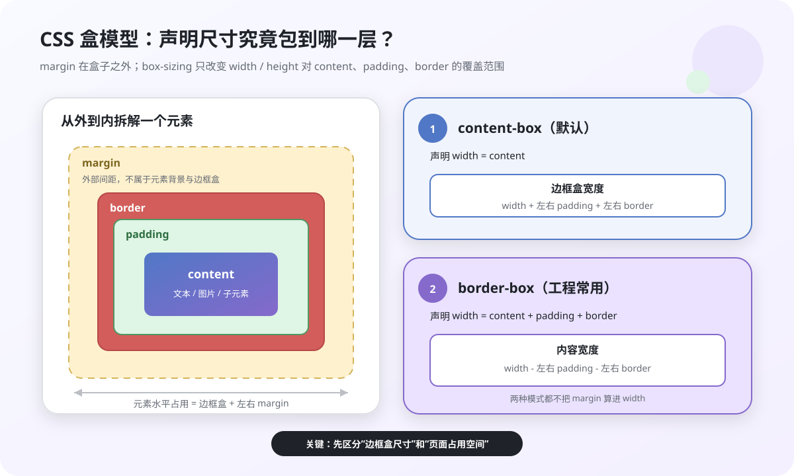
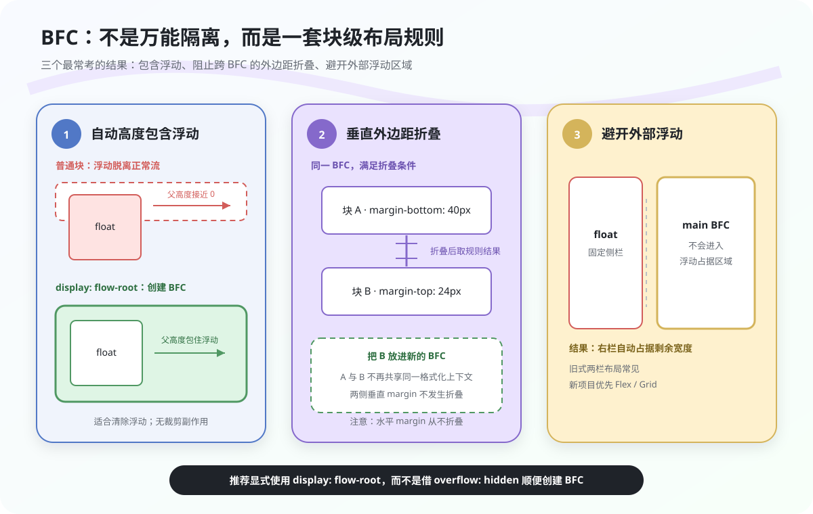
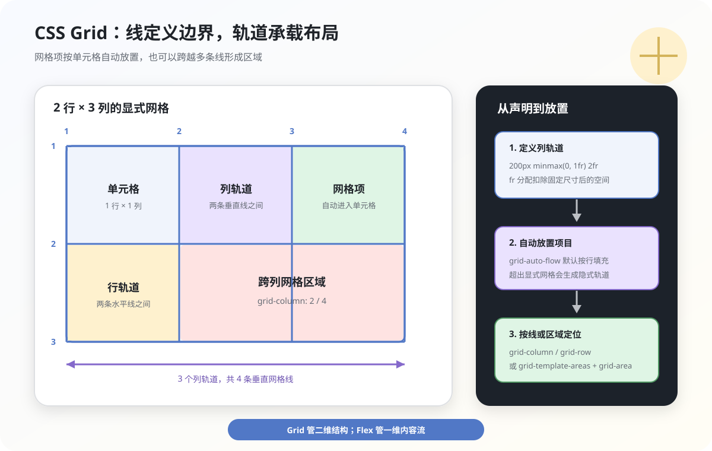
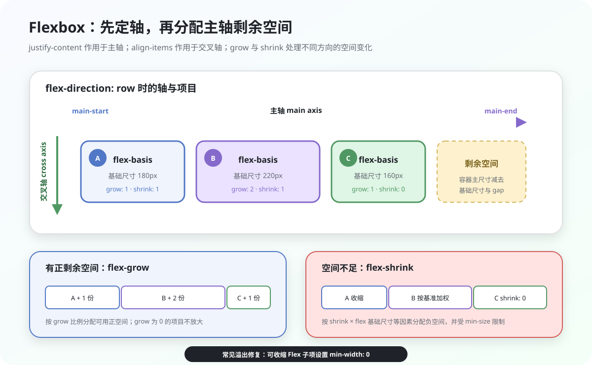
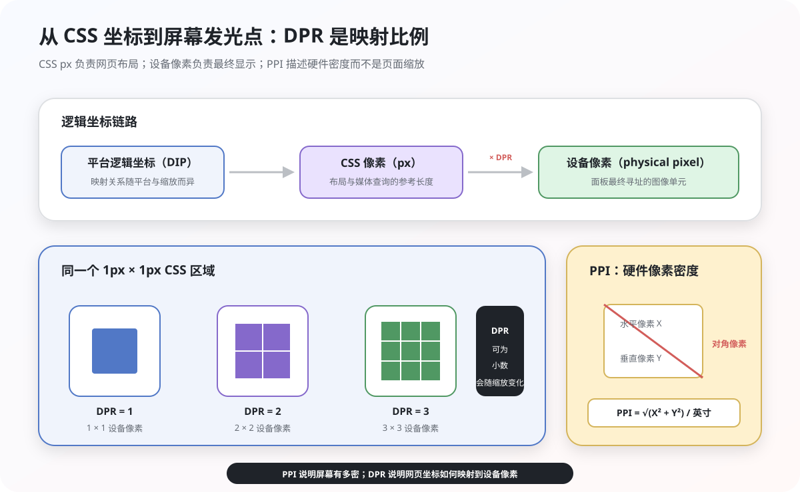
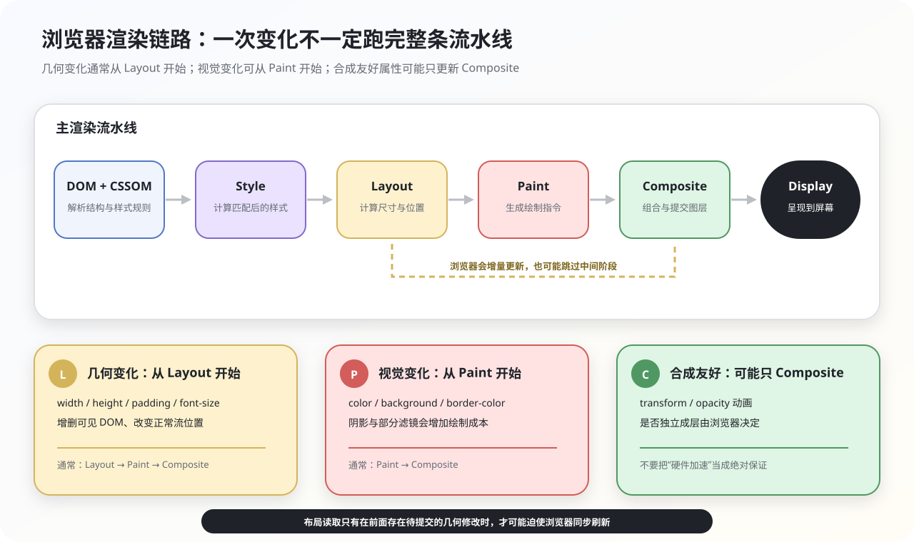

## 1. 说说你对盒子模型的理解?

### 盒子的组成

CSS 盒模型把元素表示为矩形盒子，由内到外依次是：

- `content`：内容区域，`width` 和 `height` 默认描述这一层。
- `padding`：内容与边框之间的内边距，不能为负。
- `border`：包围内容和内边距的边框。
- `margin`：盒子与周围元素之间的外边距，可以为负；它不属于元素自身的背景和可点击区域。

盒模型常见的两种尺寸计算方式是 `content-box` 和 `border-box`。两者只改变声明的 `width`、`height` 如何参与计算，不会把 `margin` 算进元素的边框盒。



### content-box 与 border-box

`box-sizing` 的默认值是 `content-box`：

```css
.box {
  box-sizing: content-box;
  width: 200px;
  padding: 20px;
  border: 2px solid;
}
```

此时：

- 内容宽度为 `200px`。
- 边框盒宽度为 `200 + 20 × 2 + 2 × 2 = 244px`。
- 水平占用空间还要再加左右 `margin`。

改为 `border-box` 后，声明的宽度包含 `padding` 和 `border`：

```css
.box {
  box-sizing: border-box;
  width: 200px;
  padding: 20px;
  border: 2px solid;
}
```

此时边框盒宽度保持 `200px`，内容宽度为 `200 - 20 × 2 - 2 × 2 = 156px`。

工程中常统一设置：

```css
*,
*::before,
*::after {
  box-sizing: border-box;
}
```

所谓“IE 盒模型”是历史称呼，通常指怪异模式下类似 `border-box` 的宽高计算。现代页面应使用标准文档模式和显式的 `box-sizing`，不要依赖怪异模式。

## 2. 谈谈你对BFC的理解?

### 核心规则

BFC（Block Formatting Context，块级格式化上下文）是块级布局的一种独立格式化环境。它主要影响内部块盒的排列、浮动参与高度计算、浮动避让以及垂直外边距折叠。



需要准确理解以下规则：

- 正常流中的块盒通常沿块轴依次排列。
- 同一 BFC 内、满足条件的相邻块级盒，其**垂直外边距**可能折叠；水平外边距不会折叠。
- BFC 的边界不会与同一格式化上下文中的浮动盒重叠，因此可形成浮动旁边的自适应内容区。
- 计算 BFC 的自动高度时，会考虑它内部的浮动后代。
- BFC 能隔离部分布局影响，但不是“内部外部完全互不影响”的通用沙箱。

### 常见触发条件

常见的 BFC 创建方式包括：

- 根元素。
- `float` 不为 `none`。
- `position` 为 `absolute` 或 `fixed`。
- `display: flow-root`。
- `display: inline-block`、`table-cell`、`table-caption`。
- Flex 或 Grid 容器。
- `overflow` 不为 `visible` 或 `clip`。

若目的只是创建 BFC，优先使用 `display: flow-root`。`overflow: hidden` 还会裁剪溢出内容，不应只为清除浮动而随意使用。

### 典型应用

**包含内部浮动**

```html
<div class="parent">
  <div class="float">浮动元素</div>
</div>
```

```css
.parent {
  display: flow-root;
  border: 1px solid;
}

.float {
  float: left;
  width: 100px;
  height: 100px;
}
```

父元素创建 BFC 后，其自动高度会包含浮动子元素。

**阻止相邻外边距折叠**

将其中一个元素放入新的 BFC，可以让两者不再处于同一个 BFC：

```html
<p class="item">第一段</p>
<div class="wrapper">
  <p class="item">第二段</p>
</div>
```

```css
.item {
  margin-block: 40px;
}

.wrapper {
  display: flow-root;
}
```

实际工程中也可以直接用父容器的 `gap` 管理间距，避免依赖外边距折叠。

**浮动两栏布局**

```css
.aside {
  float: left;
  width: 160px;
}

.main {
  display: flow-root;
}
```

`.main` 创建 BFC 后不会与 `.aside` 的浮动区域重叠。新项目通常优先使用 Flex 或 Grid，BFC 方案更适合解释旧布局或处理局部浮动内容。

## 3. 什么是响应式设计？响应式设计的基本原理是什么？如何做?

### 核心原理

响应式设计让同一份页面根据可用空间、输入方式和用户偏好调整布局与交互。它关注的是内容在不同环境下是否仍然可读、可操作，而不是为几个固定设备宽度各写一套页面。

常见手段包括：

- 流式布局和弹性媒体。
- Flex、Grid 等现代布局。
- 媒体查询与容器查询。
- `%`、`rem`、`vw`、`dvh`、`clamp()` 等相对或动态单位。
- 根据分辨率、色彩模式、动效偏好和指针精度提供差异化样式。

### Viewport 与媒体查询

移动端页面通常需要：

```html
<meta name="viewport" content="width=device-width, initial-scale=1">
```

不应默认加入 `maximum-scale=1` 或 `user-scalable=no`，因为禁用缩放会影响低视力用户。

断点应由内容何时放不下决定，而不是照抄具体设备型号：

```css
.layout {
  display: grid;
  grid-template-columns: 16rem minmax(0, 1fr);
  gap: 1.5rem;
}

@media (max-width: 48rem) {
  .layout {
    grid-template-columns: 1fr;
  }
}
```

组件只关心自身容器宽度时，可以使用容器查询：

```css
.card-list {
  container-type: inline-size;
}

@container (min-width: 36rem) {
  .card {
    grid-template-columns: 10rem 1fr;
  }
}
```

### 弹性尺寸

```css
img,
video {
  max-width: 100%;
  height: auto;
}

.title {
  font-size: clamp(1.5rem, 1rem + 2vw, 3rem);
}
```

使用百分比时要看属性的参照物：

- 普通宽度百分比通常相对包含块的宽度。
- 绝对定位偏移相对定位包含块计算。
- `padding`、`margin` 的百分比按包含块的内联尺寸计算。
- 椭圆 `border-radius` 的水平半径相对自身宽度，垂直半径相对自身高度。

`rem` 相对根元素字号，适合字号和间距体系；`vw`、`vh` 相对视口。移动端全屏高度优先根据场景选择 `svh`、`lvh` 或 `dvh`，避免浏览器工具栏伸缩造成跳动。

### 实践建议

- 先保证小屏下的内容顺序和可操作性，再逐步增强宽屏布局。
- 断点附近、横竖屏、浏览器缩放和长文本都要测试。
- 不要仅用 CSS 隐藏大资源；未展示的图片或视频仍可能被下载。
- 位图清晰度应通过 `srcset`、`sizes` 或 `image-set()` 处理，不能简单地按“小屏用 2x、大屏用 3x”判断。
- 尊重 `prefers-reduced-motion`、`prefers-contrast` 等用户偏好。

响应式设计的成本主要在于跨尺寸验证和内容优先级设计，而不是“只适合简单网站”。组件化、设计令牌和自动化视觉测试可以降低维护成本。

## 4. 元素水平垂直居中的方法有哪些？如果元素不定宽高呢?

### 方案选择

现代布局优先选择 Flex 或 Grid，它们不要求提前知道子元素尺寸：

```css
.parent {
  display: flex;
  justify-content: center; /* 主轴 */
  align-items: center; /* 交叉轴 */
}
```

```css
.parent {
  display: grid;
  place-items: center;
}
```

父容器必须有可用于分配的空间，例如明确高度、`min-height` 或由外层布局分配的尺寸。

### 定位与 transform

元素不定宽高时可以使用：

```css
.parent {
  position: relative;
}

.child {
  position: absolute;
  top: 50%;
  left: 50%;
  transform: translate(-50%, -50%);
}
```

`top`、`left` 的百分比相对定位包含块，`translate()` 的百分比相对元素自身，因此无需预先知道子元素宽高。注意 `transform` 会创建新的堆叠上下文。

已知子元素尺寸时，也可以用负外边距：

```css
.child {
  position: absolute;
  top: 50%;
  left: 50%;
  width: 100px;
  height: 60px;
  margin: -30px 0 0 -50px;
}
```

绝对定位配合 `inset: 0; margin: auto` 也能居中，但自动尺寸的非替换元素可能被拉伸，因此更适合已知尺寸或显式设置 `width: fit-content` 的场景。

### 文本与旧式布局

- 单行文本垂直居中可以让 `line-height` 等于容器高度，但不适合多行文本。
- 行内内容水平居中可在包含块上设置 `text-align: center`。
- `display: table-cell; vertical-align: middle` 能兼容旧布局，但新项目通常无需优先采用。
- 块级元素定宽后可用 `margin-inline: auto` 水平居中。

面试回答时应先说明适用条件：Flex/Grid 适合常规布局，定位方案适合覆盖层或脱离文档流的元素，文本方案只解决特定文本场景。

## 5. 如何实现两栏布局，右侧自适应？三栏布局中间自适应呢?

### 两栏布局

Flex 写法：

```css
.layout {
  display: flex;
  gap: 16px;
}

.aside {
  flex: 0 0 200px;
}

.main {
  flex: 1 1 auto;
  min-width: 0;
}
```

`min-width: 0` 允许主栏收缩到内容的最小宽度以下，避免长文本或宽内容把布局撑破。

Grid 写法：

```css
.layout {
  display: grid;
  grid-template-columns: 200px minmax(0, 1fr);
  gap: 16px;
}
```

### 三栏布局

```css
.layout {
  display: grid;
  grid-template-columns: 200px minmax(0, 1fr) 160px;
  gap: 16px;
}
```

Flex 也可以实现：

```css
.layout {
  display: flex;
  gap: 16px;
}

.left {
  flex: 0 0 200px;
}

.middle {
  flex: 1 1 0;
  min-width: 0;
}

.right {
  flex: 0 0 160px;
}
```

### 传统方案

旧项目中还会见到浮动、绝对定位、表格布局、圣杯布局和双飞翼布局：

- 浮动加外边距可以实现两栏或三栏，但需要处理浮动包含和源代码顺序。
- 绝对定位会让左右栏脱离文档流，父容器高度和内容重叠要额外处理。
- 圣杯/双飞翼使用浮动和负外边距，能让主内容在 DOM 中优先出现，但结构复杂、维护成本高。

面试中可以解释这些历史方案的原理，但生产代码通常优先选择 Grid；若需要一维伸缩和重排，则使用 Flex。

## 6. CSS选择器有哪些？优先级？哪些属性可以继承?

### 选择器类型

常见选择器包括：

- 类型选择器：`div`。
- 类选择器：`.card`。
- ID 选择器：`#app`。
- 属性选择器：`[disabled]`、`[href^="https"]`。
- 通用选择器：`*`。
- 组合器：后代空格、子代 `>`、相邻兄弟 `+`、后续兄弟 `~`。
- 伪类：`:hover`、`:focus-visible`、`:nth-child()`、`:not()`、`:is()`、`:where()`、`:has()`。
- 伪元素：`::before`、`::after`、`::first-letter`。

例如，直接子代类选择器应写成：

```css
.one > .one_1 {
  color: red;
}
```

### 层叠与优先级

最终样式不只由选择器优先级决定。浏览器会综合来源与重要性、层叠层、优先级、作用域接近度和声明顺序。只有前面的比较仍相同时，才继续比较后面的规则。

常见优先级可以记为三列：

1. ID 选择器数量。
2. 类、属性选择器和伪类数量。
3. 类型选择器和伪元素数量。

内联样式可视为比普通选择器更高的一层。组合器和通用选择器不增加优先级。

```css
#nav > ul > li > a.nav-link
```

其优先级为 `1-1-3`：一个 ID、一个类、三个类型选择器。

特殊规则：

- `:where()` 的优先级始终为 `0-0-0`。
- `:is()`、`:not()`、`:has()` 本身不加权，采用参数列表中最高的优先级。
- `!important` 会改变层叠的重要性顺序，不是给选择器简单“加分”。应谨慎使用。
- 优先级完全相同且其他层叠条件也相同时，后声明者生效。

### 继承

通常会继承的属性主要与文本和书写方式相关，例如：

- `color`。
- `font-family`、`font-size`、`font-style`、`font-weight`。
- `line-height`、`letter-spacing`、`word-spacing`。
- `text-align`、`text-indent`、`text-transform`。
- `direction`、`visibility`、`cursor`、`list-style`。

通常不会继承的属性包括：

- `display`、`position`、`float`。
- `width`、`height`、`margin`、`padding`、`border`。
- `background`。
- Flex 和 Grid 的大部分布局属性。
- `overflow`、`transform`。

`a` 的颜色和 `h1` 至 `h6` 的字号并非“不能继承”，而是浏览器默认样式通常给它们提供了自己的声明。使用 `inherit` 可以显式继承：

```css
a {
  color: inherit;
}
```

所有属性都可以使用 `inherit`，也可以用 `initial`、`unset`、`revert` 或 `revert-layer` 控制回退行为。

## 7. CSS中，有哪些方式可以隐藏页面元素？区别？

### 常见方案

| 方案 | 是否占据布局空间 | 是否可命中指针 | 可见性与无障碍特点 |
| --- | --- | --- | --- |
| `display: none` | 否 | 否 | 不生成盒子，通常也不在无障碍树中 |
| `visibility: hidden` | 是 | 否 | 后代可用 `visibility: visible` 恢复 |
| `opacity: 0` | 是 | 通常可以 | 仅透明，仍可能聚焦和响应事件 |
| 移出屏幕/裁剪 | 取决于写法 | 取决于写法 | 常用于“视觉隐藏但保留给读屏器” |
| 尺寸设为 `0` | 可能极小 | 不可靠 | 内容、边框或溢出仍可能可见 |

### 行为差异

`display: none` 会改变布局，显示状态切换通常需要重新布局：

```css
.hidden {
  display: none;
}
```

`visibility: hidden` 保留原来的布局位置，属性可参与过渡，但从 `hidden` 到 `visible` 的可见性本身是离散变化：

```css
.hidden {
  visibility: hidden;
}
```

`opacity: 0` 只改变透明度。若不希望元素挡住下面的内容，还应按需求处理指针和焦点：

```css
.transparent {
  opacity: 0;
  pointer-events: none;
}
```

只加 `pointer-events: none` 仍不能阻止键盘聚焦，需要同步管理 `tabindex`、`inert`、`aria-hidden` 或 DOM 状态。选择隐藏方式时，应同时考虑布局、动画、交互和无障碍，而不能只看“肉眼是否可见”。

## 8. 如何实现单行/多行文本溢出的省略样式?

### 单行省略

单行省略需要受限的可用宽度、不换行和溢出裁剪：

```css
.ellipsis {
  overflow: hidden;
  white-space: nowrap;
  text-overflow: ellipsis;
}
```

在 Flex 或 Grid 子项中，常需要额外设置 `min-width: 0`，否则子项的自动最小尺寸可能阻止它收缩。

### 多行省略

现代浏览器广泛支持历史上的 WebKit 组合写法：

```css
.line-clamp {
  display: -webkit-box;
  overflow: hidden;
  -webkit-box-orient: vertical;
  -webkit-line-clamp: 3;
}
```

可同时声明标准属性作为渐进增强：

```css
.line-clamp {
  line-clamp: 3;
}
```

标准 `line-clamp` 的实现和兼容性仍应结合项目目标浏览器验证，因此生产中常保留 `-webkit-` 组合。

对于很长的 URL、英文单词或连续数字，可以按需求加入：

```css
.line-clamp {
  overflow-wrap: anywhere;
}
```

固定高度配合伪元素绘制 `...` 只是近似方案：它可能在文本没有溢出时仍显示省略号，也可能遮住字符。要求准确判断溢出、提供“展开/收起”时，应使用 JavaScript 比较 `scrollHeight` 与 `clientHeight`，并保留完整文本供用户访问。

## 9. CSS如何画一个三角形？原理是什么？

### 边框三角形

当元素的内容宽高都为 `0` 时，四条边框会在中心点相接，每条边框形成一个三角形。将不需要的边设为透明，就能得到单个三角形：

```css
.triangle {
  width: 0;
  height: 0;
  border-style: solid;
  border-width: 0 50px 50px;
  border-color: transparent transparent #d9534f;
}
```

这里可见的是 `border-bottom`，形状尖端朝上。方向由哪一侧边框着色决定：

- `border-top` 着色，尖端朝下。
- `border-right` 着色，尖端朝左。
- `border-bottom` 着色，尖端朝上。
- `border-left` 着色，尖端朝右。

### 空心三角形

可以用伪元素叠放一个更小、颜色与背景一致的三角形：

```css
.triangle-outline {
  position: relative;
  width: 0;
  height: 0;
  border-style: solid;
  border-width: 0 50px 50px;
  border-color: transparent transparent #d9534f;
}

.triangle-outline::after {
  position: absolute;
  top: 6px;
  left: -40px;
  width: 0;
  height: 0;
  content: '';
  border-style: solid;
  border-width: 0 40px 40px;
  border-color: transparent transparent white;
}
```

它本质上是两个实心三角形叠加，并非真正的描边。需要更稳定的缩放、圆角或复杂图形时，应使用 `clip-path` 或 SVG。

## 10. 如何使用CSS完成视差滚动效果?

### 原理

视差滚动让不同层相对视口以不同速度移动，从而产生深度感。核心不是“滚动得越多越好”，而是让背景层、内容层的位移存在可控差异。

### background-attachment

简单背景可以固定在视口上：

```css
.hero {
  min-height: 100vh;
  background:
    linear-gradient(rgb(0 0 0 / 35%), rgb(0 0 0 / 35%)),
    url('./hero.webp') center / cover;
  background-attachment: fixed;
}
```

该方案实现简单，但移动浏览器可能出于性能或视口机制限制而弱化、忽略 `fixed` 效果，大图重绘成本也可能较高，必须在目标设备上测试。

### 3D Transform

滚动容器可以建立透视空间，让更远的图层产生不同滚动速度。远离观察者的元素会缩小，因此需要按透视关系补偿缩放：

```css
.parallax {
  height: 100vh;
  overflow-x: hidden;
  overflow-y: auto;
  perspective: 1px;
}

.parallax__back {
  transform: translateZ(-1px) scale(2);
  transform-origin: center;
}

.parallax__front {
  transform: translateZ(0);
}
```

复杂页面也可用 JavaScript 根据滚动位置更新 `transform`，但应在 `requestAnimationFrame` 中批量处理，避免在滚动回调里交替读写布局。

视差效果容易引发眩晕，应提供降级：

```css
@media (prefers-reduced-motion: reduce) {
  .parallax__back,
  .parallax__front {
    transform: none;
  }

  .hero {
    background-attachment: scroll;
  }
}
```

## 11. CSS3新增了哪些新特性?

### 先澄清“CSS3”

CSS 不再以一个整体的“CSS4”版本演进，而是拆分为不同模块独立升级。因此面试中的“CSS3 新特性”通常泛指相对 CSS2.1 后普及的一批能力，而不是当前最新标准的准确名称。

### 常见能力

- 选择器：属性匹配、结构伪类、`:not()` 等；后来又增加了 `:is()`、`:where()`、`:has()`。
- 盒模型与视觉：`border-radius`、`box-shadow`、多背景、渐变、`background-size`。
- 颜色：`rgba()`、`hsla()`；现代语法还支持 `hwb()`、`lab()`、`lch()`、`oklch()` 等。
- 排版：Web 字体、多列布局、`overflow-wrap`、更完整的文本装饰。
- 布局：Flexbox、Grid。
- 响应式：媒体查询，后续还有容器查询。
- 变换与动效：2D/3D `transform`、`transition`、`animation`。
- 图像效果：滤镜、遮罩、混合模式等。
- 自定义能力：CSS 自定义属性、级联层、原生嵌套等属于更晚的模块演进。

### 容易混淆的属性

- `background-clip` 的常用值是 `border-box`、`padding-box`、`content-box`；不存在标准的 `no-clip` 值。
- 分片元素的装饰方式由 `box-decoration-break` 控制，不是 `background-break`。
- `word-wrap` 是 `overflow-wrap` 的历史别名；`break-all` 属于 `word-break`。
- `-webkit-text-fill-color`、`-webkit-text-stroke-*` 带前缀实现较常见，不应当作无前缀、跨浏览器一致的 CSS3 核心属性。

回答这道题时，最好按布局、视觉、响应式和动效分类举例，并说明 CSS 现在按模块演进。

## 12. CSS3动画有哪些?

### Transition、Transform 与 Animation

严格来说：

- `transition`：在属性值发生变化时，在起止状态之间插值。
- `animation`：通过 `@keyframes` 定义一个或多个关键状态，可自动播放、循环和控制方向。
- `transform`：描述平移、缩放、旋转等变换，本身不是动画；它经常作为前两者的动画属性。

### Transition

```css
.button {
  transform: translateY(0);
  transition: transform 180ms ease-out;
}

.button:hover {
  transform: translateY(-2px);
}
```

简写顺序通常是：属性、持续时间、缓动函数、延迟。`display` 等离散属性不会像数值属性那样连续插值；部分离散过渡可使用新机制，但仍需验证目标浏览器。

`cubic-bezier(x1, y1, x2, y2)` 中两个 x 坐标必须在 `0` 到 `1` 之间，y 坐标可以超出该范围以产生回弹效果。

### Animation

```css
@keyframes rotate {
  from {
    transform: rotate(0deg);
  }

  to {
    transform: rotate(1turn);
  }
}

.loading {
  animation: rotate 1s linear infinite;
}
```

常用子属性包括：

- `animation-name`
- `animation-duration`
- `animation-timing-function`
- `animation-delay`
- `animation-iteration-count`
- `animation-direction`
- `animation-fill-mode`
- `animation-play-state`

`transform` 通常不作用于不可变换的非替换行内盒；需要时可将元素设为 `inline-block`。`transform` 和 `opacity` 往往更容易由合成线程处理，但是否提升为独立合成层由浏览器决定，不等于绝对“零重绘”。

动效还应尊重用户偏好：

```css
@media (prefers-reduced-motion: reduce) {
  *,
  *::before,
  *::after {
    scroll-behavior: auto !important;
    animation-duration: 0.01ms !important;
    animation-iteration-count: 1 !important;
    transition-duration: 0.01ms !important;
  }
}
```

## 13. 介绍一下grid网格布局

### Grid 核心模型

Grid 是二维布局系统，可以同时定义行和列。设置 `display: grid` 的元素是网格容器，它的直接子元素是网格项；网格轨道由相邻网格线之间的空间组成。



以 `2 × 3` 网格为例，它有 2 行、3 列、3 条水平线和 4 条垂直线。项目可以按自动放置规则进入单元格，也可以跨越多条网格线形成区域。

### 定义轨道

```css
.grid {
  display: grid;
  grid-template-columns: 200px minmax(0, 1fr) 2fr;
  grid-template-rows: repeat(2, 80px);
  gap: 16px;
}
```

常用值和函数：

- `fr`：分配扣除固定尺寸和间距后的剩余空间。
- `repeat()`：简化重复轨道。
- `minmax()`：限定轨道最小值与最大值。
- `auto-fill`：尽量创建可容纳的轨道，空轨道仍保留。
- `auto-fit`：与 `auto-fill` 类似，但会折叠空轨道，让现有项目扩展。

响应式卡片常用：

```css
.cards {
  display: grid;
  grid-template-columns: repeat(auto-fit, minmax(min(100%, 16rem), 1fr));
  gap: 1rem;
}
```

### 区域与定位

```css
.page {
  display: grid;
  grid-template:
    'header header' auto
    'aside  main' minmax(0, 1fr)
    'footer footer' auto
    / 16rem minmax(0, 1fr);
}

.header {
  grid-area: header;
}
```

也可以按网格线定位：

```css
.featured {
  grid-column: 2 / 4;
  grid-row: 1 / 3;
}
```

### 对齐与隐式网格

- `justify-items`、`align-items` 对齐每个网格项在单元格内的位置，简写为 `place-items`。
- `justify-content`、`align-content` 对齐整个网格在容器内的位置，简写为 `place-content`。
- `justify-self`、`align-self` 只作用于单个网格项。
- 自动放置或显式定位超出显式网格时，会创建隐式轨道，其尺寸由 `grid-auto-columns`、`grid-auto-rows` 控制。
- `grid-auto-flow` 控制自动放置方向，`dense` 可尝试回填空洞，但可能改变视觉顺序，需注意键盘和阅读顺序。

现代主流桌面和移动浏览器均已支持 Grid。IE 只实现过带前缀的旧规范，若项目仍支持 IE，需要单独降级，不能把旧语法与现代 Grid 混用。

## 14. 说说flexbox（弹性盒布局模型）,以及适用场景?

### Flex 核心模型

Flexbox 是一维布局模型，主要沿主轴分配空间，并沿交叉轴对齐项目。主轴不一定是水平轴：它由 `flex-direction` 和书写方向共同决定。



Grid 更擅长同时控制行列，Flex 更适合导航、工具栏、表单行、卡片内部和其他一维排列。

### 容器属性

```css
.container {
  display: flex;
  flex-flow: row wrap;
  justify-content: space-between;
  align-items: center;
  align-content: start;
  gap: 16px;
}
```

- `flex-direction`：`row`、`row-reverse`、`column`、`column-reverse`，决定主轴方向。
- `flex-wrap`：`nowrap`、`wrap`、`wrap-reverse`，决定是否换行及交叉轴方向。
- `flex-flow`：前两者的简写。
- `justify-content`：分配主轴剩余空间。
- `align-items`：控制单行中项目在交叉轴的对齐。
- `align-content`：控制多条 Flex 行在交叉轴的分布，单行时通常不起作用。

`row` 的起点不应机械理解为“左侧”，因为在从右向左书写时会变化。

### 项目伸缩

Flex 主尺寸大致按以下步骤计算：

1. 根据 `flex-basis` 得到每个项目的基础尺寸；`auto` 通常参考主尺寸属性或内容。
2. 基础尺寸之和小于容器时，按 `flex-grow` 分配正的剩余空间。
3. 基础尺寸之和大于容器时，按 `flex-shrink × flex 基础尺寸` 等因素分配负空间，并受最小尺寸限制。

因此 `flex-shrink: 1` 不表示所有项目减少相同像素。

常见简写：

```css
.fixed {
  flex: none; /* 0 0 auto */
}

.auto {
  flex: auto; /* 1 1 auto */
}

.equal {
  flex: 1; /* 通常展开为 1 1 0% */
  min-width: 0;
}
```

`flex: 1` 让项目从接近零基础尺寸开始分配剩余空间，但默认 `min-width: auto` 仍可能受内容最小宽度限制，所以可收缩内容区常需要 `min-width: 0`。

其他项目属性：

- `order` 改变视觉顺序，但不会改变 DOM、阅读和键盘顺序，不应滥用。
- `align-self` 覆盖单个项目的交叉轴对齐；`auto` 会采用容器的 `align-items`，不是普通 CSS 继承。

## 15. 说说设备像素、CSS像素、设备独立像素、dpr、 ppi 之间的区别?

### 概念关系

设备像素描述显示硬件的物理采样点；CSS 像素是 Web 布局使用的参考长度；设备独立像素是操作系统或平台提供的逻辑坐标概念。三者不应简单视为同一个单位。



### CSS 像素与设备像素

**CSS 像素（CSS px）**

`px` 在 CSS 中属于绝对长度单位，规范定义 `1in = 96px`。在屏幕上，它对应参考像素，并不保证等于一个物理像素。页面缩放、系统缩放和设备像素比都会影响一个 CSS 像素最终覆盖多少设备像素。

**设备像素（device pixel）**

设备像素也称物理像素，是显示面板可寻址的最小图像单元。其数量通常用面板分辨率表示，例如 `2560 × 1600`。它没有 `pt` 这样的 CSS 单位。

**设备独立像素（DIP）**

DIP 是平台层的逻辑坐标，用来屏蔽不同物理密度。不同平台对 DIP、逻辑像素和 CSS 像素的映射细节可能不同；在浏览器默认缩放下，它们常接近一一对应，但不能把概念完全等同。

### DPR 与 PPI

设备像素比：

```text
DPR = 一个方向上的设备像素数 / CSS 像素数
```

默认缩放下，DPR 为 `2` 时，一个 `1px × 1px` 的 CSS 区域通常覆盖 `2 × 2` 个设备像素。DPR 可以是小数，并可能随浏览器缩放或窗口移动到另一块屏幕而变化：

```js
console.log(window.devicePixelRatio)
```

PPI（pixels per inch）描述物理像素密度：

```text
PPI = √(水平物理像素² + 垂直物理像素²) / 屏幕对角线英寸
```

PPI 是硬件密度；DPR 是逻辑坐标到设备像素的映射比例，两者相关但不等价。高 DPR 位图若仍只提供低分辨率资源会显得模糊，可使用 `srcset` 或 `image-set()` 提供密度候选。

## 16. 说说em/px/rem/vh/vw区别?

### px、em 与 rem

`px` 是 CSS 绝对长度单位，和其他 CSS 绝对单位有固定换算关系，但在屏幕上不保证对应一个物理像素。

`em` 的参照物取决于它用在哪个属性：

- 用于 `font-size` 时，相对父元素的计算字号。
- 用于其他属性时，通常相对当前元素的计算字号。

```css
.card {
  font-size: 20px;
  padding: 1em; /* 20px */
}
```

嵌套元素反复用 `em` 设置字号会产生倍率累积。

`rem` 始终相对根元素 `html` 的计算字号，适合建立全局字号和间距尺度：

```css
html {
  font-size: 100%;
}

.title {
  font-size: 1.5rem;
}
```

不要假定所有用户的浏览器默认字号永远是 `16px`，也不必为了心算而把根字号强制设为 `62.5%`。保留用户默认设置通常更利于可访问性。

### vw、vh 与动态视口单位

- `1vw` 是视口宽度的 `1%`。
- `1vh` 是传统视口高度的 `1%`。
- `vmin` 取 `vw` 与 `vh` 中较小者，`vmax` 取较大者。

移动浏览器工具栏会改变可见区域，现代 CSS 还提供：

- `svh`：小视口高度，适合确保内容始终放得下。
- `lvh`：大视口高度。
- `dvh`：动态视口高度，会随工具栏变化。

```css
.screen {
  min-height: 100dvh;
}
```

`vw`、`vh` 适合与视口直接相关的布局；字号通常应使用 `rem` 或 `clamp()` 设上下限，避免纯 `vw` 在极端屏幕上过大或过小。

百分比并不总是“相对父元素”：准确说法是相对对应属性的包含块或其他规范定义的参照物。

## 17. 让Chrome支持小于12px的文字方式有哪些？区别?

### 先判断问题是否仍存在

“Chrome 中文版强制最小字号为 12px”是历史环境中的常见说法，不能作为现代 Chrome 的通用前提。当前浏览器通常可以直接渲染：

```css
.caption {
  font-size: 10px;
}
```

如果结果仍不符合预期，应先检查：

- 浏览器的“最小字号”用户设置。
- 页面或系统缩放。
- 移动端文字自动调整。
- 项目中是否存在覆盖样式。

不能通过 CSS 绕过用户主动设置的最小字号，而且正文小于 `12px` 往往会损害可读性。

### zoom 与 transform

确需缩小一个以 `12px` 设计的视觉标签时，可比较：

```css
.by-zoom {
  zoom: 0.8333;
}

.by-transform {
  display: inline-block;
  transform: scale(0.8333);
  transform-origin: left center;
}
```

- `zoom` 会参与布局尺寸计算，周围内容会按缩放后的尺寸排布。它长期带有非标准历史，但现在已有标准化定义且现代浏览器支持情况较好，仍需按目标浏览器测试。
- `transform: scale()` 只改变视觉结果，不改变原始布局占位，因此可能留下空隙或与相邻内容错位。

`text-size-adjust` 控制移动端的文本自动放大，不是解决最小字号限制的通用方案：

```css
html {
  text-size-adjust: 100%;
}
```

不建议全局设置为 `none`，否则可能妨碍移动端可读性。最佳方案仍是调整设计，让辅助文字保持可读字号，而不是依赖缩放技巧模拟更小字体。

## 18. 怎么理解回流跟重绘？什么场景下会触发？

### 渲染阶段

浏览器渲染可概括为：解析 HTML 和 CSS、构建用于渲染的数据结构、样式计算、布局、绘制、栅格化与合成。实际引擎会增量更新和跳过不必要阶段，并非每次变化都完整执行整条链路。



- **回流/重排（layout）**：计算元素几何尺寸和位置。
- **重绘（paint）**：生成背景、文字、边框、阴影等绘制指令。
- **合成（composite）**：把不同图层的结果组合到屏幕。

布局变化通常会让受影响区域重新绘制，但浏览器会做失效区域追踪和图层优化；不要把它理解成每次都重绘整页。

### 触发场景

常见布局失效包括：

- 添加或删除可见 DOM。
- 修改尺寸、边距、边框、字体或内容。
- 改变影响正常流的位置和布局方式。
- 视口尺寸变化。

只改变 `color`、`background`、阴影等通常不需要重新布局，但可能需要绘制。`transform` 和 `opacity` 的动画在满足条件时可能只需合成，不过是否创建独立合成层由浏览器决定。

读取 `offsetWidth`、`getBoundingClientRect()` 等几何信息**不一定每次都触发布局**。只有前面存在尚未提交、会影响几何信息的修改时，为返回最新结果，浏览器才可能强制同步样式计算或布局。`getComputedStyle()` 是否迫使布局也取决于读取的属性和页面状态。

### 布局抖动与优化

交替写样式和读布局容易造成 layout thrashing：

```js
for (const item of items) {
  item.style.width = `${item.offsetWidth + 10}px`
}
```

应先批量读取，再批量写入：

```js
const widths = items.map((item) => item.offsetWidth)

items.forEach((item, index) => {
  item.style.width = `${widths[index] + 10}px`
})
```

常见优化：

- 用 class 一次提交一组样式变化。
- 动画优先选择 `transform`、`opacity`，并用性能工具确认是否只发生合成。
- 大量 DOM 先在脱离文档的节点或 `DocumentFragment` 中构建，再一次插入。
- 使用 `contain`、`content-visibility` 等能力限制布局和绘制影响范围，但要理解其尺寸与可访问性语义。
- 不要随意使用 `will-change`；过多合成层会增加内存和管理成本。
- 用浏览器 Performance 面板定位真正的长任务、布局和绘制热点，而不是只凭属性名单优化。

## 19. 说说对Css预编语言的理解？有哪些区别?

### 预处理器是什么

CSS 预处理器在 CSS 之上提供变量、嵌套、混入、函数和模块等能力，源码经过编译后生成浏览器可识别的 CSS。常见方案是 Sass、Less 和 Stylus。

随着 CSS 自定义属性、原生嵌套、颜色函数和模块化构建的发展，一部分需求可以直接用原生 CSS 完成；预处理器仍适合编译期计算、复杂 mixin 和成熟的既有工程。

### Sass、Less 与 Stylus

| 方案 | 常见实现与语法 | 主要特点 |
| --- | --- | --- |
| Sass/SCSS | 当前主流实现是 Dart Sass；变量以 `$` 开头 | 模块系统、函数和控制指令完善 |
| Less | JavaScript 工具链；变量以 `@` 开头 | 语法接近 CSS，上手直接 |
| Stylus | Node.js 工具链；语法可省略括号、冒号和分号 | 写法灵活，但过度省略可能降低一致性 |

SCSS 和 Less 都可以使用接近 CSS 的大括号语法；`.sass` 和 Stylus 还支持缩进式写法。

### 变量、嵌套与作用域

```scss
// SCSS
@use 'sass:color';

$brand: #2563eb;

.button {
  color: $brand;

  &:hover {
    color: color.adjust($brand, $lightness: -10%);
  }
}
```

```less
// Less
@brand: #2563eb;

.button {
  color: @brand;

  &:hover {
    color: darken(@brand, 10%);
  }
}
```

```stylus
// Stylus
brand = #2563eb

.button
  color brand
```

三者都有作用域规则，但细节不同。Sass 存在顶层全局变量，也有词法作用域和模块私有成员；“Sass 不存在全局变量”是错误说法。Less 的变量查找和延迟求值、Stylus 的查找规则也不能简单等同 JavaScript。

### 混入与模块化

SCSS mixin：

```scss
@mixin focus-ring($color: #2563eb) {
  outline: 2px solid $color;
  outline-offset: 2px;
}

.button:focus-visible {
  @include focus-ring;
}
```

Less mixin：

```less
.focus-ring(@color: #2563eb) {
  outline: 2px solid @color;
  outline-offset: 2px;
}

.button:focus-visible {
  .focus-ring();
}
```

Sass 已弃用其传统 `@import` 机制，新代码应使用 `@use` 和 `@forward`：

```scss
@use './tokens' as tokens;

.button {
  color: tokens.$brand;
}
```

这里要区分 Sass 的编译期模块导入与浏览器原生 CSS `@import`，两者执行阶段不同。

## 20. 如果要做优化，CSS提高性能的方法有哪些？

### 加载与传输

- 删除未使用 CSS，按路由或组件拆分，避免所有页面下载完整样式库。
- 压缩资源，启用 Brotli/Gzip，使用内容哈希和长期缓存。
- 尽早通过 `<link rel="stylesheet">` 暴露关键样式。
- 适量内联首屏关键 CSS，避免为了消除一次请求而把大量不可缓存样式塞进 HTML。
- 非关键样式可以按场景延迟加载，但必须处理无 JavaScript 降级，避免闪烁和布局偏移。

例如使用预加载模式时要谨慎验证：

```html
<link
  rel="preload"
  href="/non-critical.css"
  as="style"
  onload="this.onload=null;this.rel='stylesheet'"
>
<noscript><link rel="stylesheet" href="/non-critical.css"></noscript>
```

CSS `@import` 会等包含它的样式表被下载和解析后才发现后续依赖，可能延迟关键资源；构建阶段合并模块或直接使用 `<link>` 通常更可控。

### 样式计算与布局

- 保持选择器清晰、作用域明确，避免无必要的深层依赖，主要收益是可维护性和更小的失效范围。
- 不要把“通用选择器、属性选择器一定很慢”当成绝对结论。现代浏览器会优化选择器匹配，应先用性能工具确认瓶颈。
- 批量 DOM 读取与写入，避免布局抖动。
- 对独立区域按需使用 `contain` 或 `content-visibility: auto`。
- 给图片、视频和异步组件预留尺寸，减少布局偏移。

### 绘制与合成

- 大面积模糊、滤镜、复杂阴影和混合模式可能提高绘制成本，尤其是在动画中，应结合面积和频率测量。
- 位移动画优先使用 `transform`，透明度动画使用 `opacity`，但仍要在 Performance/Layers 工具中确认合成行为。
- 谨慎使用 `will-change`，只在即将发生且确实受益的动画上短期启用。
- 尊重 `prefers-reduced-motion`，既改善可访问性，也减少不必要动效。

### 资源策略

- 图标优先考虑 SVG symbol、图标组件或字体之外的矢量方案。
- CSS Sprite 和 Base64 并非通用最优解：在 HTTP/2/HTTP/3 下，小请求成本降低；Base64 会增大体积并削弱独立缓存能力。
- 为不同显示密度和展示尺寸提供合适图片，避免下载远大于实际显示需求的资源。

CSS 优化应围绕三个指标展开：更早获得关键样式、更少无效样式与布局工作、更低绘制和合成成本。最终以真实设备上的 Performance、Coverage、Core Web Vitals 和用户体验数据为准。
