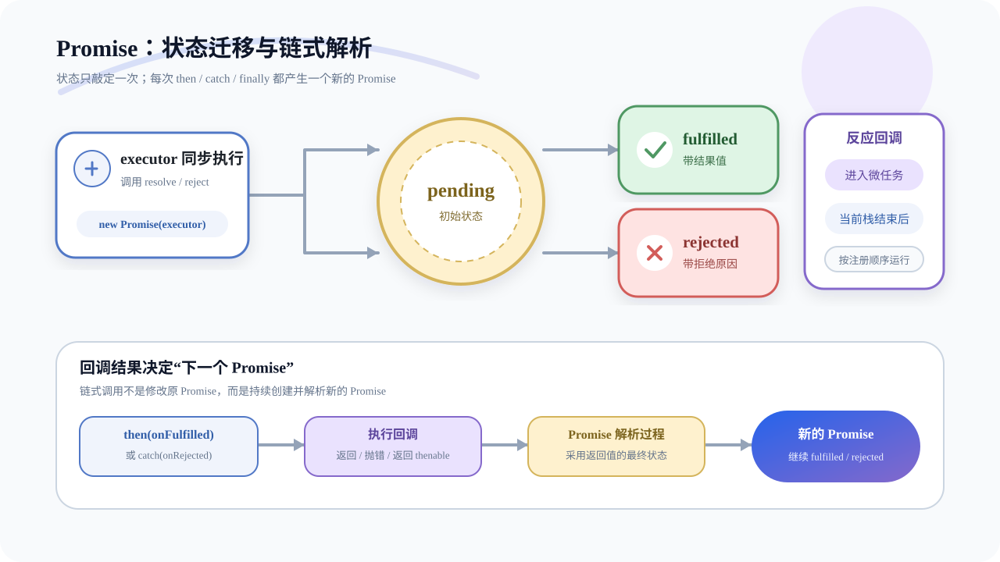
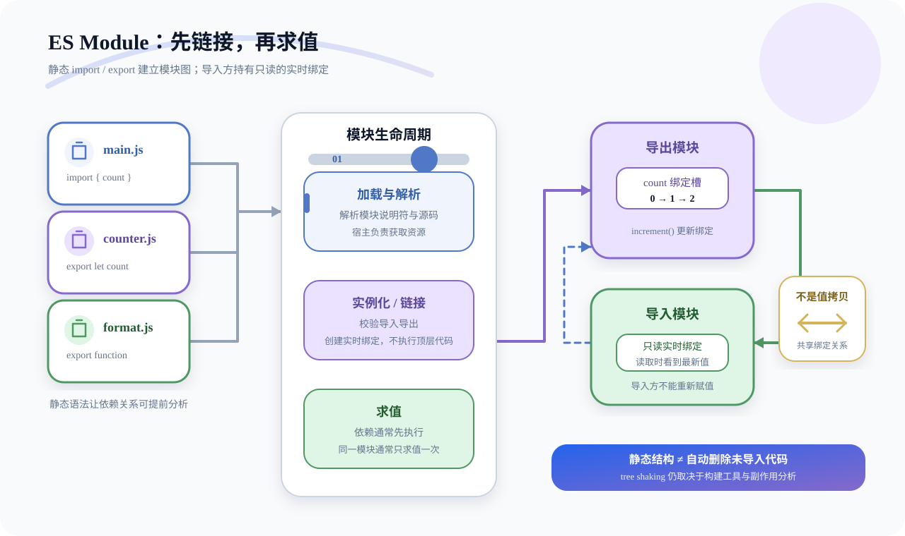
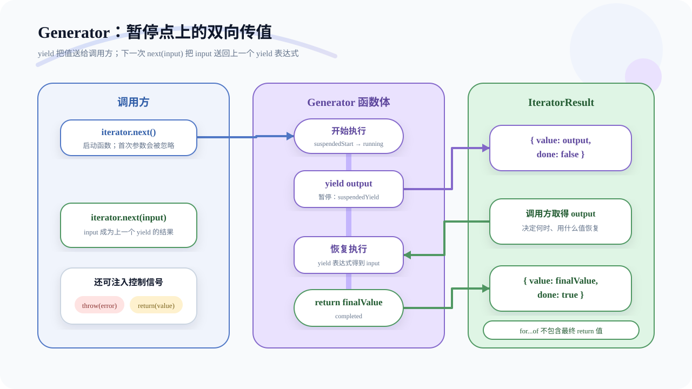
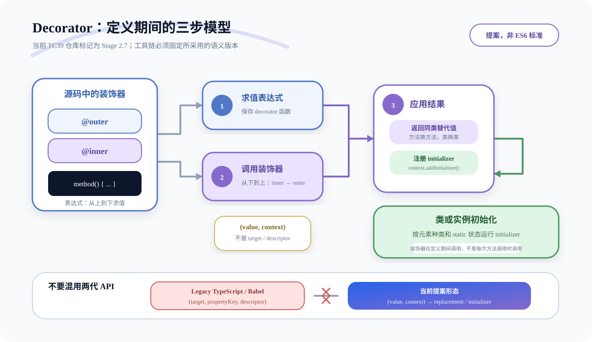
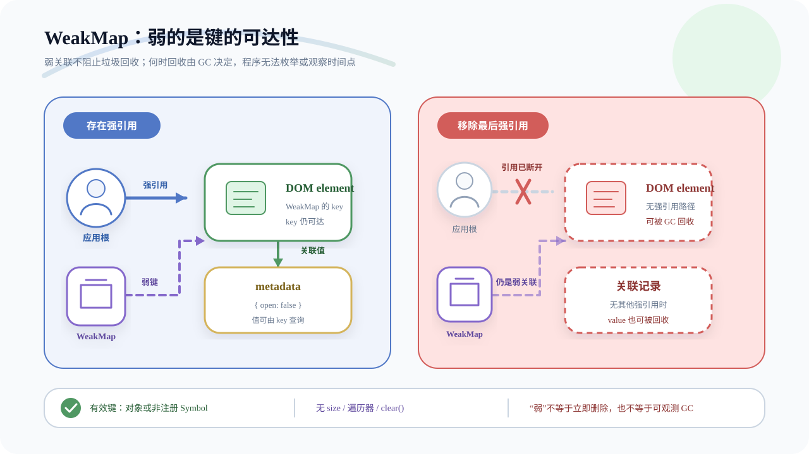
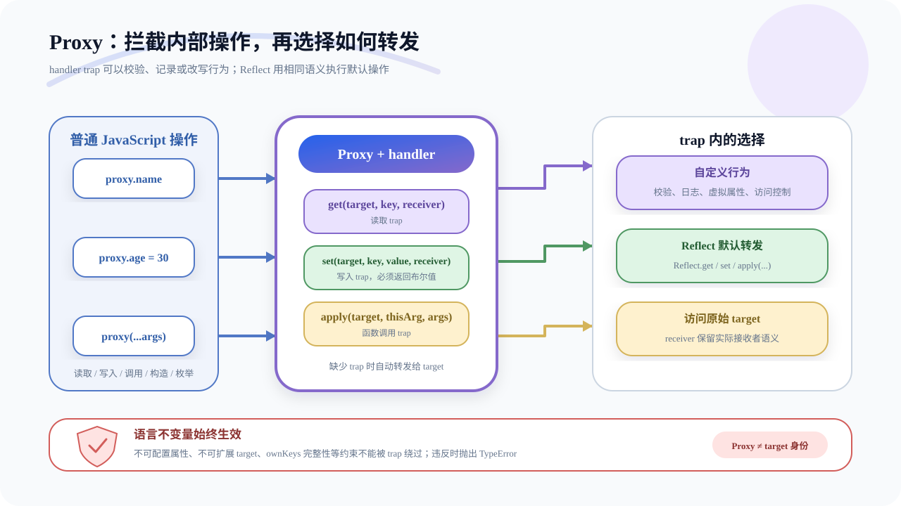

> 说明：严格来说，ES6 指 ES2015。日常面试常把 ES2015 之后的现代 JavaScript 特性也归入“ES6”，下文会在容易混淆处标明版本。

## 1. 说说var、let、const之间的区别

### 回答重点

三者最核心的差异是作用域、初始化时机、重复声明和重新赋值能力：

| 特性 | `var` | `let` | `const` |
| --- | --- | --- | --- |
| 作用域 | 函数作用域或全局作用域 | 块级作用域 | 块级作用域 |
| 声明前访问 | 得到 `undefined` | 处于暂时性死区，抛出 `ReferenceError` | 处于暂时性死区，抛出 `ReferenceError` |
| 同一作用域重复声明 | 允许 | 不允许 | 不允许 |
| 声明时必须初始化 | 否 | 否 | 是 |
| 声明后重新赋值 | 允许 | 允许 | 不允许 |

工程中优先使用 `const` 表达“绑定不会改变”，需要重新赋值时使用 `let`，一般不再使用 `var`。

### 声明提升与暂时性死区

`var` 声明会在进入执行上下文时创建并初始化为 `undefined`，所以声明前读取不会报错：

```js
console.log(value); // undefined
var value = 20;
```

`let` 和 `const` 的绑定也会在进入作用域时创建，但在执行到声明语句前不会完成初始化。这段区间称为暂时性死区（TDZ）。因此，把它们简单描述为“完全不提升”并不准确：

```js
const value = 123;

{
  // 块内的 value 已经存在，但尚未初始化，遮蔽了外层 value
  console.log(value); // ReferenceError
  let value = 456;
}
```

甚至在 TDZ 内使用 `typeof` 也会报错：

```js
{
  typeof value; // ReferenceError
  let value;
}
```

`let` 和 `const` 不能在同一作用域重复声明，也不能与同一作用域中的参数或其他词法声明重名：

```js
function example(arg) {
  // let arg; // SyntaxError

  {
    let arg = 'inner'; // 合法：这是新的块级作用域
    console.log(arg);
  }
}
```

### 作用域与全局绑定

`var` 不具备块级作用域，但具备函数作用域：

```js
{
  var a = 1;
  let b = 2;
}

console.log(a); // 1
console.log(b); // ReferenceError
```

在浏览器的经典脚本中，顶层 `var` 声明通常会成为全局对象 `window` 的属性，而顶层 `let`、`const` 不会：

```html
<script>
  var a = 1;
  let b = 2;

  console.log(window.a); // 1
  console.log(window.b); // undefined
</script>
```

这个结论不能泛化到所有环境：ES Module 的顶层绑定属于模块作用域；Node.js CommonJS 文件顶层的 `var` 也属于模块作用域，不是 `global` 的属性。

在函数中直接给未声明标识符赋值，只可能在非严格模式下意外创建全局属性；严格模式和 ES Module 会直接报错，实际开发中不应依赖这种行为：

```js
'use strict';

function change() {
  missing = 30; // ReferenceError
}
```

### `const` 限制的是绑定

`const` 保证变量绑定不能重新指向另一个值，并不冻结对象：

```js
const user = { name: 'Ada' };

user.name = 'Grace'; // 合法：修改对象内容
// user = {}; // TypeError：不能重新赋值
```

如果需要限制对象属性，还要结合 `Object.freeze()`；它也只做浅冻结：

```js
const config = Object.freeze({
  theme: 'dark',
  nested: { enabled: true },
});

// config.theme = 'light'; // 严格模式下抛出 TypeError
config.nested.enabled = false; // 仍可修改嵌套对象
```

## 2. ES6中数组新增了哪些扩展?

### 扩展运算符与 rest 元素

数组扩展运算符是三个点 `...`，可以展开任意可迭代对象，不只是数组：

```js
const numbers = [4, 38];

function add(x, y) {
  return x + y;
}

console.log(add(...numbers)); // 42
console.log([...new Set([1, 1, 2])]); // [1, 2]
console.log([...'hello']); // ['h', 'e', 'l', 'l', 'o']
```

普通对象默认不可迭代，不能直接用于数组展开：

```js
const obj = { a: 1, b: 2 };
// [...obj]; // TypeError: obj is not iterable
```

扩展语法可以复制、拼接数组，但得到的是浅拷贝：

```js
const source = [{ count: 1 }, 2];
const copy = [...source];

copy[0].count = 99;
console.log(source[0].count); // 99
```

解构中的 rest 元素用于收集剩余项，而且必须放在最后：

```js
const [first, ...rest] = [1, 2, 3, 4];

console.log(first); // 1
console.log(rest); // [2, 3, 4]
```

### 构造函数新增的方法

**`Array.from()`**

`Array.from()` 可把可迭代对象或类数组对象转换为数组，并可通过第二个参数在转换时完成映射：

```js
const arrayLike = {
  0: 'a',
  1: 'b',
  length: 2,
};

console.log(Array.from(arrayLike)); // ['a', 'b']
console.log(Array.from([1, 2, 3], (x) => x * x)); // [1, 4, 9]
```

**`Array.of()`**

`Array.of()` 始终把参数当作数组元素，解决了 `Array()` 单个数字参数表示长度的歧义：

```js
Array.of(3); // [3]
Array.of(3, 11, 8); // [3, 11, 8]

Array(3); // [empty × 3]
Array(3, 11, 8); // [3, 11, 8]
```

### 实例方法

ES2015 为数组实例增加了多种方法：

| 方法 | 作用 | 是否修改原数组 |
| --- | --- | --- |
| `copyWithin(target, start, end)` | 把指定区间复制到目标位置 | 是 |
| `find(callback)` | 返回第一个满足条件的元素 | 否 |
| `findIndex(callback)` | 返回第一个满足条件的索引，否则为 `-1` | 否 |
| `fill(value, start, end)` | 用同一个值填充指定区间 | 是 |
| `keys()` | 返回索引迭代器 | 否 |
| `values()` | 返回值迭代器 | 否 |
| `entries()` | 返回 `[index, value]` 迭代器 | 否 |

```js
const values = [1, 2, 3, 4, 5];

values.copyWithin(0, 3); // [4, 5, 3, 4, 5]

[1, 5, 10, 15].find((value) => value > 9); // 10
[1, 5, 10, 15].findIndex((value) => value > 9); // 2

['a', 'b', 'c'].fill(7, 1, 2); // ['a', 7, 'c']
```

`fill()` 如果接收对象，会把同一个对象引用放到每个位置：

```js
const rows = new Array(2).fill({});
rows[0].selected = true;

console.log(rows[1].selected); // true
```

可以使用 `Array.from()` 为每个位置创建独立对象：

```js
const rows = Array.from({ length: 2 }, () => ({}));
```

`includes()` 属于 ES2016。它使用 SameValueZero 比较，因此能够找到 `NaN`：

```js
[1, 2, 3].includes(2); // true
[1, 2, NaN].includes(NaN); // true
```

`flat()` 和 `flatMap()` 属于 ES2019：

```js
[1, [2, [3]]].flat(); // [1, 2, [3]]
[1, [2, [3]]].flat(2); // [1, 2, 3]

[1, 2, 3].flatMap((x) => [x, x * 2]);
// [1, 2, 2, 4, 3, 6]
```

`flatMap()` 等价于先 `map()` 再 `flat(1)`，只能展开一层。

### 空位与排序稳定性

稀疏数组中的空位不是显式的 `undefined`。不同方法对空位的处理并不完全一致，不能笼统地说“ES6 都会把空位转换为 `undefined`”：

```js
const sparse = [, 'a'];

0 in sparse; // false
0 in [...sparse]; // true，数组展开产生显式 undefined
0 in Array.from(sparse); // true

sparse.map(() => 'x'); // [empty, 'x']，map 跳过空位
[...sparse.values()]; // [undefined, 'a']
```

实际开发中应尽量避免依赖稀疏数组语义。

`Array.prototype.sort()` 的稳定排序是 ES2019 的要求，不是 ES2015 新增项。稳定意味着比较结果为 `0` 的元素保持原有相对顺序：

```js
const users = [
  { name: 'A', score: 80 },
  { name: 'B', score: 90 },
  { name: 'C', score: 80 },
];

users.sort((a, b) => a.score - b.score);
// A 仍在 C 前面
```

## 3. 函数新增了哪些扩展?

### 参数默认值、rest 参数与函数属性

默认参数只在实参严格等于 `undefined` 时生效：

```js
function log(message, level = 'info') {
  console.log(level, message);
}

log('ready'); // info ready
log('ready', undefined); // info ready
log('ready', null); // null ready
```

默认参数可以与解构组合，但要同时给整个参数提供默认对象，才能安全处理无实参调用：

```js
function printPoint({ x, y = 0 } = {}) {
  console.log(x, y);
}

printPoint({ x: 1 }); // 1 0
printPoint(); // undefined 0
```

非尾部默认参数无法通过省略逗号跳过，只能显式传入 `undefined`：

```js
function pair(x = 1, y) {
  return [x, y];
}

pair(undefined, 2); // [1, 2]
```

rest 参数收集剩余实参，是一个真正的数组，并且必须是最后一个形参：

```js
function sum(...numbers) {
  return numbers.reduce((total, value) => total + value, 0);
}
```

函数的 `length` 是第一个默认参数之前的形参数量；rest 参数也不计入：

```js
((a, b, c = 1) => {}).length; // 2
((a = 1, b, c) => {}).length; // 0
((...args) => {}).length; // 0
```

函数表达式赋给变量时通常会推断 `name`：

```js
const handler = function () {};
handler.name; // 'handler'

function task() {}
task.bind(null).name; // 'bound task'
```

### 参数作用域与严格模式

存在默认参数时，参数初始化有独立于函数体的环境。默认值可以引用前面的参数或外层变量，但不能引用尚未初始化的后续参数：

```js
const x = 1;

function example(y = x) {
  const x = 2;
  return y;
}

example(); // 1
```

默认值在调用时求值，而不是在函数定义时求值：

```js
let seed = 0;

function next(value = ++seed) {
  return value;
}

next(); // 1
next(); // 2
```

使用默认参数、解构参数或 rest 参数后，形参列表属于“非简单参数列表”。这类函数体内不能再写自己的 `'use strict'` 指令，否则是语法错误：

```js
// SyntaxError
function invalid(value = 1) {
  'use strict';
  return value;
}
```

这不代表它不能运行在严格模式中。ES Module 本身就是严格模式，也可以在外层脚本开启严格模式。

### 箭头函数

箭头函数适合简短回调，并具有词法 `this`：

```js
const counter = {
  value: 0,
  start() {
    setTimeout(() => {
      this.value += 1;
    }, 0);
  },
};
```

“词法 `this`”表示箭头函数没有自己的 `this`，而是从定义位置捕获；`call()`、`apply()` 和 `bind()` 不能改变它。箭头函数也没有自己的 `arguments`、`super` 和 `new.target`，会从外层环境解析这些绑定。

箭头函数还有这些限制：

- 不能作为构造函数，使用 `new` 会抛出 `TypeError`。
- 没有 `prototype` 属性。
- 函数体中不能直接使用 `yield`，因此不能声明为 Generator。
- 返回对象字面量时要用括号包裹。

```js
const createUser = (id) => ({ id, active: true });
```

需要动态 `this`、构造能力或 Generator 时，应使用普通函数。

## 4. 对象新增了哪些扩展?

### 对象字面量与属性定义

ES2015 支持属性和方法简写：

```js
const name = 'Ada';

const user = {
  name,
  greet() {
    return `Hello, ${this.name}`;
  },
};
```

对象字面量中的简写方法不是构造函数，不能使用 `new user.greet()`。

计算属性名可以使用任意能转换为属性键的表达式：

```js
const key = 'last name';

const user = {
  [key]: 'Lovelace',
  ['say' + 'Hello']() {
    return 'hello';
  },
};
```

普通对象作为属性名时会被转换为字符串，所以两个不同对象可能都变成 `"[object Object]"`。如果需要对象键，应使用 `Map`。

对象简写方法中的 `super` 根据方法定义时记录的 `[[HomeObject]]` 查找原型：

```js
const parent = {
  greet() {
    return 'hello';
  },
};

const child = {
  greet() {
    return `${super.greet()} world`;
  },
};

Object.setPrototypeOf(child, parent);
child.greet(); // 'hello world'
```

### 对象展开、rest 与属性遍历

对象 rest/spread 最终在 ES2018 标准化，不属于 ES2015。它只复制自身可枚举属性，忽略原型属性和不可枚举属性，并且是浅拷贝：

```js
const source = { a: 1, nested: { count: 0 } };
const { a, ...rest } = source;
const copy = { ...source, a: 2 };

rest.nested.count = 1;
console.log(source.nested.count); // 1
console.log(copy.a); // 2，后面的同名属性覆盖前面的
```

对象展开与 `Object.assign()` 经常得到相似结果，但并非完全等价。对象展开在新对象上创建数据属性；`Object.assign(target, source)` 使用赋值语义写入现有目标，可能触发目标对象的 setter。

常见属性遍历 API：

| API | 自身/继承 | 可枚举 | 字符串键 | Symbol 键 |
| --- | --- | --- | --- | --- |
| `for...in` | 自身和继承 | 仅可枚举 | 是 | 否 |
| `Object.keys()` | 仅自身 | 仅可枚举 | 是 | 否 |
| `Object.getOwnPropertyNames()` | 仅自身 | 全部 | 是 | 否 |
| `Object.getOwnPropertySymbols()` | 仅自身 | 全部 | 否 | 是 |
| `Reflect.ownKeys()` | 仅自身 | 全部 | 是 | 是 |

普通对象自身键的基本顺序是：数组索引键按数值升序，其他字符串键按创建顺序，Symbol 键按创建顺序：

```js
Reflect.ownKeys({
  [Symbol('s')]: 0,
  b: 0,
  10: 0,
  2: 0,
  a: 0,
});
// ['2', '10', 'b', 'a', Symbol(s)]
```

### Object 新增方法

**`Object.is()`**

它与 `===` 大体相同，主要区别是能区分 `+0` 与 `-0`，并认为 `NaN` 与自身相等：

```js
Object.is(+0, -0); // false
Object.is(NaN, NaN); // true
```

**`Object.assign()`**

它把一个或多个源对象的自身可枚举属性浅复制到目标对象，并返回目标对象：

```js
const target = { a: 1, b: 1 };
Object.assign(target, { b: 2 }, { c: 3 });

console.log(target); // { a: 1, b: 2, c: 3 }
```

**属性描述符与原型**

```js
const descriptors = Object.getOwnPropertyDescriptors({
  value: 1,
  get doubled() {
    return this.value * 2;
  },
});

const proto = { kind: 'base' };
const obj = {};

Object.setPrototypeOf(obj, proto);
Object.getPrototypeOf(obj) === proto; // true
```

频繁调用 `Object.setPrototypeOf()` 可能影响引擎优化，通常应在创建对象时通过类、构造函数或 `Object.create()` 确定原型。

**键值转换**

`Object.values()` 和 `Object.entries()` 属于 ES2017，`Object.fromEntries()` 属于 ES2019：

```js
const user = { name: 'Ada', active: true };

Object.keys(user); // ['name', 'active']
Object.values(user); // ['Ada', true]
Object.entries(user); // [['name', 'Ada'], ['active', true]]

Object.fromEntries([
  ['name', 'Ada'],
  ['active', true],
]);
// { name: 'Ada', active: true }
```

## 5. 你是怎么理解ES6中 Promise的？使用场景?

### 核心概念与状态

Promise 表示一个异步操作最终完成或失败及其结果。它有三种状态：

- `pending`：尚未敲定。
- `fulfilled`：成功完成并带有结果值。
- `rejected`：失败并带有拒绝原因。

状态只能从 `pending` 转为 `fulfilled` 或 `rejected`，一旦敲定就不可逆。需要区分 `resolved` 与 `fulfilled`：一个 Promise 可以先“锁定”到另一个仍处于 `pending` 的 Promise，已经 resolved，但尚未 fulfilled。



Promise 构造器的 executor 会同步执行，而通过 `then()`、`catch()`、`finally()` 注册的反应回调会进入微任务队列，不会在当前调用栈中同步执行：

```js
const promise = new Promise((resolve) => {
  console.log('executor');
  resolve('done');
});

promise.then(console.log);
console.log('sync end');

// executor
// sync end
// done
```

在 executor 内抛出的异常会使 Promise rejected。调用 `resolve()` 时如果传入 Promise 或 thenable，当前 Promise 会采用它的最终状态，而不是简单地把它当作普通值。

### 链式调用与错误传播

`then()` 每次都会返回一个新的 Promise。新 Promise 的结果由回调的执行结果决定：

- 返回普通值：新 Promise fulfilled 为该值。
- 返回 Promise 或 thenable：新 Promise 采用其最终状态。
- 抛出异常：新 Promise rejected。
- 对应回调缺失：成功值或失败原因继续向后传递。

```js
fetchUser()
  .then((user) => fetchOrders(user.id))
  .then((orders) => renderOrders(orders))
  .catch((error) => {
    reportError(error);
  });
```

必须 `return` 下一步 Promise，否则链条不会等待它，错误也可能脱离当前链：

```js
// 错误：没有返回 fetchOrders() 的 Promise
fetchUser().then((user) => {
  fetchOrders(user.id);
});

// 正确
fetchUser().then((user) => {
  return fetchOrders(user.id);
});
```

`catch(onRejected)` 等价于 `then(undefined, onRejected)`。链中 executor 或前序回调抛出的错误会沿拒绝分支向后传播，直到被处理。未处理的拒绝会由宿主环境报告，例如浏览器的 `unhandledrejection` 事件或 Node.js 的未处理拒绝机制；不能把它理解为“错误不会有任何反应”。

`finally()` 不接收成功值或失败原因，适合释放资源或关闭 loading。正常返回时，它会透传原结果；如果它抛错或返回 rejected Promise，则会用新的拒绝替换原结果：

```js
showLoading();

loadData()
  .then(render)
  .catch(showError)
  .finally(hideLoading);
```

### 静态方法

| 方法 | 行为 |
| --- | --- |
| `Promise.resolve(value)` | 把值转换为 Promise；会采用 Promise/thenable 的状态 |
| `Promise.reject(reason)` | 返回 rejected Promise |
| `Promise.all(iterable)` | 全部 fulfilled 后按输入顺序返回结果；任一 rejected 时立即拒绝 |
| `Promise.race(iterable)` | 采用第一个敲定的输入，无论成功或失败 |
| `Promise.allSettled(iterable)` | 等全部敲定，返回每项的状态和结果 |
| `Promise.any(iterable)` | 采用第一个 fulfilled 的输入；全部失败时以 `AggregateError` 拒绝 |
| `Promise.withResolvers()` | ES2024，返回 `{ promise, resolve, reject }` |
| `Promise.try(fn, ...args)` | ES2025，把同步返回、同步抛错和异步结果统一为 Promise |

这些组合方法都接受可迭代对象，并通过 `Promise.resolve()` 处理其中的非 Promise 值。

```js
const [user, products] = await Promise.all([
  fetchUser(),
  fetchProducts(),
]);
```

`Promise.all()` 本身不会让同步代码“并行”，也不会负责启动任务；上例中的两个请求在创建 Promise 时就已启动。它发生 fail-fast 时也不会自动取消其余任务。

```js
const outcomes = await Promise.allSettled([
  updateProfile(),
  sendAnalytics(),
]);

for (const outcome of outcomes) {
  if (outcome.status === 'rejected') {
    console.error(outcome.reason);
  }
}
```

### 典型使用场景

**封装回调 API**

只应手动 `new Promise()` 包装尚未提供 Promise 的回调 API，不要给已有 Promise 再套一层：

```js
function loadImage(src) {
  return new Promise((resolve, reject) => {
    const image = new Image();
    image.onload = () => resolve(image);
    image.onerror = () => reject(new Error(`图片加载失败：${src}`));
    image.src = src;
  });
}
```

**有依赖的异步步骤**

使用 Promise 链或更常见的 `async/await` 表达顺序依赖：

```js
async function loadDashboard() {
  const user = await fetchUser();
  const permissions = await fetchPermissions(user.id);
  return renderDashboard(user, permissions);
}
```

**超时与取消**

`Promise.race()` 只能让包装结果先失败，不能取消输掉竞速的请求。真正取消 `fetch()` 应传入 `AbortSignal`：

```js
async function fetchWithTimeout(url, timeout = 5000) {
  const controller = new AbortController();
  const timer = setTimeout(() => controller.abort(), timeout);

  try {
    return await fetch(url, { signal: controller.signal });
  } finally {
    clearTimeout(timer);
  }
}
```

Promise 本身没有通用取消协议，取消能力由具体异步 API 提供。

## 6. 你是怎么理解ES6中Module的？使用场景?

### 模块化背景与核心机制

模块化把程序拆成具有私有作用域、明确依赖和公开接口的单元，主要解决全局污染、依赖顺序、复用和维护问题。

CommonJS 使用 `require()` 与 `module.exports`，依赖通常在运行时加载；ES Module（ESM）使用静态 `import`/`export`，语法结构可在执行前分析。静态语法让运行时和构建工具能够提前建立模块依赖图、校验导入导出并进行 tree shaking，但“只导入三个名字就只执行三个函数”是错误理解：模块顶层代码仍按模块求值规则执行，tree shaking 是构建工具在满足条件时做的优化。

ESM 大致经历加载与解析、实例化/链接、求值三个阶段。链接阶段会为导入和导出建立绑定关系，依赖模块通常先于当前模块求值；同一个已解析模块在同一加载器缓存中通常只求值一次。



ES Module 自动运行在严格模式中，顶层 `this` 是 `undefined`，模块内部声明默认不会成为全局对象属性。

### 静态导入、导出与实时绑定

命名导出与默认导出：

```js
// counter.js
export let count = 0;

export function increment() {
  count += 1;
}

export default function reset() {
  count = 0;
}
```

```js
// main.js
import reset, { count, increment as addOne } from './counter.js';

console.log(count); // 0
addOne();
console.log(count); // 1
reset();
```

静态 `import` 只能出现在模块顶层，模块说明符必须是字符串字面量。它导入的是只读的实时绑定（live binding）：

- 导入方不能给 `count` 重新赋值。
- 导出模块更新 `count` 后，导入方会观察到新值。
- 如果导入的是对象，不能重绑导入名，但对象自身是否可变取决于对象本身。

```js
import { settings } from './settings.js';

settings.theme = 'dark'; // 对象可变时合法
// settings = {}; // TypeError：不能给导入绑定重新赋值
```

命名空间导入会得到模块命名空间对象：

```js
import * as counter from './counter.js';

counter.increment();
console.log(counter.count);
```

重导出可以建立统一入口，而且不会在当前模块创建可直接使用的本地绑定：

```js
export { count, increment } from './counter.js';
export { default as resetCounter } from './counter.js';
export * from './formatters.js';
```

### 与 CommonJS 的关键区别

| 维度 | ES Module | CommonJS |
| --- | --- | --- |
| 语法 | `import` / `export` | `require()` / `module.exports` |
| 依赖分析 | 静态语法为主 | 调用可出现在条件和函数中 |
| 导入语义 | 只读实时绑定 | `require()` 返回缓存的导出值/对象 |
| 执行模式 | 自动严格模式 | 取决于文件和运行环境 |
| 浏览器原生支持 | `<script type="module">` | 通常需要打包器或兼容层 |

“CommonJS 导出的一定是值拷贝”也不准确。`require()` 返回模块缓存中的 `module.exports`；如果它是对象，多个调用方通常拿到同一个对象引用。但把属性解构到局部变量会得到当时的属性值：

```js
const exportsObject = require('./state.cjs');
const { count } = exportsObject;

exportsObject.increment();
console.log(exportsObject.count); // 新值
console.log(count); // 解构时的旧值
```

### 动态导入与循环依赖

`import()` 是函数式语法，会异步加载并求值模块，返回一个兑现为模块命名空间对象的 Promise：

```js
button.addEventListener('click', async () => {
  const { openEditor } = await import('./editor.js');
  openEditor();
});
```

适合按路由、功能开关或用户操作拆分代码。静态导入适合启动时必需的依赖，也更利于静态分析。

ESM 支持循环依赖，因为链接阶段先建立实时绑定；但绑定在初始化前仍有 TDZ。如果模块在对方完成初始化前读取该值，仍会抛出 `ReferenceError`。遇到循环依赖时，应优先抽取共享模块或延后读取，而不是依赖脆弱的求值顺序。

模块说明符的解析由宿主决定。浏览器通常按 URL 解析相对路径，并常需要写文件扩展名；裸模块名通常依赖 import map、Node.js 解析规则或打包器配置。

### 应用场景

- 按职责拆分业务逻辑和组件，显式管理依赖。
- 通过公共入口文件控制包的公开 API。
- 配合构建工具做代码分割与 tree shaking。
- 在浏览器中使用原生模块，在 Node.js 中通过 `.mjs` 或包配置启用 ESM。
- 通过动态导入延迟加载低频功能。

模块化与组件化相关但不等同：组件是 UI 或业务封装单元，ESM 是组织和加载 JavaScript 代码的语言机制。

## 7. 你是怎么理解ES6中 Generator的？使用场景?

### Generator 核心机制

Generator 函数使用 `function*` 声明。调用它不会立即执行函数体，而是返回一个同时实现 Iterator 和 Iterable 协议的 Generator 对象：

```js
function* createSequence() {
  yield 'hello';
  yield 'world';
  return 'ending';
}

const iterator = createSequence();
iterator[Symbol.iterator]() === iterator; // true
```

Generator 的核心能力是可暂停、可恢复和双向传值。`next()` 恢复执行并在下一个 `yield` 处暂停；`yield` 右侧的值传给调用方，下一次 `next(value)` 的参数则成为上一个 `yield` 表达式的结果。第一次 `next()` 只是启动函数，因此传给第一次 `next(value)` 的参数会被忽略。



```js
function* calculate(x) {
  const y = yield x + 1;
  const z = yield y / 3;
  return x + y + z;
}

const iterator = calculate(5);

iterator.next(); // { value: 6, done: false }
iterator.next(12); // { value: 4, done: false }
iterator.next(13); // { value: 30, done: true }
iterator.next(); // { value: undefined, done: true }
```

不能说 `yield` 表达式“总是返回 `undefined`”：不传下一次 `next()` 参数时才会得到 `undefined`，传入参数后会得到对应值。

### 迭代器与执行控制

Generator 对象提供三个主要控制方法：

- `next(value)`：正常恢复，并把 `value` 送回上一个暂停点。
- `throw(error)`：在暂停的 `yield` 位置抛出错误，可被函数内部 `try...catch` 捕获。
- `return(value)`：请求提前结束；如果有 `finally`，会先执行清理逻辑。

`yield*` 可以委托给另一个可迭代对象：

```js
function* sequence() {
  yield 1;
  yield* [2, 3];
  yield 4;
}

[...sequence()]; // [1, 2, 3, 4]
```

`for...of` 和扩展运算符只消费 `done: false` 的值，因此不会包含最终 `return` 的值：

```js
function* numbers() {
  yield 1;
  yield 2;
  return 3;
}

[...numbers()]; // [1, 2]
```

Generator 很适合为自定义对象实现迭代协议：

```js
function* objectEntries(obj) {
  for (const key of Reflect.ownKeys(obj)) {
    yield [key, obj[key]];
  }
}

for (const [key, value] of objectEntries({ a: 1, b: 2 })) {
  console.log(key, value);
}
```

### 与异步编程的关系

Generator 不是专门的异步 API。仅仅 `yield` 一个 Promise 不会自动等待它，必须由执行器负责把 Promise 的结果送回 `next()`，把错误送入 `throw()`：

```js
function run(generatorFunction) {
  const iterator = generatorFunction();

  return new Promise((resolve, reject) => {
    function step(method, value) {
      let result;

      try {
        result = iterator[method](value);
      } catch (error) {
        reject(error);
        return;
      }

      if (result.done) {
        resolve(result.value);
        return;
      }

      Promise.resolve(result.value).then(
        (nextValue) => step('next', nextValue),
        (error) => step('throw', error),
      );
    }

    step('next');
  });
}
```

```js
run(function* () {
  const user = yield fetchUser();
  const orders = yield fetchOrders(user.id);
  return orders;
});
```

`async/await` 可以用“语言内置的自动执行器”作为理解模型：`await` 等待 Promise/thenable，异常通过 `throw` 路径传播，`async` 函数始终返回 Promise。但规范并不是简单把每个 `async` 函数源码机械转换成 Generator。

### 典型使用场景

- 实现惰性序列，按需生成值而不是一次性创建完整数组。
- 为对象实现迭代协议。
- 编写可暂停的状态流程或协程式控制逻辑。
- 在 Redux-Saga 等库中用 `yield` 描述 Effect，由运行时解释和调度。

```js
function* idGenerator() {
  let id = 1;

  while (true) {
    yield id;
    id += 1;
  }
}

const ids = idGenerator();
ids.next().value; // 1
ids.next().value; // 2
```

普通业务异步流程通常优先使用 `async/await`；需要惰性迭代、外部驱动或可注入控制信号时，Generator 更合适。

## 8. 你是怎么理解ES6中 Decorator的？使用场景?

### Decorator 的概念与现状

Decorator（装饰器）是在类定义期间调用的函数，用于包装、替换或初始化类及类元素，把日志、绑定、注册等横切逻辑声明式地附加到目标上。

它并不是 ES6/ES2015 已标准化的特性。截至本文更新时间，TC39 官方仓库把 Decorators 标记为 Stage 2.7 提案，仍不是正式 ECMAScript 标准。实际项目通常依赖 TypeScript 或 Babel 编译，并且必须明确使用哪一代语义。

当前提案模型中，装饰器接收“被装饰的值”和 `context`，可以返回同类替代值，或通过 `addInitializer()` 注册初始化逻辑。这与旧版 TypeScript/Babel 的 `target, propertyKey, descriptor` 调用约定不兼容。



下面示例使用当前提案形态，需由支持该版本的工具链编译：

```js
function logged(value, context) {
  if (context.kind !== 'method') {
    throw new TypeError('@logged 只能用于方法');
  }

  return function (...args) {
    console.log(`调用 ${String(context.name)}`, args);
    return value.call(this, ...args);
  };
}

class Calculator {
  @logged
  add(a, b) {
    return a + b;
  }
}
```

### 类与类成员装饰器

不同位置接收和返回的内容不同：

| 位置 | 第一个参数 | 可返回 |
| --- | --- | --- |
| 类 | 类构造器 | 替代类/可调用值 |
| 方法、getter、setter | 原函数 | 同类替代函数 |
| 字段 | `undefined` | 接收初值并返回新初值的初始化函数 |
| `accessor` | `{ get, set }` | 可含 `get`、`set`、`init` 的对象 |

`context` 常见字段包括：

- `kind`：`class`、`method`、`getter`、`setter`、`field` 或 `accessor`。
- `name`：元素名称。
- `static`、`private`：类元素的静态/私有标记。
- `access`：按元素类型提供访问函数。
- `addInitializer(fn)`：注册类或实例初始化逻辑。

例如，使用 `addInitializer()` 绑定实例方法：

```js
function bound(value, context) {
  if (context.kind !== 'method' || context.private) {
    throw new TypeError('@bound 只能用于非私有方法');
  }

  context.addInitializer(function () {
    this[context.name] = this[context.name].bind(this);
  });
}

class ButtonController {
  message = 'saved';

  @bound
  handleClick() {
    console.log(this.message);
  }
}
```

字段装饰器不能像 setter 一样拦截此后的每次读写，它只能影响初始化。需要拦截访问时应装饰 auto-accessor：

```js
function nonNegative({ get, set }, context) {
  if (context.kind !== 'accessor') {
    throw new TypeError('@nonNegative 只能用于 accessor');
  }

  return {
    get,
    set(value) {
      if (value < 0) {
        throw new RangeError(`${String(context.name)} 不能为负数`);
      }
      set.call(this, value);
    },
  };
}

class Account {
  @nonNegative accessor balance = 0;
}
```

### 执行顺序与旧版语义

多个装饰器组合时，装饰器表达式按源码从上到下求值，得到的装饰器函数按从下到上调用，类似函数组合：

```js
class Example {
  @outer
  @inner
  method() {}
}
```

调用顺序是先 `inner`，再 `outer`。初始化器还有自身的执行时机，不能只用“洋葱模型”概括全部行为。

旧教程中常见的写法属于 legacy decorators：

```js
// 仅表示旧版 TypeScript/Babel 语义
function readonly(target, propertyKey, descriptor) {
  descriptor.writable = false;
}
```

使用 TypeScript 时，`experimentalDecorators` 对应旧版实验语义；较新的提案形态使用不同类型和调用约定。使用 Babel 时也应固定插件版本，例如 `2023-11`，不能把 legacy 装饰器与当前提案装饰器混用。参数装饰器也不在当前核心提案中。

### 典型使用场景

- 日志、性能测量、错误上报等方法包装。
- Web Component 注册、依赖注入和实例初始化。
- 数据校验、响应式 auto-accessor。
- 路由、序列化等声明式元数据关联。

装饰器会隐藏一部分控制流。只在重复的横切逻辑足够稳定、工具链语义明确时使用；简单函数包装或显式组合更容易调试时，不必为了语法简短而引入装饰器。

## 9. 你是怎么理解ES6新增Set、Map两种数据结构的?

### Set 的特性与用法

`Set` 是按插入顺序迭代的唯一值集合，不应描述为“无序集合”。它使用 SameValueZero 判断重复：`NaN` 与 `NaN` 视为相同，`+0` 与 `-0` 也视为相同；对象按引用身份比较。

```js
const set = new Set([1, 2, 2, NaN, NaN]);

console.log([...set]); // [1, 2, NaN]
set.add(3).add(4);
set.has(3); // true
set.delete(4); // true
set.size; // 4
set.clear();
```

遍历方法包括 `keys()`、`values()`、`entries()`、`forEach()` 和默认迭代器。为兼容 Map 风格，`Set.prototype.entries()` 返回 `[value, value]`，但 Set 内部概念上存储的是值，不是键值对：

```js
const colors = new Set(['red', 'green']);

for (const value of colors) {
  console.log(value);
}

console.log([...colors.entries()]);
// [['red', 'red'], ['green', 'green']]
```

常见用途是去重和集合运算：

```js
const a = new Set([1, 2, 3]);
const b = new Set([2, 3, 4]);

const union = new Set([...a, ...b]);
const intersection = new Set([...a].filter((value) => b.has(value)));
const difference = new Set([...a].filter((value) => !b.has(value)));
```

### Map 的特性与用法

`Map` 是按键首次插入顺序迭代的键值映射。键可以是任意 JavaScript 值，不会像普通对象属性那样被强制转换为字符串或 Symbol：

```js
const metadata = new Map();
const user = { id: 1 };

metadata
  .set(user, { role: 'admin' })
  .set('version', 1);

metadata.get(user); // { role: 'admin' }
metadata.has('version'); // true
metadata.size; // 2
metadata.delete('version'); // true
```

Map 的键同样使用 SameValueZero；对象键按引用身份比较：

```js
const map = new Map();

map.set({ id: 1 }, 'first');
map.get({ id: 1 }); // undefined，不是同一个对象引用
```

Map 的 `keys()`、`values()`、`entries()` 和默认迭代器都按插入顺序遍历。对已有键再次 `set()` 会更新值，但不会把它移动到末尾；要更新顺序需先 `delete()` 再 `set()`。

```js
const map = new Map([
  ['F', 'no'],
  ['T', 'yes'],
]);

for (const [key, value] of map) {
  console.log(key, value);
}
```

对象适合结构固定、以字符串/Symbol 为属性名的记录；Map 更适合运行时动态键、对象键、频繁增删或需要直接获取 `size` 的映射。

### WeakSet 与 WeakMap

`WeakSet` 的值、`WeakMap` 的键必须是可被垃圾回收的值：对象或非注册 Symbol。`Symbol()` 创建的 Symbol 可用，`Symbol.for()` 返回的全局注册 Symbol 不可用。WeakMap 的值则可以是任意类型。

弱集合不会对这些键建立阻止垃圾回收的强引用。当一个对象不再能从其他强引用路径到达时，它作为 WeakMap 键的存在不会单独让它存活；具体何时回收由垃圾回收器决定，不能观察或依赖时间点。



由于垃圾回收具有不确定性，WeakMap/WeakSet 不提供可靠的成员列表，也就没有 `size`、遍历器和 `clear()`：

| 结构 | 主要 API |
| --- | --- |
| `WeakSet` | `add()`、`has()`、`delete()` |
| `WeakMap` | `set()`、`get()`、`has()`、`delete()` |

```js
const visited = new WeakSet();
const node = {};

visited.add(node);
visited.has(node); // true
```

WeakMap 适合把元数据关联到对象，而又不希望元数据容器延长对象生命周期：

```js
const elementState = new WeakMap();
let element = document.querySelector('#dialog');

elementState.set(element, { open: false });
elementState.get(element); // { open: false }

element.remove();
element = null;
// 若没有其他强引用，DOM 与关联记录之后都可成为回收候选
```

“弱”的只是键。只要键仍然可达，对应值就能通过 `get(key)` 取得；把外部的值变量设为 `null` 不会删除 WeakMap 中的关联：

```js
const cache = new WeakMap();
const key = {};
let value = { data: 1 };

cache.set(key, value);
value = null;

cache.get(key); // { data: 1 }
```

## 10. 你是怎么理解ES6中Proxy的？使用场景?

### Proxy 核心概念

`Proxy` 为另一个对象或函数创建代理，使程序能拦截属性读取、赋值、枚举、函数调用、构造等内部操作。它属于元编程能力：业务代码仍对代理执行普通操作，handler 中对应的 trap 决定如何响应。

```js
const proxy = new Proxy(target, handler);
```

`target` 可以是对象、数组、函数甚至另一个 Proxy；`handler` 必须是对象，不是“通常为函数的对象”。未定义某个 trap 时，操作会转发给 target。



Proxy 与 target 是两个不同的对象：

```js
const target = {};
const proxy = new Proxy(target, {});

proxy === target; // false
```

### handler、Reflect 与不变量

常见 trap：

| trap | 主要拦截操作 |
| --- | --- |
| `get` / `set` | 属性读取与赋值 |
| `has` | `key in proxy` |
| `deleteProperty` | `delete proxy[key]` |
| `ownKeys` | `Reflect.ownKeys()`、`Object.keys()` 等取键操作 |
| `getOwnPropertyDescriptor` / `defineProperty` | 属性描述符读取与定义 |
| `getPrototypeOf` / `setPrototypeOf` | 原型读取与设置 |
| `isExtensible` / `preventExtensions` | 可扩展性操作 |
| `apply` | 函数调用 |
| `construct` | `new proxy()` |

在 trap 中应优先使用同名 `Reflect` 方法执行默认行为，因为它们与内部操作的参数更一致，并返回明确的成功状态：

```js
const target = { value: 1 };

const proxy = new Proxy(target, {
  get(target, property, receiver) {
    console.log(`读取 ${String(property)}`);
    return Reflect.get(target, property, receiver);
  },

  set(target, property, value, receiver) {
    console.log(`写入 ${String(property)}`);
    return Reflect.set(target, property, value, receiver);
  },
});
```

`receiver` 很重要：目标属性是 getter/setter 时，`Reflect.get()` 和 `Reflect.set()` 会让访问器中的 `this` 保持为实际接收者，而不是强制变成原始 target。

trap 不能违反语言规定的不变量。例如：

- `get` 不能为 target 上不可配置且不可写的数据属性伪造不同值。
- `ownKeys` 不能漏掉不可配置的自有属性；target 不可扩展时也不能多报键。
- `deleteProperty` 不能声称成功删除不可配置属性。
- `set` 不能声称成功修改不可配置且不可写的数据属性。

违反不变量会抛出 `TypeError`，即使 trap 自己返回了看似成功的结果。

### 常用拦截器

**读取负数索引**

```js
function createArray(...elements) {
  return new Proxy(elements, {
    get(target, property, receiver) {
      const index = Number(property);

      if (Number.isInteger(index) && index < 0) {
        return Reflect.get(target, String(target.length + index), receiver);
      }

      return Reflect.get(target, property, receiver);
    },
  });
}

const values = createArray('a', 'b', 'c');
values[-1]; // 'c'
```

**写入校验**

`set` trap 必须返回布尔值。严格模式下返回假值会抛出 `TypeError`：

```js
const person = new Proxy({}, {
  set(target, property, value, receiver) {
    if (property === 'age') {
      if (!Number.isInteger(value) || value < 0 || value > 200) {
        throw new RangeError('age 必须是 0 到 200 的整数');
      }
    }

    return Reflect.set(target, property, value, receiver);
  },
});

person.age = 30;
// person.age = 'young'; // RangeError
```

**删除保护**

```js
const state = new Proxy({ _token: 'secret', name: 'Ada' }, {
  deleteProperty(target, property) {
    if (String(property).startsWith('_')) {
      throw new Error(`不能删除 ${String(property)}`);
    }

    return Reflect.deleteProperty(target, property);
  },
});
```

下划线只是命名约定，并不是真正私有。要隐藏数据应优先使用私有字段、闭包或 WeakMap。

**可撤销代理**

```js
const { proxy, revoke } = Proxy.revocable({ value: 1 }, {});

proxy.value; // 1
revoke();
// proxy.value; // TypeError
```

### 限制与典型使用场景

常见场景包括：

- 数据验证和访问日志。
- 响应式系统中追踪属性读取和写入。
- API 适配、默认值和虚拟属性。
- 可撤销的临时访问能力。

Proxy 不是完全透明的包装：

- 代理有独立身份，依赖对象身份的 Map/Set 键会区分 proxy 与 target。
- 私有字段使用品牌检查，不会被普通 `get` trap 拦截；把代理作为 `this` 调用含私有字段的方法还可能失败。
- `Map`、`Set`、`Date` 等内建对象的方法依赖内部槽，简单代理后直接调用可能出现 incompatible receiver，需要谨慎绑定 target。
- 只代理顶层对象时，嵌套对象不会自动变成响应式对象。

下面是一个最小观察者示例：

```js
const observers = new Set();
const observe = (fn) => observers.add(fn);

function observable(target) {
  return new Proxy(target, {
    set(target, property, value, receiver) {
      const changed = !Object.is(
        Reflect.get(target, property, receiver),
        value,
      );
      const success = Reflect.set(target, property, value, receiver);

      if (success && changed) {
        observers.forEach((observer) => observer(property, value));
      }

      return success;
    },
  });
}

const state = observable({ count: 0 });
observe((property, value) => console.log(property, value));
state.count = 1; // count 1
```

生产级响应式系统还要处理嵌套代理、依赖收集、批处理、数组和集合类型等问题，不能仅靠一个 `set` trap 完成。
