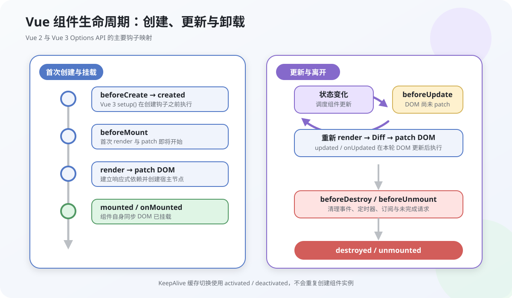
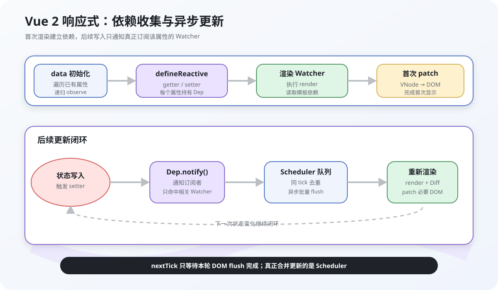
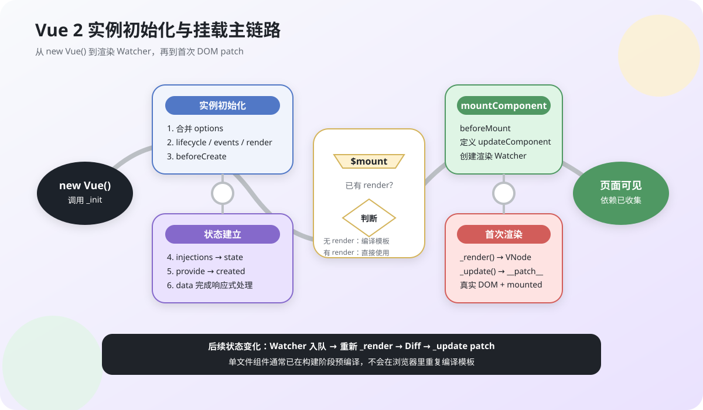
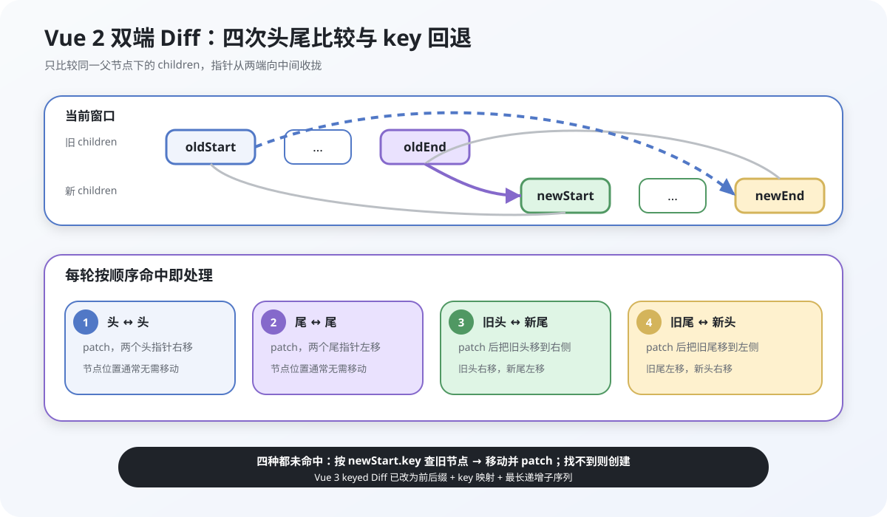
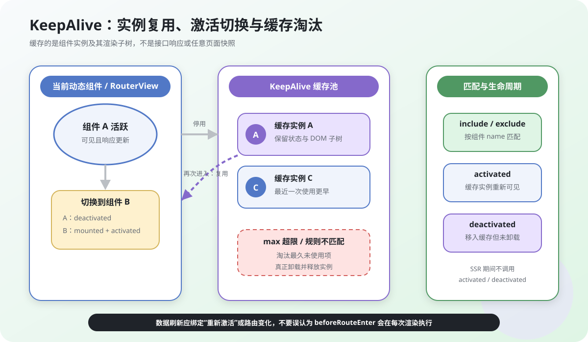
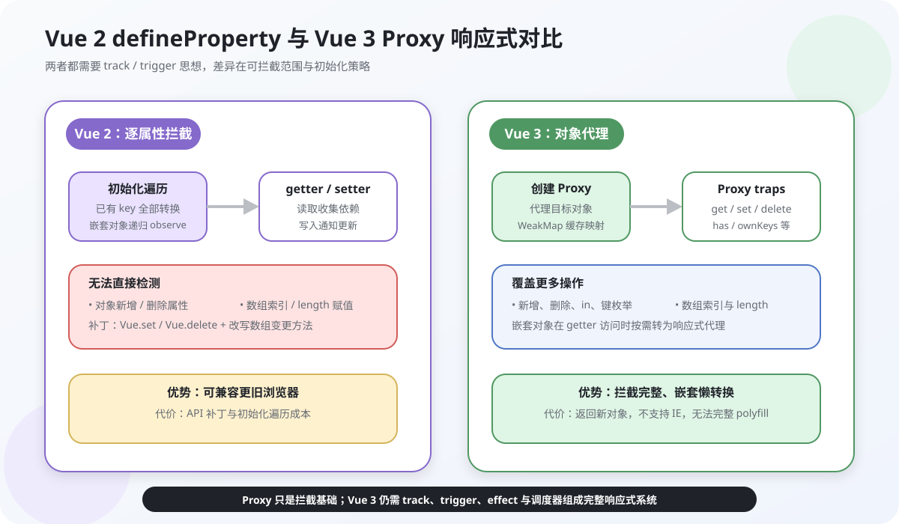

## 1. 请描述下对Vue生命周期的理解

### 生命周期与钩子

Vue 组件的生命周期是组件实例从创建、初始化、挂载、更新到卸载的完整过程。生命周期钩子让开发者在这些阶段执行副作用，例如请求数据、访问 DOM、订阅事件和释放资源。

Vue 2 与 Vue 3 的主要钩子对应关系如下：

| 阶段 | Vue 2 | Vue 3 Options API | Vue 3 Composition API |
| --- | --- | --- | --- |
| 创建前 | `beforeCreate` | `beforeCreate` | 直接写在 `setup()` 中 |
| 创建后 | `created` | `created` | 直接写在 `setup()` 中 |
| 挂载前 | `beforeMount` | `beforeMount` | `onBeforeMount` |
| 挂载后 | `mounted` | `mounted` | `onMounted` |
| 更新前 | `beforeUpdate` | `beforeUpdate` | `onBeforeUpdate` |
| 更新后 | `updated` | `updated` | `onUpdated` |
| 卸载前 | `beforeDestroy` | `beforeUnmount` | `onBeforeUnmount` |
| 卸载后 | `destroyed` | `unmounted` | `onUnmounted` |



`activated`、`deactivated` 用于被 `<KeepAlive>` 缓存的组件，`errorCaptured` 用于捕获后代组件传播上来的错误。Options API 钩子中的 `this` 会指向组件实例，因此不要用箭头函数定义依赖 `this` 的钩子。

### 各阶段执行过程

- `beforeCreate`：Vue 2 的 props、data、computed、methods 和 watch 尚未初始化。
- `created`：响应式状态和方法已经可用，但组件 DOM 尚未挂载。
- `beforeMount`：即将执行首次渲染和 patch；此时不能把 `$el` 当作最终页面 DOM。
- `mounted`：组件自身的同步子树已经挂载，可以访问组件 DOM。异步组件、`<Suspense>` 或资源加载完成不在此保证范围内。
- `beforeUpdate`：响应式依赖已经变化，但本轮 DOM patch 尚未完成，适合读取更新前的 DOM 状态。
- `updated`：本轮 DOM patch 已完成。不要在这里无条件修改组件状态，否则可能形成更新循环。
- `beforeDestroy` / `beforeUnmount`：组件仍可访问，适合清理定时器、事件监听和订阅。
- `destroyed` / `unmounted`：组件作用域内的响应式副作用和子组件已经停止或卸载。

单文件组件通常在构建阶段预编译模板；运行时主要执行渲染函数，不应把“模板编译”理解为每次挂载都会在浏览器中发生。

### 使用场景与请求时机

数据请求放在哪个钩子取决于依赖条件，而不是“越早越好”：

- 请求不依赖 DOM 时，Vue 2 可放在 `created`，Vue 3 Composition API 可在 `setup()` 中发起。
- 请求依赖 DOM 尺寸、第三方 DOM 库或浏览器专属 API 时，放在 `mounted` / `onMounted`。
- SSR 中 `created` 和 `setup()` 可能在服务端执行，`mounted` / `onMounted` 只在客户端执行。需要避免服务端重复请求时，应使用框架提供的数据预取 API。

无论在哪个钩子发请求，异步响应通常都晚于首次渲染，应通过加载态、骨架屏和错误态避免界面闪烁，并在组件卸载时取消不再需要的请求或忽略过期响应。

## 2. 双向数据绑定是什么

### 双向绑定与 MVVM

Vue 的基础数据流是“状态驱动视图”的单向更新。表单上的双向绑定是语法层面的组合：状态变化更新输入框，输入事件再把新值写回状态。`v-model` 提供了这组绑定的简写，并不意味着任意数据都会自动双向同步。

原生输入框上的：

```vue
<input v-model="name" />
```

概念上等价于：

```vue
<input :value="name" @input="name = $event.target.value" />
```

Vue 2 自定义组件的默认约定是 `value` prop 配合 `input` 事件；Vue 3 默认使用 `modelValue` prop 配合 `update:modelValue` 事件，并支持多个 `v-model` 参数。

### 响应式更新流程

以 Vue 2 为例，响应式更新链路可以概括为：

1. 初始化 data 时，Observer 递归遍历已有属性，用 `Object.defineProperty` 安装 getter 和 setter。
2. 组件首次渲染时，渲染 Watcher 读取模板依赖的属性；getter 把当前 Watcher 收集到对应的 Dep。
3. 属性写入触发 setter，Dep 通知订阅它的 Watcher。
4. Watcher 被放入异步调度队列并去重；同一轮同步修改结束后，组件重新渲染并 patch DOM。

Vue 3 的整体思想相同，但以 `Proxy`、`track`、`trigger` 和响应式 effect 实现，不再为每个已有属性预先安装 getter/setter。



### Observer、Compiler 与 Watcher

下面是帮助理解 Vue 2 核心关系的简化代码，不等同于完整源码：

```js
let activeWatcher = null

class Dep {
  constructor() {
    this.subscribers = new Set()
  }
  depend() {
    if (activeWatcher) this.subscribers.add(activeWatcher)
  }
  notify() {
    this.subscribers.forEach((watcher) => watcher.update())
  }
}

function defineReactive(target, key, value) {
  const dep = new Dep()
  observe(value)

  Object.defineProperty(target, key, {
    get() {
      dep.depend()
      return value
    },
    set(nextValue) {
      if (Object.is(nextValue, value)) return
      value = nextValue
      observe(nextValue)
      dep.notify()
    },
  })
}

function observe(value) {
  if (value === null || typeof value !== 'object') return
  Object.keys(value).forEach((key) => {
    defineReactive(value, key, value[key])
  })
}
```

### 依赖收集的实现思路

渲染 Watcher 执行渲染函数前会成为当前活动订阅者。渲染期间读取某个响应式属性时，该属性的 getter 将它加入 Dep；渲染结束后清空活动订阅者。后续 setter 只通知真正读取过该属性的 Watcher，而不是让所有组件都更新。

模板编译器负责把模板转换为渲染函数；依赖收集发生在渲染函数执行并读取响应式状态时。二者不能简单等同为一个“Compiler 扫描 DOM 后绑定 Watcher”的运行时过程，尤其是使用构建工具预编译单文件组件时。

## 3. Vue组件之间的通信方式都有哪些？

### 通信目标与关系分类

组件有各自的状态和作用域，通信方式应根据关系选择：父子组件优先使用显式 props 和事件，跨层级依赖使用 provide/inject，多个无直接关系的组件共享业务状态时使用状态管理库。越过组件公开接口直接操作实例，会提高耦合度。

### 常用通信方案

常见方案及版本边界如下：

- `props`：父组件向子组件传递只读数据。
- `$emit` / `emit`：子组件通知父组件发生了事件。
- `v-model`：约定化的 prop + update 事件，适合受控输入类组件。
- 模板 ref：父组件调用子组件明确暴露的方法；Vue 3 `<script setup>` 子组件需用 `defineExpose` 暴露。
- `$attrs`：包装组件透传未声明的属性和监听器。Vue 2 的 `$listeners` 在 Vue 3 中已合并进 `$attrs`。
- `provide` / `inject`：祖先向任意后代提供依赖，适合主题、表单上下文和服务实例，不适合代替所有业务状态。
- Pinia / Vuex：多个无直接关系的组件共享、派生和修改全局业务状态。新 Vue 3 项目通常优先 Pinia。
- 事件总线：适合很小的瞬时事件场景，但必须管理订阅与取消订阅。Vue 3 已移除组件实例的 `$on`、`$off`、`$once`，需要使用独立 emitter（如 `mitt`）。

父子通信示例：

```vue
<!-- Parent.vue -->
<Child :count="count" @increment="count++" />
```

```vue
<!-- Child.vue -->
<script setup>
defineProps({
  count: {
    type: Number,
    required: true,
  },
})

const emit = defineEmits(['increment'])
</script>

<template>
  <button type="button" @click="emit('increment')">
    {{ count }}
  </button>
</template>
```

### 跨层级与全局状态通信

Vue 3 中可以提供 ref，使后代保持响应式：

```js
// ancestor
const theme = ref('light')
provide('theme', readonly(theme))

// descendant
const theme = inject('theme', ref('light'))
```

Vue 2 的 provide/inject 本身不自动把普通对象新增为响应式；如果要传递会变化的值，应提供已被观察的对象，或使用状态管理方案。

### 选型总结

- 父子数据流：props + emit / `v-model`。
- 包装组件透传：`$attrs`。
- 跨层依赖：provide/inject。
- 跨页面、跨模块共享业务状态：Pinia / Vuex。
- 命令式能力：模板 ref，但只暴露必要方法。

不建议依赖 `$parent`、`$root` 或组件内部私有字段通信，因为层级一变就容易失效。

## 4. 为什么data属性是一个函数而不是一个对象?

### 根实例与组件的 data 约束

Vue 2 的根实例是单例，`data` 可以是对象；可复用组件的 `data` 必须是返回对象的函数。Vue 3 为保持规则一致，根组件和普通组件的 `data` 都应是函数。

```js
// Vue 2 根实例
const app = new Vue({
  el: '#app',
  data: {
    message: 'hello',
  },
})
```

```js
// Vue 2 / Vue 3 组件
export default {
  data() {
    return {
      count: 0,
    }
  },
}
```

### 函数返回值隔离实例状态

组件定义可能被实例化多次。如果所有实例共享同一个对象，一个实例的修改会污染其他实例：

```js
function Component() {}
Component.prototype.data = { count: 0 }

const componentA = new Component()
const componentB = new Component()
componentA.data.count = 1
console.log(componentB.data.count) // 1，共享对象被修改
```

工厂函数会为每个实例返回独立对象：

```js
function Component() {
  this.data = this.createData()
}
Component.prototype.createData = function () {
  return { count: 0 }
}
```

### Vue 选项合并原理

Vue 2 在合并组件选项时会把父级和子级的 data 工厂合并为新的工厂，实例创建时再调用它们并合并结果。这样既支持 mixin/extends，又不会在组件定义阶段创建共享状态。Vue 3 的 mixin data 采用浅层合并，不应依赖 Vue 2 对嵌套普通对象的递归合并行为。

### 实例隔离结论

- Vue 2 根实例的 data 可为对象或函数。
- Vue 2 可复用组件和所有 Vue 3 组件的 data 应为函数。
- 函数的关键作用是为每个组件实例创建独立状态，不是为了让 data 本身“变成响应式”。

## 5. 动态给Vue的data添加一个新的属性时会发生什么？怎样解决?

### 新增属性为何不会响应

这个问题必须区分 Vue 2 和 Vue 3。Vue 2 初始化时只会遍历当时已有的对象属性；之后直接增加或删除属性，不会经过已经安装的 getter/setter，因此不能触发依赖更新。

```html
<p v-for="(value, key) in item" :key="key">
  {{ value }}
</p>
<button @click="addProperty">动态添加新属性</button>
```

```js
new Vue({
  el: '#app',
  data() {
    return {
      item: {
        oldProperty: '旧属性',
      },
    }
  },
  methods: {
    addProperty() {
      this.item.newProperty = '新属性' // Vue 2 中不是响应式新增
    },
  },
})
```

Vue 2 也不能检测 `delete object.key`、通过索引直接设置数组元素，以及直接修改数组 `length`。Vue 3 的 `reactive()` 使用 Proxy，可以拦截对象属性新增、删除和数组索引修改，不需要 `Vue.set`。

### 可选解决方案

Vue 2 中，优先使用 `Vue.set` 或实例方法 `$set`：

```js
Vue.set(this.item, 'newProperty', '新属性')
this.$set(this.list, index, nextValue)
```

批量增加属性时，创建并替换整个对象，让现有响应式属性的 setter 接收到新引用：

```js
this.item = {
  ...this.item,
  newProperty: '新属性',
  anotherProperty: 1,
}
```

不能用 `Object.assign(this.item, patch)` 原地增加属性，因为新增 key 仍未经过响应式转换。`$forceUpdate()` 只强制当前组件重新渲染一次，不会把新增属性变成响应式，不能作为修复方案。

另外，Vue 2 不允许在实例创建后给根实例或根 `$data` 增加新的响应式顶层属性；应预先声明字段，或把动态字段放在已声明的嵌套对象中。

### 方案选择

- Vue 2 少量新增或数组索引更新：`Vue.set` / `$set`。
- Vue 2 批量新增：替换为包含新字段的新对象。
- Vue 3 `reactive` 对象：可直接新增或删除属性。
- 能预知结构时仍建议预先声明状态，以获得更稳定的类型和可读性。

## 6. v-if和v-for的优先级是什么？

### 指令作用与优先级

这个问题的答案在 Vue 2 和 Vue 3 中相反：

- Vue 2：同一元素上 `v-for` 优先于 `v-if`，所以条件会对每个循环项执行。
- Vue 3：同一元素上 `v-if` 优先于 `v-for`，因此 `v-if` 表达式不能访问尚未建立的循环变量。

### 编译结果与源码验证

以 `v-if="todo.done"` 和 `v-for="todo in todos"` 写在同一元素为例：Vue 2 会先生成列表，再为每一项判断；Vue 3 会先求值 `todo.done`，此时 `todo` 不在作用域中，会导致错误。依赖具体版本的编译优先级会降低可读性，因此两个版本都不推荐混用在同一元素上。

### 使用建议

整个列表满足条件时，把 `v-if` 放在外层：

```vue
<template v-if="isShow">
  <p v-for="item in items" :key="item.id">
    {{ item.title }}
  </p>
</template>
```

需要过滤单项时，优先用计算属性：

```js
const visibleItems = computed(() => {
  return items.value.filter((item) => item.isShow)
})
```

如果确实需要在模板中按项判断，可把 `v-for` 放在 `<template>`，把 `v-if` 放到内部元素上，并把 `key` 放在 `<template v-for>` 上（Vue 3）或按 Vue 2 的编译限制放到实际元素上。

## 7. v-show和v-if有什么区别？使用场景分别是什么？

### 共同点与核心区别

`v-if` 是条件渲染。条件为假时，对应的 VNode、DOM、事件监听和子组件都不存在；条件切换时会创建或卸载整个分支。

`v-show` 总会渲染元素，只通过 `display: none` 控制可见性，因此 DOM 和组件实例会保留。它不能用于 `<template>`，也不能与 `v-else` 配合。

```vue
<UserPanel v-if="hasPermission" />
<Toolbar v-show="toolbarVisible" />
```

`v-if` 从 false 变为 true 会挂载分支中的组件，从 true 变为 false 会卸载它们。Vue 2 对应 `beforeDestroy` / `destroyed`，Vue 3 对应 `beforeUnmount` / `unmounted`。`v-show` 切换不会重新触发挂载或卸载钩子。

### 编译与运行机制

模板编译后，`v-if` 会形成条件分支，渲染函数只为当前命中的分支创建 VNode；分支改变后，渲染器 patch 新旧分支并挂载或卸载节点。

`v-show` 由运行时指令处理。节点始终参与渲染，指令保存原始 `display` 值，并在更新时切换样式；结合 Transition 时还会调用相应的进入、离开钩子。

Vue 2 与 Vue 3 的编译器和运行时源码位置不同，但以上语义一致。面试回答应说明机制，不应把某个历史提交中的源码逐行当作稳定 API。

### 选择 v-show 或 v-if

- 条件很少变化、初始大概率不展示：使用 `v-if`，避免首次创建分支。
- 工具栏、选项卡等频繁切换并需要保留 DOM 状态：使用 `v-show`。
- 隐藏时需要释放订阅、计时器或大组件资源：使用 `v-if`，并在卸载钩子中清理。

`v-show` 只是视觉隐藏，不能作为权限安全措施；敏感数据和操作仍须由服务端鉴权。

## 8. 你知道Vue中key的原理吗？说说你对它的理解

### key 的作用

开始之前，我们先还原两个实际工作场景

1. 当我们在使用 v-for时，需要给单元加上 key

```html
<ul>
  <li v-for="item in items" :key="item.id">...</li>
</ul>
```

2. 改变 key 可以显式销毁旧组件并创建新组件

```vue
<Comp :key="resetVersion" />
```

那么这背后的逻辑是什么，key的作用又是什么?

一句话来讲

`key` 是同一组兄弟 VNode 中的稳定身份标识。渲染器借助 `type + key` 判断新旧节点是否代表同一个实体，从而正确复用组件实例和 DOM 状态，并在列表重排时决定移动、创建或卸载哪些节点。

### 有无 key 的更新差异

没有 key 时，Vue 倾向于按位置就地 patch 同类型节点。纯文本列表通常仍能正确显示，但带输入状态、过渡或子组件本地状态时，按位置复用可能把旧状态留给错误的数据项。

使用稳定 key 后，渲染器可以在列表重排时识别同一个业务实体，复用并移动对应 DOM 或组件实例。key 的首要价值是保证节点身份和状态正确，不是保证所有更新都更快。

**设置key与不设置key区别**

举个例子：

创建一个实例，2秒后往items数组插入数据

```html
<body>
  <div id="demo">
    <p v-for="item in items" :key="item">{{item}}</p>
  </div>
  <script src="../../dist/vue.js"></script>
  <script>
    //创建实例
    const app = new Vue({
    el: '#demo',
    data: { items: ['a', 'b', 'c', 'd', 'e'] },
    mounted () {
    setTimeout(() => {
    this.items.splice(2, 0, 'f') //
    }, 2000);
    },
    });
  </script>
</body>
```

在不使用 key 的情况，vue 会进行这样的操作:

分析下整体流程：

比较A，A，相同类型的节点，进行 patch，但数据相同，不发生 dom 操作

比较B，B，相同类型的节点，进行patch，但数据相同，不发生dom操作

比较C，F，相同类型的节点，进行 patch，数据不同，发生 dom 操作

比较D，C，相同类型的节点，进行 patch，数据不同，发生dom 操作

比较E，D，相同类型的节点，进行patch，数据不同，发生 dom操作

循环结束，将E插入到 DOM中

一共发生了3次更新，1次插入操作

在使用key的情况:vue会进行这样的操作:

- 比较A，A，相同类型的节点，进行 patch，但数据相同，不发生 dom操作

比较B，B，相同类型的节点，进行patch，但数据相同，不发生dom操作

- 比较C，F，不相同类型的节点

比较E、E，相同类型的节点，进行 patch，但数据相同，不发生 dom操作

- 比较D、D，相同类型的节点，进行 patch，但数据相同，不发生 dom 操作

- 比较C、C，相同类型的节点，进行 patch，但数据相同，不发生 dom 操作

循环结束，将F插入到C之前

一共发生了0次更新，1次插入操作

这个例子中，稳定 key 减少了不必要的内容改写，并保留了节点身份。但 key 不保证所有场景都“更快”；它首先保证列表重排时状态和节点身份正确。key 应来自数据的稳定唯一标识，不应使用数组下标（列表会增删或排序时）或不稳定随机值。

### key 与性能的边界

- 优先使用数据库 ID、业务唯一编码等稳定值。
- 列表会插入、删除或排序时，不要使用数组下标。
- 不要使用 `Math.random()` 或 `Date.now()`；每次渲染都改变 key 会强制销毁旧节点。
- 需要主动重置组件内部状态时，可以显式改变 key，例如递增 `resetVersion`。

稳定 key 需要维护映射，移动 DOM 也有成本，所以“有 key 一定更快”并不成立。

### 源码中的节点匹配

Vue 2 的 `sameVnode` 会综合 key、标签、注释状态、data 和 input 类型判断节点能否复用；双端 Diff 在四次头尾比较都未命中时，会根据 key 建立旧节点索引。

Vue 2 的 `updateChildren` 维护新旧列表的头尾指针。四次头尾比较未命中时，它会用 key 查找可复用的旧节点：找到则 patch 并移动，找不到则创建。循环结束后再批量添加新列表剩余节点，或删除旧列表剩余节点。

Vue 3 的 keyed children Diff 实现不同：先同步相同前缀和后缀，再处理中间未知区间，并使用最长递增子序列减少节点移动。两代实现不同，但都要求同一组兄弟节点的 key 稳定且唯一。

## 9. 说说你对Vue的mixin的理解，有什么应用场景?

### Mixin 概念与用法

Mixin是面向对象程序设计语言中的类，提供了方法的实现。其他类可以访问mixin类的方法而不必成为其子类

Mixin类通常作为功能模块使用，在需要该功能时“混入”，有利于代码复用又避免了多继承的复杂

**Vue中的mixin**

先来看一下官方定义

mixin (混入），提供了一种非常灵活的方式，来分发 Vue 组件中的可复用功能。

本质其实就是一个js对象，它可以包含我们组件中任意功能选项，如data、components methods、created、computed等等

我们只要将共用的功能以对象的方式传入 mixins选项中，当组件使用 mixins对象时所有mixins对象的选项都将被混入该组件本身的选项中来

在Vue中我们可以局部混入跟全局混入

```js
Vue.mixin({
    created: function () {
      console.log("全局混入")
    }
  })
```

**局部混入**

定义一个mixin对象，有组件 options的data、methods属性

```js
var myMixin = {
  created: function () {
    this.hello()
  },
  methods: {
    hello: function () {
      console.log('hello from mixin!')
    }
  }
}
```

组件通过mixins 属性调用 mixin 对象

```js
Vue.component('componentA',{
    mixins: [myMixin]
  })
```

该组件在使用的时候，混合了mixin里面的方法，在自动执行 created生命钩子，执行 hello方法

**全局混入**

通过Vue.mixin()进行全局的混入

使用全局混入需要特别注意，因为它会影响到每一个组件实例(包括第三方组件)

PS：全局混入常用于插件的编写

Vue 3 仍支持 mixin，并通过 `app.mixin()` 注册全局 mixin；但新代码通常优先使用 composable 复用有状态逻辑，因为依赖来源更明确，也更容易做类型推断。全局 mixin 会影响应用内每个组件，应只用于确有全局横切需求的插件。

### 合并规则与使用场景

当组件存在与mixin对象相同的选项的时候，进行递归合并的时候组件的选项会覆盖mixin的选项但是如果相同选项为生命周期钩子的时候，会合并成一个数组，先执行mixin的钩子，再执行组件的钩子

**使用场景**

在日常的开发中，我们经常会遇到在不同的组件中经常会需要用到一些相同或者相似的代码，这些代码的功能相对独立

这时，可以通过Vue的mixin功能将相同或者相似的代码提出来

举个例子

定义一个 modal弹窗组件，内部通过isShowing 来控制显示

```js
const Modal = {
  template: '#modal',
  data() {
    return {
      isShowing: false
    }
  },
  methods: {
    toggleShow() {
      this.isShowing = !this.isShowing;
    }
  }
}
```

定义一个tooltip提示框，内部通过isShowing来控制显示

```js
const Tooltip = {
  template: '#tooltip',
  data() {
    return {
      isShowing: false
    }
  },
  methods: {
    toggleShow() {
      this.isShowing = !this.isShowing;
    }
  }
}
```

通过观察上面两个组件，发现两者的逻辑是相同，代码控制显示也是相同的，这时候mixin就派上用场了

首先抽出共同代码，编写一个mixin

```js
const toggle = {
  data() {
    return {
      isShowing: false
    }
  },
  methods: {
    toggleShow() {
      this.isShowing = !this.isShowing;
    }
  }
}
```

两个组件在用上，只需要引入 mixin

```js
const Modal = {
  template:'#modal',
  mixins: [toggle]
};

const Tooltip = {
  template:'#tooltip',
  mixins: [toggle]
}
```

通过上面小小的例子，让我们知道了Mixin对于封装一些可复用的功能如此有趣、方便、实用

### 选项合并源码

下面的机制描述针对 Vue 2。`Vue.mixin()` 会把传入选项与构造器现有选项交给 `mergeOptions`；组件实例创建时，局部 mixin、extends 和组件自身选项也会按选项类型选择不同合并策略。

源码会先递归处理 `extends` 和 `mixins`，再遍历父、子选项。每个 key 交给对应的 strategy；没有专用 strategy 时才使用默认覆盖规则。应理解这套分派思路，而不是依赖历史版本内部函数签名。

### 四类合并策略

- `props`、`methods`、`inject`、`computed`：对象项合并，同名项以组件自身选项为准。
- `data`：实例创建时调用各自工厂并合并。Vue 2 会递归处理部分嵌套普通对象；Vue 3 改为浅层合并，不应依赖深层冲突结果。
- 生命周期钩子：合并成数组，mixin 钩子先于组件自身钩子执行。
- `watch`：同名 watcher 合并为多个处理函数，都会执行。
- `components`、`directives`、Vue 2 的 `filters`：通过带原型链的资源对象合并，局部注册可覆盖上层同名资源。

Mixin 的问题是依赖来源不透明、同名冲突和隐式耦合。Vue 3 新代码通常优先 composable；Mixin 更适合维护 Vue 2 旧项目或兼容现有 Options API 插件。

## 10. Vue常用的修饰符有哪些有什么应用场景

### 修饰符分类

在程序世界里，修饰符是用于限定类型以及类型成员的声明的一种符号

在Vue中，修饰符处理了许多DOM事件的细节，让我们不再需要花大量的时间去处理这些烦恼的事情，而能有更多的精力专注于程序的逻辑处理

vue中修饰符分为以下五种：

- 表单修饰符

- 事件修饰符

鼠标按键修饰符

- 键值修饰符

- v-bind修饰符

### 表单修饰符

在我们填写表单的时候用得最多的是 input 标签，指令用得最多的是 v-model关于表单的修饰符有如下：

- lazy

- trim

- number

**lazy**

在我们填完信息，光标离开标签的时候，才会将值赋予给 value，也就是在change事件之后再进行信息同步

```text
<input type="text" v-model.lazy="value">
<p>{{value}}</p>
```

**trim**

自动过滤用户输入的首空格字符，而中间的空格不会过滤

```js
<input type="text" v-model.trim="value">
```

**number**

自动将用户的输入值转为数值类型，但如果这个值无法被parseFloat解析，则会返回原来的值

```html
<input v-model.number="age" type="number">
```

### 事件与输入修饰符

事件修饰符是对事件捕获以及目标进行了处理，有如下修饰符:

- stop

- prevent

- self

- once

- capture

- passive

- native

**stop**

阻止了事件冒泡，相当于调用了event.stopPropagation方法

```html
<div @click="shout(2)">
  <button @click.stop="shout(1)">ok</button>
</div>
//只输出1
```

**prevent**

阻止了事件的默认行为，相当于调用了event.preventDefault方法

```html
<form v-on:submit.prevent="onSubmit"></form>
```

**self**

只当在 event.target 是当前元素自身时触发处理函数

1 `<div v-on:click.self="doThat">`...`</div>`

使用修饰符时，顺序很重要；相应的代码会以同样的顺序产生。因此，用v-on:click.prevent.s

elf 会阻止所有的点击，而v-on:click.self.prevent 只会阻止对元素自身的点击

**once**

绑定了事件以后只能触发一次，第二次就不会触发

```html
<button @click.once="shout(1)">ok</button>
```

**capture**

使事件触发从包含这个元素的顶层开始往下触发

```js
<div @click.capture="shout(1)">
obj1
<div @click.capture="shout(2)">
obj2
<div @click="shout(3)">
obj3
<div @click="shout(4)">
obj4
</div>
</div>
</div>
</div>
// 输出结构：1 2 4 3
```

**passive**

在移动端，当我们在监听元素滚动事件的时候，会一直触发onscroll事件会让我们的网页变卡，因此我们使用这个修饰符的时候，相当于给onscroll事件整了一个.lazy修饰符

```js
<!--滚动事件的默认行为（即滚动行为）将会立即触发-->
<!-- 而不会等待\`onScroll完成-->
<!--这其中包含\`event.preventDefault()的情况 —->
<div v-on:scroll.passive="onScroll">...</div>
```

不要把 passive 和prevent 一起使用,因为prevent 将会被忽略，同时浏览器可能会向你展示一个警告。

**native**

`.native` 是 Vue 2 的组件事件修饰符，用于监听子组件根元素的原生事件。

```html
<my-component v-on:click.native="doSomething"></my-component>
```

Vue 3 已移除 `.native`。父组件传入但未在 `emits` 中声明的监听器会作为透传 attribute 落到单根节点上；包装组件应通过 `emits` 和 `$attrs` 明确控制事件边界。

**鼠标按钮修饰符**

鼠标按钮修饰符针对的就是左键、右键、中键点击，有如下：

- left 左键点击

- right 右键点击

- middle 中键点击

**键盘修饰符**

键盘修饰符是用来修饰键盘事件（onkeyup，onkeydown）的，有如下：

Vue 为常用按键提供名称修饰符：

- 普通键(enter、tab、delete、space、esc、up...)

系统修饰键(ctrl、alt、meta、shift...)

Vue 2 可以通过以下方式自定义全局 keyCode 别名；Vue 3 已移除 `keyCode` 修饰符和 `Vue.config.keyCodes`，应直接使用按键名称：

```js
Vue.config.keyCodes.f2 = 113
```

### v-bind 修饰符与场景

这里需要区分 Vue 2 和 Vue 3：

- `.prop`：把绑定设置为 DOM property，而不是 attribute。
- `.camel`：将 kebab-case attribute 名转换为 camelCase。
- `.sync`：Vue 2 的 prop 更新语法糖，Vue 3 已移除，改用带参数的 `v-model`。

**Vue 2 的 `.sync`**

```js
//父组件
<comp :myMessage.sync="bar"></comp>
//子组件
this.$emit('update:myMessage',params);
```

**以上这种方法相当于以下的简写**

```js
//父亲组件
<comp :myMessage="bar" @update:myMessage="func"></comp>
func(e){
this.bar = e;

//子组件js
func2(){
this.$emit('update:myMessage',params);
}
```

使用 `.sync` 需要注意以下两点：

- 子组件事件名必须是 `update:propName`，其中 `propName` 与 prop 名称一致。

- 带 `.sync` 的绑定目标必须是可赋值表达式。

Vue 3 对应写法为 `<Comp v-model:myMessage="bar" />`，子组件声明 `myMessage` 并触发 `update:myMessage`。

**`.prop`**

设置自定义标签属性，避免暴露数据，防止污染HTML结构

```html
<input id="uid" title="title1" value="1" :index.prop="index">
```

将命名变为驼峰命名法，如将view-Box属性名转换为 viewBox

```text
<svg :viewBox="viewBox"></svg>
```

**应用场景**

根据每一个修饰符的功能，我们可以得到以下修饰符的应用场景：

- .stop:阻止事件冒泡

.native:绑定原生事件

- .once:事件只执行一次

- `.self`：仅当 `event.target === event.currentTarget` 时触发，不会阻止事件冒泡

.prevent：阻止默认事件

- `.capture`：在捕获阶段监听事件

- .once:只触发一次

- .keyCode：监听特定键盘按下

- .right:右键

## 11. Vue中的$nextTick有什么作用？

### 异步更新与 nextTick

响应式状态变化后，Vue 不会为每次写入同步更新 DOM，而是把组件更新任务放入调度队列，在当前同步代码结束后批量执行并去重。

`nextTick` 返回 Promise 或注册回调，让调用方等待当前这轮 Vue DOM 更新完成。批量更新由调度器完成，不是 `nextTick` 自己合并了状态修改。

### 读取更新后的 DOM

```vue
<script setup>
import { nextTick, ref } from 'vue'

const message = ref('before')
const output = ref(null)

async function update() {
  message.value = 'after'
  console.log(output.value.textContent) // before

  await nextTick()
  console.log(output.value.textContent) // after
}
</script>

<template>
  <p ref="output">{{ message }}</p>
  <button type="button" @click="update">更新</button>
</template>
```

Vue 2 组件内可使用 `this.$nextTick()`，也可使用全局 `Vue.nextTick()`；Vue 3 可从 `vue` 导入 `nextTick`，Options API 仍保留 `this.$nextTick()`。

`nextTick` 只保证当前 Vue 更新批次已经提交，不保证网络请求、图片加载、CSS 过渡或浏览器下一次绘制已经完成。等待绘制可结合 `requestAnimationFrame`，等待过渡应监听相应事件。

### 调度实现与版本边界

Vue 2 的 `/src/core/util/next-tick.js` 会把回调加入队列，并根据环境使用 Promise、MutationObserver、setImmediate 或 setTimeout 触发刷新。Vue 3 调度器已经重写，主要通过 Promise 微任务安排组件作业和 post-flush 回调。

面试时应回答“等待 Vue 当前 DOM 更新批次”，不应把某个历史版本的降级源码当作稳定 API。

## 12. Vue实例挂载的过程

我们都听过知其然知其所以然这句话

那么不知道大家是否思考过 new Vue()这个过程中究竟做了些什么?

过程中是如何完成数据的绑定，又是如何将数据渲染到视图的等等



### 实例初始化与状态建立

以下流程针对 Vue 2。`new Vue(options)` 调用实例的 `_init(options)`，主要步骤是：

1. 合并构造器选项、mixin、extends 和当前实例选项。
2. 初始化父子关系、生命周期标志、组件事件和渲染上下文。
3. 触发 `beforeCreate`。
4. 依次处理 inject、props、methods、data、computed 和 watch，并建立响应式观察。
5. 处理 provide，触发 `created`。
6. 如果传入了 `el`，调用 `$mount(el)`。

Vue 2 通过多个 mixin 初始化原型能力：`initMixin` 定义 `_init`，`stateMixin` 提供 `$set` / `$delete` / `$watch`，`eventsMixin` 提供事件 API，`lifecycleMixin` 提供 `_update` / `$forceUpdate` / `$destroy`，`renderMixin` 提供渲染相关能力。

`beforeCreate` 执行时状态尚未完成初始化；`created` 执行时 props、data、computed 和 methods 已可用，但 DOM 尚未挂载。可复用组件的 data 必须是工厂函数，以便每个实例得到独立对象。

Vue 3 不再暴露这套 Vue 2 实例原型结构，而是通过 `createApp(App).mount()` 启动应用。两代版本都遵循“建立组件状态和上下文，再进入 render/patch”的主链，但内部函数不能逐行对应。

### 模板编译与组件挂载

渲染入口有三种常见来源：

- 单文件组件：构建工具提前把 template 编译为 render 函数。
- 手写 `render`：挂载时直接使用。
- 浏览器完整版：没有 render 时，可在运行时把 template 编译为 render。

生产项目通常使用预编译单文件组件和 runtime-only 构建。模板编译大致经历 parse、transform、codegen，最终生成渲染函数；不应把“模板编译”理解为每次组件更新都会发生。

Vue 2 的 `$mount` 最终进入 `mountComponent`：

1. 保存挂载目标，确认组件存在 render 函数。
2. 触发 `beforeMount`。
3. 创建渲染 Watcher，其更新函数执行 `vm._render()` 和 `vm._update()`。
4. Watcher 首次执行，生成 VNode 并 patch 到真实 DOM。
5. 根实例首次 patch 完成后触发 `mounted`；子组件的 mounted 通过插入钩子协调。

渲染 Watcher 执行期间会收集 render 所读取的响应式依赖。依赖变化后，Watcher 进入异步调度队列，再次执行 render 和 patch，并在相应阶段触发 `beforeUpdate` / `updated`。

### render、patch 与 DOM 更新

`_render()` 调用组件的 render 函数，得到当前组件子树的 VNode。渲染期间读取到的响应式属性会被当前渲染 Watcher 收集为依赖。

`_update(vnode)` 保存本轮 VNode，并调用平台注入的 `__patch__`：

- 首次渲染：以挂载元素和新 VNode 为输入，创建 DOM。
- 后续更新：以旧 VNode 和新 VNode 为输入，比较并更新 DOM。

Patch 不只是创建元素，还会处理组件实例、属性、事件、指令、过渡、ref 和卸载钩子。`updated` 由调度器在组件更新完成后统一调用，以保证父子组件钩子顺序。

### 挂载流程总结

```text
new Vue
  -> _init / initState
  -> $mount
  -> compile template if needed
  -> mountComponent
  -> render watcher
  -> _render
  -> _update / patch
  -> mounted
```

Vue 3 使用 `createApp().mount()`、响应式 effect 和 runtime-core 渲染器实现对应流程。主思路仍是“建立状态 -> render 生成 VNode -> patch DOM -> 收集依赖”，但不要把 Vue 2 的私有方法名套到 Vue 3。

## 13. 你了解Vue的diff算法吗?

### Diff 的目标与比较策略

本题主体讲的是 **Vue 2 的双端 Diff**。Vue 3 的 keyed children Diff 会先处理相同前缀和后缀，再为未知区间建立 key 到新索引的映射，并使用最长递增子序列减少节点移动，不能把 Vue 2 的四指针流程直接当成 Vue 3 实现。

Diff 的目标是在新旧 VNode 树之间找到需要应用到宿主 DOM 的变化。Vue 的渲染器按同层子节点比较，不会尝试计算任意树之间的最小编辑距离。



Vue 2 比较同一父节点下的 children 时，维护 `oldStart`、`oldEnd`、`newStart`、`newEnd` 四个指针，从两端向中间收拢。比较只发生在同一层的兄弟节点之间。

### 双端比较过程

每轮按顺序尝试：

1. 旧头与新头。
2. 旧尾与新尾。
3. 旧头与新尾。
4. 旧尾与新头。

前两种命中时 patch 节点并移动对应指针；后两种命中时还要移动已有 DOM。四种都不命中时，根据新头节点的 key 在旧节点映射中查找：找到则复用并移动，找不到则创建。

循环结束后，新列表还有剩余节点就批量创建，旧列表还有剩余节点就批量卸载。

### patch 与 patchVnode

顶层 `patch` 先处理几个边界：

- 没有新 VNode：卸载旧节点。
- 没有旧 VNode：直接创建新节点。
- 新旧节点可视为同一节点：进入 `patchVnode`。
- 节点类型或 key 不同：创建新节点并卸载旧节点。

`patchVnode` 复用旧 VNode 对应的真实 DOM，再根据 children 形态分支处理：

- 新旧都是文本：内容不同才更新文本。
- 两边都有 children：执行 children Diff。
- 只有新 children：清空旧文本并批量创建。
- 只有旧 children：批量卸载。
- 新旧引用完全相同或满足静态节点复用条件：跳过无意义工作。

属性、class、style、事件、组件和指令的更新由对应模块钩子完成。以上流程是 Vue 2 的概念结构，私有函数签名会随版本变化。

### updateChildren 的分支与总结

Vue 2 的 `updateChildren` 可概括为“头尾四次比较 + key 映射回退 + 收尾增删”。key 相同但节点类型不同仍会创建新节点，重复 key 则可能让映射和复用结果失去确定性。

Vue 3 的主要步骤是：

1. 从头同步相同节点。
2. 从尾同步相同节点。
3. 一侧先耗尽时，批量挂载或卸载剩余节点。
4. 处理中间未知区间，建立新 key 到索引的映射。
5. patch 可复用节点，卸载不存在的旧节点。
6. 对新旧索引关系计算最长递增子序列，只移动不在稳定序列中的节点。

最长递增子序列用于减少移动次数，不用于判断节点是否相同。无 key 列表则采用按位置比较策略。

## 14. Vue中组件和插件有什么区别?

### 组件与插件的职责

组件是渲染树中的可复用 UI 单元，通过 props、事件和插槽定义公开接口，可以被实例化多次。插件是在应用安装阶段执行的一组全局扩展逻辑，常用于注册全局组件或指令、提供依赖、安装路由/状态管理，或增加应用级配置。

组件关注“页面由哪些 UI 单元组成”，插件关注“为整个 Vue 应用安装什么能力”。一个组件库可以同时提供许多组件和一个负责批量注册的插件入口。

### 编写方式

组件通常写成单文件组件：

```vue
<template>
  <button type="button" @click="$emit('confirm')">
    {{ label }}
  </button>
</template>

<script>
export default {
  props: {
    label: {
      type: String,
      required: true,
    },
  },
  emits: ['confirm'],
}
</script>
```

插件应是函数或包含 `install` 方法的对象。Vue 2 的第一个参数是 `Vue` 构造器；Vue 3 的第一个参数是应用实例 `app`：

```js
// Vue 3
const MyPlugin = {
  install(app, options) {
    app.component('BaseButton', BaseButton)
    app.directive('focus', focusDirective)
    app.provide('pluginOptions', options)
    app.config.globalProperties.$myService = createService(options)
  },
}
```

### 注册方式

Vue 2 使用 `Vue.component()` / `Vue.use()`；Vue 3 使用 `app.component()` / `app.use()`：

```js
const app = createApp(App)
app.component('BaseButton', BaseButton)
app.use(MyPlugin, { endpoint: '/api' })
app.mount('#app')
```

局部组件注册只影响当前组件；全局组件和插件应在应用挂载前注册。Vue 会避免在同一应用中重复安装同一个插件对象。

### 组件与插件的适用场景

- 按钮、表格、弹窗、页面区域：组件。
- 路由、状态管理、国际化、监控 SDK、整套组件库安装器：插件。
- 只在一个组件中使用的函数无需包装成插件；优先普通模块或 composable。

## 15. Vue项目中你是如何解决跨域的呢?

### 跨域与同源策略

浏览器同源策略限制页面脚本读取不同源的响应。协议、主机和端口都相同才是同源。跨域请求可能已经发送到服务器，但浏览器是否允许脚本读取响应，要看 CORS 响应头；Postman、服务端程序等非浏览器客户端不受浏览器同源策略限制。

跨域不是 Vue 特性，也不能仅靠前端代码“关闭”。生产环境必须由 API 服务、网关或同源反向代理配合。

### CORS 与代理方案

CORS 由服务端声明允许的 Origin、方法和请求头。带凭据请求不能同时使用 `Access-Control-Allow-Origin: *`，而应回显经过白名单校验的具体 Origin，并返回 `Access-Control-Allow-Credentials: true`。非简单请求还要正确响应 `OPTIONS` 预检。

```js
const allowedOrigins = new Set(['https://app.example.com'])

app.use(async (ctx, next) => {
  const origin = ctx.get('Origin')
  if (allowedOrigins.has(origin)) {
    ctx.set('Access-Control-Allow-Origin', origin)
    ctx.set('Vary', 'Origin')
    ctx.set('Access-Control-Allow-Credentials', 'true')
    ctx.set('Access-Control-Allow-Headers', 'Content-Type, Authorization')
    ctx.set('Access-Control-Allow-Methods', 'GET, POST, PUT, DELETE, OPTIONS')
  }

  if (ctx.method === 'OPTIONS') {
    ctx.status = 204
    return
  }

  await next()
})
```

JSONP 只支持 GET，依赖可执行脚本且安全边界弱，现代项目一般不再采用。

### 开发与生产环境的代理配置

开发服务器代理只对本地开发生效。以 Vite 为例：

```js
// vite.config.js
import { defineConfig } from 'vite'

export default defineConfig({
  server: {
    proxy: {
      '/api': {
        target: 'http://localhost:3000',
        changeOrigin: true,
      },
    },
  },
})
```

前端统一请求同源 `/api`：

```js
const api = axios.create({
  baseURL: '/api',
})
```

生产环境可让 API 服务直接启用 CORS，或由 Nginx/网关把 `/api` 反向代理到后端。开发服务器代理配置不会自动进入生产构建。

## 16. 有写过自定义指令吗？自定义指令的应用场景有哪些？

### 自定义指令的能力

自定义指令适合封装必须直接操作普通 DOM 元素的低层行为，例如自动聚焦、元素可见性观察、点击外部关闭和拖拽。可由组件或 composable 完成的 UI、状态和业务逻辑，应优先使用组件或 composable。

指令可以接收值、参数和修饰符：

```vue
<div v-track:click.once="payload" />
```

在钩子中可以通过 `binding.value`、`binding.arg` 和 `binding.modifiers` 读取这些信息。

### 注册方式与钩子

Vue 2 通过 `Vue.directive()` 全局注册；Vue 3 通过 `app.directive()` 注册。注册名不包含 `v-` 前缀。

两代版本的钩子对应关系如下：

| 阶段 | Vue 2 | Vue 3 |
| --- | --- | --- |
| 首次绑定 | `bind` | `created` / `beforeMount` |
| 插入 DOM | `inserted` | `mounted` |
| 更新 | `update` / `componentUpdated` | `beforeUpdate` / `updated` |
| 解绑 | `unbind` | `beforeUnmount` / `unmounted` |

常用参数包括 `el`、`binding` 和 `vnode`。除 `el` 外，不应修改框架传入的对象。指令创建的事件监听、Observer、计时器和第三方实例必须在解绑阶段释放，并保存同一个资源或回调引用。

### 常见应用场景

常见场景包括自动聚焦、图片懒加载、元素曝光统计、拖拽和复制。下面用 Vue 3 的可见性指令说明资源管理：

```js
const observers = new WeakMap()

export const observeVisibility = {
  mounted(el, binding) {
    const observer = new IntersectionObserver(([entry]) => {
      binding.value(entry.isIntersecting)
    })

    observer.observe(el)
    observers.set(el, observer)
  },

  unmounted(el) {
    observers.get(el)?.disconnect()
    observers.delete(el)
  },
}
```

```js
const app = createApp(App)
app.directive('observe-visibility', observeVisibility)
```

```vue
<section v-observe-visibility="handleVisibility">
  ...
</section>
```

Vue 2 可把 `mounted` / `unmounted` 分别改为 `inserted` / `unbind`。生产代码还应处理 `IntersectionObserver` 的兼容范围。

复制文本应优先使用 `navigator.clipboard.writeText()`；`document.execCommand('copy')` 已废弃。表单防重复提交不能只依赖前端节流，服务端仍应提供幂等控制。

## 17. Vue中的过滤器了解吗？过滤器的应用场景有哪些?

### 作用与版本边界

过滤器是 Vue 2 的模板格式化语法。它不会修改原始数据，而是把表达式结果传给过滤器函数，再把函数返回值用于展示。

Vue 3 已移除过滤器语法和 `filters` 选项，而不只是标记为废弃；新项目应使用普通函数或 computed。

### 定义与使用

Vue 2 的过滤器可用于双花括号插值和 `v-bind` 表达式：

```vue
<p>{{ message | capitalize }}</p>
<div :id="rawId | formatId"></div>
```

局部过滤器在组件的 `filters` 选项中定义：

```js
export default {
  filters: {
    capitalize(value) {
      if (value == null) return ''
      const text = String(value)
      return text.charAt(0).toUpperCase() + text.slice(1)
    },
  },
}
```

全局过滤器通过 `Vue.filter()` 注册：

```js
Vue.filter('formatNumber', (value) => {
  if (value == null) return ''
  return new Intl.NumberFormat('zh-CN').format(value)
})
```

局部过滤器与全局过滤器同名时，局部定义优先。过滤器函数的第一个参数始终是前一个表达式的结果，其余参数来自模板调用：

```vue
{{ message | filterA | filterB }}
{{ message | truncate(20, '...') }}
```

串联过滤器从左到右执行，即 `filterA(message)` 的结果会传给 `filterB`。过滤器应保持为无副作用的展示函数，不适合发请求或修改传入对象。

### Vue 3 的替代方案

需要缓存的派生展示值使用 computed：

```vue
<script setup>
import { computed, ref } from 'vue'

const amount = ref(30000)
const formattedAmount = computed(() => {
  return new Intl.NumberFormat('zh-CN').format(amount.value)
})
</script>

<template>
  <p>{{ formattedAmount }}</p>
</template>
```

无需缓存的轻量格式化可以直接调用普通函数：

```vue
<p>{{ formatDate(createdAt) }}</p>
```

### Vue 2 编译原理

Vue 2 编译器会把过滤器表达式转换成嵌套函数调用，并通过运行时辅助函数解析已注册的过滤器。例如 `message | capitalize` 会转换为“先解析 `capitalize`，再以 `message` 为参数调用”的表达式。

这套编译和运行时辅助函数只属于 Vue 2。理解调用链即可，不应把历史源码片段复制到 Vue 3 项目。

## 18. 说说你对slot的理解？slot使用场景有哪些？

### 核心概念与使用场景

插槽是组件向调用方开放的内容扩展点。父组件提供内容，子组件决定内容出现的位置和调用时机，因此组件可以复用结构与行为，同时允许调用方定制局部 UI。

常见场景包括布局容器、弹窗正文与底部操作、表格单元格、列表项和表单字段包装。固定数据优先使用 props，通知动作使用 emits；需要传入一段模板结构时才使用插槽。

插槽内容在父组件作用域中编译，因此可以访问父组件状态，不能直接访问子组件状态。子组件若要向插槽内容提供数据，必须显式传递 slot props。

### 默认、具名与作用域插槽

下面的 `Panel` 同时声明默认插槽、具名插槽和后备内容：

```vue
<!-- Panel.vue -->
<template>
  <section>
    <header>
      <slot name="header">
        <h2>默认标题</h2>
      </slot>
    </header>

    <main>
      <slot />
    </main>

    <footer>
      <slot name="footer" :pending="pending">
        <button type="button">关闭</button>
      </slot>
    </footer>
  </section>
</template>
```

父组件通过 `v-slot` 或简写 `#` 指定插槽，并接收子组件传出的数据：

```vue
<Panel>
  <template #header>
    <h2>{{ title }}</h2>
  </template>

  <p>默认插槽内容</p>

  <template #footer="{ pending }">
    <button type="button" :disabled="pending" @click="submit">
      {{ pending ? '提交中' : '提交' }}
    </button>
  </template>
</Panel>
```

没有提供某个插槽时，子组件 `<slot>` 标签内部的后备内容才会渲染。`#footer` 必须带插槽名；只有单个默认插槽时，`v-slot` 可以直接写在组件标签上。

### 版本边界与渲染原理

Vue 2.6 引入了 `v-slot`，用于替代旧的 `slot`、`slot-scope` 语法；Vue 3 只保留 `v-slot` 体系。维护 Vue 2.5 及更早项目时才需要识别旧语法，新代码不应混用。

从渲染模型看，插槽可以理解为由父组件提供、返回 VNode 的函数。子组件渲染 `<slot>` 时调用对应函数；作用域插槽调用时会传入 slot props。Vue 3 中所有插槽都统一为 `slots` 上的函数：

```js
import { h } from 'vue'

export default {
  setup(_, { slots }) {
    return () => h('section', [
      slots.header?.(),
      slots.default?.(),
      slots.footer?.({ pending: false }),
    ])
  },
}
```

Vue 2 内部还区分 `$slots` 与 `$scopedSlots`，Vue 3 则统一为函数插槽。业务代码应使用模板语法或公开的 `slots` API，不依赖编译器生成的私有辅助函数。

## 19. 什么是虚拟DOM？如何实现一个虚拟DOM？说说你的思路

### 定义与价值

虚拟 DOM 是用普通 JavaScript 对象描述界面结构的渲染模型，其中的节点称为 VNode。模板或渲染函数先生成 VNode 树，渲染器再把它挂载到 DOM；状态变化后，渲染器比较新旧 VNode，把必要变化应用到真实 DOM。

一个简化的 VNode 如下：

```js
const vnode = {
  type: 'button',
  props: {
    class: 'primary',
    onClick: submit,
  },
  children: '提交',
  key: 'submit',
  el: null,
}
```

真实 VNode 还会记录组件、插槽、静态标记和宿主节点等信息。Vue 2 使用 `createElement` 创建 VNode，Vue 3 常用 `h` / `createVNode`；两代字段和渲染器实现不同，内部结构不是公共 API。

虚拟 DOM 的核心价值是提供声明式、可组合、可跨平台的渲染抽象。它也会产生创建对象和执行 Diff 的成本，因此不等于“任何场景都比直接操作 DOM 快”。Vue 的性能还依赖响应式依赖追踪、批量调度和编译器优化。

### 最小实现思路

一个教学版实现可以拆为四层：

1. `h(type, props, children)` 创建并规范化 VNode。
2. `mount(vnode, container)` 创建真实节点、设置属性并递归挂载 children。
3. `patch(oldVNode, newVNode)` 判断复用还是替换，并更新属性和 children。
4. `unmount(vnode)` 删除节点并清理事件、组件副作用和引用。

```js
function h(type, props = null, children = null) {
  return {
    type,
    props,
    children,
    key: props?.key,
    el: null,
  }
}

function mount(vnode, container) {
  const el = document.createElement(vnode.type)
  vnode.el = el

  for (const [key, value] of Object.entries(vnode.props ?? {})) {
    if (key === 'key') continue
    if (key.startsWith('on')) {
      el.addEventListener(key.slice(2).toLowerCase(), value)
    } else {
      el.setAttribute(key, value)
    }
  }

  if (typeof vnode.children === 'string') {
    el.textContent = vnode.children
  } else if (Array.isArray(vnode.children)) {
    vnode.children.forEach((child) => mount(child, el))
  }

  container.appendChild(el)
}
```

`patch` 首先比较 `type` 和 `key`：不同则替换节点，相同则复用 `el`，再比较 props、文本和子节点。列表更新还需要 keyed children Diff 来决定新增、删除和移动。

### 生产实现还需处理什么

生产渲染器还要支持组件实例、Fragment、Teleport、插槽、指令、过渡、异步组件、SSR hydration、事件更新和错误边界。Diff 是基于常见 UI 结构的启发式算法，不保证得到理论上的最少 DOM 操作；实现时应优先保证节点身份、组件状态和生命周期正确。

## 20. Vue项目中有封装过axios吗？主要是封装哪方面的?

### 封装目标

Axios 是独立于 Vue 的 Promise HTTP 客户端。它通过 adapter 适配浏览器和 Node.js 环境；现代 Axios 1.x 可按环境使用 XHR、Fetch 或 Node HTTP adapter，不能简单描述为“Axios 就是 XHR”。

二次封装的目标是统一项目级约定，而不是重新实现 Axios。通常处理：

- `baseURL`、超时、公共请求头和序列化规则。
- 认证信息注入、401 刷新与退出登录。
- HTTP 错误、业务错误、网络错误、超时和取消的分类。
- 请求取消、有限重试、日志与链路标识。
- 按业务域导出类型清晰的 API 函数。

### 最小封装

```js
import axios from 'axios'

export const apiClient = axios.create({
  baseURL: '/api',
  timeout: 15_000,
})

apiClient.interceptors.request.use((config) => {
  const token = getAccessToken()
  if (token) {
    config.headers.Authorization = `Bearer ${token}`
  }
  config.headers['X-Request-ID'] = crypto.randomUUID()
  return config
})

apiClient.interceptors.response.use(
  (response) => response,
  (error) => {
    const normalizedError = {
      status: error.response?.status,
      code: error.response?.data?.code ?? error.code,
      message: error.response?.data?.message ?? error.message,
      canceled: axios.isCancel(error),
      cause: error,
    }

    return Promise.reject(normalizedError)
  },
)
```

业务模块只描述资源和返回值：

```js
export async function getUser(userId, { signal } = {}) {
  const response = await apiClient.get(`/users/${userId}`, { signal })
  return response.data
}
```

调用方可以用标准 `AbortController` 取消请求：

```js
const controller = new AbortController()
const request = getUser('42', { signal: controller.signal })

controller.abort()
await request
```

Axios 从 0.22 起支持 `AbortController`，并同时弃用 `CancelToken`；新代码应使用 `signal`。并发请求直接使用 `Promise.all` 或 `Promise.allSettled`，无需依赖 Axios 的旧辅助方法。

### 边界与常见错误

`error.response` 只在服务端返回响应时存在；断网、DNS、超时和部分取消场景不能直接读取它。自动重试应限制次数并使用退避，通常只重试可安全重放的幂等请求。

多个请求同时收到 401 时，刷新 token 应采用 single-flight：只发送一次刷新请求，其余请求等待结果后再重放。重放还要防止刷新接口自身进入无限循环。

不要用 `new Promise` 再包装 Axios Promise，不要在拦截器中吞掉原始错误，也不要无条件只返回 `response.data`，否则调用方可能丢失状态码、响应头和分页信息。

## 21. 是怎么处理Vue项目中的错误的?

### 分层处理

Vue 项目的错误通常分为四层：

1. **接口层**：区分 HTTP 非 2xx、业务错误、网络错误、超时和取消。
2. **组件层**：用错误边界捕获后代组件经 Vue 调用链抛出的错误，并展示降级 UI。
3. **应用层**：用 Vue 全局 handler 统一上报未被边界终止传播的框架错误。
4. **平台层**：监听未处理的 Promise 拒绝、脚本错误和资源加载错误。

错误处理不应只有日志。界面还要根据场景提供重试、空态、回退路由或重新登录，同时避免把 token、密码和个人数据上报到监控平台。

### Vue 2 与 Vue 3 的错误边界

Vue 2 使用全局 `Vue.config.errorHandler`，Vue 3 改为应用实例配置：

```js
// Vue 2
Vue.config.errorHandler = (error, vm, info) => {
  reportError({ error, instance: vm, info })
}
```

```js
// Vue 3
const app = createApp(App)

app.config.errorHandler = (error, instance, info) => {
  reportError({ error, instance, info })
}
```

组件级可使用 Options API 的 `errorCaptured`；Vue 3 Composition API 还提供 `onErrorCaptured`：

```js
onErrorCaptured((error, instance, info) => {
  reportError({ error, instance, info })
  hasError.value = true

  // 已经在当前边界完整处理时，阻止继续向上传播。
  return false
})
```

Vue 2 从 2.5 起提供 `errorCaptured`。错误通常从出错组件沿父链传播，最后到应用级 handler；返回 `false` 会终止当前错误继续传播。边界自身抛出的新错误仍需由上层处理。

### Vue 之外的错误

Vue handler 不能覆盖资源加载失败、脱离 Vue 调用链的异步任务或所有第三方脚本错误，因此浏览器端还要按需监听：

```js
window.addEventListener('error', (event) => {
  reportError({
    error: event.error ?? new Error(`资源加载失败: ${event.target?.src}`),
    source: 'window.error',
  })
}, true)

window.addEventListener('unhandledrejection', (event) => {
  reportError({
    error: event.reason,
    source: 'unhandledrejection',
  })
})
```

接口拦截器负责分类和标准化错误，但不应对每个错误都弹相同提示；页面更了解业务语境。SSR 还需要服务端进程、请求日志和框架错误边界，浏览器监听器不能覆盖服务端异常。

上报内容至少应包含应用版本、路由、用户操作链、错误来源和 source map 映射后的堆栈，并设置采样、去重和敏感信息过滤。

## 22. 你了解axios的原理吗？有看过它的源码吗?

### Axios 的调用方式

```js
import axios from 'axios'

axios({ url: '/users', method: 'get' })
axios('/users', { method: 'get' })
axios.get('/users', { params: { page: 1 } })

const client = axios.create({
  baseURL: '/api',
  timeout: 15_000,
})
```

**请求拦截器**

```js
axios.interceptors.request.use(function (config) {
    // 这里写发送请求前处理的代码
    return config;
  }, function (error) {
    //这里写发送请求错误相关的代码
    return Promise.reject(error);
  });
```

**响应拦截器**

```js
axios.interceptors.response.use(function (response) {
    //这里写得到响应数据后处理的代码
    return response;
  }, function (error) {
    // 这里写得到错误响应处理的代码
    return Promise.reject(error);
  });
```

**取消请求**

`CancelToken` 从 Axios 0.22 起已弃用。新代码使用标准 `AbortController`：

```js
const controller = new AbortController()
const request = axios.get('/users', {
  signal: controller.signal,
})

controller.abort()
await request
```

### 简易 Axios 实现

Axios 的核心不是“封装一个 XHR”这么简单，而是把配置合并、数据转换、拦截器和环境适配器组织成 Promise 链：

```text
merge config
  -> request interceptors
  -> dispatchRequest
  -> adapter
  -> transform response
  -> response interceptors
```

一个教学实现至少要正确处理状态码、请求头、序列化、错误、超时和取消。只实现 `xhr.open()` / `send()` 容易给出错误的 Promise 语义，不适合作为可运行 Axios 替代品。

### 实例创建与请求入口

Axios 默认导出本质上是绑定了 Axios 实例上下文的 `request` 函数，同时把实例方法和属性复制到函数对象上，因此以下调用都可用：

```js
axios({ url: '/users', method: 'get' })
axios('/users', { method: 'get' })
axios.get('/users')

const client = axios.create({ baseURL: '/api' })
client.get('/users')
```

`axios.create()` 会合并默认配置并创建隔离实例。请求入口再把库默认值、实例默认值和单次请求配置按字段策略合并，规范化 method、URL、headers 和 data。

早期 Axios 源码使用 `bind` 与 `extend` 组合函数实例；现代版本的文件布局和细节已有变化，实际排查必须以项目 lockfile 对应版本为准。

### 拦截器、请求派发与取消

请求拦截器通常按后注册先执行，响应拦截器按注册顺序执行；但现代 Axios 还支持同步请求拦截器和 `runWhen`，具体链路要结合版本与配置判断。请求最终交给 adapter，adapter 决定使用 XHR、Fetch 或 Node HTTP 等实现。

```js
const requestId = client.interceptors.request.use(addAuthHeader)
const responseId = client.interceptors.response.use(
  handleResponse,
  handleError,
)

client.interceptors.request.eject(requestId)
client.interceptors.response.eject(responseId)
```

动态注册拦截器时必须保存 ID 并在不再需要时 eject，否则会产生重复处理。项目级实例通常在模块初始化时注册一次。

请求派发前会检查取消状态、组合 URL、规范化 headers 并执行 `transformRequest`。Adapter 返回后，Axios 根据状态码决定 Promise 状态，再执行 `transformResponse` 和响应拦截器。

`CancelToken` 从 Axios 0.22 起已弃用。新代码使用标准 `AbortController`，signal 由 adapter 传给 XHR、Fetch 或 Node 请求；调用 `abort()` 后，底层请求中止并以取消错误结束 Promise。

## 23. Vue要做权限管理该怎么做?

### 权限控制目标

前端权限控制只负责界面可见性和导航体验，不能作为安全边界。用户可以修改前端代码并直接请求接口，因此服务端必须对每个受保护资源执行身份认证和授权校验；前端隐藏菜单、路由或按钮不能替代接口鉴权。

前端通常控制四层体验：接口认证信息、路由访问、菜单展示和按钮/内容展示。四层应基于同一份权限数据，最终授权结果仍以服务端为准。

### 权限层级与接口校验

前端权限控制可以分为四个方面：

- 接口权限

- 按钮权限

- 菜单权限

- 路由权限

登录后可由安全 Cookie 自动携带会话，或在 Axios 请求拦截器中附加短期访问令牌。长期令牌不应无条件存入 `localStorage`；存储方式要结合 XSS、CSRF 和刷新令牌策略评估。

```js
apiClient.interceptors.request.use((config) => {
  const token = getAccessToken()
  if (token) config.headers.Authorization = `Bearer ${token}`
  return config
})

apiClient.interceptors.response.use(undefined, (error) => {
  if (error.response?.status === 401) {
    sessionStore.clear()
    router.push({ name: 'Login' })
  }
  return Promise.reject(error)
})
```

### 路由与菜单权限

登录后获取当前用户权限，筛选允许访问的菜单和路由。Vue Router 4 可动态添加路由：

```js
const removeRoutes = []

for (const route of allowedRoutes) {
  removeRoutes.push(router.addRoute(route))
}

function clearDynamicRoutes() {
  removeRoutes.splice(0).forEach((removeRoute) => removeRoute())
}
```

退出登录或权限变化时必须移除旧路由。Vue Router 3 的 `addRoutes()` 已在 Vue Router 4 移除，不应把两代守卫写法混在一起。

后端返回菜单或路由时，组件标识必须通过前端 allowlist 映射，不能拼接任意 import 路径：

```js
const pageComponents = {
  userList: () => import('@/pages/UserList.vue'),
  auditLog: () => import('@/pages/AuditLog.vue'),
}

const component = pageComponents[routeRecord.componentKey]
```

路由守卫还要处理未登录回跳、用户信息只初始化一次、403 页面、动态路由完成后的重新解析，以及避免无限重定向。菜单可由同一份授权结果生成，但“菜单不可见”不能替代路由和接口校验。

### 按钮权限与方案选择

权限模型应围绕 permission/capability 判断，例如 `user:edit`，不要把角色名散落在组件中：

```js
export function can(permissionSet, permission) {
  return permissionSet.has(permission)
}
```

```vue
<button
  v-if="can(permissionSet, 'user:edit')"
  type="button"
  @click="editUser"
>
  编辑用户
</button>
```

也可以封装 `v-permission` 指令统一隐藏或禁用元素，但指令和 `v-if` 都只是展示控制。对应写操作必须由服务端再次授权，敏感数据也应由后端按权限过滤。

会话可使用安全 Cookie，或在请求中附加短期访问令牌。存储策略要同时评估 XSS、CSRF、刷新令牌轮换和多标签页同步，不能把 `localStorage` 或 Cookie 简化为绝对安全方案。

## 24. 说说你对keep-alive的理解是什么？

### 缓存能力与生命周期

`<KeepAlive>` 是 Vue 的内置组件。它在动态组件切换时保留非活动组件实例，避免重复创建、挂载和丢失局部状态；它缓存的不是一段 DOM 字符串。

Vue 2 使用 `<keep-alive>`，Vue 3 文档使用 `<KeepAlive>`。二者核心能力一致，但内部实现和生命周期名称存在版本差异。



`include` 指定允许缓存的组件名，`exclude` 指定不缓存的组件名，二者支持字符串、正则表达式或数组；`max` 限制最多缓存的实例数。

```vue
<KeepAlive :include="['ProductList', 'ProductDetail']" :max="10">
  <component :is="currentView" />
</KeepAlive>
```

`include` / `exclude` 根据组件的 `name` 匹配。使用 `<script setup>` 时，Vue 3.2.34 起会根据文件名自动推断名称；其他场景应显式声明名称。

缓存组件会多出激活与停用生命周期：

- Vue 2：`activated` / `deactivated`。
- Vue 3 Options API：`activated` / `deactivated`；Composition API：`onActivated` / `onDeactivated`。

首次显示时，组件仍会执行创建和挂载流程，随后进入激活状态；离开缓存组件时触发停用钩子，而不是卸载钩子。再次显示时复用原实例，不重复挂载。路由守卫是否执行取决于具体导航，不属于 `<KeepAlive>` 生命周期。

### 路由缓存场景

当用户从首页进入列表页，再进入商品详情页后返回时，列表页通常需要缓存滚动位置和筛选条件。

如果从详情页返回列表需要复用状态，而从首页重新进入列表需要新状态，就应结合路由来源、组件 key 或缓存名单按需控制，而不是永久缓存所有页面。

可以在路由元信息中声明是否缓存，并保证同一时刻只渲染一个 `<RouterView>`：

```js
const routes = [
  {
    path: '/products',
    name: 'ProductList',
    component: () => import('@/pages/ProductList.vue'),
    meta: { keepAlive: true },
  },
]
```

```vue
<RouterView v-slot="{ Component, route }">
  <KeepAlive>
    <component
      :is="Component"
      v-if="route.meta.keepAlive"
      :key="route.name"
    />
  </KeepAlive>
  <component
    :is="Component"
    v-if="!route.meta.keepAlive"
    :key="route.fullPath"
  />
</RouterView>
```

### 缓存实现原理

Vue 2 的实现位于 `src/core/components/keep-alive.js`，Vue 3 的实现位于 `runtime-core`。两代源码不能逐行混用，但核心机制相近：

1. 渲染默认插槽中的组件 VNode，并根据组件类型与 `key` 生成缓存标识。
2. 命中缓存时复用已有组件实例；未命中时记录待缓存的子树。
3. `include` / `exclude` 变化时，清理不再匹配的缓存。
4. 设置 `max` 后按最近使用顺序维护缓存，超限时淘汰最久未使用且不是当前活动项的实例。
5. 被淘汰的实例会正常卸载并执行清理逻辑。

因此，`key` 决定两个视图是否共享缓存实例。把 `route.fullPath` 用作 `key` 会让不同参数产生不同缓存项，可能很快达到 `max`；固定使用 `route.name` 则会复用同一实例，需要自行响应参数变化。

### 缓存后的数据刷新

缓存保留的是实例状态，不代表数据永远有效。可以在激活时按业务规则刷新：

```vue
<script setup>
import { onActivated } from 'vue'

onActivated(() => {
  refreshIfStale()
})
</script>
```

Options API 可使用 `activated()`。路由进入、参数变化还可以分别结合 `beforeRouteEnter`、`beforeRouteUpdate` 或监听 `route.params`。应避免每次激活都无条件重复请求，并在请求竞态、错误和缓存过期之间制定明确策略。

服务端渲染期间不会调用激活与停用钩子。

## 25. 你对SPA单页面的理解，它的优缺点分别是什么？如何实现SPA应用呢

### SPA 与 MPA 的差异

SPA（Single-Page Application）通常只加载一个 HTML 文档，后续导航由客户端路由更新 URL 和页面组件，并按需请求代码与数据，不触发整页文档跳转。它仍可能请求多个 JavaScript、CSS 和数据资源；“单页”指应用壳和导航模型，不是所有资源一次加载。

React、Vue 和 Angular 等框架可以构建 SPA，也可以配合路由和元框架构建 MPA、SSR 或 SSG 应用；框架本身不等于 SPA。

MPA（Multi-Page Application）的页面导航通常向服务端请求新的 HTML 文档。公共资源仍可通过 HTTP 缓存复用，并不意味着每次都重新下载全部资源。

| 维度 | SPA | MPA |
| --- | --- | --- |
| 文档导航 | 客户端替换视图 | 服务端返回新文档 |
| 路由 | Hash 或 History API | 服务端 URL 路由 |
| 首次加载 | 可能承担较多客户端代码 | 可按页面拆分资源 |
| 后续切换 | 通常无需整页刷新 | 通常发生文档导航 |
| SEO | 需关注可抓取 HTML、元信息和渲染策略 | 服务端 HTML 通常更直接 |
| 状态 | 客户端状态可跨路由保留 | 常通过 URL、Cookie、服务端会话等传递 |

维护成本取决于业务和架构，不能简单断言 SPA 一定更容易。

### 优缺点

- 优点：后续导航可局部更新，客户端状态更容易跨页面保留，前后端可通过 API 明确分工。
- 代价：入口包、数据请求和客户端渲染可能拖慢首屏；History 模式需要服务端回退；SEO、无 JavaScript 降级、错误恢复和前端监控需要额外设计。

SSR、SSG 和流式渲染可以改善 SPA 的首屏与抓取能力，但会引入服务端运行、hydration 和缓存复杂度。

### 路由实现原理

1. Hash 模式监听 `hashchange`，通过 `location.hash` 改变地址。
2. History 模式用 `pushState` / `replaceState` 写入历史，并监听 `popstate` 处理前进后退。

**hash 模式**

下面只演示 URL 与回调映射，真实路由器还要处理嵌套路由、参数、守卫、异步组件和错误：

```js
class HashRouter {
  constructor() {
    this.routes = new Map()
    window.addEventListener('hashchange', () => this.resolve())
  }

  route(path, callback) {
    this.routes.set(path, callback)
  }

  push(path) {
    location.hash = path
  }

  resolve() {
    const path = location.hash.slice(1) || '/'
    this.routes.get(path)?.()
  }
}

const hashRouter = new HashRouter()
hashRouter.route('/', () => console.log('home'))
hashRouter.route('/about', () => console.log('about'))
hashRouter.resolve()
```

**History 模式**

`history.pushState()` 和 `replaceState()` 本身不会触发 `popstate`，所以主动导航后要自行解析；浏览器前进、后退时再由 `popstate` 触发解析。

```js
class HistoryRouter {
  constructor() {
    this.routes = new Map()
    window.addEventListener('popstate', () => this.resolve())
  }

  route(path, callback) {
    this.routes.set(path, callback)
  }

  push(path) {
    history.pushState(null, '', path)
    this.resolve()
  }

  resolve() {
    this.routes.get(location.pathname)?.()
  }
}

const historyRouter = new HistoryRouter()
historyRouter.route('/', () => console.log('home'))
historyRouter.route('/about', () => console.log('about'))
historyRouter.resolve()
```

History 模式部署时，服务端必须把非静态资源、非 API 的未知页面路径回退到应用入口，否则刷新子路由会返回 404。

### SEO 方案

常见方案包括：

1. **SSR**：服务端按请求生成 HTML，例如使用 Nuxt；适合内容动态且需要首屏 HTML 的页面。
2. **SSG / 预渲染**：构建时生成静态 HTML；适合内容变化不频繁、路由可枚举的页面。
3. **混合渲染**：不同路由分别使用 CSR、SSR 或 SSG，是现代元框架的常见做法。

只有无法迁移到 SSR/SSG 且确有爬虫兼容需求时，才考虑面向爬虫的动态渲染服务。必须确保爬虫与用户看到的核心内容一致，避免 cloaking 风险。

## 26. SPA首屏加载速度慢的怎么解决?

### 首屏指标与慢因

FCP（First Contentful Paint）表示导航开始后首次渲染文本、图片、SVG 或非白色 canvas 的时间，不等于“首屏全部完成”。衡量主要内容出现通常关注 LCP，交互响应关注 INP，布局稳定性关注 CLS。

`DOMContentLoaded` 只表示 HTML 解析完成，并不等于 FCP。`performance.timing` 已废弃，生产环境可通过 Web Vitals 库或 `PerformanceObserver` 采集真实用户指标：

```js
const observer = new PerformanceObserver((list) => {
  for (const entry of list.getEntries()) {
    console.log(entry.name, entry.startTime)
  }
})

observer.observe({ type: 'paint', buffered: true })
```

先用浏览器 Network、Performance、Coverage 和 bundle analyzer 区分瓶颈。常见原因包括网络延迟、服务端响应慢、关键资源过大、缓存失效、重复依赖、渲染阻塞脚本、主线程长任务，以及首屏数据请求串行。

### 代码拆分与缓存

路由懒加载可以把非首屏页面从入口包中拆出：

```js
const routes = [
  {
    path: '/blogs',
    name: 'blogs',
    component: () => import('./pages/BlogList.vue'),
  },
]
```

- 带内容哈希的静态资源可使用长期强缓存；HTML 通常使用协商缓存或短缓存，避免引用旧资源。
- Service Worker 适合明确的离线与更新策略，不应默认缓存所有请求。
- 业务数据是否放入浏览器存储要考虑过期、一致性、容量和敏感信息，不能用 `localStorage` 替代 HTTP 缓存。
- 对可预判的下一路由可适度 prefetch，但要避免消耗弱网用户流量。

### 依赖与静态资源优化

优先使用支持 ES Modules 和按需导入的组件库，并检查样式是否也被按需加载。例如具体语法取决于组件库版本，不应混用 Vue 2 的 `Vue.use()` 与 Vue 3 的 `app.use()` 示例。

Webpack 的 `CommonsChunkPlugin` 已在 Webpack 4 移除，现代项目使用 `optimization.splitChunks`；Vite/Rollup 则由动态 import 和 Rollup 分块策略处理。分块不是越细越好，还要权衡请求开销、缓存命中率和重复依赖。

图片应按展示尺寸生成 WebP/AVIF 等现代格式，设置尺寸避免布局偏移，并对非首屏图片懒加载。小图标可使用 SVG sprite 或按需 SVG；在 HTTP/2/3 下，不应只为减少请求数而盲目合并大雪碧图或字体图标。

### 压缩、SSR 与总结

静态文本资源应由 CDN 或 Web 服务器协商 Brotli / Gzip，并正确返回 `Content-Encoding` 与 `Vary: Accept-Encoding`。是否在构建阶段预压缩取决于部署平台；不要只生成 `.gz` 文件却忘记配置服务器。

SSR、SSG 或流式渲染可以更早输出内容，但并不会自动减少客户端 JavaScript 或数据请求。Vue 项目通常优先使用 Nuxt 等成熟方案，并同时优化 hydration 成本。

总结时应给出证据链：指标基线、主要瓶颈、所做改动、实验或真实用户数据结果。优化顺序通常是减少关键资源和请求串行、合理缓存与压缩，再处理渲染和交互长任务。

## 27. Vue项目本地开发完成后部署到服务器后报404是什么原因呢?

### 部署流程

先区分错误请求：

- 访问 `/assets/app.hash.js` 返回 404：通常是构建产物未完整上传、站点 `base` 配置错误、CDN 路径错误或旧 HTML 引用了已删除的哈希文件。
- 直接访问或刷新 `/users/42` 返回 404，但站内跳转正常：通常是 History 路由缺少服务端回退。
- API 返回 404：检查反向代理和后端路由，不应回退到前端 HTML。

```bash
# 检查配置
nginx -t

# 平滑重载
nginx -s reload
```

部署时应原子化发布完整构建目录，保留上一版本以便回滚，并确认构建工具的公共基础路径与实际子目录一致。

### History 模式刷新 404 的原因

Vue 应用常以单页应用（Single-Page Application，SPA）方式部署。

在 History 模式中，站内导航由客户端接管；但刷新 `/login` 时，浏览器会向服务器真实请求 `/login`。服务器找不到同名文件或后端路由就会返回 404。Hash 模式的 `#/login` 不会作为 HTTP 请求路径发送给服务器，所以没有这个问题。

### 服务端回退配置

Nginx 可先匹配真实文件，再把页面路由回退到 `index.html`。API 路径应单独代理：

```nginx
server {
  listen 80;
  server_name example.com;
  root /data/dist;

  location /api/ {
    proxy_pass http://backend;
  }

  location /assets/ {
    try_files $uri =404;
    expires 1y;
    add_header Cache-Control "public, immutable";
  }

  location / {
    try_files $uri $uri/ /index.html;
  }
}
```

服务端回退只负责把有效前端路由交给客户端。应用内部还要声明真正的 404 页面：

```js
const routes = [
  // 其他路由必须放在兜底路由之前
  {
    path: '/:pathMatch(.*)*',
    name: 'not-found',
    component: () => import('@/pages/NotFound.vue'),
  },
]
```

这是 Vue Router 4 写法；Vue Router 3 历史项目使用 `path: '*'`。两代配置不要混用。CDN、对象存储和其他 Web 服务器也需要配置等价的页面回退规则。

## 28. SSR解决了什么问题？有做过SSR吗？你是怎么做的？

### SSR 的工作方式

SSR 在服务端把当前路由渲染成 HTML，浏览器先展示 HTML，再加载客户端 JavaScript 进行 hydration（激活），把事件和响应式状态接到已有 DOM 上。服务端输出可改善内容可见时间和可抓取性，但可交互时间仍受客户端包体、主线程和 hydration 成本影响。

同一套组件代码能在服务端和客户端运行，因此也常称“同构”或“通用”应用。完整请求链路是：

1. 服务端根据 URL 创建独立应用、路由和状态实例。
2. 等待路由与首屏数据就绪，将组件树渲染成 HTML，并安全序列化初始状态。
3. 浏览器展示 HTML，加载客户端资源，再以相同状态创建应用并 hydration。
4. 后续导航通常由客户端路由接管。

服务端与客户端第一次渲染的结构必须一致，否则会出现 hydration mismatch。时间、随机数、浏览器专属 API 和仅客户端数据都要放在合适的生命周期或客户端边界中。

### 解决的问题与代价

SSR 主要改善两件事：

- 返回包含业务内容的 HTML，便于搜索引擎和链接预览读取。
- 在客户端 JavaScript 完成前先展示首屏内容，可能改善 FCP/LCP。

代价包括服务端算力和响应时间、双端代码兼容、数据预取、状态隔离、缓存分层、部署与监控复杂度，以及 hydration 的客户端成本。每个请求必须创建独立的应用、路由和状态容器，避免用户数据串请求污染。

SSR 不保证所有性能指标都提升，也不能仅凭“服务端有 HTML”解决 SEO。还要正确设置标题、描述、canonical、状态码和结构化数据，并控制客户端 JavaScript 体积。

**使用前评估**

评估时重点确认：

1. 哪些路由确实需要可抓取 HTML，静态生成能否满足。
2. 首屏数据时延、个性化程度和缓存命中率如何。
3. 团队能否承担 Node 服务、边缘运行时或托管平台的部署与观测。
4. 第三方库是否支持 SSR，hydration 后的交互收益是否覆盖额外成本。

### 同构应用结构

Vue 3 裸 SSR 的关键是应用工厂。服务端每个请求调用一次，客户端 hydration 时再调用一次：

```js
// app.js
import { createSSRApp } from 'vue'
import App from './App.vue'
import { createRouter } from './router'
import { createStore } from './store'

export function createApp() {
  const app = createSSRApp(App)
  const router = createRouter()
  const store = createStore()

  app.use(router)
  app.use(store)

  return { app, router, store }
}
```

路由在服务端通常使用 memory history，在客户端使用 web history。状态容器同样必须由工厂创建，不能导出跨请求共享的单例。

### 构建、数据预取与激活

服务端入口需要等待路由和数据就绪，再渲染 HTML：

```js
// entry-server.js
import { renderToString } from '@vue/server-renderer'
import { createApp } from './app'

export async function render(url) {
  const { app, router, store } = createApp()

  await router.push(url)
  await router.isReady()
  await loadMatchedRouteData(router.currentRoute.value, store)

  const appHtml = await renderToString(app)
  return {
    appHtml,
    state: store.state.value,
  }
}
```

客户端必须在挂载前恢复同一份初始状态，并等待路由就绪：

```js
// entry-client.js
import { createApp } from './app'

const { app, router, store } = createApp()
store.replaceState(window.__INITIAL_STATE__)

router.isReady().then(() => {
  app.mount('#app')
})
```

把状态嵌入 HTML 时必须使用可靠的序列化方案，转义 `<` 等字符，避免用户数据闭合 `<script>` 造成 XSS。含用户身份的 HTML 不应进入公共缓存；缓存键至少要覆盖语言、设备和权限等影响输出的维度。

上面的代码只说明机制，未包含双端构建、资源清单、流式输出、状态码、重定向、head 管理和错误边界。Vue 2 的 `vue-server-renderer`、`createBundleRenderer` 与 `router.onReady()` 属于旧方案；Vue 3 使用 `@vue/server-renderer` 与 `router.isReady()`。生产项目通常优先 Nuxt 3，由框架处理这些工程细节。

## 29. Vue3有了解过吗？能说说跟Vue2的区别吗?

### Vue 3 的设计方向

Vue 3 是一次面向长期维护的大版本重构，主要方向包括：

- 运行时与编译器协同优化，例如 PatchFlag、静态提升和事件处理器缓存。
- 以 Proxy 重写对象响应式，支持属性新增、删除和数组索引等操作。
- 提供 Composition API，改善复杂逻辑的组织、复用和类型推断。
- 按功能拆分 monorepo 包，并通过 ES Module 命名导出提高 Tree Shaking 机会。
- 使用 TypeScript 维护核心代码并提供更完整的类型声明。
- 提供自定义渲染器、Teleport、Fragment 等平台和组件能力。

性能与体积收益取决于模板、依赖、构建器和浏览器目标，不能把早期发布基准中的固定倍数或包体数字当作所有项目的结论。

Vue 3 仍支持 Options API；Composition API 是另一种组织方式，不是强制替代。`@vue/reactivity` 也可独立使用，但离开 Vue 组件后要自行处理调度和生命周期。

### 新增能力

**Fragment**

Vue 3 组件可以有多个根节点。多根节点时，非 prop attribute 不会自动决定落到哪个根节点，应通过 `$attrs` 显式转发：

```vue
<template>
  <header>...</header>
  <main v-bind="$attrs">...</main>
  <footer>...</footer>
</template>
```

**Teleport**

`<Teleport>` 保留组件逻辑父子关系，但把实际 DOM 渲染到其他容器，常用于 Modal、Toast 等浮层：

```vue
<Teleport to="body">
  <div v-if="visible" role="dialog" aria-modal="true">
    弹窗内容
  </div>
</Teleport>
```

**Composition API**

```vue
<script setup>
import { computed, onMounted, ref } from 'vue'

const count = ref(0)
const double = computed(() => count.value * 2)

onMounted(() => {
  console.log('mounted')
})
</script>
```

自定义渲染器由 `createRenderer()` 提供宿主节点操作，可把 Vue 的组件模型适配到非 DOM 平台。这属于底层平台能力，业务项目通常不直接使用。

### 非兼容变更

迁移时常见的不兼容点包括：

- 全局配置从 `Vue.use()`、`Vue.component()` 等改为应用实例上的 `app.use()`、`app.component()`。
- `v-model` 的默认 prop / event 改为 `modelValue` / `update:modelValue`，并支持多个 `v-model`。
- 同一元素上 `v-if` 的优先级高于 `v-for`；仍建议避免二者写在同一元素。
- 异步组件使用 `defineAsyncComponent()`。
- `$scopedSlots` 被移除，所有插槽统一为 `$slots` 中的函数。
- `beforeDestroy` / `destroyed` 改名为 `beforeUnmount` / `unmounted`。
- 自定义指令钩子、过渡 class 和渲染函数 API 有调整。
- Vue 3 挂载时使用容器的 `innerHTML`，不会用根组件替换挂载容器本身。

Vue 2.7 已回移 Composition API 和 `<script setup>` 等能力，但响应式底层仍是 `Object.defineProperty`，也不等同于完整 Vue 3 运行时。迁移应以官方 migration build 的告警和迁移指南为准。

### 移除的 API

- 数字 `keyCode` 事件修饰符。
- `$on`、`$off`、`$once` 实例事件 API。
- 模板过滤器。
- `inline-template`。
- 用户侧调用的 `$destroy()`。

这些 API 不能在 Vue 3 中直接照搬。事件总线可改为显式状态管理或轻量 emitter；过滤器改为方法或计算属性；组件卸载由应用和渲染树管理。

---

## 1. Vue3.0 所采用的 Composition Api 与 Vue2.x 使用的 Options Api 有什么不同?

### Composition API 解决的问题

Composition API 是 Vue 3 的重要能力之一，并已内置回 Vue 2.7。它不是对 Options API 的废弃，而是为复杂组件的逻辑组织、跨组件逻辑复用和类型推断提供另一种选择。

Options API 本身不是问题，但大型组件可能出现：

- 同一业务逻辑分散在 `data`、`computed`、`watch`、`methods` 和生命周期中。
- mixin 的字段来源不透明，且可能发生命名与合并冲突。
- 依赖 `this` 的类型推断和逻辑抽取相对困难。

Composition API 能缓解这些问题，但不能自动让代码清晰；composable 的职责、命名和依赖边界仍需要设计。

### 组织逻辑的差异

Options API 按选项类型组织代码，Composition API 则允许按业务关注点组织代码。后者可以把状态、派生值、操作和生命周期封装进 composable：

```js
import { computed, ref } from 'vue'

function useCount() {
  const count = ref(10)
  const double = computed(() => count.value * 2)
  const increment = () => {
    count.value += 1
  }

  return { count, double, increment }
}
```

```vue
<script setup>
const { count, double, increment } = useCount()
</script>
```

Composition API 不要求把所有代码塞进一个 `setup()`。复杂逻辑应按职责拆成 composable，否则只是把一个大组件换成一个大函数。

### 逻辑复用方式

Vue 2 常用 mixin 复用逻辑，但多个 mixin 容易产生命名冲突和来源不明。Vue 3 composable 的依赖、返回值和清理逻辑都可以显式表达：

```js
import { onMounted, onUnmounted, reactive } from "vue";
export function useMove() {
  const position = reactive({
      x: 0,
      y: 0,
    });

  const handleKeyup = (e) => {
    switch (e.code) {
      case "ArrowUp":
        position.y--;
        break;
      case "ArrowDown":
        position.y++;
        break;
      case "ArrowLeft":
        position.x--;
        break;
      case "ArrowRight":
        position.x++;
        break;
    }
  };

  onMounted(() => {
      window.addEventListener("keyup", handleKeyup);
    });

  onUnmounted(() => {
      window.removeEventListener("keyup", handleKeyup);
    });

  return { position };
}
```

```vue
<template>
  <div>Position: {{ position.x }}, {{ position.y }}</div>
</template>

<script setup>
import { useMove } from './useMove'

const { position } = useMove()
</script>
```

可以看到，依赖来源比 mixin 更显式。多个 composable 返回同名字段时仍可能发生解构冲突，但调用方可以显式重命名。

### 选型结论

Composition API 更适合复杂逻辑、composable 复用和 TypeScript；Options API 对简单组件仍然直观且完整受支持。两者可以在迁移期共存，但同一逻辑关注点应尽量保持一种组织方式。

Composition API 通过普通变量和函数获得更直接的类型推断，也避免依赖组件 `this`。Tree Shaking 的基础是 ES Modules 和库的模块化导出，不能简单归因于“使用了 Composition API”。

## 2. Vue3.0的设计目标是什么？做了哪些优化

### 设计目标

Vue 3 的目标不是只增加新语法，而是同时改善运行时性能、包体、源码可维护性、类型支持、逻辑复用和跨平台能力：

- **更快**：编译器生成 PatchFlag、动态节点 block、静态提升和事件处理器缓存，运行时减少无效遍历。
- **更小**：公开 API 更多采用 ES Module 命名导出，为 Tree Shaking 提供条件。
- **更易维护**：源码使用 TypeScript 和 monorepo，按编译器、响应式、运行时、SSR 等职责拆包。
- **更易组织逻辑**：Composition API 让状态、派生值、操作与生命周期按业务关注点聚合。
- **更完整的底层能力**：响应式包、自定义渲染器和编译器能力可以独立使用。

### 源码与工程优化

Vue 3 在 monorepo 的 `packages` 下拆分 `reactivity`、`runtime-core`、`runtime-dom`、`compiler-core`、`compiler-sfc`、`server-renderer` 等模块。这样能明确平台无关逻辑与 DOM 实现的边界，也便于独立发布和测试。

核心代码使用 TypeScript 编写，公开 API 更重视 props、emits、模板 ref 和 composable 的类型推断。业务仍可使用 JavaScript，不要求所有 Vue 3 项目都迁移到 TypeScript。

### 运行时性能优化

Vue 2 使用 `Object.defineProperty` 劫持初始化时已有的属性，因此新增、删除属性需要 `Vue.set` / `Vue.delete`，数组也需要改写变更方法。

Vue 3 对普通对象使用 Proxy，可以拦截属性读写、新增、删除、键遍历和数组索引等操作。嵌套对象不是初始化时全部递归代理，而是在 getter 返回对象时按需转换，并通过缓存保持代理身份稳定。`ref` 等类型还会使用独立的 getter / setter，这一结论不能简化成“Vue 3 全部响应式都只靠 Proxy”。

编译器同时标记动态文本、class、style、props 和动态插槽等信息，运行时更新时只走对应快速路径。

### Composition API 优化

Composition API 的主要收益是逻辑组织和显式复用。下面的 composable 把事件注册与清理放在同一职责内：

```js
import { onMounted, onUnmounted, readonly, reactive } from 'vue'

export function useMouse() {
  const position = reactive({ x: 0, y: 0 })
  const update = (event) => {
    position.x = event.pageX
    position.y = event.pageY
  }

  onMounted(() => window.addEventListener('mousemove', update))
  onUnmounted(() => window.removeEventListener('mousemove', update))

  return readonly(position)
}
```

调用方可以从 import 与函数名看出状态来源，并在需要时显式重命名。Composition API 仍可能设计出职责过大的 composable，不能替代模块边界和测试。

## 3. 用 Vue 3.0 写过组件吗？如果想实现一个 Modal，你会怎么设计？

### 组件目标与需求

Modal 应同时设计受控状态、内容扩展、交互和可访问性：

- 使用 `v-model` 控制显示，声明 `confirm`、`cancel`、`closed` 等事件。
- 标题、正文和底部操作通过 props 与插槽扩展，不把任意 HTML 字符串直接写入 `v-html`。
- 通过 `<Teleport>` 渲染到 `body` 或指定容器，避免父级 `overflow`、层叠上下文影响。
- 支持 Escape、遮罩关闭策略、焦点进入与恢复、焦点圈定、滚动锁定及 `role="dialog"`。
- 确定操作支持 loading、错误提示和防重复提交，并在卸载时恢复全局副作用。

组件式调用适合声明式页面；命令式 API 适合确认框等临时场景，两者可以复用同一个基础 Modal。

### 结构与主体实现

```vue
<Teleport to="body">
  <div v-if="modelValue" class="modal">
    <div class="modal__mask" @click="cancelFromMask" />
    <section
      ref="panel"
      class="modal__panel"
      role="dialog"
      aria-modal="true"
      :aria-labelledby="titleId"
    >
      <header>
        <h2 :id="titleId">{{ title }}</h2>
        <button type="button" aria-label="关闭" @click="cancel">×</button>
      </header>

      <div class="modal__content">
        <slot>
          {{ content }}
        </slot>
      </div>

      <footer>
        <button type="button" :disabled="loading" @click="confirm">
          {{ loading ? '处理中…' : '确定' }}
        </button>
        <button type="button" :disabled="loading" @click="cancel">取消</button>
      </footer>
    </section>
  </div>
</Teleport>
```

示例省略了键盘与焦点管理的实现，但这些不是可选装饰。实际组件应在打开后聚焦面板内首个可交互元素，Tab 不应逃出弹窗，关闭后要把焦点还给触发元素。

### API 调用方式

Vue 3 移除了 Vue 2 的 `Vue.extend()`。命令式 API 可以创建 VNode，继承当前应用上下文，并在关闭时正常卸载：

```js
import { createVNode, render } from 'vue'
import Modal from './Modal.vue'

function openModal(options, appContext) {
  const container = document.createElement('div')

  const close = () => {
    render(null, container)
    container.remove()
  }

  const vnode = createVNode(Modal, {
    ...options,
    modelValue: true,
    'onUpdate:modelValue': (visible) => {
      if (!visible) close()
    },
    onConfirm: options.onConfirm,
    onCancel: options.onCancel,
  })

  vnode.appContext = appContext
  document.body.appendChild(container)
  render(vnode, container)

  return close
}
```

这里通过 `vnode.appContext` 继承 provide、全局组件和插件上下文，并用 `render(null, container)` 正常卸载。不要访问私有的 `vnode.component`，也不要直接修改子组件 props。

全局命令式 API 更稳妥的实现是：在应用组件树中挂载一个 `<ModalHost>`，由 `provide` / `inject` 暴露服务并用响应式队列驱动弹窗。这样可以自然继承应用上下文，不依赖 `app._context`、`vnode.component` 等私有字段。挂到 `app.config.globalProperties` 主要服务 Options API，`<script setup>` 中不会自动出现对应变量。

### 事件处理与完善

Modal 内部通过公开事件处理“确定”“取消”，不把回调挂到 `getCurrentInstance()` 的私有字段：

```js
const emit = defineEmits(['confirm', 'cancel', 'update:modelValue'])

function confirm() {
  emit('confirm')
}

function cancel() {
  emit('cancel')
  emit('update:modelValue', false)
}
```

`confirm` 的异步 loading、错误展示和关闭策略可以由 Modal 组件通过显式 props/emits 管理，或由 `openModal` 的状态对象管理。

生产组件还应定义 props / emits 类型、z-index 管理、多弹窗栈、过渡结束后卸载、SSR 下的 Teleport 行为、国际化和自动化可访问性测试。

## 4. Vue3.0性能提升主要是通过哪几方面体现的?

### 编译阶段优化

Vue 2 和 Vue 3 都以组件为更新边界。Vue 3 的核心变化是让编译器向运行时提供更多动态信息。例如下面模板只有一处动态文本：

```vue
<template>
  <section>
    <p class="text">静态文本</p>
    <p class="text">{{ message }}</p>
  </section>
</template>
```

编译器可把静态内容提升到渲染函数外，并给动态文本标记 `TEXT` PatchFlag。组件更新时，运行时沿 block tree 访问动态节点，而不是无差别遍历整棵静态子树。

### PatchFlag 与静态提升

常见 PatchFlag 包括 `TEXT`、`CLASS`、`STYLE`、`PROPS`、`FULL_PROPS` 和 `DYNAMIC_SLOTS`。它们是编译器与运行时之间的内部协议，具体枚举会随版本变化，面试时解释用途即可，不应在业务代码中依赖数值。

静态提升让不会变化的 VNode 或属性对象只创建一次；连续静态节点还可能被整段字符串化。动态节点则被收集到 block 中，更新时走更短路径。

### 事件监听与 SSR 优化

模板编译器可缓存无需每次创建的新事件处理函数，减少子组件因回调身份变化而发生的无效更新。是否缓存由编译结果和处理器形态决定，不应手工依赖生成代码。

SSR 编译器会针对字符串输出生成专用代码，连续静态内容可直接拼接，减少服务端创建完整 VNode 的成本。客户端 hydration 仍需保证首屏结构一致。

### 体积与响应式系统

Vue 3 的命名导出与模块拆分提高了未使用 API 被移除的机会，但最终结果仍取决于打包器、构建模式、副作用标记和实际依赖。不能保证每个未调用的 Vue API 都完全不进入产物。

响应式方面，Proxy 让对象属性新增、删除、数组索引和 `length` 等操作可被统一拦截，并把深层对象转换推迟到读取时。调度器还会批量执行同一轮更新，避免同步重复渲染。

回答性能问题时应覆盖“编译器快速路径、运行时与响应式、包体与 SSR”四层，并强调真实收益需要在目标应用上通过 Vue Devtools、Performance 面板和 bundle analyzer 验证。

## 5. Vue3.0里为什么要用 Proxy API 替代defineProperty API?

### defineProperty 的响应式机制

`Object.defineProperty()` 可以为一个已知属性定义 getter 和 setter。Vue 2 在 getter 中收集依赖，在 setter 中通知依赖更新。下面只演示拦截本身，不包含真实的依赖图和调度器：

```js
function defineReactive(target, key, initialValue, onChange) {
  let value = initialValue

  Object.defineProperty(target, key, {
    enumerable: true,
    configurable: true,
    get() {
      return value
    },
    set(nextValue) {
      if (Object.is(nextValue, value)) return
      value = nextValue
      onChange(key, nextValue)
    },
  })
}

const state = {}
defineReactive(state, 'count', 0, console.log)
state.count = 1
```

这种方式只拦截调用时已经存在的指定属性。Vue 2 因此要遍历对象，并递归观察初始化时可达的嵌套值。

### defineProperty 的局限

- 无法拦截对象属性的添加和删除，Vue 2 需要 `Vue.set` / `Vue.delete`

- 无法直接拦截数组索引和 `length` 赋值，Vue 2 通过改写七个变更方法补足常见数组操作

- 初始化时需要遍历已有属性并递归观察嵌套对象，深层大对象会增加初始化成本

### Proxy 的实现方式

Proxy 包裹整个目标对象，可以通过不同 trap 拦截属性读取、写入、新增、删除、`in` 判断和键枚举等操作。Vue 3 在这些 trap 中执行依赖收集与触发；并不是创建 Proxy 后就会自动获得完整响应式能力。



下面的最小示例只演示“拦截对象操作”，省略了依赖图、调度器和代理缓存：

```js
function createObservable(target, notify) {
  return new Proxy(target, {
    get(source, key, receiver) {
      return Reflect.get(source, key, receiver)
    },
    set(source, key, value, receiver) {
      const previous = Reflect.get(source, key, receiver)
      const succeeded = Reflect.set(source, key, value, receiver)
      if (succeeded && !Object.is(previous, value)) {
        notify({ type: 'set', key, value })
      }
      return succeeded
    },
    deleteProperty(source, key) {
      const existed = Reflect.has(source, key)
      const succeeded = Reflect.deleteProperty(source, key)
      if (succeeded && existed) {
        notify({ type: 'delete', key })
      }
      return succeeded
    },
  })
}

const state = createObservable({ count: 0 }, console.log)
state.count = 1
state.ready = true
delete state.count
```

Vue 3 还会在 getter 返回嵌套对象时按需转换它，并使用 `WeakMap` 缓存“原对象到代理”的映射，避免重复创建代理。数组和 `Map`、`Set` 等集合也需要框架提供专门的依赖追踪逻辑，不能由上面的简化代码完整覆盖。

### 两种方案的取舍

- `defineProperty` 修改原对象上的指定属性，Vue 2 必须提前遍历已有键，并通过额外 API 处理新增、删除和数组索引变化。
- Proxy 返回代理对象，可以统一拦截更多对象操作；业务应通过代理读写，直接修改原对象不会触发代理 trap。
- 原对象与代理对象身份不同。Vue 3 用缓存保持同一原对象对应稳定代理，并提供 `toRaw()`、`markRaw()` 处理少数互操作场景。
- Proxy 无法被完整 polyfill，因此 Vue 3 不支持 IE。兼容旧浏览器的历史项目只能继续使用 Vue 2，或调整浏览器支持范围。

Proxy 解决的是拦截能力，不会让响应式系统没有成本。依赖图维护、Effect 调度、集合类型处理和对象身份仍需框架实现。

## 6. 说说Vue 3.0中Treeshaking特性？举例说明一下?

### Tree Shaking 的含义

Tree Shaking 是构建阶段的无用代码消除：打包器根据 ES Module 的静态导入导出关系标记可达代码，再由压缩器删除可以证明不会被使用且没有副作用的部分。它不是运行时按需加载；动态 `import()` 对应的是代码分割。

Vue 3 将许多公开 API 设计为 ES Module 命名导出，并把运行时、响应式、编译器等职责拆成更清晰的包，使打包器更容易分析未使用能力。Vue 2 的大量全局 API 挂在 `Vue` 构造器上，公开 API 形态和构建方式限制了可消除粒度，但也不能简单说“Vue 2 完全不能 Tree Shaking”。

```js
// Vue 2：能力通过统一构造器暴露
import Vue from 'vue'
Vue.nextTick(() => {})
```

```ts
// Vue 3：只导入当前模块实际使用的 API
import { nextTick, reactive } from 'vue'

const state = reactive({ count: 0 })
nextTick(() => {
  console.log(state.count)
})
```

### 基于 ES Modules 的消除过程

典型构建过程是：

- 解析静态 `import` / `export`，建立模块图和导出引用关系。
- 标记入口可达的模块与被使用的导出。
- 结合包的副作用声明判断整个模块是否可以跳过。
- 在生产构建中由压缩器删除不可达或未使用代码。

Tree Shaking 能否生效还取决于工具链是否保留 ESM、构建模式、包的 `sideEffects` 声明和代码是否包含难以分析的副作用。CommonJS 的动态 `require()` 通常比 ESM 更难做精确静态分析。

### Vue 2 与 Vue 3 的打包差异

Vue 3 的 API 设计为更细粒度消除提供了条件，但最终包体不能只按框架大版本推断。真实项目还包含模板编译结果、组件库、路由、状态管理和业务依赖，应在相同浏览器目标、压缩配置和入口下使用 bundle analyzer 对比。

下面的代码只使用 `ref` 和 `computed`；未导入的 `watch`、`Transition` 等 API 才可能在满足副作用条件时不进入最终产物：

```ts
import { computed, ref } from 'vue'

const count = ref(1)
const doubled = computed(() => count.value * 2)

console.log(doubled.value)
```

### 收益

- 减少未使用框架能力和业务导出进入产物的机会。
- 降低下载、解析和编译无用代码的成本。
- 促使库采用显式模块边界和可分析的副作用约定。

Tree Shaking 不能替代代码分割，也不保证删除所有未调用函数。应以构建产物分析和真实页面指标验证收益。
