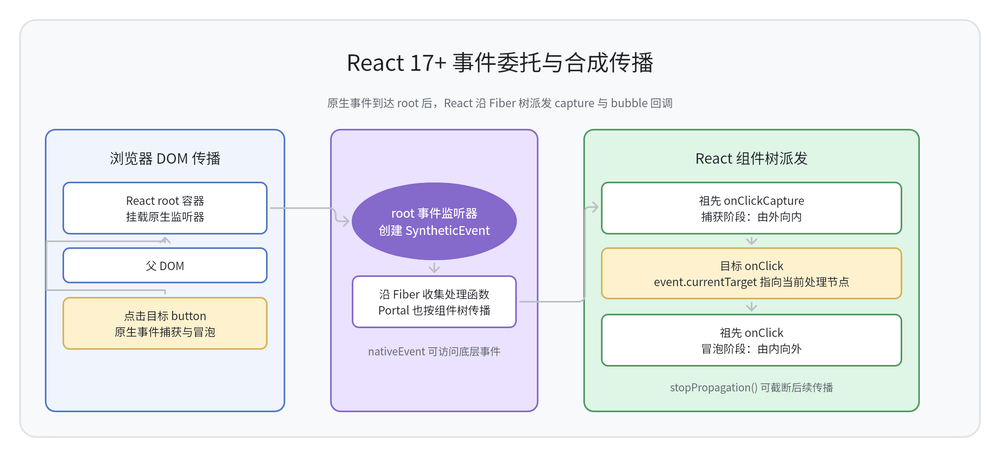
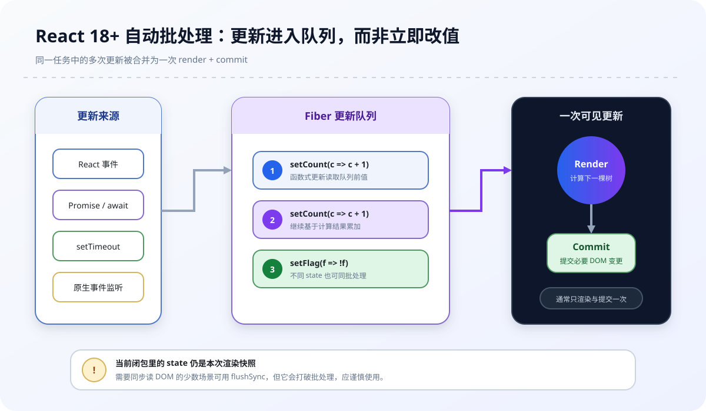
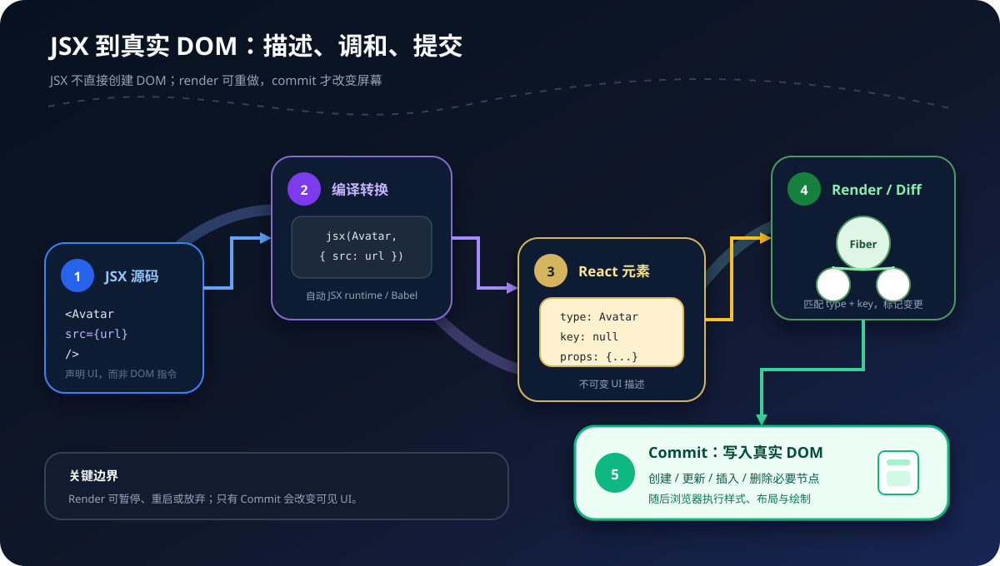
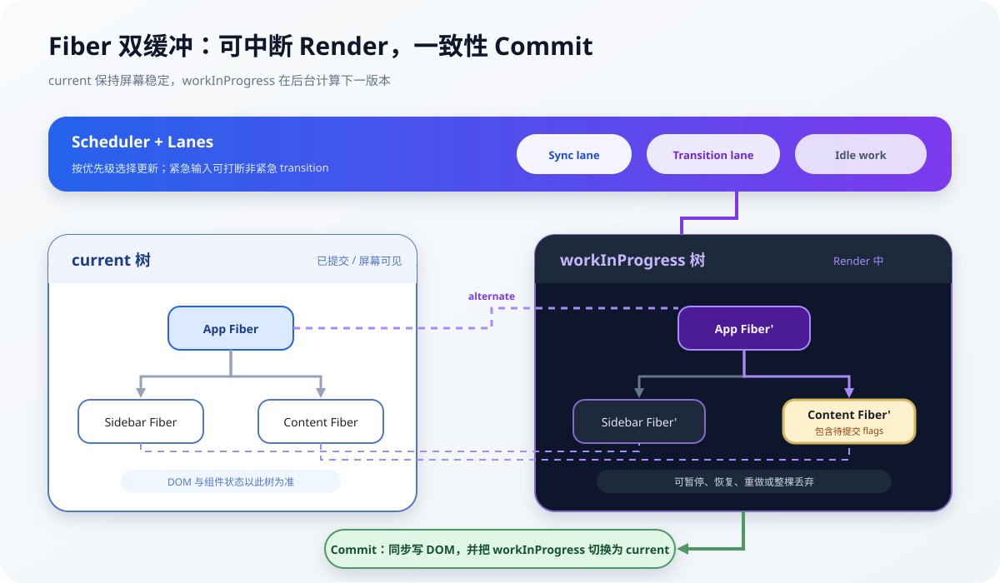
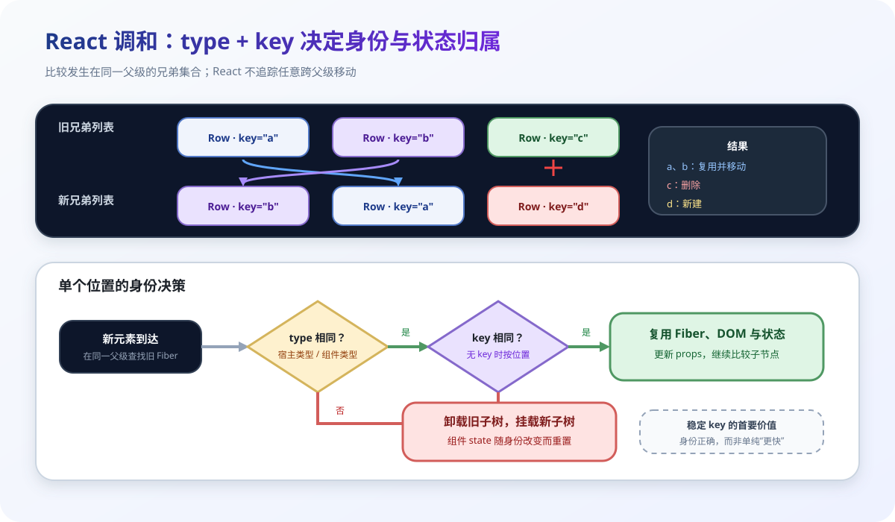
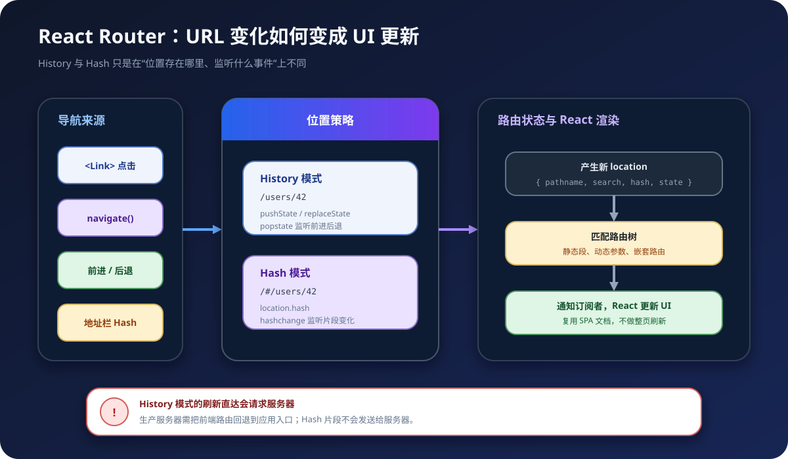
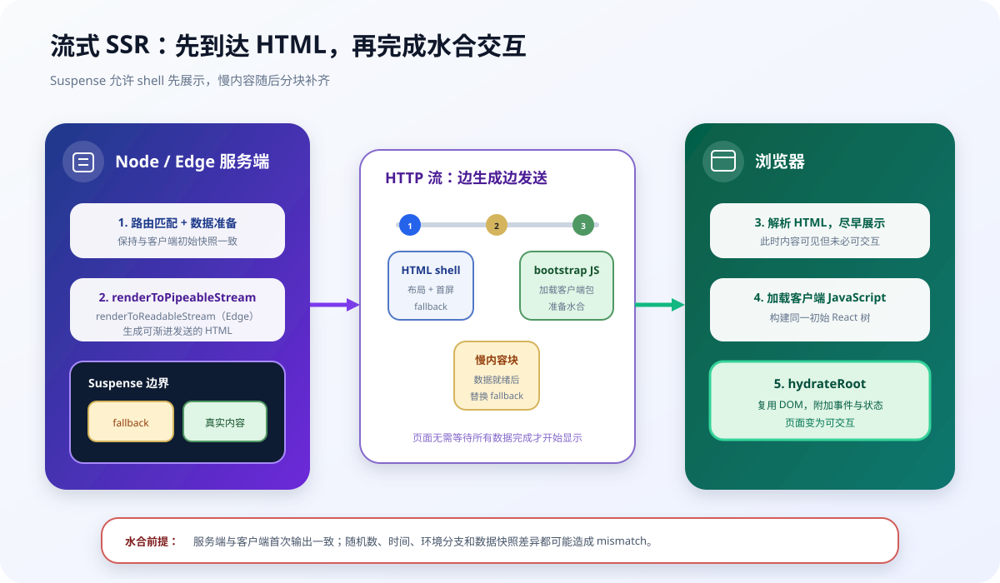

## 1. 说说对 React 的理解？有哪些特性?

### 回答重点

React 是用于构建用户界面的 JavaScript 库。它负责把状态声明为 UI，并通过组件组合、调和与渲染器把声明落实到浏览器 DOM 或其他宿主环境。React 本身不等于完整应用框架，路由、数据获取和工程约束通常由 React 生态或 Next.js 等框架补足。

现代 React 以函数组件为主。组件接收 `props`，读取自身状态并返回 React 节点；状态更新后，React 会重新计算相关组件的输出，再把必要变更提交到宿主环境。

```jsx
import { createRoot } from 'react-dom/client';

function Greeting({ name }) {
  return <h1>Hello, {name}</h1>;
}

createRoot(document.getElementById('root')).render(
  <Greeting name="Taylor" />,
);
```

### 核心特性

- **声明式**：描述某个状态下 UI 应该是什么，而不是逐条命令式修改 DOM。
- **组件化**：把界面、交互和相关状态组织成可组合的组件。
- **单向数据流**：数据通常由父组件通过 `props` 向下传递，子组件通过回调表达事件。
- **JSX**：用接近 HTML 的语法描述 React 节点，构建时会转换为 JavaScript。
- **调和机制**：比较前后两次元素树，尽量复用已有组件状态和宿主节点。
- **多渲染器**：同一套组件模型可由 React DOM、React Native 等渲染器落到不同平台。
- **并发能力**：React 18+ 可为部分非紧急更新启用可中断渲染，但提交阶段仍保持一致性。

“Virtual DOM 一定比手写 DOM 快”不是 React 的保证。它首先提供的是声明式编程模型和可预测更新，性能来自批处理、调和、调度以及对宿主变更的集中提交。

## 2. state 和 props 有什么区别?

### Props：外部输入

`props` 是父组件传给子组件的只读输入。组件不能修改本次渲染收到的 `props`；需要变化时，应由数据拥有者产生新值，再触发一次渲染。

```jsx
function Welcome({ name, onRename }) {
  return <button onClick={() => onRename('Ada')}>Hello, {name}</button>;
}
```

### State：组件记忆

`state` 属于某个组件实例在树中当前位置的内部状态。函数组件用 Hook 更新状态，类组件用 `setState` 更新状态。状态在一次渲染中是快照，调用更新函数只会把下一次渲染排入队列，不会改写当前闭包里的值。

```jsx
import { useState } from 'react';

function Counter() {
  const [count, setCount] = useState(0);

  return (
    <button onClick={() => setCount((value) => value + 1)}>
      {count}
    </button>
  );
}
```

### 核心区别

| 维度 | props | state |
| --- | --- | --- |
| 来源 | 父组件或调用方 | 组件自身 |
| 是否可直接修改 | 不可修改 | 通过更新 API 提交新值 |
| 作用 | 配置组件、传递数据和回调 | 记录随交互变化的数据 |
| 更新影响 | 父组件传入新值后可能重渲染 | 更新所属组件并默认继续渲染其后代 |

二者都不是“可随意改写的普通对象”。保持不可变更新有助于 React 通过引用比较判断变化，也能避免当前渲染快照被外部突变。

## 3. super() 和 super(props) 有什么区别?

### ES 类继承语义

派生类定义了 `constructor` 时，必须先调用 `super(...)` 才能访问 `this`。这是 JavaScript 类继承的规则，不是 React 特例。

```js
class Employee extends Person {
  constructor(name, role) {
    super(name);
    this.role = role;
  }
}
```

### React 类组件中的区别

React 类组件的构造函数通常写成：

```jsx
class Button extends React.Component {
  constructor(props) {
    super(props);
    this.state = { pressed: false };
  }

  render() {
    return <button>{this.props.label}</button>;
  }
}
```

- `super()` 会调用 `React.Component` 构造函数，但构造函数执行期间 `this.props` 不可依赖。
- `super(props)` 会把 `props` 传给父类，使构造函数中可以读取 `this.props`。
- 构造函数参数 `props` 本身在两种写法中都可读取。
- 构造完成后 React 会设置实例的 `props`，所以 `render` 中都能访问 `this.props`。

现代代码一般优先使用函数组件；只有维护类组件时才会遇到这个区别。

## 4. 说说对React中类组件和函数组件的理解？有什么区别?

### 两种组件模型

函数组件是接收 `props` 并返回 React 节点的函数，可通过 Hooks 使用状态、上下文、ref 和副作用。

```jsx
function Welcome({ name }) {
  const [online, setOnline] = useState(false);
  return <p onClick={() => setOnline(true)}>{name}: {String(online)}</p>;
}
```

类组件继承 `React.Component`，通过实例字段、`this.state`、`setState` 和生命周期方法组织逻辑。

```jsx
class Welcome extends React.Component {
  state = { online: false };

  render() {
    return (
      <p onClick={() => this.setState({ online: true })}>
        {this.props.name}: {String(this.state.online)}
      </p>
    );
  }
}
```

### 核心区别

| 维度 | 函数组件 | 类组件 |
| --- | --- | --- |
| 状态与复用 | Hooks、自定义 Hook | `state`、生命周期、HOC/render props |
| 本次渲染数据 | 闭包捕获本次渲染快照 | 实例方法通常读取最新的 `this.props/state` |
| 副作用 | `useEffect`、`useLayoutEffect` | 生命周期方法 |
| `this` | 无 | 需要处理方法绑定 |
| 错误边界 | 普通函数组件不能直接实现 | 可用 `componentDidCatch` 实现 |

函数组件并非“无状态组件”，也不能简单说 `useEffect` 等于某个生命周期。Effect 表达的是“渲染结果与外部系统同步”，清理函数会在依赖变化后的下一次 Effect 前以及卸载时执行；开发环境 Strict Mode 还会额外执行一次建立与清理，以暴露不完整的副作用。

新代码通常优先函数组件和 Hooks。类组件仍受支持，错误边界和历史代码维护是常见使用场景。

## 5. 说说对受控组件和非受控组件的理解？应用场景?

### 受控组件

表单当前值由 React 状态决定，输入事件再把新值写回状态。`value` 与 `onChange` 应成对出现。

```jsx
function SearchBox() {
  const [query, setQuery] = useState('');

  return (
    <input
      value={query}
      onChange={(event) => setQuery(event.target.value)}
    />
  );
}
```

受控组件适合即时校验、联动、条件禁用、格式化和一个状态驱动多个视图。代价是每次输入都会触发状态更新，应避免把高频输入状态无必要地提升到很高层。

### 非受控组件

值由 DOM 保存，React 只设置初始值，需要时通过 ref 或表单提交读取。

```jsx
function ProfileForm() {
  const inputRef = useRef(null);

  function handleSubmit(event) {
    event.preventDefault();
    console.log(inputRef.current.value);
  }

  return (
    <form onSubmit={handleSubmit}>
      <input ref={inputRef} defaultValue="Ada" />
      <button type="submit">提交</button>
    </form>
  );
}
```

非受控组件适合提交时一次性取值、与非 React 表单库集成，以及文件输入。`<input type="file">` 的值不能由 React 设置，天然按非受控方式处理。

同一个输入在生命周期内不要从受控切换为非受控，或反向切换。受控 `value` 应始终是字符串等明确值，不要在 `undefined` 和字符串之间切换。

## 6. 说说React的事件机制?

### 合成事件与根容器委托

React 用 `SyntheticEvent` 提供与浏览器事件相近的接口，并在事件插件系统中统一收集和派发处理函数。React 17+ 的大多数可委托事件监听器挂在每个 React 根容器，而不是统一挂在 `document`；少数不能正常冒泡的事件会采用特殊处理。



事件发生后，浏览器先按原生捕获/冒泡规则传播。React 根监听器收到事件后，根据 Fiber 树收集目标到祖先的处理函数，再依次执行 `onClickCapture` 和 `onClick` 等回调。Portal 中的合成事件也按 React 组件树传播，不完全等同于 DOM 祖先关系。

```jsx
function Toolbar() {
  function handleClick(event) {
    console.log(event.target);
    console.log(event.currentTarget);
    console.log(event.nativeEvent);
  }

  return <button onClick={handleClick}>保存</button>;
}
```

### 与原生事件的关键差异

- JSX 事件名使用小驼峰，并传函数引用：`onClick={handleClick}`。
- `event.currentTarget` 是当前 React 处理函数对应的节点，`target` 是原始目标。
- `event.nativeEvent` 可访问底层原生事件，但不应依赖其具体映射实现。
- React 17 起合成事件不再池化，一般不需要调用历史上的 `event.persist()`。
- React 的 `onFocus`、`onBlur` 会冒泡；`onScroll` 在现代 React 中不冒泡。

### 阻止默认行为与传播

```jsx
function Link() {
  return (
    <a
      href="/danger"
      onClick={(event) => {
        event.preventDefault();
        event.stopPropagation();
      }}
    >
      拦截跳转
    </a>
  );
}
```

`stopPropagation()` 可以阻止后续合成事件传播，也会调用原生事件的传播控制。混用 React 监听器与手动 `addEventListener` 时，确切先后顺序受监听阶段、注册位置和注册顺序影响，不能套用“永远先原生、再 React、最后 document”的固定结论。

## 7. React事件绑定的方式有哪些？区别？

### 函数组件

函数组件没有 `this` 绑定问题，通常直接声明处理函数。

```jsx
function SaveButton() {
  function handleClick(event) {
    console.log(event.currentTarget);
  }

  return <button onClick={handleClick}>保存</button>;
}
```

只有需要把回调传给已做引用比较的子组件，并且分析确认引用变化造成了实际性能问题时，才考虑 `useCallback`。内联箭头函数本身通常不是性能瓶颈。

### 类组件的四种写法

```jsx
class Panel extends React.Component {
  constructor(props) {
    super(props);
    this.handleBound = this.handleBound.bind(this);
  }

  handleBound() {}

  handleField = () => {};

  render() {
    return (
      <>
        <button onClick={this.handleBound}>构造函数绑定</button>
        <button onClick={this.handleField}>类字段箭头函数</button>
        <button onClick={this.handleBound.bind(this)}>render 中 bind</button>
        <button onClick={(event) => this.handleBound(event)}>
          render 中箭头函数
        </button>
      </>
    );
  }
}
```

构造函数绑定和类字段箭头函数通常能保持实例生命周期内的函数引用稳定。后两种写法每次渲染都会创建新函数，但是否值得优化取决于它是否穿过 memo 边界或造成可测量开销，不能仅凭“创建函数”判定性能差。

## 8. React构建组件的方式有哪些？区别?

### 现代方式

现代 React 实际使用两种组件定义方式：

- **函数组件**：推荐用于新代码，可配合 Hooks 和自定义 Hook。
- **类组件**：用于历史代码、类生命周期或错误边界。

```jsx
function Clock({ time }) {
  return <time>{time}</time>;
}

class LegacyClock extends React.Component {
  render() {
    return <time>{this.props.time}</time>;
  }
}
```

### 历史方式

`React.createClass` 是早期 API，React 15.5 已弃用，React 16 核心包中已移除。它不会由 Babel 把函数组件自动转换出来；Babel 转换的是 JSX，例如把 `<div />` 转为 `jsx(...)` 或旧转换下的 `React.createElement(...)`。

因此面试回答可以说明“三种历史写法”，但工程选型不应继续把 `createClass` 当成可选方案。函数组件也不再等同于“无状态组件”。

## 9. 说说React中引入CSS的方式有哪几种？区别?

### 常见方案

1. **普通 CSS**：通过 `import './page.css'` 引入，规则默认是全局的，适合全局基础样式和设计令牌。
2. **CSS Modules**：使用 `*.module.css`，构建工具为类名生成局部作用域标识，适合组件样式。
3. **内联样式**：`style={{ color, width: 100 }}`，适合依赖运行时数据的少量样式，不支持伪类、媒体查询和关键帧。
4. **CSS-in-JS**：由 styled-components、Emotion 等库提供，可绑定运行时 props，但要评估运行时开销、SSR 和缓存策略。
5. **原子化/实用类 CSS**：例如 Tailwind CSS，通过组合类完成样式，便于约束设计系统，但类名会更密集。

### 示例

```jsx
import styles from './button.module.css';

function Button({ active }) {
  return (
    <button
      className={styles.button}
      style={{ opacity: active ? 1 : 0.6 }}
    >
      保存
    </button>
  );
}
```

```css
.button {
  border-radius: 0.5rem;
}

.button:hover {
  transform: translateY(-1px);
}
```

CSS Modules 限定的是类名标识，不是“样式绝不会影响后代”。如果模块规则写了 `.button span`，仍会命中该按钮中的后代 `span`。类名包含短横线也不是禁用项，可用 `styles['primary-button']` 访问；实践中常用驼峰类名改善调用体验。

选型取决于作用域、动态程度、SSR、主题能力和团队约束，没有 React 官方唯一方案。

## 10. React 生命周期有哪些不同阶段？每个阶段应该做些什么？

### 类组件生命周期

类组件可以按挂载、更新、卸载和错误处理理解：

| 阶段 | 方法 | 适合做什么 |
| --- | --- | --- |
| 挂载 | `constructor` | 初始化 state、绑定实例方法 |
| 挂载/更新 | `getDerivedStateFromProps` | 极少数由 props 派生 state 的场景 |
| 渲染 | `render` | 纯计算 React 节点，不做副作用 |
| 提交后 | `componentDidMount` | 订阅、请求、操作 DOM |
| 更新前判断 | `shouldComponentUpdate` | 性能优化，不用于保证正确性 |
| DOM 变更前 | `getSnapshotBeforeUpdate` | 读取滚动位置等提交前快照 |
| 更新提交后 | `componentDidUpdate` | 根据前后值同步外部系统 |
| 卸载 | `componentWillUnmount` | 取消订阅、计时器和资源 |
| 错误 | `getDerivedStateFromError`、`componentDidCatch` | 展示降级 UI、上报错误 |

`UNSAFE_componentWillMount`、`UNSAFE_componentWillReceiveProps`、`UNSAFE_componentWillUpdate` 不应在新代码使用。并发渲染下 render 阶段可能重启或放弃，所以 render 和 render 前生命周期必须保持纯净。

### 函数组件的对应心智

函数组件没有一一对应的生命周期方法。组件函数负责渲染，Effect 负责把已提交的 UI 与外部系统同步：

```jsx
function ChatRoom({ roomId }) {
  useEffect(() => {
    const connection = connect(roomId);
    connection.open();

    return () => connection.close();
  }, [roomId]);

  return <section>Room: {roomId}</section>;
}
```

`useLayoutEffect` 在 DOM 提交后、浏览器绘制前同步执行，只用于必须测量并立即调整布局的场景；普通订阅、网络同步优先 `useEffect`。

## 11. React中组件之间如何通信?

### 常用方式

- **父传子**：通过 props 传值。
- **子传父**：父组件传回调，子组件调用回调上报事件。
- **兄弟组件**：把共享状态提升到最近公共父组件。
- **跨层级**：用 Context 传递主题、认证、语言等树级数据。
- **外部状态**：复杂跨页面状态可用 Redux、Zustand 等；外部 store 与并发 React 集成应基于 `useSyncExternalStore`。
- **命令式能力**：少数聚焦、滚动、播放等能力通过 ref 暴露，不作为普通数据流替代品。

```jsx
function Parent() {
  const [value, setValue] = useState('');

  return (
    <>
      <Editor value={value} onChange={setValue} />
      <Preview value={value} />
    </>
  );
}
```

Context 会让读取该 Context 的组件在 `value` 变化时更新。不要把每次渲染都新建的大对象无条件放进 Provider；也不要因为避免“逐层传 props”就把所有局部状态全局化。

## 12. 说说对高阶组件的理解？应用场景？

### 定义

高阶组件（HOC）是接收组件并返回新组件的函数：

```jsx
function withPermission(WrappedComponent) {
  function WithPermission(props) {
    const allowed = usePermission(props.permission);

    if (!allowed) return <p>无权限</p>;
    return <WrappedComponent {...props} />;
  }

  WithPermission.displayName = `withPermission(${
    WrappedComponent.displayName ?? WrappedComponent.name ?? 'Component'
  })`;

  return WithPermission;
}
```

HOC 用于权限、埋点、兼容旧库等横切逻辑。现代函数组件中，可复用状态逻辑通常优先自定义 Hook；HOC 仍适合需要改变组件边界或适配类组件的场景。

### 使用约束

- 不修改传入组件，也不要通过继承它来注入行为，优先组合。
- 透传与 HOC 无关的 props。
- 不要在 render 内创建 HOC，否则每次都会得到新的组件类型并导致子树重置。
- 注意静态属性不会自动复制，可按需 hoist。
- ref 不是普通 props。React 18 及以前需要 `forwardRef` 转发；React 19 函数组件可把 `ref` 作为 prop 接收，但仍应把 ref 契约设计清楚。

## 13. 在React中组件间过渡动画如何实现?

### 实现层次

1. 元素持续存在、只改变样式时，用 CSS `transition` 或 `animation`。
2. 元素需要进场和离场时，要在离场动画结束前保留节点，可用 React Transition Group、Motion 等库管理状态。
3. 列表动画必须使用稳定 key，避免用索引让动画和数据身份错位。
4. 尊重 `prefers-reduced-motion`，为减少动态效果的用户关闭非必要动画。

### React Transition Group 示例

```jsx
import { useRef, useState } from 'react';
import { CSSTransition } from 'react-transition-group';

function Notice() {
  const [visible, setVisible] = useState(true);
  const nodeRef = useRef(null);

  return (
    <>
      <CSSTransition
        in={visible}
        nodeRef={nodeRef}
        timeout={200}
        classNames="fade"
        unmountOnExit
      >
        <div ref={nodeRef}>保存成功</div>
      </CSSTransition>
      <button onClick={() => setVisible((value) => !value)}>切换</button>
    </>
  );
}
```

```css
.fade-enter,
.fade-exit-active {
  opacity: 0;
  transform: translateY(0.5rem);
}

.fade-enter-active,
.fade-exit {
  opacity: 1;
  transform: translateY(0);
}

.fade-enter-active,
.fade-exit-active {
  transition: opacity 200ms, transform 200ms;
}

@media (prefers-reduced-motion: reduce) {
  .fade-enter-active,
  .fade-exit-active {
    transition: none;
  }
}
```

`SwitchTransition` 用于两个互斥视图按 `out-in` 或 `in-out` 切换，`TransitionGroup` 用于管理一组带稳定 key 的进出场节点。`nodeRef` 可避免依赖已不推荐的 `findDOMNode`。

## 14. 说说你在React项目是如何捕获错误的?

### 错误边界

错误边界能捕获其后代组件在渲染、构造函数和生命周期中抛出的错误，展示降级 UI，并在 `componentDidCatch` 中上报。

```jsx
class ErrorBoundary extends React.Component {
  state = { error: null };

  static getDerivedStateFromError(error) {
    return { error };
  }

  componentDidCatch(error, info) {
    sendErrorToMonitoring(error, info.componentStack);
  }

  render() {
    if (this.state.error) {
      return <Fallback onRetry={() => this.setState({ error: null })} />;
    }
    return this.props.children;
  }
}
```

应按页面、路由或关键模块布置边界，而不是只在最外层放一个边界导致任何局部错误都清空整页。

### 捕获不到的范围

错误边界不会捕获：

- 事件处理函数中的错误；
- `setTimeout`、Promise 回调等边界之外的异步错误；
- 服务端渲染期间的错误；
- 错误边界自身渲染时抛出的错误。

事件和主动异步流程使用 `try/catch`，网络请求要显式处理拒绝；SSR 在服务端日志和流式渲染回调中处理。`window.error` 与 `unhandledrejection` 可作为最后的观测补充，不能替代局部错误处理。现代根 API 还提供 `onCaughtError`、`onUncaughtError`、`onRecoverableError` 等观测入口，是否可用取决于 React 版本。

## 15. 说说对React refs 的理解？应用场景?

### 定义与创建

ref 是 React 提供的命令式逃生口，用于保存跨渲染值或访问提交后的 DOM/组件句柄。改变 `ref.current` 不会触发渲染。

```jsx
function SearchInput() {
  const inputRef = useRef(null);

  return (
    <>
      <input ref={inputRef} />
      <button onClick={() => inputRef.current?.focus()}>聚焦</button>
    </>
  );
}
```

类组件使用 `createRef`，也可以使用回调 ref。字符串 ref 是遗留 API，不应继续使用。

### 适用场景

- 聚焦、文本选择、滚动和尺寸测量；
- 媒体播放、Canvas、WebGL；
- 集成第三方 DOM 库；
- 保存定时器 ID 等不参与渲染的数据；
- 用 `useImperativeHandle` 暴露最小命令式接口。

不要在 render 中读取或写入 `ref.current` 来驱动视图，因为 render 应保持纯净。能由 props 和 state 表达的 UI 不要改用 ref。

React 18 及以前，函数组件接收 ref 通常需要 `forwardRef`；React 19 支持把 `ref` 作为函数组件的 prop。无论版本如何，都应暴露稳定且最小的句柄，而不是泄露整个内部 DOM 结构。

## 16. 说说 React中的setState执行机制

### 状态是快照，更新进入队列

`setState` 和 Hook 的 state setter 都是“请求一次更新”，不是立即改写当前渲染中的变量。React 给更新标记优先级，把它加入对应 Fiber 的更新队列，再在合适时机执行 render 和 commit。



```jsx
function Counter() {
  const [count, setCount] = useState(0);

  function addThree() {
    setCount((value) => value + 1);
    setCount((value) => value + 1);
    setCount((value) => value + 1);
  }

  return <button onClick={addThree}>{count}</button>;
}
```

函数式更新器按队列依次接收前一次计算结果，所以示例会加 3。若连续执行 `setCount(count + 1)`，三次都读取同一个渲染快照，最终通常只得到加 1 的结果。

### 类组件与函数组件差异

- 类组件 `this.setState({ count: 1 })` 会浅合并对象；函数式写法适合依赖前值。
- Hook setter 会替换该 state 值，不会自动合并对象。
- 类组件 `setState` 可接收提交后的回调；函数组件用 Effect 响应已提交状态，不支持 setter 回调参数。

```jsx
this.setState(
  (state) => ({ count: state.count + 1 }),
  () => console.log(this.state.count),
);
```

### React 18 自动批处理

使用 `createRoot` 时，React 18+ 会自动批处理同一任务中的多次更新，包括 React 事件、Promise、`setTimeout` 和原生事件监听器中的更新。旧版“合成事件中异步、定时器和原生事件中同步”的结论只适用于旧根和旧版本，不能作为现代语义。

批处理不等于返回 Promise，也不保证能在 setter 下一行读到新值。确实必须同步提交 DOM 的少数集成场景可用 `flushSync`，但它会破坏批处理并影响性能，应谨慎使用。

## 17. 说说React render方法的原理？在什么时候会被触发?

### Render 与 Commit

React 更新可分为三个步骤：

1. **Trigger**：初次 `root.render`、状态更新、Context 变化等触发工作。
2. **Render**：React 调用函数组件或类组件的 `render`，递归计算下一棵元素/Fiber 树并标记变更。
3. **Commit**：把必要宿主变更写入 DOM，更新 ref，运行布局 Effect；浏览器绘制后再运行普通 Effect。

render 是计算阶段，不等于“已经更新 DOM”。并发渲染中它可能暂停、重启或被放弃，因此组件函数和类组件 `render` 必须保持纯净。

### 常见触发条件

- 初次挂载；
- 组件自身状态更新；
- 父组件重渲染时，默认继续渲染其子组件；
- 组件读取的 Context 值变化；
- 外部 store 订阅通知变化。

`React.memo`、`PureComponent`、`shouldComponentUpdate` 可跳过部分重渲染。Hook setter 传入与当前值 `Object.is` 相等的值时，React 通常会跳过后代更新；实现上仍可能为确认结果调用一次组件。类组件普通 `setState` 没有同样的值级自动保证。

即使组件执行了 render，只要输出与上次相同，commit 也可能不改 DOM。“组件重渲染”和“浏览器 DOM 更新”是两个不同概念。

## 18. 说说 Real DOM 和 Virtual DOM 的区别？优缺点?

### 两者分别是什么

真实 DOM 是浏览器维护的文档对象树，DOM 节点带有布局、事件、可访问性等浏览器能力。React 元素是描述 UI 的不可变 JavaScript 值，Fiber 则是 React 在调和过程中维护的工作数据结构；二者常被宽泛称为 Virtual DOM，但不能完全混为一谈。

```jsx
const element = <h1 className="title">Hello</h1>;
```

JSX 创建的是描述，不会立即创建 `<h1>` DOM。React 渲染并提交后，React DOM 才调用宿主 DOM API。

### 优缺点

Virtual DOM/调和的价值：

- 用声明式结果代替分散的命令式 DOM 操作；
- 批量计算变更并集中提交；
- 通过组件类型与 key 尽量复用 DOM 和组件状态；
- 把组件模型与具体渲染平台解耦。

代价：

- 需要额外的元素创建、Fiber 管理和比较；
- 大树重渲染仍可能占用 CPU 和内存；
- 针对单一场景精心编写的命令式 DOM 可能更快。

浏览器不会因为每次 DOM API 调用都必然立刻完成一次完整重排；它本身也会延迟和批量处理样式、布局。React 的性能优势不能简化成“十次 DOM 操作合成一次 attach”，应结合批处理、读写顺序和实际 Profiling 判断。

## 19. 说说React Jsx转换成真实DOM过程?

### 从 JSX 到提交

JSX 先由编译器转换为 JavaScript。现代自动 JSX 转换通常调用 `react/jsx-runtime` 的 `jsx`/`jsxs`；旧转换调用 `React.createElement`。两者都先产生 React 元素描述，不直接创建 DOM。



```jsx
function Avatar({ src }) {
  return ;
}
```

概念上会变成：

```js
import { jsx as _jsx } from 'react/jsx-runtime';

function Avatar({ src }) {
  return _jsx('img', {
    className: 'avatar',
    src,
    alt: '用户头像',
  });
}
```

### 完整流程

1. 编译 JSX，生成创建 React 元素的 JavaScript。
2. 执行组件，得到由 `type`、`key`、`props` 等组成的 React 元素树。
3. Reconciler 基于元素类型和 key，把新元素与当前 Fiber 树匹配，构建 work-in-progress Fiber 树并标记变更。
4. Host Config 把通用变更映射为 React DOM 的节点创建、属性更新、插入和删除。
5. Commit 阶段一次性提交本轮必要变更，更新 ref 和 Effect。
6. 浏览器随后执行样式计算、布局与绘制。

小写 JSX 标签会编译为 `'div'` 这类宿主类型；大写标签会编译为变量引用，例如 `Avatar` 函数本身，而不是笼统的“对象”。在 React 18+，客户端入口使用 `createRoot(...).render(...)`；SSR 页面使用 `hydrateRoot(...)` 复用服务端 HTML。

## 20. 说说对Fiber架构的理解？解决了什么问题?

### Fiber 是什么

Fiber 同时表示一种可拆分的工作单元和 React 内部节点数据结构。每个 Fiber 记录组件类型、key、props、state、更新队列、优先级、flags，以及 `return`、`child`、`sibling` 等指针。



React 通常维护两棵通过 `alternate` 关联的树：

- `current`：当前屏幕对应的已提交树；
- `workInProgress`：本次 render 正在构建的树。

render 成功后，React 在 commit 阶段切换 current 指针。若低优先级 render 被更紧急更新打断，未提交的工作可以继续、重做或丢弃，而屏幕仍保持上一次已提交的一致 UI。

### 解决的问题

React 15 的 Stack Reconciler 递归工作一旦开始便难以让出主线程。Fiber 把遍历改造成可逐单元执行的链式过程，并配合 Scheduler 与 lanes：

- 为更新表达优先级；
- 在并发更新中暂停和恢复 render；
- 丢弃已经过时的渲染结果；
- 让输入等紧急更新优先于非紧急 transition；
- 在提交前不触碰可见 DOM，保证 UI 一致。

Fiber 的时间切片不是简单调用浏览器 `requestIdleCallback`。React 有自己的 Scheduler，在不同环境使用适当的任务调度机制；`requestIdleCallback` 也不是 React 并发语义的公共保证。commit 阶段包含 DOM 变更和布局 Effect，仍是不可随意中断的同步过程。

## 21. React中的key有什么作用?

### key 表示同级身份

`key` 帮助 React 在同一父节点的兄弟列表中识别“哪个元素还是原来的元素”。它和元素类型共同决定 Fiber 能否复用，从而影响 DOM 复用和组件状态是否保留。

```jsx
function TodoList({ todos }) {
  return (
    <ul>
      {todos.map((todo) => (
        <TodoItem key={todo.id} todo={todo} />
      ))}
    </ul>
  );
}
```

key 只需在当前兄弟集合中唯一，不会作为普通 prop 传给组件。组件需要 ID 时应另传 `id={todo.id}`。

### 使用原则

- 使用来自数据的稳定 ID。
- 不要在 render 中生成随机 key，否则每次都会卸载旧组件并挂载新组件。
- 列表会插入、删除或重排时不要使用索引 key，否则状态可能跟着位置而不是数据移动。
- 仅当列表静态、无重排且条目没有稳定 ID 时，索引 key 才是可接受退路。

改变 key 也可以有意重置组件状态，例如 `<Form key={userId} />`。因此 key 的第一含义是身份与状态归属，不只是“消除警告”或单纯性能优化。

## 22. 说说React diff的原理是什么？

### 调和假设

通用树编辑距离可能达到较高复杂度。React 采用面向 UI 的启发式调和，在常见情况下近似线性遍历：

1. 不同元素类型通常产生不同子树，旧子树会卸载，新子树会挂载。
2. 相同宿主类型复用 DOM 节点并更新属性。
3. 相同组件类型复用对应 Fiber 和状态，再比较其输出。
4. 同级列表通过 key 匹配身份；React 不尝试任意跨父级追踪移动。



### 列表比较

React 先按顺序匹配可直接复用的节点；出现不一致后，会借助 key 查找剩余旧节点，标记插入、移动和删除。是否真的操作 DOM 取决于最终 flags，而不是“执行 render 就重建全部 DOM”。

```jsx
// 交换后，React 可通过 key 识别 a 和 b 仍是原来的条目。
const before = [
  <Row key="a" />,
  <Row key="b" />,
];

const after = [
  <Row key="b" />,
  <Row key="a" />,
];
```

没有 key 时 React 主要按位置匹配。对纯文本列表，这有时看似只需改文本；但含输入框、本地状态或动画时，状态会错误地留在位置上。不能据此得出“不加 key 性能更好”的工程结论。

### 状态保留规则

状态与组件在渲染树中的身份绑定。相同父级位置、相同类型、相同 key 通常保留状态；类型或 key 改变会重置该子树。Fragment 在列表中也需要 key，可使用显式 `<Fragment key={id}>`。

## 23. 说说对React Hooks的理解？解决了什么问题?

### Hooks 的价值

Hooks 从 React 16.8 起让函数组件使用状态和其他 React 能力，并通过自定义 Hook 复用“带状态的逻辑”，无需改变组件层级。它主要解决：

- 生命周期方法按阶段拆散同一业务逻辑；
- mixin、HOC、render props 容易增加嵌套或命名冲突；
- 类组件的实例与 `this` 增加理解和工具优化成本；
- 状态逻辑难以提取和组合。

常用 Hook 包括 `useState`、`useReducer`、`useEffect`、`useLayoutEffect`、`useMemo`、`useCallback`、`useRef`、`useContext`、`useTransition` 和 `useDeferredValue`。

### 自定义 Hook

```jsx
function useOnlineStatus() {
  const [online, setOnline] = useState(navigator.onLine);

  useEffect(() => {
    const update = () => setOnline(navigator.onLine);
    window.addEventListener('online', update);
    window.addEventListener('offline', update);

    return () => {
      window.removeEventListener('online', update);
      window.removeEventListener('offline', update);
    };
  }, []);

  return online;
}
```

每次调用自定义 Hook 都拥有独立状态；复用的是逻辑，不是同一份 state。要共享 state，仍需提升状态、Context 或外部 store。

### Hooks 规则

- 只在组件或自定义 Hook 顶层调用，不放在普通条件、循环或嵌套函数中。
- 只从 React 函数组件或自定义 Hook 调用。
- Effect 的依赖应包含其读取的响应式值，不通过关闭 ESLint 规则掩盖陈旧闭包。
- `useMemo` 和 `useCallback` 是性能提示，不应承担业务正确性。

Hooks 依靠稳定调用顺序把每次调用映射到 Fiber 上对应的 Hook 链，因此条件调用会使后续状态错位。

## 24. 如何提高组件的渲染效率？在 React 中如何避免不必要的 render？

### 先定位再优化

先用 React DevTools Profiler、浏览器 Performance 面板和业务指标确认慢在哪里。重渲染本身不一定慢，真正成本可能是组件计算、DOM 提交、布局、绘制或网络。

### 常见手段

- 把高频局部状态放在真正使用它的最低公共祖先，避免整页跟着输入变化。
- 拆分组件，让稳定区域可以独立跳过渲染。
- 类组件使用 `PureComponent` 或有针对性的 `shouldComponentUpdate`。
- 函数组件使用 `React.memo` 跳过 props 浅比较相等的渲染。
- 只有在跨 memo 边界或计算确实昂贵时使用 `useMemo`、`useCallback`。
- 保持不可变更新和稳定 key，避免破坏浅比较与状态复用。
- 读取 Context 的大组件可拆成较小消费者，或按变化频率拆分 Context。
- 外部 store 使用细粒度 selector，避免订阅整个大对象。

```jsx
const ResultList = memo(function ResultList({ items, onSelect }) {
  return items.map((item) => (
    <button key={item.id} onClick={() => onSelect(item.id)}>
      {item.name}
    </button>
  ));
});
```

自定义 `memo` 比较函数必须比较所有会影响输出的 props，包括函数闭包；深比较可能比重渲染更贵。启用 React Compiler 的项目可由编译器自动完成一部分 memoization，但仍应以当前工具链和 Profiling 结果为准。

## 25. 说说 React 性能优化的手段有哪些?

### 按层次回答

**测量与渲染层**

- 用 Profiler 找出高耗时提交和重复渲染。
- 状态就近放置，拆分组件，按需使用 `memo`/`useMemo`/`useCallback`。
- 长列表使用窗口化，只渲染可视区域。
- 大量非紧急结果更新可用 `startTransition`/`useTransition`，输入展示保持紧急。
- 避免 render 中执行副作用或重复构造超大数据。

**DOM 与浏览器层**

- 减少会触发布局抖动的交错读写。
- 图片设置尺寸并按需懒加载，控制大图和字体成本。
- 动画优先使用 `transform`、`opacity`，并尊重减少动画偏好。

**网络与工程层**

- 通过路由和组件级动态导入拆包，结合 `lazy` 与 `Suspense`。
- 对静态资源使用压缩、缓存、预加载和 CDN。
- 避免重复请求，使用合适的数据缓存与预取策略。
- SSR/SSG/流式 SSR 可改善首屏内容到达时间，但会增加服务端成本，不是所有页面都适合。

### 常见误区

- 内联函数不是天然性能问题，只有引用变化穿过优化边界并造成实际重渲染时才需要处理。
- Fragment 的主要作用是避免无语义包裹节点，不会自动让应用显著变快。
- memoization 会增加比较、缓存和复杂度，不应全量套用。
- 并发特性改善的是调度和交互响应，不会减少总计算量。

性能优化目标应落到 INP、LCP、内存、提交耗时等可测指标，而不是只追求“render 次数最少”。

## 26. 说说你对React Router的理解？常用的Router组件有哪些?

### React Router 的作用

React Router 把当前位置映射为 React UI，并提供导航、嵌套路由、参数、数据加载和表单操作能力。URL 变化后由路由器更新状态，React 再渲染匹配分支，通常不进行整页刷新。

现代 React Router 可按三种使用层次理解：

- **Declarative 模式**：`BrowserRouter` + `Routes`/`Route`。
- **Data 模式**：`createBrowserRouter` + `RouterProvider`，支持 loader、action、pending UI 等。
- **Framework 模式**：在 React Router 框架约定下提供类型安全路由、代码拆分和渲染策略。

### 常用组件与 Hooks

- 路由器：`BrowserRouter`、`HashRouter`、`MemoryRouter`、`RouterProvider`
- 匹配与布局：`Routes`、`Route`、`Outlet`
- 导航：`Link`、`NavLink`、`Navigate`
- 数据交互：`Form`、`Await`
- Hooks：`useNavigate`、`useLocation`、`useParams`、`useSearchParams`、`useNavigation`

```jsx
import {
  BrowserRouter,
  Link,
  Outlet,
  Route,
  Routes,
} from 'react-router-dom';

function Layout() {
  return (
    <>
      <nav><Link to="/users/42">用户</Link></nav>
      <Outlet />
    </>
  );
}

function App() {
  return (
    <BrowserRouter>
      <Routes>
        <Route element={<Layout />}>
          <Route path="users/:id" element={<User />} />
          <Route path="*" element={<NotFound />} />
        </Route>
      </Routes>
    </BrowserRouter>
  );
}
```

`Switch`、`Redirect`、`component`/`render` Route 属性、`useHistory`、`activeClassName` 属于 React Router v5 时代。现代 API 对应 `Routes`、`Navigate`、`element`、`useNavigate` 和 `NavLink` 的函数式 `className`/`style`。

## 27. 说说React Router有几种模式？实现原理?

### URL 存储策略

浏览器端最常见的是两种 URL 策略：

- **History 模式**：路径形如 `/users/42`，使用 History API；URL 干净，但服务器必须把未知前端路由回退到应用入口。
- **Hash 模式**：路径形如 `/#/users/42`，片段不会随 HTTP 请求发送给服务器，静态托管配置简单，但 URL 带 `#`。

`MemoryRouter` 把历史栈保存在内存中，适合测试、Storybook 或没有地址栏的环境。



### 实现原理

History 路由通过 `history.pushState`/`replaceState` 修改地址而不刷新页面，并监听 `popstate` 处理浏览器前进后退。调用 `pushState` 本身不会触发 `popstate`，所以路由库会在执行导航时主动更新内部 location，再通知订阅者。

Hash 路由修改 `location.hash` 并监听 `hashchange`。两种方式都会把新的 location 交给路由匹配器，根据路由树、动态参数和嵌套关系得到匹配分支，最后由 React 更新 UI。

```js
window.addEventListener('popstate', () => {
  renderByLocation(window.location);
});

function navigate(path) {
  history.pushState(null, '', path);
  renderByLocation(window.location);
}
```

生产环境还要处理刷新直达、404 回退、basename、编码、滚动恢复和服务端渲染，不能只靠一个 `popstate` 示例代替完整路由器。

## 28. 你在React项目中是如何使用Redux的？项目结构是如何划分的?

### 现代 Redux 选型

新项目应使用 Redux Toolkit（RTK）编写 Redux 逻辑，使用 React-Redux Hooks 连接组件。`configureStore` 默认配置 thunk、开发期检查和 DevTools；`createSlice` 基于 Immer 生成 reducer 与 action。

```js
// app/store.js
import { configureStore } from '@reduxjs/toolkit';
import todosReducer from '../features/todos/todosSlice';

export const store = configureStore({
  reducer: {
    todos: todosReducer,
  },
});
```

```js
// features/todos/todosSlice.js
import { createSlice, nanoid } from '@reduxjs/toolkit';

const todosSlice = createSlice({
  name: 'todos',
  initialState: [],
  reducers: {
    todoAdded: {
      reducer(state, action) {
        state.push(action.payload);
      },
      prepare(text) {
        return { payload: { id: nanoid(), text, done: false } };
      },
    },
  },
});

export const { todoAdded } = todosSlice.actions;
export default todosSlice.reducer;
```

入口用 Provider 注入：

```jsx
createRoot(document.getElementById('root')).render(
  <Provider store={store}>
    <App />
  </Provider>,
);
```

组件通过 `useSelector` 订阅所需状态，通过 `useDispatch` 派发 action。`connect` 仍受支持，适合类组件或既有代码。

### 项目结构

推荐按业务 feature 聚合，而不是把所有 action、reducer、常量按类型散落：

```text
src/
  app/
    store.js
    hooks.js
  features/
    todos/
      todosSlice.js
      TodoList.jsx
      selectors.js
    users/
      usersSlice.js
      UserPage.jsx
  services/
    api.js
```

服务端缓存优先考虑 RTK Query 或专门的数据请求库，不要把所有请求结果和临时 UI 状态都无条件塞进 Redux。全局状态应是确实跨组件、需要可追踪或由多处协作修改的数据。

## 29. 如何理解 Redux 中间件？常用中间件有哪些？实现原理是什么？

### 中间件是什么

Redux 中间件包装 `dispatch`，位于“派发 action”和“action 到达 reducer”之间，可记录日志、执行异步逻辑、上报错误或响应特定 action。标准签名是三层柯里化函数：

```js
const logger = (store) => (next) => (action) => {
  console.log('before', store.getState());
  const result = next(action);
  console.log('after', store.getState());
  return result;
};
```

- `store` 提供 `getState` 和增强后的 `dispatch`。
- `next(action)` 把 action 交给链中的下一个中间件。
- `store.dispatch(action)` 会从完整中间件链入口重新开始，适合派发新 action，但误用可能递归。

### 常见中间件

- Redux Thunk：允许派发函数，函数接收 `dispatch`、`getState` 和可选 extra argument。
- RTK listener middleware：按 action 或状态变化运行响应式副作用。
- RTK Query middleware：管理请求生命周期、缓存失效和轮询。
- Redux Logger：开发期记录 action 与状态。
- Redux Saga：适合已有项目中复杂的长流程和取消语义，新项目不必默认引入。

`configureStore` 已包含 thunk。追加中间件时应保留默认中间件：

```js
const store = configureStore({
  reducer,
  middleware: (getDefaultMiddleware) =>
    getDefaultMiddleware().concat(logger),
});
```

### 组合原理

`applyMiddleware` 先让每个中间件拿到 middleware API，再通过 `compose` 从右到左包装原始 `store.dispatch`。若注册顺序是 `a, b, c`，请求方向为 `a -> b -> c -> reducer`，返回方向反过来。中间件必须调用并返回 `next(action)` 的结果，除非它有意吞掉或替换该 action。

## 30. 如何理解 immutable？如何应用在 React 项目中？

### 不可变更新

不可变不是“对象永远不能变”，而是更新时不修改当前版本，而是创建包含变化的新版本。未变化分支可继续共享引用，这叫结构共享。

```js
const nextUser = {
  ...user,
  profile: {
    ...user.profile,
    name: 'Ada',
  },
};
```

React 中不可变更新很重要，因为：

- 当前 render 读取的是稳定快照；
- 浅比较可通过引用快速判断变化；
- 历史状态、撤销和并发渲染不会被后续突变污染；
- memo、Redux selector 等优化依赖引用语义。

### 实践方式

- 对象使用展开语法，数组使用 `map`、`filter`、`concat` 等返回新数组的方法。
- 嵌套更新复杂时，可规范化 state，减少深层复制。
- Redux Toolkit 内置 Immer，可在 `createSlice` reducer 中写“看似可变”的语法，由 Immer 生成不可变结果。
- `Immutable.js` 提供持久化 `Map`、`List` 等结构，但有独立 API 和 JS 数据互转成本，现代 React 项目并非必须使用。

```js
const todosSlice = createSlice({
  name: 'todos',
  initialState: [],
  reducers: {
    toggled(state, action) {
      const todo = state.find((item) => item.id === action.payload);
      if (todo) todo.done = !todo.done;
    },
  },
});
```

这里直接赋值是合法的，因为只能在 Immer 管理的 reducer 草稿中这样写。普通 React state 仍不能直接 `state.user.name = ...` 后把同一对象传回 setter。

## 31. 说说React服务端渲染怎么做？原理是什么？

### SSR、流式输出与水合

SSR 在服务器上把 React 树渲染为 HTML，让浏览器在 JavaScript 下载前看到内容；客户端随后用 `hydrateRoot` 在已有 DOM 上建立 React 事件与状态能力，这个过程叫水合。



Node.js 中现代流式 API 是 `renderToPipeableStream`，Web Streams/Edge 环境使用 `renderToReadableStream`。`renderToString` 仍可用，但不能流式等待 Suspense 内容。

```jsx
// server.js
import { renderToPipeableStream } from 'react-dom/server';

app.use((request, response) => {
  const { pipe, abort } = renderToPipeableStream(
    <App url={request.url} />,
    {
      bootstrapScripts: ['/client.js'],
      onShellReady() {
        response.statusCode = 200;
        response.setHeader('content-type', 'text/html; charset=utf-8');
        pipe(response);
      },
      onShellError(error) {
        response.statusCode = 500;
        response.end('<h1>服务暂时不可用</h1>');
      },
      onError(error) {
        console.error(error);
      },
    },
  );

  setTimeout(abort, 10_000);
});
```

```jsx
// client.js
import { hydrateRoot } from 'react-dom/client';

hydrateRoot(document, <App url={window.location.pathname} />);
```

### 工作流程

1. 服务器根据 URL 匹配路由并准备首屏数据。
2. React 渲染 HTML shell；Suspense 边界允许先输出 fallback，再流式补齐慢内容。
3. 浏览器边接收边解析 HTML，可以在完整 JavaScript 到达前展示内容。
4. 客户端加载同一组件树与初始数据，`hydrateRoot` 复用现有 DOM 并附加交互。
5. 后续导航由客户端路由或框架策略处理。

服务端与客户端首次渲染结果必须一致。时间、随机数、浏览器专属 API、区域设置差异或数据快照不一致都可能导致 hydration mismatch。初始数据要安全序列化，避免把用户输入直接拼进脚本造成 XSS。

### 工程选择

生产项目通常使用 Next.js、React Router Framework Mode 等成熟方案处理构建、路由、数据、错误、代码拆分和缓存。SSR 可改善首屏与可抓取内容，但会增加服务器计算、缓存和水合成本；静态内容可选 SSG，强交互后台页面未必需要 SSR。

React Server Components 与 SSR 相关但不是同一概念：RSC 决定哪些组件只在服务端执行及其传输协议，SSR 决定如何把首屏 React 树输出为 HTML；框架可以组合二者。
