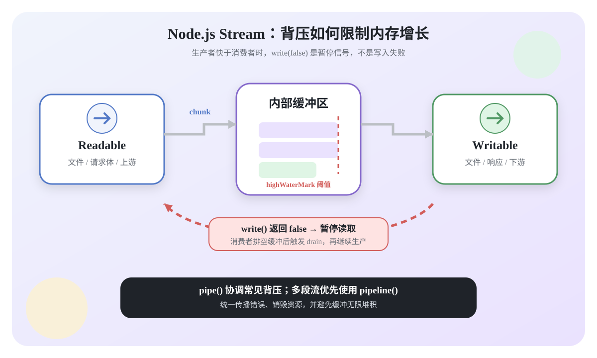
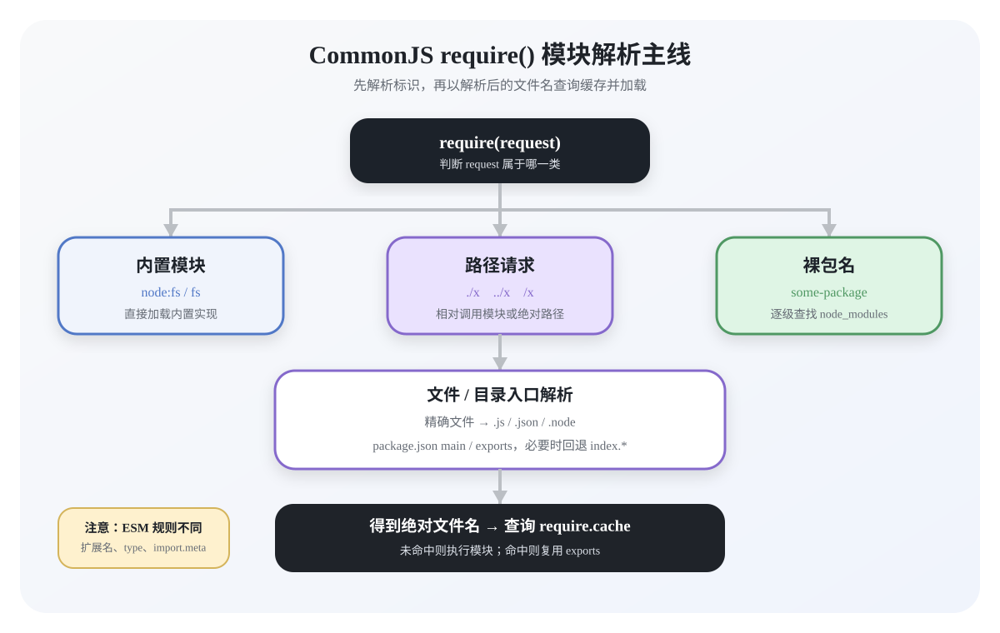
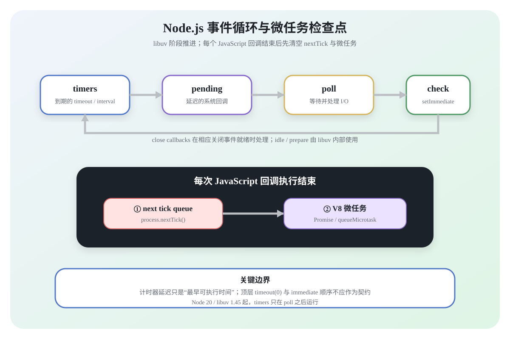
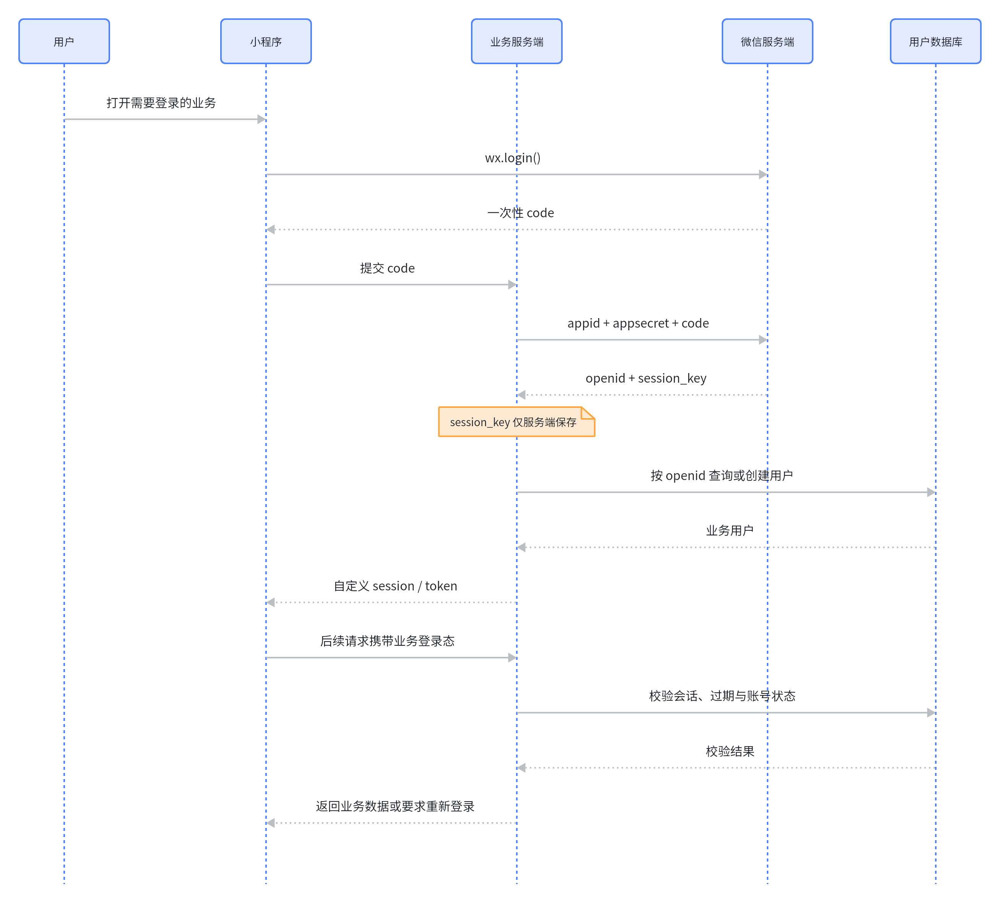
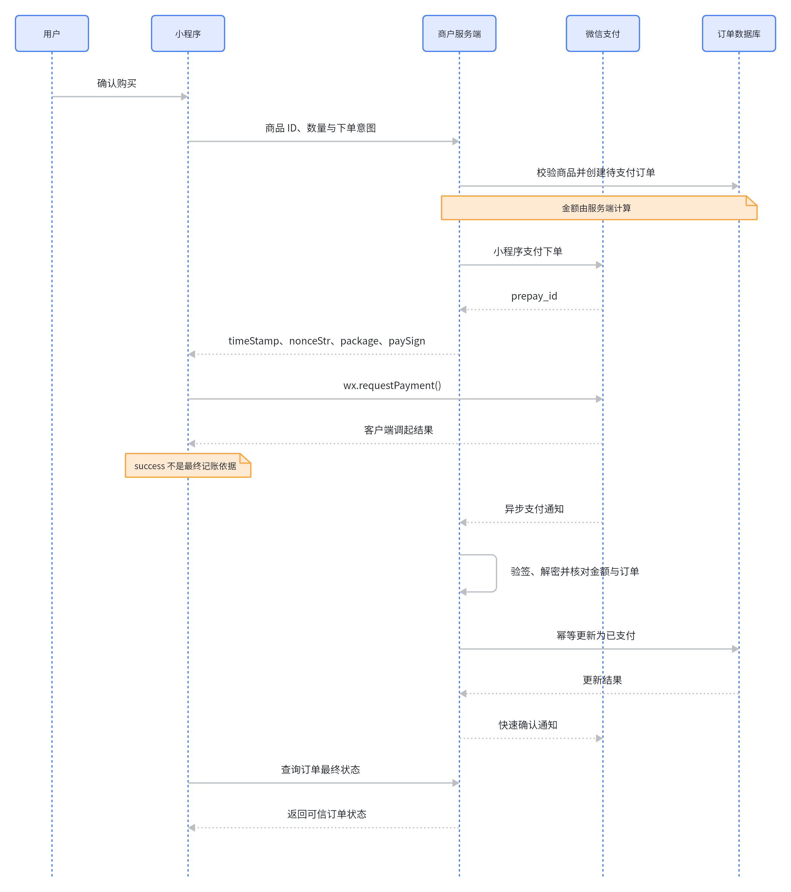
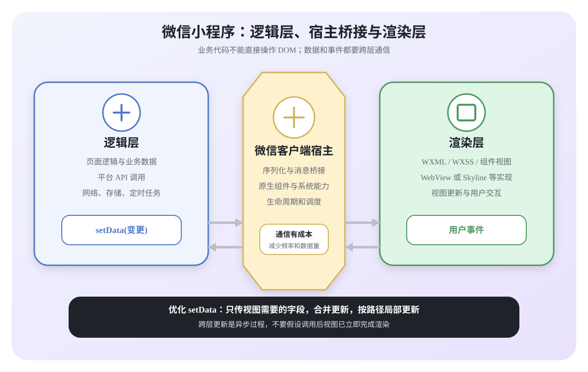
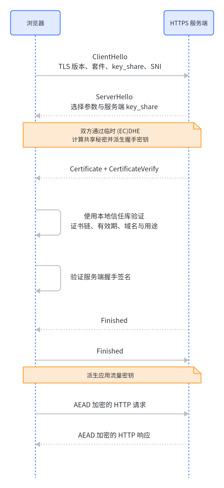
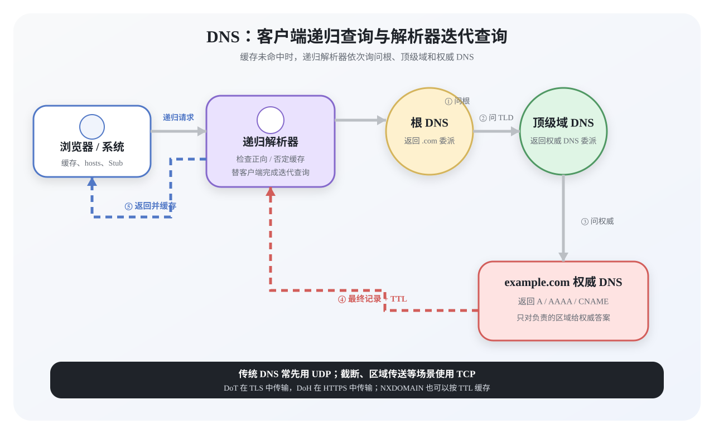

## 1. 说说你对Node.js的理解？优缺点？应用场景?

### 核心原理

Node.js 是一个开源、跨平台的 JavaScript 运行时。它在浏览器外运行 V8 引擎，并通过事件驱动、非阻塞 I/O 等机制构建网络应用、命令行工具和工程化工具。

JavaScript 回调默认在一个主线程上执行，但整个 Node.js 进程并非只有一个线程：网络 I/O 通常依赖操作系统事件通知，文件系统、部分 DNS 和加密任务可能使用 libuv 线程池。CPU 密集型任务还可以交给 `worker_threads`，多核扩展也可以采用多进程或容器副本。

**非阻塞异步**

Node.js 的异步 API 发起 I/O 后，不必让 JavaScript 主线程同步等待；操作完成后，回调会被事件循环调度。注意，同步 API 和长时间 JavaScript 计算仍会阻塞主线程。

例如，数据库查询发出后，主线程可以继续处理其他任务；结果就绪后，再执行回调或恢复等待该 Promise 的异步函数。

**事件驱动**

事件循环会处理计时器、I/O、`setImmediate` 和关闭事件等不同阶段的回调，不应简化成“所有请求都进入同一个事件队列”。

例如，文件读取完成后，Node.js 会在合适的事件循环时机执行对应回调。

### 优缺点

优点：

- 适合高并发、I/O 密集型应用，并能用 Stream 增量处理数据。
- 前后端可共享 JavaScript/TypeScript、类型和校验逻辑，npm 生态成熟。

缺点与边界：

- 长时间同步计算会阻塞同一进程内的其他请求，CPU 密集型工作需要 Worker 或独立服务。
- 单个进程默认只用一个 JavaScript 主线程，但不等于 Node.js 只能使用一个 CPU 核。
- 未处理异常或内存耗尽可能导致进程退出，生产环境需要错误边界、健康检查、优雅停机和进程守护。

### 应用场景

典型场景包括：

- BFF、API 网关、管理后台接口和 SSR 服务。
- WebSocket、SSE、流式代理等 I/O 密集型实时服务。
- CLI、构建工具、自动化脚本和 Serverless 函数。

Node.js 也能执行 CPU 密集型任务，但不能让长计算占用请求进程的主线程。此类任务应拆到 `worker_threads`、任务队列或独立计算服务，并结合压测决定架构。

## 2. 如何理解 Node.js 的 fs 模块？有哪些常用方法？

### 模块能力与文件基础

`node:fs` 提供文件、目录和文件描述符操作，并统一了不同操作系统的常用文件系统能力。它有回调、Promise 和同步三套接口；同步接口会阻塞 JavaScript 主线程，不应在高并发请求路径中滥用。

导入模块如下：

```js
const fs = require('node:fs');
const fsp = require('node:fs/promises');
```

大文件应优先使用 `createReadStream()`、`createWriteStream()`，或配合 `stream.pipeline()` 增量处理，避免一次性把全部内容读入内存。

文件 API 中常见三个概念：权限位 `mode`、打开标识 `flag` 和文件描述符 `fd`。

**权限位 mode**

| 权限项 | 字符 | 数值 |
| --- | --- | --- |
| 读 | `r` | 4 |
| 写 | `w` | 2 |
| 执行 | `x` | 1 |

Unix 权限分别作用于文件所有者、所属组和其他用户。读、写、执行对应数值 `4`、`2`、`1`，例如 `0o644` 表示所有者可读写，其余用户只读。Windows 对权限位的支持与 Unix 不完全相同。

例如，在 Linux 中可能看到：

```text
drwxr-xr-x 1 PandaShen 197121 0 Jun 28 14:41 core
-rw-r--r-- 1 PandaShen 197121 293 Jun 23 17:44 index.md
```

首位表示文件类型，后九位每三位一组，依次表示所有者、所属组和其他用户的 `rwx` 权限。

**标识位**

标识位代表着对文件的操作方式，如可读、可写、即可读又可写等等，如下表所示：

| flag | 含义 |
| --- | --- |
| `r` | 只读，文件不存在时报错 |
| `r+` | 读写，文件不存在时报错 |
| `w` | 只写，文件不存在则创建，存在则截断 |
| `wx` | 排他创建并写入，文件已存在时报错 |
| `w+` | 读写，文件不存在则创建，存在则截断 |
| `a` | 追加写，文件不存在则创建 |
| `ax` | 排他创建并追加写 |
| `a+` | 读取并追加写 |

**文件描述为 fd**

操作系统会为打开的文件分配句柄。Node.js 抽象了平台差异，并在相关 API 中以数值文件描述符或 `FileHandle` 暴露它们。

在 Node.js 中，`0`、`1`、`2` 通常分别对应 `process.stdin`、`process.stdout` 和 `process.stderr`。后续文件描述符由操作系统分配并可能复用，不能依赖它持续递增。通过 `open()` 获取的文件句柄用完应关闭。

### 常用读写方法

常用方法包括 `readFile()`、`writeFile()`、`appendFile()`、`copyFile()`、`mkdir()`、`stat()`、`open()` 和 `rm()`。现代业务代码通常使用 `node:fs/promises`：

### 最小示例

```js
const fs = require('node:fs/promises');

async function updateFiles() {
  await fs.writeFile('message.txt', 'Hello', 'utf8');
  await fs.appendFile('message.txt', ' Node.js', 'utf8');
  const text = await fs.readFile('message.txt', 'utf8');

  await fs.mkdir('backup/daily', { recursive: true });
  await fs.copyFile('message.txt', 'backup/daily/message.txt');
  return text;
}
```

`readFile()` 会把完整文件读入内存，适合小文件。大文件应使用 Stream。多进程同时写同一文件时，还要考虑原子替换、锁或数据库等并发控制，不能把一次 `writeFile()` 当成跨进程事务。

## 3. 说说对 Node 中的 Buffer 的理解？应用场景?

### 核心概念

在 Node.js 应用中，网络、文件、图片、压缩和加密都需要处理二进制数据。`Buffer` 表示一段固定长度的字节序列，是 `Uint8Array` 的子类，每个元素表示 `0` 到 `255` 的一个字节。

Buffer 是内存中的数据结构，不是“计算机中的物理单位”。Node 内部可能使用内存池优化小 Buffer 分配，但具体池大小属于实现细节，不能把“每次初始化固定开辟 8 KiB”当作 Buffer 语义。

Buffer 的长度按字节计算，不等于字符串字符数。创建后的长度固定，但字节内容可以修改。

### 创建与编码

`Buffer` 可直接使用；为清楚表达来源，也可以从 `node:buffer` 导入。常见创建方法是 `Buffer.from()` 和 `Buffer.alloc()`。

**Buffer.from()**

```js
const b1 = Buffer.from('10');
const b2 = Buffer.from('10', 'utf8');
const b3 = Buffer.from([10]);
const b4 = Buffer.from(b3);

console.log(b1, b2, b3, b4);
// <Buffer 31 30> <Buffer 31 30> <Buffer 0a> <Buffer 0a>
```

**Buffer.alloc()**

```js
const bAlloc1 = Buffer.alloc(10); // 创建一个 10 字节、填充为 0 的 Buffer
const bAlloc2 = Buffer.alloc(10, 1); // 创建一个 10 字节、填充为 1 的 Buffer
console.log(bAlloc1); // <Buffer 00 00 00 00 00 00 00 00 00 00>
console.log(bAlloc2); // <Buffer 01 01 01 01 01 01 01 01 01 01>
```

字符串与 Buffer 转换时默认使用 UTF-8：

```js
const buffer = Buffer.from('你好', 'utf8');
console.log(buffer); // <Buffer e4 bd a0 e5 a5 bd>
console.log(buffer.length); // 6 个字节
console.log(buffer.toString('utf8')); // 你好
```

按字节截断多字节字符可能产生替换字符，因此文本流解码应使用 `StringDecoder` 或设置流编码，避免把一个 UTF-8 字符拆开：

```js
const partial = buffer.subarray(0, 4);
console.log(partial.toString('utf8')); // 你�
```

常用编码包括 `utf8`、`utf16le`、`latin1`、`base64`、`base64url` 和 `hex`。Base64 是编码，不是加密。

`Buffer.alloc(size)` 会清零内存；`Buffer.allocUnsafe(size)` 速度可能更快，但返回的内存未初始化，读取前必须完全覆盖，不能把旧内存内容返回给用户。

### 应用场景

Buffer 常用于：

- 文件和网络 I/O 的字节块。
- 哈希、签名、加解密和压缩 API 的输入输出。
- 图片、音视频、协议帧等二进制格式解析。

大文件复制应使用 Stream，并通过 `pipeline()` 传播错误：

```js
const fs = require('node:fs');
const { pipeline } = require('node:stream/promises');

async function copyFile() {
  await pipeline(
    fs.createReadStream('input.bin'),
    fs.createWriteStream('output.bin'),
  );
}

copyFile().catch(console.error);
```

## 4. 说说对 Node 中的 Stream 的理解？应用场景?

### 核心概念

Stream 是增量处理数据的抽象，可以逐块读取、转换和写入数据，而不必等待全部数据进入内存。默认 chunk 常为 Buffer，但对象模式流也可以传递 JavaScript 值。

`source.pipe(dest)` 可以把可读流连接到可写流，但“source、dest、pipe”不是 Stream 的类型划分。

当生产者快于消费者时会产生**背压**。`writable.write(chunk)` 返回 `false` 表示内部缓冲达到阈值，生产者应暂停并等待 `drain`。`pipe()` 会协调常见背压，多段流还应优先使用 `pipeline()` 统一传播错误和销毁资源。



### 流的类型

Node.js Stream 分成四类：

- 可读流（Readable）：例如 `fs.createReadStream()`、HTTP 请求体。
- 可写流（Writable）：例如 `fs.createWriteStream()`、HTTP 响应体。
- 双工流（Duplex）：读写方向独立，例如 `net.Socket`。
- 转换流：一种 Duplex，输出由输入转换而来，例如 gzip 压缩、解密或文本转换。

`Transform` 必须在完成转换后调用 `callback`，错误通过第一个参数传递。以下示例只适合 ASCII 文本；处理可能跨 chunk 的多字节文本时，应使用 `StringDecoder` 或先设置正确的流编码。

```js
const { Transform } = require('node:stream');

const upperCaseAscii = new Transform({
  transform(chunk, encoding, callback) {
    try {
      callback(null, chunk.toString().toUpperCase());
    } catch (error) {
      callback(error);
    }
  },
});
```

### 应用场景

常见场景包括大文件传输、HTTP 请求/响应、压缩、加密、日志和构建流水线。服务端返回文件时应处理读取错误和客户端中断：

```js
const fs = require('node:fs');
const http = require('node:http');
const path = require('node:path');
const { pipeline } = require('node:stream/promises');

const server = http.createServer(function (req, res) {
  if (req.method !== 'GET') {
    res.writeHead(405).end();
    return;
  }

  const fileName = path.resolve(__dirname, 'data.txt');
  pipeline(fs.createReadStream(fileName), res).catch((error) => {
    if (!res.headersSent) res.writeHead(500);
    res.end();
    console.error(error);
  });
});

server.listen(8000);
```

生产代码还应设置正确的 `Content-Type`、缓存头和文件访问边界。不要把未经校验的 URL 路径直接拼成文件路径。

**文件操作**

多个流组成链路时应优先使用 `pipeline()`，因为它会统一处理错误、关闭和背压：

```js
const fs = require('node:fs');
const { pipeline } = require('node:stream/promises');

async function backupFile() {
  await pipeline(
    fs.createReadStream('data.txt'),
    fs.createWriteStream('data-backup.txt'),
  );
}

backupFile().catch(console.error);
```

## 5. 说说对 Node 中的 process 的理解？有哪些常用方法?

### 核心概念

全局 `process` 对象提供当前 Node.js 进程的信息和控制能力。进程拥有独立地址空间，并可包含多个线程；JavaScript 默认在主线程执行，但 V8、libuv、线程池和 Worker 都可能使用其他线程。

### 常用属性与方法

- `process.argv`：命令行参数，前两项通常是 Node 可执行文件和入口脚本路径。
- `process.env`：环境变量。值通常是字符串，使用前应校验和转换，密钥不要写入日志。
- `process.cwd()`：当前工作目录，可能与当前模块目录不同。
- `process.pid`、`process.ppid`、`process.platform`、`process.uptime()`：进程与平台信息。
- `process.memoryUsage()`、`process.cpuUsage()`：进程资源快照。
- `process.stdin`、`process.stdout`、`process.stderr`：标准输入、输出和错误流。

```js
const args = process.argv.slice(2);
const port = Number(process.env.PORT ?? 3000);

if (!Number.isInteger(port) || port < 1 || port > 65535) {
  throw new Error('PORT 必须是 1 到 65535 的整数');
}
```

**process.nextTick()**

`process.nextTick()` 不是“下一轮事件循环”。在普通 CommonJS 脚本和回调边界，当前调用栈结束后，Node 通常先清空 next tick 队列，再处理 Promise、`queueMicrotask()` 等 V8 微任务。ESM 顶层求值本身处于异步任务中，初始顺序可能不同。

```js
function foo() {
  console.log('foo');
}

process.nextTick(foo);
console.log('bar');
// bar
// foo
```

递归安排 `process.nextTick()` 可能让 I/O 饥饿。一般异步调度可优先选择 Promise、`queueMicrotask()`，或根据阶段语义使用 `setImmediate()`。

`setTimeout(fn, 0)` 只表示达到最小延迟后进入 timers 调度，实际执行还取决于事件循环阶段和主线程是否空闲。

### 退出与信号

`process.on('SIGTERM', cb)`、`process.on('SIGINT', cb)` 常用于停止接收新请求、等待在途任务、关闭连接后退出。`process.on('exit', cb)` 只能执行同步操作。

`uncaughtException` 和未处理的 Promise 拒绝意味着程序可能处于未知状态。生产服务通常应记录错误、停止接流量并由进程管理器重启，而不是捕获后无限继续运行。不要用 `process.exit()` 强制截断尚未刷新的日志和网络响应；优先设置 `process.exitCode` 并完成清理。

## 6. 说说Node中的EventEmitter？如何实现一个EventEmitter?

### 核心概念

`EventEmitter` 是 Node.js 事件驱动 API 的基础抽象。许多核心对象是它的实例，例如 Stream、Socket 和 Server，但并非所有模块都继承它。

监听器默认按注册顺序同步执行，`emit()` 不会自动等待监听器返回的 Promise。未注册监听器时触发特殊的 `error` 事件通常会抛出异常。

### API 与使用方式

```js
const { EventEmitter } = require('node:events');

class MyEmitter extends EventEmitter {}
const emitter = new MyEmitter();

function callback() {
  console.log('触发 event');
}

emitter.on('event', callback);
emitter.emit('event');
emitter.off('event', callback);
```

常用方法包括 `on()`、`once()`、`off()`、`emit()`、`prependListener()` 和 `removeAllListeners()`。大量动态注册但不移除监听器会造成内存泄漏警告，应让订阅方负责清理。

### 最小实现

```js
class EventEmitter {
  constructor() {
    this.events = new Map();
  }

  on(type, handler) {
    const listeners = this.events.get(type) ?? [];
    listeners.push(handler);
    this.events.set(type, listeners);
    return this;
  }

  off(type, handler) {
    const listeners = this.events.get(type);
    if (!listeners) return this;

    const next = listeners.filter(
      item => item !== handler && item.original !== handler,
    );
    if (next.length) this.events.set(type, next);
    else this.events.delete(type);
    return this;
  }

  emit(type, ...args) {
    const listeners = this.events.get(type);
    if (!listeners?.length) {
      if (type === 'error') throw args[0] ?? new Error('Unhandled error event');
      return false;
    }
    // 使用快照，避免回调内增删监听器破坏本次遍历。
    for (const listener of [...listeners]) {
      Reflect.apply(listener, this, args);
    }
    return true;
  }

  once(type, handler) {
    const wrapped = (...args) => {
      this.off(type, wrapped);
      Reflect.apply(handler, this, args);
    };
    wrapped.original = handler;
    return this.on(type, wrapped);
  }
}
```

这个教学实现只覆盖同步监听、一次性监听和移除逻辑。生产代码应直接使用 `node:events`，并根据需要处理 `AbortSignal`、异步迭代和监听器上限。

### 测试

```js
const ee = new EventEmitter();

ee.once('wakeUp', (name) => { console.log(`${name} 1`); });
ee.on('eat', (name) => { console.log(`${name} 2`); });
const meetingFn = (name) => { console.log(`${name} 4`); };
ee.on('work', meetingFn);

ee.emit('wakeUp', 'xx');
ee.emit('wakeUp', 'xx'); // 第二次没有触发
ee.emit('eat', 'xx');
ee.emit('work', 'xx');
ee.off('work', meetingFn);
ee.emit('work', 'xx'); // 已移除，不再输出
```

## 7. 说说 Node 文件查找的优先级以及 Require 方法的文件查找策略?

### CommonJS 模块与加载入口

CommonJS 模块使用 `require()` 导入，使用 `module.exports` 或 `exports` 导出。每个文件按解析后的模块标识缓存，同一文件通常只执行一次。不同路径若最终解析到同一文件，也会共享缓存实例。

### 路径解析与查找规则

`require()` 根据模块标识选择不同策略：

- `node:fs`、`node:path`：直接加载内置模块。显式 `node:` 前缀更清晰，也避免与用户包同名。
- `./mod`、`../mod`：相对于发起 `require()` 的模块目录解析，不相对于 `process.cwd()`。
- `/absolute/mod`：按绝对路径解析。
- `some-package`：从当前模块目录开始，逐级向父目录查找 `node_modules/some-package`。

传统 CommonJS 文件解析会尝试确切文件名以及 `.js`、`.json`、`.node` 扩展名；目录解析会读取 `package.json.main`，并可能回退到 `index.js`、`index.json`、`index.node`。现代包常用 `package.json.exports` 明确公开入口和条件分支，此时未导出的子路径不能绕过限制直接导入。

### 查找优先级

可以把流程概括为：识别内置模块或路径类型，解析到具体入口，查询缓存，再读取并执行尚未缓存的模块。`require.resolve()` 可用于观察解析结果。`NODE_PATH` 属于历史兼容机制，现代项目不应依赖它组织依赖。



以上是 CommonJS 的主要规则。ESM 有独立的解析与缓存语义，相对导入通常需要明确扩展名，并受 `package.json.type`、`.mjs`/`.cjs`、`exports`/`imports` 影响，不能把 CommonJS 规则直接套用到 ESM。具体行为还可能受包管理器的链接布局影响，应以目标 Node.js 版本文档和解析 API 的结果为准。

## 8. 说说 Node有哪些全局对象?

### 全局对象的边界

浏览器页面通常以 `window` 暴露全局对象；Node.js 推荐使用标准的 `globalThis`，`global` 是 Node 兼容别名。顶层声明属于当前模块，不会自动成为 `globalThis` 的属性。

需要区分真正的全局 API 与 CommonJS 模块包装器注入的变量。

### 真正的全局对象

常见全局 API 包括：

- `globalThis`，以及 Node.js 兼容别名 `global`。
- `process`、`console`、`Buffer`。
- `setTimeout()`、`setInterval()`、`setImmediate()` 及对应清理函数。
- `URL`、`AbortController`、`TextEncoder` 等 Web 兼容 API。

受支持的新版本 Node.js 还提供稳定程度不同的 `fetch`、Web Streams 等 API；部署前应以目标 Node.js 版本文档为准。Node.js 没有页面 DOM，`window`、`document` 并不存在。

```js
console.log(process === globalThis.process); // true
console.log(Buffer.from('Node.js'));

const timer = setTimeout(() => {
  console.log('执行一次');
}, 1000);
clearTimeout(timer);
```

### 模块级全局变量

这些值只由 CommonJS 模块包装器注入，看起来像全局变量，但不是 `globalThis` 属性：

- `__dirname`
- `__filename`
- `exports`
- `module`
- `require`

ESM 中没有 `require`、`module`、`exports`、`__filename` 和 `__dirname`，应使用 `import` 与 `import.meta` 相关能力。

CommonJS：

```js
console.log(__filename);
console.log(__dirname);
```

ESM：

```js
console.log(import.meta.url);
console.log(import.meta.dirname); // 是否可用取决于目标 Node.js 版本
```

库代码若需兼容多个 Node.js 版本，可从 `import.meta.url` 配合 `fileURLToPath()` 推导目录，不应假设所有运行时都已支持较新的 `import.meta.dirname`。

## 9. 说说对中间件概念的理解，如何封装 node中间件?

### 中间件与洋葱模型

在 Node.js Web 框架中，中间件通常是位于请求入口和最终路由之间的函数。它可以读取或修改请求上下文、提前返回响应，也可以调用 `next()` 把控制权交给后续中间件。日志、鉴权、限流、错误处理和请求体解析都适合用中间件封装。

Express 的 `next()` 主要按注册顺序继续执行；Koa 的 `await next()` 会先进入下游，再回到当前函数执行后半段，形成“洋葱模型”。

### Koa 中间件封装

Koa 中间件接收 `ctx` 和 `next`。必须 `await next()` 或返回其 Promise，才能正确等待下游并让异常沿调用链传播：

```js
app.use(async (ctx, next) => {
  const start = Date.now();
  try {
    await next();
  } finally {
    const duration = Date.now() - start;
    console.log(`${ctx.method} ${ctx.url} ${ctx.status} ${duration}ms`);
  }
});
```

鉴权中间件应拒绝缺失或无效凭证，并把可信身份放入 `ctx.state`：

```js
module.exports = ({ verify }) => async (ctx, next) => {
  const authorization = ctx.get('Authorization');
  if (!authorization) ctx.throw(401, '缺少认证信息');

  try {
    ctx.state.user = await verify(authorization);
  } catch {
    ctx.throw(401, '认证信息无效');
  }

  await next();
};
```

**请求体解析**

下面的最小示例只演示 JSON 和 URL 编码文本。生产环境应使用维护中的解析库，并同时限制压缩前后大小、超时和支持的 `Content-Type`；文件上传应使用流式 multipart 解析器。

```js
const querystring = require('node:querystring');

module.exports = function bodyParser({ limit = 1024 * 1024 } = {}) {
  return async (ctx, next) => {
    if (!ctx.request.length && !ctx.request.is('json', 'urlencoded')) {
      return next();
    }

    const chunks = [];
    let size = 0;

    for await (const chunk of ctx.req) {
      size += chunk.length;
      if (size > limit) ctx.throw(413, '请求体过大');
      chunks.push(chunk);
    }

    const data = Buffer.concat(chunks).toString('utf8');
    if (ctx.is('application/x-www-form-urlencoded')) {
      ctx.request.body = querystring.parse(data);
    } else if (ctx.is('application/json')) {
      try {
        ctx.request.body = data ? JSON.parse(data) : {};
      } catch {
        ctx.throw(400, 'JSON 格式错误');
      }
    }

    await next();
  };
};
```

**静态文件**

静态文件处理中最重要的安全边界是不能让 URL 逃出公开目录。还应处理 URL 解码失败、符号链接、目录默认页、条件请求、Range 和缓存，因此生产环境应优先使用成熟中间件或反向代理。

```js
const fs = require('node:fs');
const fsp = require('node:fs/promises');
const path = require('node:path');
const mime = require('mime');

module.exports = function serveStatic(root) {
  const realRoot = fs.realpathSync(root);

  return async (ctx, next) => {
    const filePath = path.resolve(realRoot, `.${ctx.path}`);
    const relative = path.relative(realRoot, filePath);
    if (relative.startsWith('..') || path.isAbsolute(relative)) {
      ctx.throw(403);
    }

    try {
      const realFile = await fsp.realpath(filePath);
      const realRelative = path.relative(realRoot, realFile);
      if (realRelative.startsWith('..') || path.isAbsolute(realRelative)) {
        ctx.throw(403);
      }

      const statObj = await fsp.stat(realFile);
      if (!statObj.isFile()) return next();
      ctx.type = mime.getType(realFile) || 'application/octet-stream';
      ctx.body = fs.createReadStream(realFile);
    } catch (error) {
      if (error.code !== 'ENOENT') throw error;
      await next();
    }
  };
};
```

### 设计原则

单个中间件应职责单一，明确何时短路、何时调用 `next()`，并避免重复调用。错误处理中间件应放在链路外层；认证必须先于授权；读取请求体的中间件只能消费流一次。日志中还要脱敏令牌、Cookie、密码和个人信息。

## 10. 说说对Node.js中的事件循环机制理解?

### 运行机制

Node.js 的事件循环由 libuv 驱动。JavaScript 回调通常在主线程执行，操作系统事件机制和 libuv 线程池负责完成不同类型的异步 I/O。事件循环不是单一回调队列，而是按阶段处理不同来源的回调。

### 阶段与任务队列

- 定时器阶段（timers）：执行到期的 `setTimeout`、`setInterval` 回调。
- 待定回调阶段（pending callbacks）：执行部分延迟到下一轮的系统 I/O 回调。
- 闲置/准备阶段（idle、prepare）：仅供内部使用。
- 轮询阶段（poll）：接收新的 I/O 事件并执行 I/O 回调，必要时等待事件。
- 检查阶段（check）：执行 `setImmediate()` 回调。
- 关闭回调阶段（close callbacks）：执行部分资源的关闭回调，例如 `socket.on('close', ...)`。

进入一个阶段后，Node.js 会执行该阶段中可运行的回调，直到队列耗尽或达到内部限制，再决定是否进入下一阶段。

`process.nextTick()` 不属于 libuv 阶段。在普通回调边界，Node 会先处理 next tick 队列，再处理 Promise 和 `queueMicrotask()` 等 V8 微任务，然后继续事件循环。ESM 顶层求值属于特殊上下文，不能直接套用主 CommonJS 脚本的初始顺序。

从 Node 20 对应的 libuv 1.45 起，计时器只在 poll 之后运行，不再同时在 poll 前后各运行一次，这可能影响少数计时器与 `setImmediate()` 的边界顺序。



可以把 `Promise.then()`、`catch()`、`finally()` 和 `queueMicrotask()` 视为 V8 微任务；`process.nextTick()` 使用 Node.js 自己的更高优先级队列。timers、poll、check、close 等由当前循环阶段和就绪事件决定，不能写成一条每轮固定不变的全局顺序。

### 示例执行顺序

以下示例按 CommonJS 主模块运行：

```js
async function async1() {
  console.log('async1 start');
  await async2();
  console.log('async1 end');
}

async function async2() {
  console.log('async2');
}

console.log('script start');
setTimeout(() => console.log('setTimeout0'), 0);
setImmediate(() => console.log('setImmediate'));
process.nextTick(() => console.log('nextTick1'));
async1();
process.nextTick(() => console.log('nextTick2'));
Promise.resolve().then(() => console.log('promise'));
console.log('script end');
```

同步代码先执行；当前栈结束后，next tick 队列先于 V8 微任务队列清空。因此稳定的前半段输出是：

```text
script start
async1 start
async2
script end
nextTick1
nextTick2
async1 end
promise
```

`await async2()` 注册的恢复任务早于后面的 `Promise.resolve().then()`，所以 `async1 end` 先输出。之后 `setTimeout0` 与 `setImmediate` 在主模块顶层的先后不能作为稳定契约。

### setTimeout 与 setImmediate

```js
setTimeout(() => console.log('setTimeout'), 0);
setImmediate(() => console.log('setImmediate'));
```

在主模块顶层，运行时机和计时器是否已到期会影响二者顺序，因此不能依赖。若二者在同一个 I/O 回调中注册，`setImmediate()` 通常在接下来的 check 阶段先于下一轮 timers 执行。计时器延迟只表示“至少等待这么久后才有资格执行”，不是精确执行时间。

## 11. Node性能如何进行监控以及优化?

### 监控指标

性能优化应先建立服务级目标，再观察吞吐量、错误率和 p50/p95/p99 延迟。Node.js 进程重点关注：

- CPU 使用率、系统负载、容器限额和 CPU profile。
- 事件循环延迟与利用率，判断主线程是否被长任务占用。
- RSS、V8 Heap、`external`、`arrayBuffers`、GC 停顿与增长趋势。
- 磁盘、网络、数据库和外部服务的吞吐、等待时间、连接池和错误率。
- 请求队列、并发数、超时、重试和背压。

CPU 使用率高可能来自 JavaScript 计算、序列化、正则、加解密、GC 或原生模块，不能只归因于同步 I/O。内存则必须看趋势：一次快照偏高不等于泄漏，持续增长且 GC 后不回落才值得重点排查。

```js
const { monitorEventLoopDelay } = require('node:perf_hooks');

const delay = monitorEventLoopDelay({ resolution: 20 });
delay.enable();

setInterval(() => {
  const memory = process.memoryUsage();
  console.log({
    rss: memory.rss,
    heapUsed: memory.heapUsed,
    external: memory.external,
    eventLoopP99Ms: delay.percentile(99) / 1e6,
  });
  delay.reset();
}, 10_000).unref();
```

V8 堆上限取决于 Node/V8 版本、架构、容器限制和启动参数，并非固定为 1.5 GiB。RSS 还包含原生内存、线程栈、代码空间和 Buffer 等外部内存。

### 监控工具

常用诊断工具包括 `node --inspect`、`node --cpu-prof`、`node --heap-prof`、`perf_hooks`、Clinic.js，以及 APM/OpenTelemetry。应结合 CPU profile、Heap Snapshot、GC、事件循环利用率和端到端链路定位瓶颈。

Heap Snapshot 和 Inspector 可能暂停进程、增加内存占用，生产环境应在隔离实例或明确的运维窗口执行。Profile 也要与同一时段的流量、部署和下游指标对齐，避免只凭单张火焰图下结论。

### 优化方法

优化顺序通常是：

1. 用压测或线上观测稳定复现瓶颈，保留基线。
2. 减少同步 I/O、长时间 JavaScript 计算和无界并发；CPU 密集任务移到 Worker 或独立服务。
3. 修复 N+1 查询、缺失索引、连接池耗尽和重复序列化；缓存只用于高频且生成成本高的数据，并设计 TTL、失效和击穿保护。
4. 大数据使用 Stream 和背压，限制请求体、队列、批量大小与并发数。
5. 排查未释放的监听器、定时器、闭包、缓存和连接。对象池只在 profile 证明分配/GC 是瓶颈时采用。
6. 使用仍受支持的 Node.js LTS，在相同负载下复测吞吐、尾延迟、错误率和资源占用。

加机器或多进程能提高容量，但不能修复单请求的阻塞、泄漏或下游瓶颈。优化结论必须说明 Node.js 版本、硬件/容器限额、数据规模和压测模型。

## 12. 如何实现文件上传？说说你的思路

### 上传协议

浏览器只能在用户选择、拖拽或授权后读取本地文件。小文件可以直接上传；大文件通常需要流式、分片或通过短期签名 URL 直传对象存储。

文件表单通常使用 `multipart/form-data`。使用浏览器 `FormData` 时不要手动设置 `Content-Type`，浏览器会自动生成包含随机 `boundary` 的完整请求头。

最小报文结构如下：

```http
POST /upload HTTP/1.1
Host: example.com
Content-Type: multipart/form-data; boundary=example-boundary

--example-boundary
Content-Disposition: form-data; name="description"

avatar
--example-boundary
Content-Disposition: form-data; name="file"; filename="photo.jpg"
Content-Type: image/jpeg

... binary data ...
--example-boundary--
```

`Content-Disposition` 的 `name` 对应表单字段名，文件 part 还可以包含 `filename`。客户端文件名不可信，服务端不能直接把它作为存储路径。

`boundary` 分隔各个 part，最后一个边界以 `--` 结束。multipart 的主要价值是一个请求可以承载多个命名字段和文件，不是因为二进制只能用这种格式传输。

### 前端提交

```html
<form action="/api/upload" method="post" enctype="multipart/form-data">
  <input type="file" name="file" multiple />
  <button type="submit">提交</button>
</form>
```

`name="file"` 必须与服务端解析器配置的字段名一致，不要求固定叫 `file`。使用 JavaScript 时可以把文件加入 `FormData`：

```js
async function uploadFile(file) {
  const form = new FormData();
  form.append('file', file);

  await fetch('/api/upload', {
    method: 'POST',
    body: form,
  });
}
```

### 服务端解析与保存

服务端应使用维护中的流式 multipart 解析器。不同库与主版本的字段名和临时文件 API 不同，以下仅展示解析后的保存步骤，不代表某个库的完整配置：

```js
const fs = require('node:fs');
const fsp = require('node:fs/promises');
const path = require('node:path');
const { pipeline } = require('node:stream/promises');
const { randomUUID } = require('node:crypto');

async function saveUpload(file) {
  const extensions = {
    'image/jpeg': '.jpg',
    'image/png': '.png',
  };
  const extension = extensions[file.detectedMime];
  if (!extension) throw new Error('不支持的文件类型');

  const directory = path.resolve(__dirname, 'private-uploads');
  await fsp.mkdir(directory, { recursive: true });

  const id = `${randomUUID()}${extension}`;
  const target = path.join(directory, id);
  await pipeline(fs.createReadStream(file.tempPath), fs.createWriteStream(target, {
    flags: 'wx',
    mode: 0o600,
  }));
  return id;
}
```

生产实现必须限制请求总大小、单文件大小、文件数量、解析时间和并发数；同时校验 MIME 与文件魔数，随机生成服务端文件名，隔离公开目录，并处理上传中断和临时文件清理。图片还可能需要重新编码，文档类文件需按业务风险做恶意内容扫描。对象存储签名应限制对象键、大小、类型、过期时间和可用操作。

## 13. 如何实现jwt鉴权机制？说说你的思路

### JWT 结构与鉴权流程

JWT（JSON Web Token）是紧凑的声明容器。常见 JWS 形式由 `header.payload.signature` 组成，用于验证内容未被篡改且由持有密钥的一方签发。JWT 默认只签名、不加密，Header 和 Payload 可被直接解码，不能存放密码或密钥。

Header 声明令牌类型、算法和可选密钥 ID：

```json
{ "alg": "RS256", "typ": "JWT", "kid": "2026-10" }
```

Payload 存放声明。常见标准声明包括签发者 `iss`、受众 `aud`、主题 `sub`、过期时间 `exp`、生效时间 `nbf`、签发时间 `iat` 和令牌 ID `jti`：

```json
{
  "iss": "https://auth.example.com",
  "aud": "example-api",
  "sub": "user-123",
  "exp": 1792167300,
  "iat": 1792166400
}
```

Header 和 Payload 使用 Base64URL 编码；编码不等于加密。签名覆盖前两部分，可检测篡改，但不能隐藏内容：

```text
token = base64url(header) + "." + base64url(payload) + "." + signature
```

HS256 使用共享密钥签发和验证；RS256、ES256 等非对称算法使用私钥签发、公钥验证。分布式验证场景通常更适合非对称算法，但算法选择仍应服从身份系统、密钥管理和库的支持范围。

### 生成与校验 Token

**生成 token**

```js
const jwt = require('jsonwebtoken');

// user 已通过 Argon2、scrypt 或 bcrypt 校验密码。
const token = jwt.sign(
  { sub: user.id, role: user.role },
  privateKey,
  {
    algorithm: 'RS256',
    issuer: 'https://auth.example.com',
    audience: 'example-api',
    expiresIn: '15m',
    keyid: keyId,
  },
);
```

私钥必须由密钥管理系统或受保护的运行环境提供，不能硬编码进仓库。`kid` 用于密钥轮换时选择验证公钥，不应由验证方无约束地当作文件路径或 URL 使用。

**校验 Token**

```js
function verifyAuthorization(authorization) {
  const match = /^Bearer ([^\s]+)$/i.exec(authorization ?? '');
  if (!match) throw new Error('缺少 Bearer Token');

  const token = match[1];
  const result = jwt.verify(token, publicKey, {
    algorithms: ['RS256'],
    issuer: 'https://auth.example.com',
    audience: 'example-api',
    clockTolerance: 5,
  });
  return result;
}
```

验证时必须固定允许的算法，并校验签名、`iss`、`aud`、`exp`、`nbf` 等声明；不能只解码 Payload，也不能相信令牌 Header 自己选择的算法或密钥来源。验证身份后，仍需按服务端当前策略执行授权，令牌中的角色并不自动等于永久权限。

### 优缺点

JWT 格式跨语言，Access Token 可离线验证，适合多个服务共享同一身份系统。但令牌一旦签发，在过期前通常难以即时撤销；登出、封禁、Refresh Token 轮换、重放检测和密钥轮换仍需要服务端状态或短有效期设计。

浏览器可在 `Authorization: Bearer <token>` 中发送 Access Token。`localStorage` 会暴露给同源 JavaScript，XSS 可直接窃取；`HttpOnly; Secure; SameSite` Cookie 可降低令牌被脚本读取的风险，但需要防护 CSRF。无论采用哪种存储方式都必须使用 HTTPS，并避免在 URL、日志和错误信息中泄露令牌。JWT 本身不会自动防止 XSS 或 CSRF。

## 14. 如果让你来设计一个分页功能，你会怎么设计？前后端如何交互？

### 分页模型

分页避免一次返回和渲染全部数据。常见模型有：

- Offset 分页：客户端传 `page`、`pageSize`，适合后台表格和需要跳页的场景。
- Cursor 分页：客户端传上一页返回的 `nextCursor`，适合时间线、大数据集和持续变化的数据。

### 前后端交互与查询实现

Offset 分页响应可以返回：

```json
{
  "page": 1,
  "pageSize": 20,
  "total": 1836,
  "totalPages": 92,
  "items": []
}
```

以 MySQL 为例，偏移量为：

```js
const start = (page - 1) * pageSize;
```

当确定了 limit和start 的值后，就能够确定 SQL 语句：

```js
const sql = `
  SELECT id, title, created_at
  FROM record
  ORDER BY created_at DESC, id DESC
  LIMIT ? OFFSET ?
`;
```

查询必须带稳定排序，并通过驱动参数化传入 `pageSize`、`start`；不能把未校验的用户输入直接拼进 SQL。总数查询为：

```sql
SELECT COUNT(*) FROM record;
```

后端需要校验页码、限制最大 `pageSize`，再返回总数和当前页：

```js
router.get('/api/records', async (req, res) => {
  const page = Math.max(1, Number.parseInt(req.query.page, 10) || 1);
  const pageSize = Math.min(
    100,
    Math.max(1, Number.parseInt(req.query.pageSize, 10) || 10),
  );
  const offset = (page - 1) * pageSize;

  const [[countRows], [items]] = await Promise.all([
    pool.query('SELECT COUNT(*) AS total FROM record'),
    pool.query(sql, [pageSize, offset]),
  ]);

  const total = countRows[0].total;
  res.json({
    page,
    pageSize,
    total,
    totalPages: Math.ceil(total / pageSize),
    items,
  });
});
```

总数查询与列表查询并发执行时，不保证来自同一数据库快照。若业务要求严格一致，应在合适的事务隔离级别中查询；多数列表可接受短暂差异，以换取更低成本。

### 关键公式

页码从 1 开始时，`LIMIT = pageSize`，`OFFSET = pageSize * (page - 1)`。

Offset 分页越往后通常扫描和丢弃的数据越多，而且数据频繁插入时可能重复或漏项。时间线和大数据列表更适合基于稳定排序键（例如 `created_at + id`）的 Cursor 分页，响应返回 `nextCursor` 与 `hasMore`；总数昂贵时可以按产品需求省略、异步统计或返回近似值。

---

## 1. 说说你对微信小程序的理解？优缺点?

### 核心概念

微信小程序是运行在微信客户端宿主环境中的应用形态。用户可以通过搜索、扫码、分享、附近入口等方式打开，代码包由平台分发，能力和发布流程受平台管理。

微信、支付宝、抖音等平台的小程序在理念上相似，但组件、API、权限、审核和运行时并不完全兼容，不能把一个平台的行为直接当成通用标准。

### 设计背景与 H5 差异

小程序不是“只能在微信打开的 H5”，也不是把 HTML 标签替换成 WXML。它没有完整 DOM/BOM，逻辑层和渲染层隔离，通过宿主桥接通信；组件、网络、存储、权限与发布也受平台规范管理。

与普通 H5 相比：

- 运行时：H5 运行在浏览器页面环境，小程序运行在微信宿主提供的框架和基础库中。
- 渲染：H5 业务脚本可操作 DOM；小程序通过 WXML/WXSS、组件和 `setData()` 更新视图。
- 能力：小程序可在用户授权和平台规则内调用扫码、支付等宿主能力，但并非天然拥有全部系统权限。
- 分发：H5 由 Web 服务器发布，小程序代码需要上传、审核和发布，并受代码包、域名和类目规则约束。

### 优缺点

优点：

- 打开路径短，可利用微信内搜索、分享、扫码等入口。
- 组件和平台 API 较完整，前端团队上手成本相对低。
- 代码分发、基础库兼容和部分安全能力由平台统一管理。

缺点：

- 能力、类目、隐私、域名、审核和发布节奏受平台约束。
- 代码包、分包、页面栈和运行资源均有限制，具体额度会随基础库和平台规则更新，应查当前官方文档。
- 跨平台迁移仍需适配，复杂原生能力和后台常驻任务不一定适合小程序。
- 用户留存取决于业务价值、入口和运营，不能用缺少来源与时间范围的固定比例概括。

## 2. 说说微信小程序的生命周期函数有哪些？

### 生命周期分类

小程序生命周期分为三类：

- 应用生命周期：通过 `App(Object)` 注册。
- 页面生命周期：通过 `Page(Object)` 注册。
- 组件生命周期：通过 `Component(Object)` 注册。

### 回调与触发时机

**应用生命周期**

| 回调 | 触发时机 |
| --- | --- |
| `onLaunch` | 当前应用实例初始化时触发一次 |
| `onShow` | 启动或从后台进入前台 |
| `onHide` | 从前台进入后台 |
| `onError` | 脚本错误或部分 API 调用错误 |
| `onPageNotFound` | 要打开的页面不存在 |
| `onUnhandledRejection` | 出现未处理的 Promise 拒绝 |
| `onThemeChange` | 系统主题发生变化 |

**页面生命周期**

| 回调 | 触发时机 | 常见用途 |
| --- | --- | --- |
| `onLoad` | 页面加载，一个页面实例通常一次 | 读取路由参数、初始化数据 |
| `onShow` | 页面显示，每次回到前台都可能触发 | 刷新时效性数据 |
| `onReady` | 页面首次渲染完成 | 依赖首轮布局的操作 |
| `onHide` | 页面隐藏但实例仍在栈中 | 暂停计时器、媒体或订阅 |
| `onUnload` | 页面实例被卸载 | 释放资源、取消监听 |

**组件的生命周期函数**

| 生命周期 | 说明 |
| --- | --- |
| `created` | 组件实例刚创建，此时不应调用 `setData` |
| `attached` | 组件进入页面节点树，适合初始化 |
| `ready` | 组件布局完成 |
| `moved` | 组件在节点树中移动 |
| `detached` | 组件离开页面节点树，适合清理 |
| `error` | 组件方法抛出错误 |

### 组件注意事项

`created` 时组件刚创建，不应调用 `setData()`；`attached` 适合初始化依赖节点树的逻辑；`detached` 必须清理定时器、事件监听和外部订阅。组件可通过 `pageLifetimes` 感知所在页面显示或隐藏：

```js
Component({
  pageLifetimes: {
    show() {
      // 页面显示。
    },
    hide() {
      // 页面隐藏。
    },
  },
});
```

### 执行顺序

常见顺序是：

- 冷启动首页：`App.onLaunch` → `App.onShow` → `Page.onLoad` → `Page.onShow` → `Page.onReady`。
- `navigateTo` 新页面：原页面 `onHide`，新页面依次 `onLoad` → `onShow` → `onReady`。
- 返回上一页：当前页面 `onUnload`，上一页再次 `onShow`。
- 进入后台：当前页面 `onHide`，随后应用 `onHide`。

这些回调不是业务事务边界。异步请求可能跨越隐藏、卸载或实例回收，应使用请求标识、取消机制和幂等更新防止过期结果覆盖新状态。具体新增回调和基础库兼容范围以当前官方文档为准。

## 3. 说说微信小程序的登录流程？

### 登录基础

小程序登录的目标是把微信侧身份映射到业务用户，并建立业务自己的会话。`wx.login()` 返回一次性、短时有效的 `code`；小程序把它交给业务服务端，由服务端携带 `appid`、`appsecret` 调用微信接口换取 `openid` 和 `session_key`。

`openid` 在同一小程序内标识用户；`unionid` 只有在满足开放平台绑定等条件时才能用于跨应用关联。二者都不是密码。

### 登录与会话流程

1. 小程序调用 `wx.login()` 获取 `code`，再通过 HTTPS 发给业务服务端。
2. 服务端向微信接口换取 `openid`、`session_key` 等结果，并校验接口错误码。
3. 服务端按 `openid` 查找或创建业务用户，生成随机、可撤销、有过期时间的业务会话。
4. 小程序保存业务会话标识，后续请求携带它；服务端每次校验有效期、状态和权限。

`appsecret` 与 `session_key` 只能保存在服务端，不能下发给小程序，也不能直接把 `session_key` 当作业务登录态。登录身份与用户资料授权是两件事：头像昵称、手机号等资料应按平台当前接口，在用户主动操作和授权后单独获取。



### 登录态续期

业务会话是否有效始终由业务服务端决定。接口返回登录失效时，小程序重新执行 `wx.login()` 并刷新业务会话；并发请求应合并刷新流程，避免重复登录和旧会话覆盖新会话。

`wx.checkSession()` 只检查微信侧 `session_key` 对应登录态是否可能仍有效，不能替代业务服务端校验，也不能证明业务用户仍有权限。接口语义、隐私授权方式和有效期规则可能随基础库与平台调整，接入时应核对当前官方文档。

## 4. 说说微信小程序中路由跳转的方式有哪些？区别？

### 页面栈模型

小程序通过页面栈管理非 tabBar 页面。页面栈深度受平台限制，具体上限应查当前基础库文档，不能依赖历史固定数字。

### 跳转 API 与差异

| API | 目标限制 | 页面栈变化 |
| --- | --- | --- |
| `wx.navigateTo()` | 打开非 tabBar 页面 | 保留当前页，新页面入栈 |
| `wx.redirectTo()` | 打开非 tabBar 页面 | 替换当前页 |
| `wx.switchTab()` | 只能打开 `app.json` 配置的 tabBar 页面 | 切换 tabBar，并关闭其他非 tabBar 页面 |
| `wx.navigateBack()` | 返回已有页面 | 按 `delta` 弹出页面 |
| `wx.reLaunch()` | 可打开应用内页面 | 清空旧页面栈，以目标页建立新栈 |

`navigateTo` 适合需要返回的详情页；`redirectTo` 适合完成页或不应回退的中间页；`reLaunch` 常用于登录态切换后重建导航。路由参数会出现在页面 URL 中，不应携带令牌、密码等敏感信息。

### 选择与页面栈变化

调用路由 API 成功只表示导航动作被接受，不表示目标页数据已加载完成。跨页面通信可使用 URL 中的非敏感标识、`eventChannel` 或共享状态，并处理页面被回收后重新加载的情况。

## 5. 说说微信小程序的发布流程?

### 发布机制

小程序代码包由平台托管，发布状态通常依次经历开发/体验、上传、审核和正式发布。开发者权限、体验成员、审核与发布权限应按最小权限原则分配。

### 基础发布流程

1. 本地或 CI 完成构建、静态检查、自动化测试和真机验证。
2. 上传代码，填写可追溯的版本号、提交摘要和对应 Git 提交。
3. 配置体验版，完成产品、测试、隐私和支付等验收。
4. 在管理后台提交审核，补齐类目、隐私声明和审核路径。
5. 审核通过后按权限发布，并观察错误、性能与业务指标；需要时按平台能力回退或发布修复版本。

### 团队协作与自动化

团队应从受保护分支和可追溯提交构建，避免“线上代码未回合主分支”。可以借助官方 `miniprogram-ci` 自动完成预览二维码、构建检查和上传；提审、隐私合规和正式发布仍应有明确权限与审批。CI 密钥必须放在密钥管理中并定期轮换。

后台入口、审核材料和发布能力会调整，接入流程应以当前平台后台与官方文档为准。上传成功、审核通过和正式发布是三个不同状态。

## 6. 说说微信小程序的支付流程?

### 支付场景

小程序支付包含业务下单、微信支付下单、客户端调起、支付通知和订单确认五个环节。支付资格、商户配置和所需参数会随微信支付 API 版本变化，接入时应以商户当前启用版本的官方文档为准。

### 下单与支付流程

1. 小程序先建立业务登录态，服务端从已认证用户关联到 `openid`。
2. 小程序提交商品 ID、数量等购买意图。服务端根据可信商品数据重新计算金额，生成唯一商户订单号；不能信任客户端提交的金额或 `openid`。
3. 服务端以商户身份调用微信支付下单接口，获得 `prepay_id`，再按当前 API 版本生成 `wx.requestPayment()` 所需签名参数。
4. 小程序调用 `wx.requestPayment()`，由用户在微信支付界面确认。
5. 微信支付向商户服务端发送异步通知。服务端验签、解密并核对商户号、订单号、金额、币种和支付状态，再以幂等事务更新订单；状态不确定时主动查单。



### 调用参数与结果确认

服务端返回当前支付 API 版本要求的调起参数：

```js
wx.requestPayment({
  timeStamp,
  nonceStr,
  package: `prepay_id=${prepayId}`,
  signType: 'RSA',
  paySign,
  success() {
    // 只表示客户端调起流程成功，最终订单状态仍以服务端为准。
  },
});
```

`timeStamp`、`nonceStr`、`package`、`signType`、`paySign` 的格式必须与服务端下单和签名版本一致。客户端 `success`、`fail` 都不能作为记账或发货依据；异步通知可能重复，订单更新必须幂等。商户私钥、API 密钥和平台证书不能下发到小程序。

## 7. 说说微信小程序的实现原理？

### 双线程架构

小程序采用逻辑层与渲染层隔离的架构。具体运行时随客户端平台和渲染方案变化：视图可能由 WebView、Skyline 等承载，逻辑运行时也不能永久概括为某一种 JSCore 实现。

- 渲染层：负责 WXML/WXSS 和组件视图，不向业务代码暴露完整浏览器 DOM。

- 逻辑层：运行页面逻辑、数据和平台 API 调用；微信客户端宿主负责桥接通信、原生组件和系统能力。



### 通信与渲染

逻辑层调用 `setData()` 后，框架会序列化变更，经宿主桥接发送到渲染层并更新视图。这里应称为小程序视图树，不能直接套用可由业务脚本操作的浏览器 DOM。

用户事件由渲染层经宿主桥接交给逻辑层处理。逻辑层与渲染层之间的数据需要序列化和通信，因此 `setData()` 是异步视图更新，不应在调用后立刻假设布局已经完成。

通信成本通常随次数和数据量增长。高频、全量或包含长字符串的 `setData()` 会增加序列化、传输和渲染开销，应只发送视图需要的最小变更。

### 启动和更新机制

- 冷启动：首次打开，或旧实例已被回收后重新创建运行环境并加载代码包。
- 热启动：仍存活的后台实例重新进入前台。

业务不能依赖后台实例固定存活。系统资源、后台策略和异常都可能导致实例被回收，关键状态应持久化，任务应可恢复或幂等。

版本检查、异步下载和生效时机由平台更新机制控制，不能依赖固定时限。需要提示更新时应使用 `UpdateManager`，处理检查、下载失败和用户确认重启等分支；具体策略以当前基础库文档为准。

## 8. 说说提高微信小程序的应用速度的手段有哪些？

### 启动流程

冷启动通常涉及准备运行环境、下载或读取代码包、执行应用逻辑、加载首页和首轮渲染。优化应分别测量代码包下载、脚本执行、首屏数据和渲染耗时，而不是只看启动界面停留时间。

### 加载优化

- 删除未使用代码和资源，压缩脚本与图片，避免把大图和低频资源放入主包。
- 按访问路径拆分分包，把首屏必需代码留在主包；根据下一步访问概率配置分包预下载，避免无差别预取浪费流量。
- 减少启动阶段同步计算和串行请求，把非首屏任务延后，并为必要请求设置超时、降级和缓存。
- 代码包和分包额度会调整，应以当前平台规则和构建分析结果为准。

### 渲染优化

- 首屏请求可在 `onLoad` 发起，不必等待 `onReady`；用骨架屏和明确的加载/错误状态避免白屏。
- 合并同一时机的 `setData()`，只发送视图需要的字段和最小路径，不传递与视图无关的大对象。
- 长列表采用分页、按需渲染或适用的虚拟列表方案，图片按展示尺寸压缩并懒加载。
- 缓存必须有版本、过期和一致性策略。同步存储 API 会阻塞逻辑线程，不应大量使用 `getStorageSync()`、`setStorageSync()`。
- 重计算可拆分、缓存，或在适用且基础库支持时使用 Worker；组件拆分应以更新边界和复用价值为依据。

### 优化总结

应在低端真机和弱网下观察冷启动、首屏可交互时间、请求瀑布、`setData()` 数据量、长列表、图片解码和内存。开发者工具数据只能辅助定位，最终以真机与线上监控为准。每次优化都要对比相同入口、基础库、设备和网络条件下的基线。

---

## 1. 如何理解OSI七层模型？

### 模型定位

OSI（Open Systems Interconnection）是 ISO 提出的七层参考模型，用于理解网络通信的职责边界。它不是互联网协议栈的逐层实现，真实协议和设备可能跨越多个层次。

### 七层职责

| 层 | 主要职责 | 常见例子 |
| --- | --- | --- |
| 7 应用层 | 定义应用之间的消息与交互语义 | HTTP、DNS、SMTP |
| 6 表示层 | 数据格式、编码、压缩与加密表示 | TLS、JSON、字符编码可体现相关职责 |
| 5 会话层 | 会话建立、同步、恢复与结束 | RPC 会话、断点恢复可体现相关职责 |
| 4 传输层 | 进程到进程传输、端口、可靠性与流量控制 | TCP、UDP |
| 3 网络层 | 跨网络寻址与路由 | IPv4、IPv6、ICMP |
| 2 数据链路层 | 相邻节点间成帧、链路寻址与差错检测 | Ethernet、Wi-Fi、PPP |
| 1 物理层 | 在介质上传输比特 | 电缆、光纤、无线信号 |

表示层和会话层的职责在 TCP/IP 实践中通常由应用、协议库或 TLS 等组件共同承担，不一定存在独立软件层。

### 数据封装与传输

发送端大致按“应用消息 → TCP 报文段或 UDP 数据报 → IP 数据报 → 链路帧 → 比特”逐层封装，接收端反向解封装。每经过一台路由器，链路层帧通常会针对下一跳重新封装，而源/目的 IP 在没有 NAT 等处理时保持不变。

## 2. 如何理解TCP/IP协议?

### 协议簇与核心协议

TCP/IP 指互联网协议簇，不只包含 TCP 和 IP。IP 负责跨网络寻址与尽力而为地交付数据报；TCP 在 IP 之上提供面向连接、可靠、有序的字节流。UDP、ICMP、DNS、HTTP 等也属于该协议簇的不同层次。

### 分层模型

工程中常用四层模型，教学时也常把网络接口层拆成数据链路层和物理层，形成五层模型：

| TCP/IP 四层 | 教学五层 | 主要职责 | 例子 |
| --- | --- | --- | --- |
| 应用层 | 应用层 | 应用消息与业务语义 | HTTP、DNS、SMTP |
| 传输层 | 传输层 | 进程到进程通信 | TCP、UDP |
| 网际层 | 网络层 | IP 寻址与路由 | IPv4、IPv6、ICMP |
| 网络接口层 | 数据链路层 + 物理层 | 相邻链路传输与物理介质 | Ethernet、Wi-Fi |

### 与 OSI 的对应关系

OSI 强调七层职责和服务边界；TCP/IP 来自实际互联网协议簇，通常合并 OSI 的应用、表示、会话层，也不强制把网络接口层拆开。两者都是理解工具，不能仅凭协议名称断言它在所有实现中只属于一层。

## 3. 如何理解UDP 和 TCP？区别？应用场景?

### UDP 特性

UDP（User Datagram Protocol）是无连接、面向数据报的传输层协议。UDP 保留应用数据报边界，但不保证到达、顺序和唯一性，也不提供流量控制与拥塞控制。

一次 UDP 发送对应一个数据报，不表示网络层一定不分片。超过路径 MTU 的数据报可能发生 IP 分片或发送失败，工程上应控制报文大小。

UDP 首部包含源端口、目的端口、长度和校验和四个字段，共 8 字节，开销较小。UDP 本身不重传、不排序，也没有流量控制和拥塞控制；需要这些能力时，应由应用层或 QUIC 等上层协议实现。

### TCP 特性

TCP（Transmission Control Protocol）是可靠、面向字节流的传输层协议，把应用数据视为无结构字节流。

应用的一次 `write()` 不对应接收方的一次 `read()`。TCP 会根据 MSS、拥塞窗口、接收窗口等条件分段并重传，接收方再按序交付字节流。

TCP 首部最小为 20 字节，使用选项时会更长。

**可靠传输机制**

- 序列号和确认应答用于有序交付与丢包检测。
- 重传计时器和快速重传用于恢复丢失数据。
- 滑动窗口提供流量控制，拥塞控制避免持续压垮网络。
- 校验和用于检测传输错误，但 TCP 不提供加密或应用身份认证。

### 核心区别与场景

UDP 与 TCP 都位于传输层，核心差异如下：

| 维度 | TCP | UDP |
| --- | --- | --- |
| 连接 | 面向连接 | 无连接 |
| 数据语义 | 字节流，不保留应用写入边界 | 数据报，保留边界 |
| 可靠性 | 按序、无重复交付 | 尽力而为 |
| 流量/拥塞控制 | 有 | UDP 本身没有 |
| 典型场景 | HTTP/1.1、HTTP/2、SSH、数据库连接 | 实时音视频、游戏、传统 DNS、QUIC |

TCP 连接是点对点、全双工的；UDP 套接字可以用于单播、组播或广播，具体能力受网络与平台限制。HTTP/1.1、HTTP/2、SSH、数据库连接通常直接使用 TCP；传统 DNS 查询、实时媒体和部分游戏常直接使用 UDP。

选择依据不是简单的“TCP 慢、UDP 快”。例如 QUIC 在 UDP 之上实现可靠传输、多路复用和拥塞控制；应用应根据延迟、可靠性、消息边界、拥塞公平性和实现复杂度选择。

## 4. 说一下 GET 和 POST 的区别?

### 基本语义

GET 和 POST 是 HTTP 方法。GET 用于获取目标资源的表示，按规范属于安全、幂等方法；POST 用于让目标资源处理请求内容，通常会产生状态变化，默认不保证幂等。

二者都是 HTTP 方法，不应说“本质上都是 TCP 连接”：HTTP/3 运行在 QUIC 上，而且方法语义独立于传输层。

### 主要差异

- GET 是安全方法，并且按规范是幂等的；POST 通常会改变服务端状态，并不保证幂等。
- GET 参数常放在 URL，便于链接、收藏和缓存；POST 数据常放在请求体，但 POST 也可以带查询参数。
- GET 响应天然更适合缓存；POST 响应满足明确缓存条件时也可以缓存。
- URL 和请求体都受客户端、代理和服务器配置限制，POST 并非“没有长度限制”。
- GET 不只接受 ASCII，URL 会按 URI/百分号编码规则表示字符。

### 约定、限制与安全性

在 HTTP/1.1 文本报文中，二者首先体现在请求行的方法名不同，参数位置也常按语义选择：

```http
GET /index.html?name=qiming.c&age=22 HTTP/1.1
Host: example.com
```

```http
POST /index.html HTTP/1.1
Host: example.com
Content-Type: application/x-www-form-urlencoded
Content-Length: 20

name=qiming.c&age=22
```

POST 也可以带查询参数。HTTP 语义没有普遍禁止 GET 请求体，但其语义没有通用约定，许多客户端、缓存、代理和服务端不会支持或处理它，因此不应依赖。

**参数长度**

HTTP 规范不为所有实现规定一个统一的 URL 或请求体上限。实际限制来自浏览器、CDN、代理、Web 服务器和应用框架，应按完整链路配置并在超限时返回合适状态码。URL 限制针对完整请求目标，不只是某个参数。

**安全**

POST 不会因为参数在请求体中就自动更安全。查询参数更容易进入地址栏、历史记录、日志和 Referer，但 POST 请求体在纯 HTTP 下同样可被窃听。

HTTPS 保护传输链路，但服务端日志、前端 XSS、越权和 CSRF 仍需单独防护。修改状态的接口还应结合 CSRF 防护和幂等键等业务机制。

**数据包**

不能用“GET 发一个包、POST 发两个包”概括差异。HTTP 消息可能被拆成多个 TCP 段，多个消息也可能共享连接；HTTP/2 和 HTTP/3 还使用二进制帧。`Expect: 100-continue` 只是客户端发送大请求体时可选的优化，不是所有 POST 的固定流程。

## 5. 说说TCP为什么需要三次握手和四次挥手?

### 三次握手

建立 TCP 连接时，双方要同步各自的初始序列号，并确认对方已经收到：

1. 客户端发送 `SYN` 和初始序列号 `x`，进入 `SYN_SENT`。
2. 服务端回复 `SYN + ACK`，携带自己的初始序列号 `y`，并确认 `x + 1`，进入 `SYN_RCVD`。
3. 客户端回复 `ACK` 确认 `y + 1`；服务端收到后，双方进入 `ESTABLISHED`。

握手还可以协商 MSS、窗口扩大、SACK 等 TCP 选项。它证明当前报文往返路径可用并同步连接状态，但不保证未来链路不会丢包，也不提供应用身份认证。

### 为什么不能只握手两次

两次握手后，服务端还不知道客户端是否收到了服务端的初始序列号和确认，双方对连接是否建立的认识可能不一致。第三个 ACK 完成了对服务端序列号的确认，也有助于区分网络中的旧 SYN 与当前连接请求。

三次握手仍可能遭受 SYN Flood，服务端可通过 SYN Cookies、队列和限速等机制缓解。

### 四次挥手

以客户端主动关闭为例：

1. 客户端发送 `FIN`，表示自己不再发送数据。
2. 服务端回复 `ACK`；此时服务端仍可继续发送剩余数据。
3. 服务端发送完毕后发送自己的 `FIN`。
4. 客户端回复最后的 `ACK`，并进入 `TIME_WAIT`；服务端收到 ACK 后关闭。

**四次挥手原因**

TCP 是全双工，两条发送方向独立关闭。收到 FIN 只表示对端不再发送，本端仍可发送剩余数据；准备完成后再发送自己的 FIN。如果收到 FIN 时也准备关闭，ACK 与 FIN 可以合并，因此抓包可能只有三个报文。

主动关闭方通常进入 `TIME_WAIT` 并等待 2MSL，让最后的 ACK 有机会重传，并避免旧连接的延迟报文污染同一四元组的新连接。

若进程异常、超时或使用 `RST`，连接不一定经历完整四次挥手，因此抓包时应结合状态机和应用行为判断。

## 6. 说说 HTTP 常见的请求头有哪些？作用？

### 请求头的作用

HTTP 头字段携带请求目标、内容协商、认证、缓存和条件请求等元数据。字段名大小写不敏感，但字段值语义由规范定义；自定义字段也要考虑代理、缓存和跨域策略。

```http
GET /home.html HTTP/1.1
Host: example.com
User-Agent: Mozilla/5.0
Accept: text/html,application/xhtml+xml,application/xml;q=0.9,*/*;q=0.8
Accept-Language: zh-CN,zh;q=0.9
Accept-Encoding: gzip, deflate, br
Referer: https://example.com/list
If-None-Match: "abc123"
```

### 常见字段

| 字段 | 作用 |
| --- | --- |
| `Host` / HTTP/2、HTTP/3 的 `:authority` | 指定目标主机和可选端口，用于虚拟主机路由 |
| `Accept`、`Accept-Language`、`Accept-Encoding` | 声明可接受的媒体类型、语言和内容编码 |
| `Content-Type`、`Content-Length` | 描述请求体类型和字节长度；分块或流式传输不一定有长度 |
| `Authorization` | 携带认证凭证，例如 Bearer Token |
| `Cookie` | 携带匹配当前域、路径与策略的 Cookie |
| `Origin`、`Referer` | 描述请求来源，常用于 CORS、CSRF 防护和分析；Referer 可能按策略裁剪 |
| `Cache-Control` | 表达请求侧缓存指令 |
| `If-None-Match`、`If-Modified-Since` | 条件获取，用于协商缓存 |
| `If-Match` | 条件写入，可防止覆盖已变化的资源 |
| `Range` | 请求资源的部分字节范围 |
| `User-Agent` | 客户端标识，但可被伪造，不应作为认证依据 |

### 缓存与会话场景

**协商缓存**

ETag 是服务端生成的不透明缓存验证器，可分为强验证器和弱验证器。它用于判断表示是否匹配，不保证全局唯一，也不要求必须由内容哈希生成。

客户端可把响应中的 `ETag` 作为 `If-None-Match` 发回，或把 `Last-Modified` 作为 `If-Modified-Since` 发回。资源未变化时服务端返回 `304 Not Modified`，变化时返回新表示。`If-None-Match` 通常优先于日期验证器。

强缓存不需要向服务端发起条件请求，主要根据**响应头** `Cache-Control` 和历史兼容的 `Expires` 判断，不是请求头 `expires`。

**会话状态**

服务端通过响应头 `Set-Cookie` 写入 Cookie，浏览器按域、路径、有效期、`Secure`、`HttpOnly`、`SameSite` 等属性决定是否存储和发送。Cookie 常用于会话状态和偏好设置，也可能用于分析；单项和总量都受浏览器限制，不应保存大量数据。

认证 Cookie 通常应设置 `Secure`、`HttpOnly` 和合适的 `SameSite`，并结合 CSRF 防护。请求头来自客户端，服务端必须校验长度、格式和权限，不能信任 `Host`、`Origin`、`X-Forwarded-*` 等字段未经可信代理处理后的值。

## 7. 说说HTTP常见的状态码有哪些，适用场景?

### 状态码含义

现代 HTTP 语义与状态码主要由 RFC 9110 等规范定义；WebDAV 等扩展协议还会定义额外状态码。

状态码是三位数字，用于说明本次 HTTP 请求的处理结果。它只描述协议层结果，不能单独代表完整业务状态。

### 分类与常见状态码

| 类别 | 含义 | 常见状态码 |
| --- | --- | --- |
| `1xx` | 临时信息，后续还有最终响应 | `100 Continue`、`101 Switching Protocols` |
| `2xx` | 请求成功处理 | `200 OK`、`201 Created`、`202 Accepted`、`204 No Content`、`206 Partial Content` |
| `3xx` | 重定向或缓存验证 | `301 Moved Permanently`、`302 Found`、`303 See Other`、`304 Not Modified`、`307 Temporary Redirect`、`308 Permanent Redirect` |
| `4xx` | 客户端请求无法完成 | `400 Bad Request`、`401 Unauthorized`、`403 Forbidden`、`404 Not Found`、`405 Method Not Allowed`、`409 Conflict`、`413 Content Too Large`、`429 Too Many Requests` |
| `5xx` | 服务端或上游处理失败 | `500 Internal Server Error`、`501 Not Implemented`、`502 Bad Gateway`、`503 Service Unavailable`、`504 Gateway Timeout` |

`401` 实际表示“缺少或无效的认证凭证”，通常应配合 `WWW-Authenticate`；已经识别身份但无权访问时通常使用 `403`。`404` 也可用于避免泄露资源是否存在。

`301`、`302` 在历史客户端中可能改变非 GET 方法；需要明确保留方法和请求体时使用 `307` 或 `308`。`305 Use Proxy` 已因安全问题废弃。

### 典型场景

- `100`：配合 `Expect: 100-continue`，允许客户端在发送大请求体前确认服务端愿意继续。
- `201`：创建资源成功，通常配合 `Location` 指向新资源。
- `202`：任务已接收但尚未完成，响应应提供查询状态的方式。
- `204`：成功且没有响应体。
- `206`：配合 `Range` 和 `Content-Range` 返回部分内容。
- `304`：条件请求验证缓存仍有效，不包含正常响应体。
- `409`：资源版本或业务状态冲突。
- `429`：请求过多，可配合 `Retry-After`。
- `503`：服务暂时不可用或维护，可配合 `Retry-After`；网关等待上游超时通常使用 `504`。

业务错误可以在响应体中提供稳定错误码和可读信息，但 HTTP 状态码仍应与协议语义一致。不要所有错误都返回 `200`，也不要把内部堆栈或敏感信息暴露给客户端。

## 8. 什么是HTTP？ HTTP 和 HTTPS 的区别?

### HTTP 特性

HTTP 是应用层请求/响应协议，定义方法、目标、头字段、状态码和消息内容；它可以经过代理、网关和缓存，但不等同于传输层协议。

HTTP 可以传输 HTML、JSON、图片、视频等任意字节内容，媒体类型由 `Content-Type` 描述。协议本身无状态，即每个请求都应能独立解释；Cookie、Token 和服务端 Session 可以在应用层建立会话。

HTTP/1.1 默认使用持久 TCP 连接，HTTP/2 在一个连接上多路复用 Stream，HTTP/3 运行在 QUIC 上。“每个请求结束就断开”不适用于现代 HTTP。

### HTTPS 与 TLS

HTTPS 是通过 TLS 保护的 HTTP。现代部署应称 TLS，SSL 2.0/3.0 已废弃。TLS 提供传输机密性、完整性和通信方认证，浏览器通常验证服务器证书；双向 TLS 还可以验证客户端证书。

以 TLS 1.3 为例，客户端和服务端交换支持参数与临时密钥份额，服务端发送证书链并用证书私钥对握手上下文签名。客户端验证证书链、域名和签名后，双方通过 (EC)DHE 计算共享秘密并派生会话密钥，再使用 AEAD 对称加密保护 HTTP 数据。旧资料中“客户端用证书公钥加密会话密钥”的 RSA 密钥交换不适用于 TLS 1.3。

### 核心区别

- HTTP 明文传输，链路上的参与者可能读取或修改内容；HTTPS 使用 TLS 加密并校验数据。
- 默认端口通常分别是 80 和 443，但端口不是安全性的来源，也可以配置为其他值。
- HTTPS 可认证证书对应的域名和连接，不会自动修复 XSS、SQL 注入、越权、恶意服务端或终端失陷。

HTTPS 有握手和加密成本，但 TLS 1.3、会话恢复、连接复用和硬件加速已显著降低开销。证书也可以免费自动签发，不能把“证书一定收费”作为协议差异。

## 9. 说说 HTTP1.0/1.1/2.0 的区别?

### HTTP/1.0

HTTP/1.0 默认按请求使用短连接，持久连接主要依赖非标准的 `Connection: keep-alive` 扩展。页面包含多个资源时，频繁建连会增加 TCP 握手和慢启动成本。

### HTTP/1.1

HTTP/1.1 默认使用持久连接，`Host` 成为必需字段，并完善了缓存、Range、分块传输和方法语义。

HTTP/1.1 定义了管线化：客户端可不等待前一响应就发送后续请求，但响应必须按请求顺序返回，容易产生应用层队头阻塞，因此浏览器很少启用。实际并发常依赖同源多个 TCP 连接。

### HTTP/2

HTTP/2 把消息编码为二进制帧，在一个连接中通过不同 Stream 多路复用请求和响应，并用 HPACK 压缩头字段。

多路复用解决了 HTTP/1.1 的应用层队头阻塞，但所有流仍共享同一 TCP 字节流，丢包可能阻塞连接中后续数据。流并发数也受端点配置和资源限制，不是无限并发。

HTTP/2 Server Push 因收益、缓存协同和实现复杂度问题，主流浏览器已逐步移除或停用，不能再作为现代静态资源优化重点。

### 版本对比

| 版本 | 连接与并发 | 报文与头压缩 |
| --- | --- | --- |
| HTTP/1.0 | 默认短连接 | 文本报文，无标准头压缩 |
| HTTP/1.1 | 默认持久连接；管线化受限，浏览器常开多个连接 | 文本报文，无标准头压缩 |
| HTTP/2 | 单个 TCP 连接多路复用多个 Stream | 二进制分帧，HPACK |

HTTP/3 保留 HTTP 语义但运行在 QUIC 上，使用 QPACK，并让不同 Stream 的传输丢包不再被同一 TCP 字节流统一阻塞。是否使用 HTTP/2 或 HTTP/3 取决于客户端、服务端、网络和 TLS/ALPN 等协商结果。

## 10. 为什么说HTTPS比HTTP安全？HTTPS是如何保证安全的?

### HTTP 的安全问题

明文 HTTP 无法防止链路上的参与者读取、修改或伪造内容。HTTPS 在 HTTP 与传输层之间加入 TLS，提供机密性、完整性和通信方认证。现代系统使用 TLS；旧版 SSL 已废弃。

### 加密与密钥交换

以 TLS 1.3 的完整握手为例：

1. 客户端发送支持的 TLS 版本、密码套件、随机数、SNI、ALPN 和临时密钥份额。
2. 服务端选择参数并返回临时密钥份额、证书链，以及对握手上下文的数字签名。
3. 客户端验证证书链、有效期、域名和签名。
4. 双方通过临时 (EC)DHE 共享秘密派生握手密钥和应用数据密钥。
5. 后续 HTTP 数据使用对称 AEAD 算法加密并认证。

数字签名、非对称加密和密钥交换是不同密码学操作，不能把签名描述为“私钥加密、公钥解密”。TLS 1.3 不使用旧式 RSA 密钥交换，并通过临时密钥交换提供前向保密。



### 完整性与身份认证

哈希函数只能生成摘要，不能单独抵御主动篡改，因为攻击者可以同时替换内容和摘要。TLS 使用握手 transcript 校验和 AEAD 认证标签检测篡改。

证书把域名、公钥、有效期、用途和颁发者等信息绑定在一起，并由 CA 签名。客户端沿证书链验证到本地信任的根证书，同时检查域名、有效期、密钥用途和吊销相关信息。证书验证失败时不能简单忽略警告。

浏览器通常只认证服务端；需要客户端身份时可使用双向 TLS，更多业务仍使用 Cookie、Token 等应用层认证。

### 安全能力总结

- 机密性：会话密钥与对称加密。
- 完整性：AEAD 和握手校验。
- 身份认证：证书链与数字签名。

HTTPS 只保护传输中的连接，不会自动防止 XSS、CSRF、SQL 注入、越权、恶意依赖、终端失陷或服务端泄露，也不应笼统宣称业务行为天然具备“不可否认性”。0-RTT 数据还可能被重放，只适合服务端明确允许重放的幂等操作。

## 11. 如何理解CDN？说说实现原理?

### 核心概念

CDN（Content Delivery Network）通过分布在不同地区和网络中的边缘节点缓存或代理内容，减少用户到源站的网络距离、源站带宽和请求压力。

简单来说，CDN 会综合递归解析器位置、运营商、网络质量、节点容量、健康状态和成本选择边缘节点，不只是按地理距离选择“最近”节点。

### 请求调度与负载均衡

接入 CDN 时，业务域名常配置 CNAME 指向 CDN 域名；递归解析器会继续查询 CDN 权威 DNS，最终仍获得边缘节点 IP。部分 CDN 也会结合 Anycast 等方式调度。

DNS 调度通常根据递归解析器来源估计用户网络，必要时参考 EDNS Client Subnet；它通常看不到用户精确 IP。HTTP 请求到达边缘后，边缘还可以根据 Host、路径、节点负载和健康状态转发。CNAME 只是 DNS 别名记录，不是实际转发 HTTP 内容的代理。

### 缓存与回源

边缘节点先根据缓存键查找对象。命中时直接返回；未命中、过期或被主动刷新时向上层缓存或源站回源，并按响应缓存策略保存。多级缓存是常见架构，但不是所有 CDN 都固定分成两级。

命中率取决于资源类型、缓存键、TTL、流量分布和业务策略。还应关注字节命中率、回源带宽和尾延迟，不能用固定“90%”或“放大 10 倍”概括所有 CDN。

### 整体价值

CDN 可降低静态资源延迟、吸收流量峰值，并在边缘完成 TLS、压缩、图片处理、WAF 或动态代理等能力。缓存键必须正确处理查询参数、`Vary`、Cookie 和认证信息，否则可能出现缓存污染、用户数据串读或命中率过低。源站还应限制只接受可信 CDN 回源，并保护回源鉴权密钥。

## 12. DNS协议是什么？说说DNS 完整的查询过程？

### DNS 与域名层级

DNS（Domain Name System）是分层、分布式命名系统，最常见用途是把域名解析为 IP 地址；它不是单台“转换服务器”。

IP 地址用于标识网络接口和路由目的地；受 NAT、动态分配、多网卡和 IPv4/IPv6 等影响，不能简单视为一台计算机的永久唯一标识。

域名从右向左分层。例如 `www.example.com.` 中，`.` 是根，`com` 是顶级域，`example` 是注册域，`www` 是其下主机名。日常输入通常省略末尾根标签。

### 查询模式与缓存

客户端通常向递归解析器发起递归查询，要求其返回最终答案或错误。递归解析器缓存未命中时，再向根、顶级域和权威 DNS 发起迭代查询：上级服务器返回下一步应查询的委派信息。

操作系统缓存与 hosts 是不同概念：hosts 是静态名称映射来源，Stub Resolver 和本地 DNS 服务还可以维护独立缓存。

### 完整解析流程

1. 浏览器、操作系统或本地解析服务先检查 hosts、已有连接和缓存，具体顺序由平台实现决定。
2. 未命中时，Stub Resolver 把问题交给配置的递归解析器。
3. 递归解析器检查缓存；未命中时，从根 DNS 获取顶级域 DNS 委派，再从顶级域 DNS 获取权威 DNS 委派。
4. 递归解析器向权威 DNS 查询，处理可能的 CNAME 链，获得 A、AAAA 等答案或 NXDOMAIN。
5. 结果按 TTL 缓存在各层并返回客户端。TTL 到期不等于记录会被主动推送删除，只表示缓存需要重新验证或查询。



传统 DNS 通常先使用 UDP 53 端口；响应截断、区域传送或特定大响应会使用 TCP。DoT 在 TLS 中传输 DNS，DoH 在 HTTPS 中传输 DNS。DNSSEC 用于验证记录来源和完整性，不负责加密查询内容；DoH/DoT 提供到递归解析器这一段的加密，但递归解析器仍能看到查询。

## 13. 说说对WebSocket的理解？应用场景?

### 核心概念

WebSocket 是应用层全双工消息协议。连接建立后，客户端和服务端都可以主动发送文本、二进制和控制帧，适合低延迟双向通信。

在 WebSocket 之前，实时页面常使用短轮询或长轮询。轮询仍适合更新不频繁、基础设施简单的场景；WebSocket 的优势来自持久连接和双向推送，但也增加了连接管理、扩容和故障恢复成本。

### 协议与握手

全双工表示双方都可以独立主动发送数据，两个方向可以同时进行，但不表示消息“瞬时”到达。

握手之后传输 WebSocket 帧，不再是普通 HTTP 请求/响应。协议提供文本、二进制、Ping、Pong、Close 等帧，并支持消息分片；一个连接本身没有 HTTP/2 那样的多个独立 Stream，业务若要多频道复用需自行设计消息格式。

**协议名**

`ws` 表示明文 WebSocket，默认端口通常是 80；`wss` 表示经 TLS 保护，默认端口通常是 443。生产环境应使用 `wss`。

```text
ws://example.com/socket
ws://example.com:8080/socket
wss://example.com/im?room_id=123
```

**握手**

经典浏览器 WebSocket 使用 HTTP/1.1 Upgrade 握手。客户端请求示例：

```http
GET /chat HTTP/1.1
Host: server.example.com
Upgrade: websocket
Connection: Upgrade
Sec-WebSocket-Key: dGhlIHNhbXBsZSBub25jZQ==
Origin: http://example.com
Sec-WebSocket-Protocol: chat, superchat
Sec-WebSocket-Version: 13
```

服务端接受后返回：

```http
HTTP/1.1 101 Switching Protocols
Upgrade: websocket
Connection: Upgrade
Sec-WebSocket-Accept: s3pPLMBiTxaQ9kYGzzhZRbK+xOo=
Sec-WebSocket-Protocol: chat
```

`Upgrade` 和 `Connection` 表示切换协议。`Sec-WebSocket-Key` 是随机 nonce 的 Base64 表示；服务端将其与固定 GUID 拼接，计算 SHA-1 后再 Base64 编码得到 `Sec-WebSocket-Accept`。这只用于确认服务端理解握手并防止误连接，不是加密或用户认证。服务端只能从客户端提出的子协议中选择并返回一个 `Sec-WebSocket-Protocol`。

HTTP/2 还定义了扩展 CONNECT 方式，但可用性取决于客户端、服务端和中间设施，不能假设所有浏览器链路都支持。

### 优点

- 建连后帧头通常小于重复 HTTP 请求头，适合高频消息。
- 双方可主动发送文本或二进制消息，不必等待客户端轮询。
- 支持子协议和 `permessage-deflate` 等扩展，但压缩会增加 CPU、内存和安全配置复杂度。

长连接仍需处理心跳、空闲超时、断线重连、消息上限、背压、连接迁移和服务端优雅下线。浏览器客户端帧的掩码不是加密；服务端应验证 `Origin`、认证信息和每条消息的业务权限。若 Cookie 自动参与握手，还要防护跨站 WebSocket 劫持。

### 应用场景

适合即时聊天、协同编辑、在线游戏、设备状态、行情和体育比分等高频双向更新。只有服务端单向推送时，SSE 可能更简单；低频更新可继续使用普通 HTTP 轮询。选择时应比较代理兼容、消息方向、断线恢复、顺序、投递语义和运维成本。

## 14. 说说地址栏输入URL 敲下回车后发生了什么？

### 整体流程

1. 解析并规范化 URL，应用搜索、默认协议、HSTS、代理和安全策略。
2. 查找缓存与可复用连接，必要时进行 DNS 查询。
3. 建立或复用传输连接，并协商 TLS 与 HTTP 版本。
4. 发送 HTTP 请求，经过代理、CDN、网关到达源站。
5. 处理重定向、缓存、Cookie 和响应内容。
6. 解析 HTML/CSS/JavaScript，加载子资源，完成布局、绘制与合成。

### 请求建立与发送

**URL解析**

浏览器先判断输入是 URL 还是搜索词，并解析协议、主机、端口、路径、查询和片段。例如：

```text
https://example.com:443/docs?id=42#network
```

片段 `#network` 只在客户端使用，不会随 HTTP 请求发送。浏览器还可能根据 HSTS 把 HTTP 升级为 HTTPS，并在请求前由 Service Worker 或本地缓存直接返回结果。

**DNS查询**

若没有可用缓存和连接，浏览器通过系统解析器或安全 DNS 获取 A/AAAA 等记录。IPv4、IPv6 多地址可能并行或错峰尝试，以降低单一路径失败造成的等待。

**建立连接**

确定目标地址后，浏览器会复用可用连接，或建立新连接。HTTP/1.1、HTTP/2 常先建立 TCP 并进行 TLS/ALPN 协商；HTTP/3 使用 QUIC。代理、VPN、Happy Eyeballs 等也可能参与连接选择。

HTTPS 下，客户端还要验证证书链、域名和有效期，并通过 ALPN 协商 HTTP/1.1 或 HTTP/2；HTTP/3 的 TLS 1.3 握手集成在 QUIC 中。

**发送 HTTP 请求**

以 HTTP/1.1 导航请求为例，消息由请求行、请求头、空行和可选请求体组成：

```http
GET /docs?id=42 HTTP/1.1
Host: example.com
Accept: text/html,application/xhtml+xml
Accept-Encoding: gzip, br
Accept-Language: zh-CN,zh;q=0.9
Cookie: session=opaque-session-id
Referer: https://example.com/
```

浏览器按 Cookie 的域、路径、`Secure`、`SameSite` 等规则决定是否发送。`Referer` 也会受 Referrer Policy 裁剪。HTTP/2、HTTP/3 在语义上等价，但在线路上使用二进制帧和伪头字段，不会发送上述文本格式。

### 响应处理与页面渲染

请求可能依次经过代理、CDN、负载均衡、网关和应用服务。服务端返回状态码、响应头和可选响应体；浏览器根据状态码处理重定向、认证或缓存，根据 `Content-Type`、`Content-Encoding` 等解释正文，并处理 `Set-Cookie`、CSP 等策略。

```http
HTTP/1.1 200 OK
Content-Type: text/html; charset=utf-8
Cache-Control: no-cache

<!doctype html>...
```

响应后连接通常会保留一段时间供后续请求复用。关闭页面不等于浏览器立即关闭所有相关连接，更不能假定此时必然立刻观察到一组固定的 TCP 四次挥手。

**页面渲染**

浏览器可以边接收边解析 HTML：

1. HTML 解析器构建 DOM，预加载扫描器提前发现部分脚本、样式、图片和字体。
2. CSS 解析形成 CSSOM。DOM 与 CSSOM 共同参与样式计算，得到需要渲染的盒结构。
3. 布局计算元素尺寸和位置，绘制阶段生成绘制指令，合成线程把图层提交到屏幕。
4. JavaScript 可能阻塞 HTML 解析、修改 DOM/CSSOM，并触发新的样式计算、布局或绘制；`defer`、`async` 和模块脚本的执行时机不同。

页面“显示出来”不是单一终点。首字节、首次内容绘制、最大内容绘制和可交互时间关注不同阶段；图片、字体、异步脚本和接口请求可能在首屏之后继续完成。
