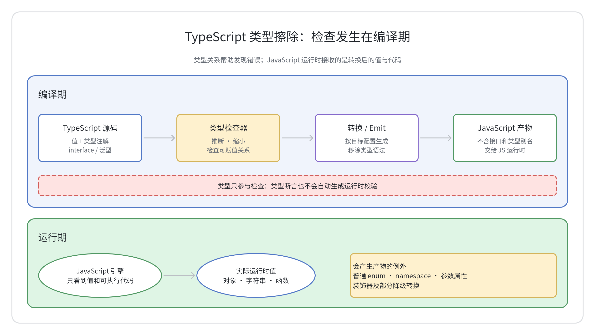
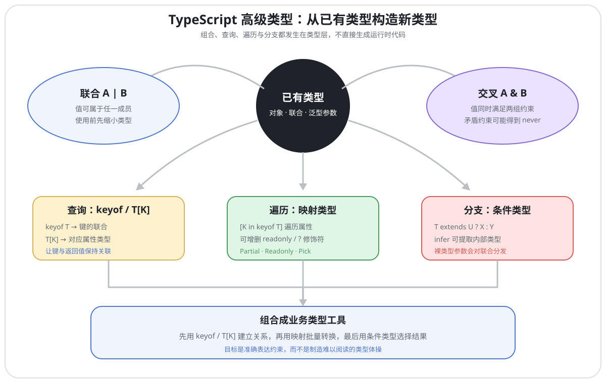
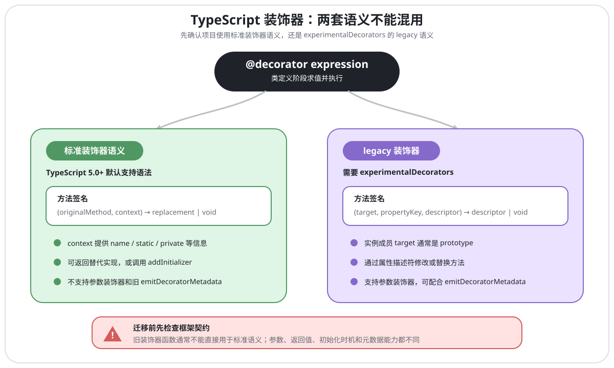
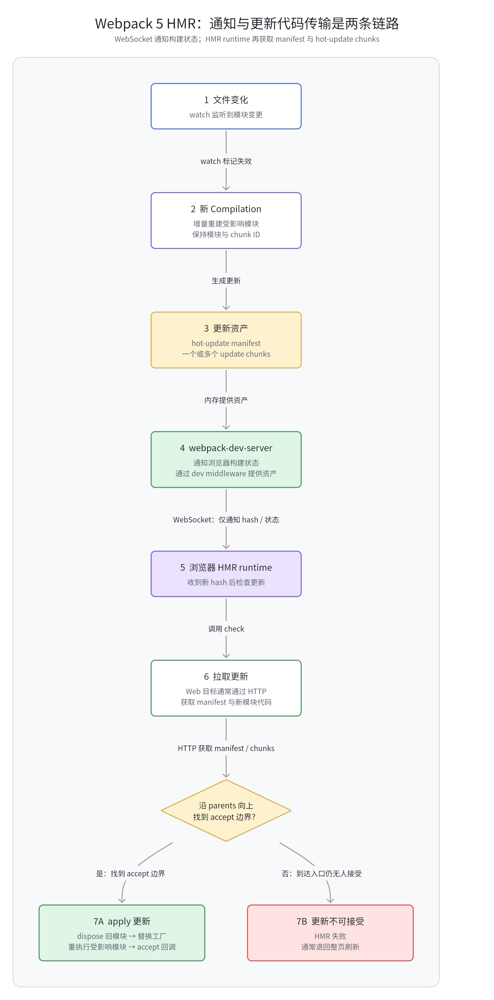
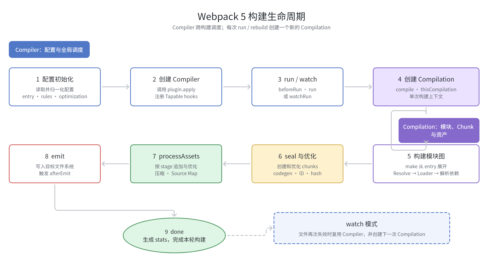
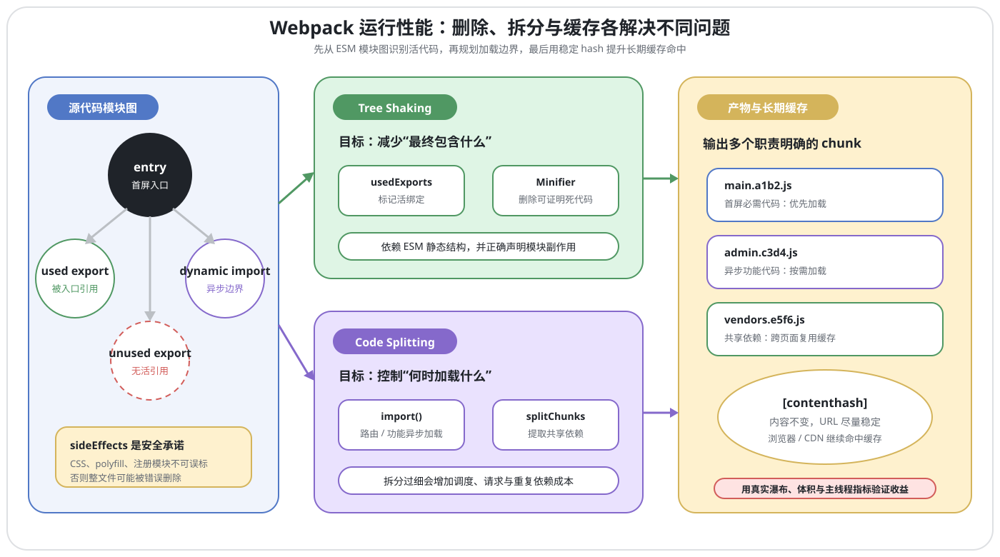

## 1. 如何理解 TypeScript？它与 JavaScript 有什么区别？

### 回答重点

TypeScript 是 JavaScript 的带类型语法超集：合法的 JavaScript 语法通常也能写在 TypeScript 中，TypeScript 在此基础上增加了静态类型检查、类型推断、泛型、接口等能力。浏览器和 Node.js 最终执行的仍是 JavaScript；TypeScript 代码需要先由 `tsc`、Babel、SWC 等工具转换。

TypeScript 的核心价值不是改变 JavaScript 的运行时，而是在开发阶段检查类型关系。它能提前发现一部分属性拼写、参数类型和空值处理错误，也能为编辑器提供跳转、重构和补全能力，但不能替代运行时校验和测试。

### 类型擦除与编译边界

绝大多数类型语法只供编译器使用，生成 JavaScript 时会被擦除：

```ts
interface User {
  name: string;
}

function greet(user: User): string {
  return `Hello, ${user.name}`;
}
```

大致会生成：

```js
function greet(user) {
  return `Hello, ${user.name}`;
}
```

`interface`、类型别名、泛型参数和类型注解在运行时都不存在，因此不能用它们校验接口响应。外部数据仍要用类型守卫、Schema 校验库或手写解析逻辑验证。



类型擦除也不是“所有 TypeScript 语法都不产生产物”。普通 `enum`、`namespace`、参数属性和装饰器等特性可能生成 JavaScript；具体结果还受 `target`、`module`、`useDefineForClassFields` 等编译选项影响。

### 与 JavaScript 的主要区别

| 维度 | JavaScript | TypeScript |
| --- | --- | --- |
| 类型检查 | 主要在运行时暴露类型错误 | 编译阶段执行静态检查 |
| 类型信息 | 值决定运行时类型 | 支持注解、推断和类型运算 |
| 执行方式 | 可直接交给 JavaScript 运行时 | 通常先转换为 JavaScript |
| 运行时语义 | 由 ECMAScript 决定 | 最终仍遵循 JavaScript 语义 |
| 工程能力 | 依赖编辑器和约定 | 类型信息增强补全、重构与 API 约束 |

需要注意：

- TypeScript 不是“强类型运行时”，`as` 类型断言通常不生成检查代码。
- `tsc` 是否在类型错误时停止产物输出取决于配置，例如 `noEmitOnError`。
- JavaScript 本身支持类、原型、模块、可选参数写法等能力，不能把它们都算作 TypeScript 独有特性。

## 2. 说说 TypeScript 的数据类型有哪些?

### 类型体系概览

常见类型可以按下表理解：

| 类别 | 代表类型 | 说明 |
| --- | --- | --- |
| JavaScript 原始值 | `string`、`number`、`bigint`、`boolean`、`symbol`、`null`、`undefined` | 与运行时值对应 |
| 对象类型 | 对象字面量、数组、元组、函数、类实例 | 描述属性、调用签名或构造签名 |
| 字面量类型 | `'success'`、`200`、`true` | 表示某一个具体值 |
| 类型组合 | 联合 `A \| B`、交叉 `A & B` | 组合已有类型 |
| TypeScript 特殊类型 | `any`、`unknown`、`never`、`void` | 表达检查边界或控制流语义 |
| TypeScript 运行时扩展 | `enum` | 同时具有类型和运行时产物 |

```ts
const enabled: boolean = true;
const count: number = 3;
const title: string = 'TypeScript';
const ids: number[] = [1, 2, 3];
const pair: [string, number] = ['age', 18];
```

元组不仅限制元素类型，还描述已知位置和长度。数组泛型 `Array<number>` 与 `number[]` 基本等价，而 `[number]` 是只有一个数字元素的元组。

### `any`、`unknown` 与 `never`

这三个类型容易混淆：

- `any`：关闭该值后续的大部分类型检查。它几乎可以与任意类型双向赋值，也允许直接访问属性和调用，风险会向下游传播。
- `unknown`：安全的“未知值”。任意值都能赋给它，但使用前必须缩小类型或断言。
- `never`：不存在任何可能值，常用于永不返回的函数和穷尽性检查。`never` 可以赋给其他类型，普通值不能赋给 `never`。

```ts
function parse(value: unknown): string {
  if (typeof value === 'string') {
    return value.trim();
  }
  throw new TypeError('expected a string');
}

type Shape =
  | { kind: 'circle'; radius: number }
  | { kind: 'square'; side: number };

function area(shape: Shape): number {
  switch (shape.kind) {
    case 'circle':
      return Math.PI * shape.radius ** 2;
    case 'square':
      return shape.side ** 2;
    default: {
      const unreachable: never = shape;
      return unreachable;
    }
  }
}
```

`unknown` 适合接口响应、`catch` 错误和反序列化结果等信任边界；`any` 更适合作为迁移旧代码时的临时逃生口，并应尽快收窄。

### `null`、`undefined`、`void` 与对象类型

开启 `strictNullChecks` 后，`null` 和 `undefined` 不会自动属于所有类型，必须显式声明：

```ts
let selectedId: number | null = null;
let result: string | undefined;
```

`void` 常用来表示调用方不关心函数返回值，不等同于“只能返回 `undefined`”的所有场景。`never` 则表示函数根本不会正常结束：

```ts
function log(message: string): void {
  console.log(message);
}

function fail(message: string): never {
  throw new Error(message);
}
```

另外，`object` 表示非原始值；`{}` 在严格空值检查下通常表示除 `null`、`undefined` 外的任意值；大写的 `String`、`Number`、`Boolean` 表示装箱对象，业务类型中通常应使用小写类型。

## 3. 说说你对 TypeScript 中高级类型的理解？有哪些?

### 回答重点

所谓“高级类型”不是一组严格的官方分类，通常指通过类型运算符从已有类型构造新类型的能力，例如联合、交叉、`keyof`、索引访问、映射类型、条件类型、模板字面量类型和内置工具类型。

这些能力都发生在类型层，不会直接生成运行时代码。使用时应优先表达真实业务约束，不要为了炫技堆叠难以维护的类型运算。



### 联合类型与交叉类型

联合类型 `A | B` 表示值可以属于 A 或 B。没有缩小前，只能直接使用所有成员都支持的操作：

```ts
function format(value: string | string[]): string {
  return typeof value === 'string'
    ? value.trim()
    : value.join(' ').trim();
}
```

交叉类型 `A & B` 表示值必须同时满足 A 和 B，常用于组合对象能力：

```ts
type Named = { name: string };
type Timestamped = { createdAt: Date };
type RecordItem = Named & Timestamped;

const item: RecordItem = {
  name: 'report',
  createdAt: new Date(),
};
```

从值集合角度看，联合扩大了可选值集合，交叉要求同时满足约束。若约束互相矛盾，例如 `string & number`，结果通常是 `never`。因此不能简单把 `&` 说成集合“并”、把 `|` 说成集合“交”。

### 类型别名、索引与类型约束

类型别名能命名任意类型：

```ts
type Id = string | number;
type Pair<T> = [T, T];
```

`keyof T` 取得对象键的联合，`T[K]` 取得对应属性类型。它们经常与泛型约束组合：

```ts
function getValue<T, K extends keyof T>(object: T, key: K): T[K] {
  return object[key];
}

const user = { id: 1, name: 'Easton' };
const name = getValue(user, 'name'); // string
```

这里的 `extends` 表示可赋值约束，不是运行时类继承。

### 映射类型与条件类型

映射类型遍历键并转换属性：

```ts
type Mutable<T> = {
  -readonly [K in keyof T]: T[K];
};

type Optional<T> = {
  [K in keyof T]?: T[K];
};
```

条件类型根据可赋值关系选择结果：

```ts
type ElementType<T> = T extends readonly (infer U)[] ? U : T;

type A = ElementType<string[]>; // string
type B = ElementType<number>; // number
```

当条件类型中的检查对象是裸类型参数时，会对联合类型分发：

```ts
type ToArray<T> = T extends unknown ? T[] : never;
type Result = ToArray<string | number>; // string[] | number[]
```

如果想把联合整体参与判断，可以用元组包裹两侧：`[T] extends [U] ? X : Y`。

常见内置工具类型如 `Partial<T>`、`Required<T>`、`Readonly<T>`、`Pick<T, K>`、`Omit<T, K>`、`Record<K, V>`、`Parameters<T>` 和 `ReturnType<T>`，本质上大多由上述能力组合而成。

## 4. 说说你对 TypeScript 中接口的理解？应用场景?

### 接口的核心概念

`interface` 用来命名对象结构、函数调用签名或构造签名。TypeScript 采用结构类型系统，只要值的结构满足要求，就不必显式声明“实现了某接口”：

```ts
interface User {
  readonly id: number;
  name: string;
  age?: number;
  greet(message: string): string;
}

const user = {
  id: 1,
  name: 'Easton',
  greet: (message: string) => `${message}, Easton`,
};

const current: User = user;
```

`readonly` 只做编译期写入约束，并不会自动冻结运行时对象；`age?` 表示属性可以缺失，读取时通常要处理 `undefined`。

### 接口扩展与声明合并

接口可以扩展一个或多个接口：

```ts
interface Identified {
  id: string;
}

interface Timestamped {
  createdAt: Date;
}

interface Article extends Identified, Timestamped {
  title: string;
}
```

同名接口声明还会合并，这对扩展第三方声明很有用：

```ts
interface Window {
  analyticsVersion: string;
}
```

声明合并也可能意外污染全局，因此应用内部不应依赖它来随意拆散同一个业务模型。

### 接口与类型别名的区别

两者都能描述对象结构，选择重点如下：

| 能力 | `interface` | `type` |
| --- | --- | --- |
| 描述对象、函数 | 支持 | 支持 |
| `extends` 扩展 | 支持 | 通常用交叉类型组合 |
| 声明合并 | 支持 | 不支持 |
| 联合、元组、原始类型别名 | 不能直接表示 | 支持 |
| 映射类型、条件类型 | 不能直接声明 | 支持 |

公共对象契约、可扩展库声明通常优先 `interface`；联合、元组和类型计算使用 `type`。不必把其中一种规定为所有场景的唯一答案。

### 多余属性检查

结构类型不意味着对象字面量可以随意多传字段。新鲜对象字面量会触发多余属性检查：

```ts
interface RequestOptions {
  url: string;
  timeout?: number;
}

function request(options: RequestOptions): void {
  // ...
}

request({ url: '/api', retry: 3 }); // retry 不在接口中

const options = { url: '/api', retry: 3 };
request(options); // 结构满足要求，可以传入
```

如果确实允许动态键，应使用准确的索引签名或 `Record`，不要用 `[key: string]: any` 掩盖所有拼写错误。

## 5. 说说你对 TypeScript 中类的理解？应用场景?

### 类的两层语义

TypeScript 的 `class` 以 JavaScript 类为运行时基础，再增加类型检查能力。构造函数、实例字段、静态字段、继承和 `#private` 都有运行时语义；`implements`、`abstract`、大部分访问修饰符和类型注解主要在编译期生效。

```ts
abstract class Animal {
  constructor(public readonly name: string) {}

  abstract speak(): string;

  move(distance = 0): string {
    return `${this.name} moved ${distance}m`;
  }
}

class Dog extends Animal {
  speak(): string {
    return 'woof';
  }
}
```

`abstract` 类不能直接实例化，抽象成员必须由非抽象子类实现，但抽象标记在生成 JavaScript 后通常不存在。

### 访问控制与运行时私有

- `public`：默认值，类内外都可访问。
- `protected`：类及其子类可访问。
- `private`：TypeScript 类型层限制访问，生成后的属性通常仍是普通 JavaScript 属性。
- `#field`：ECMAScript 私有字段，由 JavaScript 运行时强制隔离。
- `readonly`：限制类型层的重新赋值，不等同于 `Object.freeze`。

```ts
class Counter {
  private label = 'counter';
  #value = 0;

  increment(): number {
    return ++this.#value;
  }
}
```

需要真正的运行时私有状态时优先 `#private`；只需要工程内类型约束时可以使用 `private`。

### `implements` 与应用场景

`implements` 只检查实例侧结构，不会改变类，也不会自动复制实现：

```ts
interface Cache {
  get(key: string): string | undefined;
  set(key: string, value: string): void;
}

class MemoryCache implements Cache {
  #data = new Map<string, string>();

  get(key: string): string | undefined {
    return this.#data.get(key);
  }

  set(key: string, value: string): void {
    this.#data.set(key, value);
  }
}
```

类适合需要实例状态、封装、继承或框架约定的场景。纯数据结构通常用接口或类型别名更轻量；不要为了“面向对象”把无状态工具函数强行包装成类。

## 6. 说说你对 TypeScript 中枚举类型的理解？应用场景?

### 枚举的类型与运行时产物

`enum` 用一组命名成员表达有限状态。它是 TypeScript 少数会生成运行时代码的特性之一：

```ts
enum Direction {
  Up,
  Down,
  Left,
  Right,
}

const direction: Direction = Direction.Up;
```

数字枚举默认从 `0` 自增，也可以指定起始值。其输出会创建运行时对象，并同时生成“名称到值”和“值到名称”的反向映射：

```js
var Direction;
(function (Direction) {
  Direction[(Direction.Up = 0)] = 'Up';
  Direction[(Direction.Down = 1)] = 'Down';
  Direction[(Direction.Left = 2)] = 'Left';
  Direction[(Direction.Right = 3)] = 'Right';
})(Direction || (Direction = {}));
```

字符串枚举需要给成员初始化字符串，只生成正向映射，不生成数值到名称的反向映射：

```ts
enum Status {
  Pending = 'PENDING',
  Success = 'SUCCESS',
}
```

异构枚举虽然允许混合数字和字符串，但难以理解，通常不应使用。

### `const enum` 与替代方案

`const enum` 的成员通常在使用处内联，从而避免普通枚举对象的运行时代码：

```ts
const enum DirectionCode {
  Up,
  Down,
}

const code = DirectionCode.Up; // 通常输出为 0
```

但 `preserveConstEnums` 会改变产物，发布 ambient `const enum` 还可能与 `isolatedModules` 和依赖版本错位冲突。库作者应谨慎导出它。

只需要 JavaScript 对象和字面量联合时，可以使用 `as const`：

```ts
const StatusValue = {
  Pending: 'PENDING',
  Success: 'SUCCESS',
} as const;

type StatusValue = (typeof StatusValue)[keyof typeof StatusValue];
```

这种写法运行时就是普通对象，和 JavaScript 生态更一致。是否使用 `enum` 应取决于是否需要它的名义成员语义、运行时对象和团队约定，而不是把所有常量都改成枚举。

## 7. 说说你对 TypeScript 中函数的理解？与 JavaScript函数的区别?

### 函数类型与类型推断

JavaScript 决定函数的实际调用语义，TypeScript 为参数、返回值、`this` 和重载列表增加静态检查：

```ts
type BinaryOperation = (left: number, right: number) => number;

const add: BinaryOperation = (left, right) => left + right;
```

上下文类型能从 `BinaryOperation` 推断箭头函数参数，不必重复注解。返回类型也通常可以推断，但公共 API 显式标注返回类型有助于防止实现变化意外改变契约。

### 可选、默认与剩余参数

```ts
function sum(first: number, second = 0, ...rest: number[]): number {
  return first + second + rest.reduce((total, value) => total + value, 0);
}
```

- 可选参数 `value?: T` 在读取位置通常是 `T | undefined`。
- 默认参数允许调用方省略参数，并在运行时提供默认值。
- 剩余参数必须是数组或元组类型。
- `this` 参数可以显式声明调用上下文，但它只存在于类型层。

### 函数重载

TypeScript 重载由多个对外签名和一个实现签名组成。它不会在运行时生成多个函数，也不会自动分派：

```ts
function combine(left: string, right: string): string;
function combine(left: number, right: number): number;
function combine(
  left: string | number,
  right: string | number,
): string | number {
  if (typeof left === 'string' && typeof right === 'string') {
    return left + right;
  }
  if (typeof left === 'number' && typeof right === 'number') {
    return left + right;
  }
  throw new TypeError('arguments must have the same type');
}
```

实现签名必须兼容所有重载，但调用方只能看到重载签名。参数和返回关系简单时，联合类型通常更清晰；只有不同输入确实对应不同返回类型时才需要重载。

## 8. 说说你对 TypeScript 中泛型的理解？应用场景?

### 泛型解决的问题

泛型用类型参数表达“多个位置使用同一组类型关系”，既复用实现，又保留具体类型：

```ts
function identity<T>(value: T): T {
  return value;
}

const text = identity('hello'); // T 推断为 string
```

如果改成 `any`，参数与返回值之间的关系会丢失。泛型也不是“运行时传入类型”，因为类型参数通常会被擦除；运行时分支仍要依赖实际值。

### 泛型函数、接口与类

```ts
function swap<T, U>(pair: [T, U]): [U, T] {
  return [pair[1], pair[0]];
}

interface ApiResponse<T> {
  data: T;
  code: number;
}

class Stack<T> {
  #items: T[] = [];

  push(item: T): void {
    this.#items.push(item);
  }

  pop(): T | undefined {
    return this.#items.pop();
  }
}
```

类型参数应放在能够体现关系的位置。只出现一次且没有约束关系的泛型往往没有意义，直接写具体类型或 `unknown` 更清楚。

### 泛型约束、默认值与推断

```ts
function getValue<T extends object, K extends keyof T>(
  object: T,
  key: K,
): T[K] {
  return object[key];
}

interface Page<T, Meta = { total: number }> {
  items: T[];
  meta: Meta;
}
```

`K extends keyof T` 保证键确实属于对象，返回值 `T[K]` 保留对应属性类型。约束只限定允许的类型范围，不会把 `T` 直接替换成约束本身。

常见应用包括容器、接口响应、表格列配置、事件映射和可复用 Hook。设计泛型 API 时应优先让编译器从参数推断类型，避免要求调用方到处手写类型实参。

## 9. 说说你对 TypeScript 装饰器的理解？应用场景?

### 现代提案装饰器与 legacy 装饰器

装饰器是在类定义阶段执行的函数，可观察、替换类或类成员，并可注册初始化逻辑。TypeScript 5.0 起支持现代装饰器提案的调用模型；这套实现源自 2022-03 版本，当时提案处于 Stage 3。截至本文更新时间，TC39 官方仓库将 Decorators 标记为 Stage 2.7，仍不是正式 ECMAScript 标准。TypeScript 多年来还保留了另一套由 `experimentalDecorators` 启用的 legacy 语义，两套语义的参数、返回值和产物不同，不能混为一谈。



关键区别如下：

| 维度 | 现代提案装饰器语义 | legacy 装饰器 |
| --- | --- | --- |
| 启用方式 | TypeScript 5.0+ 默认支持语法 | 需要 `experimentalDecorators` |
| 方法装饰器参数 | 原方法值、`context` | `target`、`propertyKey`、`descriptor` |
| 参数装饰器 | 不支持 | 支持 |
| 元数据 | 不兼容旧的 `emitDecoratorMetadata` | 可与 `emitDecoratorMetadata` 配合 |
| 修改方式 | 返回替换值或用 `addInitializer` | 修改/返回属性描述符等 |

因此，依赖旧参数装饰器和反射元数据的框架通常仍使用 legacy 模式；新代码要先确认框架生态支持哪套语义。

### 标准方法装饰器示例

```ts
function logged<This, Args extends unknown[], Return>(
  original: (this: This, ...args: Args) => Return,
  context: ClassMethodDecoratorContext<
    This,
    (this: This, ...args: Args) => Return
  >,
) {
  const methodName = String(context.name);

  return function (this: This, ...args: Args): Return {
    console.log(`enter ${methodName}`);
    const result = original.call(this, ...args);
    console.log(`leave ${methodName}`);
    return result;
  };
}

class Calculator {
  @logged
  add(left: number, right: number): number {
    return left + right;
  }
}
```

标准装饰器不是简单的 `Object.defineProperty` 语法糖。不同装饰目标拥有不同的 context，装饰器可以返回替代实现；`context.addInitializer()` 还能注册实例或静态初始化逻辑。

### legacy 示例与执行顺序

legacy 方法装饰器接收属性描述符：

```ts
function readonlyMethod(
  _target: object,
  _key: string | symbol,
  descriptor: PropertyDescriptor,
): void {
  descriptor.writable = false;
}
```

多个装饰器工厂会从上到下求值，再从下到上应用，类似函数组合。这个顺序在标准与 legacy 的组合直觉中都很重要，但具体初始化时机仍应按所用语义判断。

适合装饰器的场景包括日志、依赖注入注册、序列化元数据和框架声明式 API。装饰器包含运行时副作用，应避免隐藏关键业务流程，也不能假设类型层新增的属性会自动反映到被装饰类的静态类型中。

## 10. 说说对 TypeScript 中命名空间与模块的理解？区别?

### 模块

在常规配置下，含顶级 `import` 或 `export` 的文件会成为外部模块，文件内声明默认只在模块作用域可见。`moduleDetection` 等选项也会影响模块判定；仅想强制建立模块边界时可以写 `export {}`。

```ts
// user.ts
export interface User {
  id: string;
}

export function getName(user: User): string {
  return user.id;
}
```

模块明确声明依赖和导出，由运行时、打包器或加载器解析。现代浏览器和 Node.js 都支持 ECMAScript Modules，应用代码应优先使用 `import` / `export`。

### 命名空间

`namespace` 主要把同一脚本作用域中的声明聚合到一个运行时对象：

```ts
namespace Geometry {
  export interface Point {
    x: number;
    y: number;
  }

  export function distance(point: Point): number {
    return Math.hypot(point.x, point.y);
  }
}
```

它通常会生成对象和 IIFE 一类 JavaScript 产物。未导出的成员只在命名空间内部可见，同名命名空间可以合并。

### 区别与选型

- 模块以文件为边界并显式声明依赖，适合现代应用和包。
- 命名空间主要组织全局脚本，不提供独立的文件加载机制。
- 应用中混用全局 namespace 会让依赖关系变得隐式，不利于 tree shaking 和代码分割。
- 在为传统全局脚本库编写 `.d.ts`、描述 UMD 全局入口或维护无模块旧代码时，命名空间仍有价值。

“内部模块”是 TypeScript 早期对 namespace 的旧称，不应再与 ECMAScript 模块混用。

## 11. 说说如何在 React 项目中应用 TypeScript?

### 工程接入

现代 React 脚手架和框架通常已经提供 TypeScript 模板。项目至少需要 TypeScript 与 React 类型声明；依赖应按所用 React 和构建工具版本安装，而不是固定照抄旧命令。

组件文件使用 `.tsx`，`tsconfig.json` 开启适合当前构建链的 JSX 模式，并建议启用 `strict`。构建工具只负责转译时，还应在 CI 中单独运行 `tsc --noEmit`。

### 函数组件与 Props

```tsx
import type { MouseEvent, ReactNode } from 'react';

interface ButtonProps {
  label: string;
  children?: ReactNode;
  onClick?: (event: MouseEvent<HTMLButtonElement>) => void;
}

export function Button({
  label,
  children,
  onClick,
}: ButtonProps) {
  return (
    <button type="button" onClick={onClick}>
      {label}
      {children}
    </button>
  );
}
```

React 18 之后的常用类型声明中，`React.FC<Props>` 不再隐式添加 `children`。是否使用 `React.FC` 是风格选择；无论哪种写法，需要 children 时都应在 Props 中显式声明。

联合 Props 能表达互斥状态：

```ts
type LinkOrButtonProps =
  | { kind: 'link'; href: string; onClick?: never }
  | { kind: 'button'; href?: never; onClick: () => void };
```

### Hooks、事件与引用

```tsx
import { useRef, useState } from 'react';

function SearchBox() {
  const [keyword, setKeyword] = useState('');
  const inputRef = useRef<HTMLInputElement>(null);

  return (
    <input
      ref={inputRef}
      value={keyword}
      onChange={(event) => setKeyword(event.currentTarget.value)}
    />
  );
}
```

优先利用 Hook 和 JSX 上下文推断；只有空数组、可空状态、复杂 reducer 或公共 Hook 返回值等推断不足的地方再显式传泛型。DOM 事件应使用 React 提供的事件类型，并通过 `currentTarget` 获取与处理器绑定的元素。

类组件仍可用 `React.Component<Props, State>` 标注，但新业务通常以函数组件和 Hooks 为主。

## 12. 说说如何在Vue项目中应用TypeScript?

### Vue 3 的推荐方式

Vue 3 对 TypeScript 提供一等支持。新项目通常使用 `create-vue` 创建 Vite 工程，在单文件组件中使用 `<script setup lang="ts">`，通过组合式 API、`defineProps`、`defineEmits` 等宏获得类型推断。

原文所使用的 `vue-property-decorator`、`vue-class-component` 和 `@Component` 类组件模式主要属于 Vue 2 时代，不应再作为 Vue 3 新项目的默认方案。

### Props、事件与响应式状态

```vue
<script setup lang="ts">
import { computed, ref } from 'vue';

interface Props {
  initial?: number;
  step?: number;
}

const props = withDefaults(defineProps<Props>(), {
  initial: 0,
  step: 1,
});

const emit = defineEmits<{
  change: [value: number];
}>();

const count = ref(props.initial);
const doubled = computed(() => count.value * 2);

function increment(): void {
  count.value += props.step;
  emit('change', count.value);
}
</script>

<template>
  <button type="button" @click="increment">
    {{ count }} / {{ doubled }}
  </button>
</template>
```

`ref(0)` 能推断为 `Ref<number>`，复杂或可空状态再显式标注。模板引用可写为 `ref<HTMLInputElement | null>(null)`，外部 API 数据仍需运行时校验。

### 类型检查边界

Vite 对 TypeScript 的转换不等同于完整类型检查。Vue 单文件组件通常使用 `vue-tsc --noEmit` 检查模板与脚本类型，并在编辑器中启用 Vue 官方语言工具。

选型时应区分：

- Vue 3 新项目：组合式 API + `<script setup lang="ts">`。
- Vue 2 遗留项目：可能继续维护类组件装饰器，但要确认对应版本和 legacy 装饰器配置。
- 公共组件库：需要额外验证声明文件生成、Props 默认值和对外导出类型。

---

## 1. 说说你对Webpack的理解？解决了什么问题?

### Webpack 的定位

Webpack 是面向现代 JavaScript 应用的静态模块打包器。它从一个或多个入口出发，解析 `import`、`require`、`import()` 等依赖，构建模块图，再把模块组织为 chunk 并生成浏览器或其他目标环境可使用的 assets。

“静态”指构建阶段能够分析的依赖关系，不代表应用不能使用动态导入。`import()` 会在模块图中形成异步依赖和代码分割点。

### 解决的核心问题

- **模块组织**：统一处理 ESM、CommonJS 等依赖关系，减少手工维护脚本顺序和全局变量。
- **资源转换**：通过 Loader 处理 TypeScript、JSX、Sass 等输入，通过 Asset Modules 处理图片、字体等资源。
- **产物优化**：压缩、tree shaking、代码分割、长期缓存和 Source Map。
- **开发体验**：watch、dev server、HMR 与错误反馈。
- **扩展构建流程**：Plugin 可以接入 Compiler 和 Compilation 生命周期。

Webpack 本身不是 Babel、TypeScript 编译器或 Sass 编译器。它负责组织模块图和构建流程，具体语法转换通常由相应 Loader 或内置模块类型完成。

### 核心名词

- **Entry**：依赖图的起点。
- **Module**：Webpack 能处理的离散资源单元。
- **Chunk**：Webpack 在构建过程中组织模块的代码块，可能来自入口或动态导入。
- **Asset**：最终输出的 JavaScript、CSS、图片、Source Map 等文件。
- **Loader**：把单个模块内容转换成 Webpack 可继续处理的形式。
- **Plugin**：通过钩子参与整个构建生命周期。

## 2. 说说Webpack的热更新是如何做到的？原理是什么?

### HMR 的目标与边界

HMR（Hot Module Replacement）在应用运行时替换、添加或删除模块，尽量避免整页刷新，从而保留页面状态。`webpack-dev-server` 可以启用 HMR，但某类模块能否安全热替换，还取决于模块自身、Loader 或框架集成是否提供 accept 边界和状态恢复逻辑。

```js
export default {
  mode: 'development',
  devServer: {
    hot: true,
  },
};
```

业务模块也可以显式接受依赖更新：

```js
if (module.hot) {
  module.hot.accept('./format.js', () => {
    render();
  });
}
```

### Webpack 5 的热更新链路

一次更新可以概括为：

1. watch 监听到文件变化，Compiler 创建新的 Compilation，只重建受影响的模块和依赖。
2. 新编译生成 update manifest 和一个或多个 hot-update chunk；dev middleware 通常把它们保存在内存中。
3. dev server 通过 WebSocket 通知浏览器“有新 hash / 构建结果”，而不是把所有更新代码直接塞进 WebSocket 消息。
4. 浏览器中的 HMR runtime 发起检查，通过目标环境对应的加载方式获取 manifest 和 update chunks；Web 目标通常使用 HTTP。
5. runtime 计算更新影响范围，运行旧模块的 dispose 处理器，替换模块工厂并重新执行需要更新的模块。
6. 更新沿导入关系向上寻找 accept 边界。若一直到入口仍无人接受，更新失败，dev server 或框架通常退回整页刷新。



update manifest 描述变更、删除的 chunk 或模块，update chunk 携带新的模块代码。模块 ID 和 chunk ID 需要在相邻编译间保持一致，watch 编译器会在内存中维护这些信息。

### 为什么 CSS 和框架组件体验更好

样式 Loader 或 Webpack 的 CSS 能力可以注册 HMR 处理逻辑，用新样式替换旧样式。React Refresh、Vue Loader 等框架集成会建立组件级边界并尽量保留可恢复状态。

普通 JavaScript 模块若没有 accept 处理，不应假设一定能无刷新更新。副作用、单例和模块外状态也可能让热替换结果与首次加载不同。

## 3. 说说Webpack的构建流程?

### Compiler 与 Compilation

Webpack 并不是一条“所有工作都严格串行”的流水线。它有阶段顺序，但钩子包含同步、异步串行和异步并行等类型，模块构建也可以并发。

两个核心对象是：

- **Compiler**：由一次配置创建，持有配置、插件和完整生命周期；watch 模式下会跨多次重建复用。
- **Compilation**：表示一次具体构建，包含当前模块图、chunks、assets、错误和依赖；每次重建都会创建新的 Compilation。

### Webpack 5 构建阶段

典型流程如下：

1. **初始化**：CLI / Node API 读取并归一化配置，创建 Compiler，依次调用插件的 `apply` 注册钩子。
2. **启动构建**：`run` 或 `watch` 进入构建，触发 `beforeRun`、`run` / `watchRun` 等 Compiler 钩子。
3. **创建 Compilation**：触发 `beforeCompile`、`compile`，随后创建并发布 `thisCompilation`、`compilation`。
4. **构建模块图**：`make` 从 entry 创建模块，经 resolve 找到资源，按规则运行 Loader，解析转换结果并递归收集依赖。
5. **封装与优化**：完成模块后执行 `finishModules`、`seal`，创建和优化 chunks，进行代码生成、tree shaking、ID 与 hash 计算。
6. **生成资产**：在 `processAssets` 各 stage 中追加、优化或压缩 assets。
7. **输出**：`emit` 前后把 assets 写入目标文件系统，触发 `afterEmit`。
8. **结束**：生成 stats，触发 `done`；失败则进入相应错误流程。watch 模式等待下一次失效并创建新 Compilation。



具体内部钩子会随版本演进，面试中应把握“配置与插件初始化 -> 模块图 -> chunk 与优化 -> assets -> emit”主线，不要背诵某个旧版本源码中的私有函数。

### Loader 与 Plugin 在流程中的位置

Loader 主要参与某个模块的构建，把输入转换为匹配模块类型的内容。Plugin 则注册在 Compiler 或 Compilation 钩子上，能参与解析、模块构建、chunk 优化和 assets 处理等多个阶段。

修改或新增最终资产应优先使用 `compilation.hooks.processAssets` 及合适的 stage。把这类逻辑都塞进 `compiler.hooks.emit` 会错过后续优化阶段，现代 Webpack 会对部分旧写法给出弃用提示。

## 4. 说说Webpack proxy工作原理？为什么能解决跨域?

### 它属于 dev server，而不是 Webpack 核心

日常所说的 “Webpack proxy” 实际是 `webpack-dev-server` 的代理配置。它在开发服务器中注册代理中间件，把匹配请求转发给目标后端：

```js
export default {
  devServer: {
    port: 8080,
    proxy: [
      {
        context: ['/api'],
        target: 'http://localhost:3000',
        changeOrigin: true,
        pathRewrite: { '^/api': '' },
      },
    ],
  },
};
```

浏览器请求 `http://localhost:8080/api/users`，dev server 再以服务器身份请求 `http://localhost:3000/users`，最后把响应转回浏览器。

### 为什么浏览器不再报跨域

同源策略由浏览器执行。页面和它请求的地址都是 `localhost:8080`，从浏览器视角属于同源；dev server 到后端是服务器到服务器的通信，不受浏览器同源策略限制。

这不是“关闭跨域”，而是改变了浏览器实际访问的源。代理仍可能受后端鉴权、Cookie 域、TLS、Host 校验和 WebSocket 升级等约束：

- `changeOrigin` 主要调整代理请求的 `Host` 等来源信息，不能替代所有 CORS 或鉴权配置。
- `secure: false` 仅应在开发时处理不受信任的 HTTPS 证书。
- WebSocket 接口需要开启相应代理能力。
- 生产环境不会自动拥有 dev server 代理，应由 Nginx、网关、BFF 或后端 CORS 策略承担。

## 5. 说说Webpack中常见的Loader？解决了什么问题?

### Loader 的作用

Loader 是对单个模块源代码的转换函数。Webpack 根据 `module.rules` 匹配资源，并把多个 Loader 组成转换链。普通 Loader 阶段按 `use` 从右到左执行，pitch 阶段则是另一套从左到右的机制。

```js
export default {
  module: {
    rules: [
      {
        test: /\.[jt]sx?$/,
        exclude: /node_modules/,
        use: 'babel-loader',
      },
      {
        test: /\.s[ac]ss$/i,
        use: [
          'style-loader',
          'css-loader',
          'postcss-loader',
          'sass-loader',
        ],
      },
      {
        test: /\.(png|svg|woff2?)$/i,
        type: 'asset',
        parser: {
          dataUrlCondition: {
            maxSize: 4 * 1024,
          },
        },
      },
    ],
  },
};
```

SCSS 链的正常执行顺序是 `sass-loader -> postcss-loader -> css-loader -> style-loader`。最后一个 Loader 的结果必须符合当前模块类型，例如 JavaScript、CSS、JSON 或 asset 内容。

### 常见 Loader

| Loader | 主要职责 |
| --- | --- |
| `babel-loader` | 使用 Babel 转换 JavaScript / JSX |
| `ts-loader` | 使用 TypeScript 编译器处理 TypeScript，并可执行类型检查 |
| `swc-loader` | 使用 SWC 快速转换 JS / TS / JSX |
| `css-loader` | 解析 CSS 中的 `@import`、`url()` 和 CSS Modules |
| `style-loader` | 开发时把 CSS 注入页面 |
| `sass-loader` / `less-loader` | 把预处理器语法转换为 CSS |
| `postcss-loader` | 运行 PostCSS 插件，例如 Autoprefixer |
| `html-loader` | 处理 HTML 及其资源引用 |

Webpack 5 的 Asset Modules 已能覆盖旧 `file-loader`、`url-loader`、`raw-loader` 的常见用途：

- `asset/resource`：输出独立文件并返回 URL。
- `asset/inline`：内联 Data URL。
- `asset/source`：导出源码字符串。
- `asset`：按阈值自动选择 inline 或 resource。

因此新配置不应继续把 `file-loader`、`url-loader` 当默认方案。

## 6. 说说Webpack中常见的Plugin？解决了什么问题?

### Plugin 的作用

Plugin 是带 `apply(compiler)` 方法的对象。Webpack 创建 Compiler 时会调用 `apply`，插件在其中订阅 Compiler 或 Compilation 的 Tapable 钩子，从而介入构建生命周期。

```js
class BuildStartPlugin {
  apply(compiler) {
    compiler.hooks.run.tap('BuildStartPlugin', () => {
      console.log('build started');
    });
  }
}
```

Loader 主要处理单个模块内容，Plugin 可以跨模块、chunk 和 asset 工作，例如生成 HTML、提取 CSS、定义常量、复制文件、分析体积或上传产物。

### Webpack 5 常见 Plugin 与内置能力

| 工具 | 作用 |
| --- | --- |
| `HtmlWebpackPlugin` | 从模板生成 HTML 并注入构建资源 |
| `MiniCssExtractPlugin` | 把 CSS 提取为独立文件，适合生产构建 |
| `CopyWebpackPlugin` | 复制不进入模块图的静态文件 |
| `DefinePlugin` | 在编译时替换标识符表达式 |
| `ProvidePlugin` | 在使用特定自由变量时自动加载模块 |
| `CompressionWebpackPlugin` | 预生成 gzip / Brotli 资源 |
| `CssMinimizerWebpackPlugin` | 压缩 CSS |
| `BundleAnalyzerPlugin` | 可视化分析 bundle 组成 |

Webpack 5 已有不少内置能力：

- `output.clean: true` 可替代常见的目录清理插件。
- `optimization.splitChunks` 替代早已移除的 `CommonsChunkPlugin`。
- `MiniCssExtractPlugin` 替代旧的 `ExtractTextWebpackPlugin`。
- `devServer.hot` 使用 dev server 时通常会自动启用需要的 HMR 支持，不应照搬旧版重复配置。

`DefinePlugin` 做的是编译期代码替换，不是运行时全局变量注入。字符串值通常要显式 `JSON.stringify`：

```js
new DefinePlugin({
  __API_BASE__: JSON.stringify('https://example.com'),
});
```

## 7. Loader 和 Plugin 有什么区别？编写 Loader、Plugin 的思路是什么？

### 核心区别

| 维度 | Loader | Plugin |
| --- | --- | --- |
| 处理对象 | 某个匹配模块的内容 | 整个 Compiler / Compilation 生命周期 |
| 配置位置 | `module.rules` | `plugins` |
| 典型用途 | 语法转换、资源预处理 | 资源管理、优化、注入、分析 |
| 基本形态 | 导出普通函数 | 带 `apply(compiler)` 的对象 |
| 调用次数 | 通常按匹配模块调用 | 按所订阅钩子调用 |

### 编写 Loader

Loader 应保持单一职责、声明依赖和缓存行为，并正确传递 Source Map。不能用箭头函数依赖 Loader Context，因为 Webpack 会通过 `this` 提供 API：

```js
export default function bannerLoader(source, inputSourceMap) {
  const { banner = '' } = this.getOptions();
  const code = `/* ${banner} */\n${source}`;

  this.callback(null, code, inputSourceMap);
}
```

同步 Loader 可以直接 `return`；调用 `this.async()` 或 `this.callback()` 后则不要再同时返回同一份结果。异步工作应这样结束：

```js
export default function asyncLoader(source) {
  const callback = this.async();

  transform(source).then(
    (result) => callback(null, result.code, result.map),
    (error) => callback(error),
  );
}
```

编写时还要考虑 `this.cacheable()`、`this.addDependency()`、输入是字符串还是 Buffer，以及链中前后 Loader 的数据契约。

### 编写 Plugin

先确定数据属于 Compiler 还是单次 Compilation，再选择最窄、最合适的钩子和 stage：

```js
class BuildMetaPlugin {
  apply(compiler) {
    const pluginName = 'BuildMetaPlugin';
    const { Compilation, sources } = compiler.webpack;

    compiler.hooks.thisCompilation.tap(pluginName, (compilation) => {
      compilation.hooks.processAssets.tap(
        {
          name: pluginName,
          stage: Compilation.PROCESS_ASSETS_STAGE_ADDITIONAL,
        },
        () => {
          const content = JSON.stringify({ generatedBy: pluginName });
          compilation.emitAsset(
            'build-meta.json',
            new sources.RawSource(content),
          );
        },
      );
    });
  }
}
```

异步钩子要选 `tapAsync` 或 `tapPromise` 并正确结束，否则会阻塞构建。watch 模式下还要避免把单次 Compilation 状态泄漏到下一轮，并把新增文件加入依赖集合。

## 8. 如何提高Webpack的构建速度?

### 先测量，再优化

构建慢可能发生在解析、Loader 转换、类型检查、压缩、Source Map、文件系统或插件阶段。先比较冷启动、热重建和生产构建，并通过 stats / profile 找出耗时模块：

```bash
npx webpack --profile --json=stats.json
```

不要只凭配置项数量判断性能，也不要把生产压缩速度和开发 HMR 速度混为一谈。

### Webpack 5 持久化缓存

Webpack 5 原生支持文件系统缓存，通常比继续叠加 `cache-loader` 更合适：

```js
const path = require('node:path');

module.exports = {
  cache: {
    type: 'filesystem',
    buildDependencies: {
      config: [__filename],
    },
  },
  snapshot: {
    managedPaths: [path.resolve(__dirname, 'node_modules')],
  },
};
```

开发模式默认使用内存缓存，生产模式默认不启用缓存；显式 `filesystem` 才能跨进程复用。配置、Loader 或外部依赖变动必须进入正确的失效链，不能为了命中率忽略缓存正确性。

### 缩小工作范围

- 用 `test`、`include`、`exclude` 精确限制昂贵 Loader，通常不编译 `node_modules`。
- `resolve.extensions` 只保留真实使用的后缀并把高频项放前面，减少无效文件探测。
- 合理配置 `resolve.alias` 和包导出，不要用别名掩盖循环依赖。
- watch 模式忽略输出目录、日志和不会影响构建的文件。
- 对确认没有依赖的超大预构建脚本可考虑 `module.noParse`，但误用会漏掉依赖。

### 降低单模块与优化阶段成本

- 开发环境选择更快的 Source Map，生产环境按是否需要线上定位决定。
- Babel 开启自身缓存；也可评估 SWC / esbuild Loader，但要把“快速转译”和“完整类型检查”分开。
- `TerserPlugin` 的 `parallel` 默认可利用多进程，仍应根据 CI CPU / 内存限制调节。
- `thread-loader` 只适合转换成本足够高、可并行且不依赖受限 Loader API 的链；进程启动和 IPC 可能让小项目更慢。
- 把类型检查移到独立进程或 CI 时，必须保证构建不能在未检查的情况下发布。

DLL、`cache-loader` 等方案在旧版 Webpack 中常见，但 Webpack 5 的持久化缓存和更好的长期缓存已改变默认优先级。除非有测量数据和遗留约束，不应先上这些旧方案。

## 9. 说说如何借助Webpack来优化前端性能?

### 先区分构建速度与运行性能

构建更快不代表页面更快。本题关注最终产物体积、加载时机、缓存命中和解析执行成本。第一步是分析 stats 和真实页面指标，再决定压缩、拆包还是减少依赖。

### Tree Shaking

Tree shaking 依赖 ESM 的静态结构。Webpack 标记未使用导出，生产压缩器再删除可证明无用的代码；`package.json` 的 `sideEffects` 告诉 Webpack 哪些文件可以整模块跳过。

```json
{
  "sideEffects": [
    "**/*.css",
    "./src/polyfills.js"
  ]
}
```

`sideEffects: false` 的含义不是“这个包没有未使用导出”，而是“导入任意文件都不会产生除导出外的副作用”。误标会删除注册逻辑、polyfill 或样式导入。Babel 等前置转换还应保留 ESM，让 Webpack 有机会静态分析。

### Code Splitting

代码分割控制“何时加载哪些代码”，与删除无用代码不是同一件事：

```js
button.addEventListener('click', async () => {
  const { openAdminPanel } = await import('./admin.js');
  openAdminPanel();
});
```

Webpack 会为动态导入建立异步 chunk。公共依赖可以交给 `optimization.splitChunks`：

```js
export default {
  mode: 'production',
  output: {
    filename: '[name].[contenthash].js',
    chunkFilename: '[name].[contenthash].js',
    clean: true,
  },
  optimization: {
    splitChunks: {
      chunks: 'all',
    },
    runtimeChunk: 'single',
    moduleIds: 'deterministic',
  },
};
```



拆包不是越细越好。应结合首屏路径、缓存复用、HTTP 并发、压缩率和框架路由边界，避免重复依赖和大量微小 chunk。

### 压缩、资源与长期缓存

- `mode: 'production'` 会启用适合生产的默认优化，JavaScript 通常由 Terser 压缩。
- CSS 可由 `CssMinimizerWebpackPlugin` 压缩并通过 `MiniCssExtractPlugin` 提取。
- Asset Modules 可以内联小资源或输出带 hash 的独立文件；图片编码和响应式尺寸通常还需要专门图片管线。
- `[contenthash]`、稳定的模块 ID 和分离 runtime 能减少无关变更造成的缓存失效。
- gzip / Brotli 应优先由 CDN 或服务器按协商提供；插件预压缩适合部署平台直接托管 `.gz` / `.br` 的场景。
- Source Map、预加载和预获取要结合安全、缓存及优先级策略，不应全部内联。

优化时要同时观察下载体积、主线程解析执行、缓存命中和请求瀑布，不能只比较 bundle 文件数量。

## 10. 与Webpack类似的工具还有哪些？区别?

### 选型维度

前端工具不能只按“谁更快”比较，应看开发服务器模型、生产 bundler、插件兼容、目标平台、库/应用产物和既有配置成本。

| 工具 | 核心定位 | 主要特点 | 更适合 |
| --- | --- | --- | --- |
| Webpack 5 | 通用模块打包器 | Loader / Plugin 生态成熟，复杂资源图、Module Federation 和定制能力强 | 大型存量应用、深度定制构建 |
| Vite 8 | 应用开发与构建工具链 | 开发期按需服务与快速 HMR；Vite 8 使用 Rolldown 统一底层 bundler，并以 Oxc 处理解析、转换和压缩 | 现代框架应用、新项目 |
| Rollup | JavaScript 模块打包器 | ESM 优先，tree shaking、代码分割和多输出格式能力强，插件 API 成熟 | 库、SDK、定制打包流程 |
| Rolldown | Rust bundler | 追求 Rollup / Vite 插件兼容与高性能，是 Vite 8 的核心 bundler | Vite 生态、高性能 ESM 构建 |
| esbuild | Go 编写的构建工具 | 转译、打包和压缩速度快，API 简洁 | 快速工具链、对深度兼容要求较低的项目 |
| Parcel | 一体化应用打包器 | 约定和自动发现较多，开箱配置少 | 中小型应用、快速原型 |
| Rspack | Rust 编写的 Webpack 兼容 bundler | 兼容大量 Webpack 配置和生态，强调迁移成本与构建性能 | 想保留 Webpack 心智和插件体系的项目 |

### 需要澄清的版本差异

旧资料常说“Vite 开发用 esbuild、生产用 Rollup”，这描述的是 Vite 7 及更早版本的主架构。Vite 8 已改为 Rolldown 驱动的统一工具链，不能继续把旧结论当作当前事实。

Rollup 并非“不能开发应用”或“完全不支持 CommonJS”，而是核心更专注 bundling；Node 解析、CommonJS 和完整 dev server 体验通常由插件或上层工具补充。它也支持多入口、动态导入和代码分割。

Snowpack 推动过基于原生 ESM 的开发模式，但项目已停止维护，不应作为新项目的常规选项。Gulp、Grunt 更接近任务编排器，与基于模块图的 bundler 也不是同一层次。

### 简化的选型建议

- 新建常规 React / Vue 应用：优先评估框架官方推荐的 Vite 或框架内置工具链。
- 发布多格式 JavaScript 库：评估 Rollup、Rolldown 或基于它们的库模式。
- 已有复杂 Webpack 配置：先测量迁移收益，再比较升级 Webpack、迁移 Rspack 或重建 Vite 配置。
- 需要 Module Federation、特殊 Loader 或成熟企业插件：Webpack / Rspack 的兼容生态通常更关键。

工具选择应基于真实仓库做冷启动、热更新、生产构建、产物体积和兼容性验证，不能只引用通用 benchmark。
