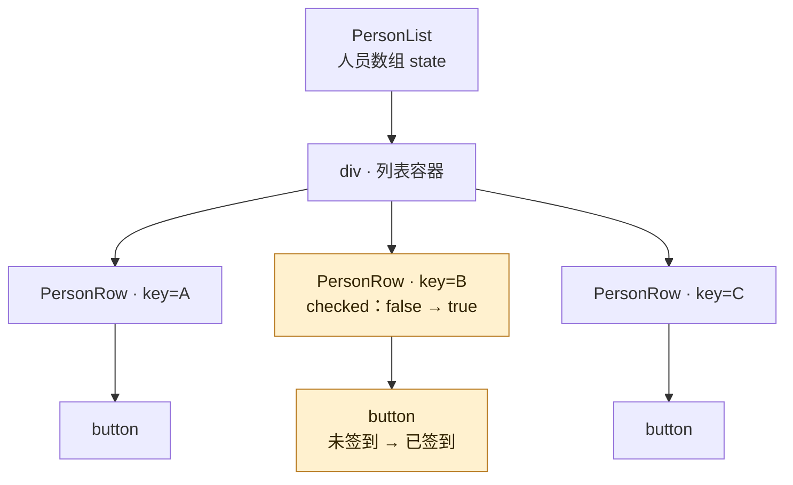

# 携程支付部门校招一面

携程 27 届校招。面试时间：2026-09-08。面试部门：携程支付部门（国内 / 国际及海外支付方向）。

面经来自牛客网友，已获得转载许可。

原文：[携程｜支付部门｜前端一面面经](https://www.nowcoder.com/feed/main/detail/f8179895f2364279a947ed4c529b561f?sourceSSR=users)

## 一面内容

### 实习与项目经历

主要围绕实习经历和项目产出深挖：

1. 实习期间主要负责哪些工作？有什么具体产出？
2. 针对具体项目经历进行细节追问。
3. 实习中的开发工作流是怎样的？
4. Skill 相关工作是如何设计和使用的？
5. 定时任务相关功能是如何实现的？

### JavaScript 基础

1. 什么是闭包？

   > 内部函数仍能访问外层的 count，即使 createCounter 已经执行结束。

   ```ts
   function createCounter() {
     let count = 0;
     return function () {
       return ++count;
     };
   }

   const next = createCounter();
   next(); // 1
   next(); // 2
   ```

   > **口播：**闭包是函数和它能访问的外部词法环境的组合。这里 createCounter 执行结束后，返回的函数仍然能访问外层的 count，所以调用 next 时还能继续修改它。两次调用访问的是同一个 count，因此结果依次是 1 和 2。

2. 闭包在实际开发中有哪些应用场景？

   - 函数柯里化
   - 防抖节流
   - 变量私有化

   > **口播：**柯里化利用闭包保留先传入的参数，让后续调用继续使用。防抖通过闭包保存计时器，节流则保存上次执行时间或执行标记，让多次调用共享这些信息。变量私有化是把变量放在函数内部，只通过返回的方法读写，外部不能直接访问。

### React

1. 如何理解 useState？状态更新的过程是怎样的？

   > <https://react.dev/reference/react/useState#adding-state-to-a-component>
   >
   > - 怎么使用
   > - 即时渲染 / 更新时机
   > - 函数式更新

   > **口播：**useState 用来保存函数组件的状态，返回当前值和 setter，比如官网的 age 和 setAge，初始值是 42。调用 setter 后，React 会把更新入队并安排 render，计算新状态和界面，再在 commit 阶段更新 DOM；当前执行中的状态仍是旧快照，同一次事件里的多次更新也可以批量处理。基于前一个状态计算新值时，可以写 setAge(a => a + 1)，更新函数会接收队列中前一步算出的状态。

2. useMemo 和 useCallback 有什么区别？分别适用于什么场景？

   - useMemo
     - 计算结果
     - Filter
     - React 子组件
   - useCallback
     - 缓存函数
   - 依赖数组

   > **口播：**useMemo 缓存计算结果，比如 filter 筛选后的数组；也可以缓存 JSX 节点，或者稳定传给 React.memo 子组件的数据引用，减少父组件更新带来的重复渲染。useCallback 缓存函数引用，常用于传给子组件的事件回调。两者都在渲染时用 Object.is 逐项比较依赖，依赖不变时复用缓存；缓存 JSX 也不会阻止子组件自身的 state 或 context 更新。

3. 全局变量能不能放到 useMemo 的依赖数组中？为什么？

   - 语法上可以
   - 全局赋值不触发渲染
   - useMemo 在渲染阶段比较依赖

   > **口播：**语法上可以放，但给全局变量赋值不会触发组件重新渲染，所以 useMemo 不会因此自动重新计算。它只在组件渲染时比较依赖，依赖数组并不是变量监听器；需要驱动界面的数据，应放进 state，或者通过订阅接入 React。

4. useEffect 和 useLayoutEffect 有什么区别？

   - 执行时机
     - 前者：提交后安排执行，通常在浏览器绘制后；交互更新时也可能提前
     - 后者：commit 的 layout 阶段，DOM 变更后、浏览器绘制前执行，阻塞绘制

   > **口播：**React 更新时，先在 render 阶段计算状态和界面差异，再在 commit 阶段提交 DOM 变更。useLayoutEffect 在 commit 的 layout 阶段执行，此时 DOM 已更新、浏览器还没绘制，它会阻塞绘制。useEffect 则在提交后安排执行，通常让浏览器先绘制，但交互触发的更新中也可能提前执行，所以不能把它理解成永远在绘制之后。

5. React 为什么要引入 Fiber 架构？

   - 旧架构问题：
     - 同步递归方式去协调组件树，耗时比较长，阻塞主线程
     - 执行进度依赖 JS 调用栈，不方便去暂停、保存进度
     - 同步协调一旦开始，难以及时让位给更高优先级的更新
   - 新架构 feature
     - 组件相关的工作拆分成小单元：Fiber 节点、状态、信息、节点之间的关系
     - 分步执行，时间切片
     - 可中断，任务调度
       - 数据更新
       - 用户交互按钮

   > **口播：**旧的 Stack Reconciler 用同步递归协调组件树，计算量大时会长时间占用主线程，而且执行进度依赖 JavaScript 调用栈，难以暂停恢复，也难以及时让位给更紧急的更新。Fiber 把工作组织成一个个节点，记录状态、更新信息和节点关系，让 React 可以分步推进，为时间切片、可中断渲染和优先级调度提供基础。比如配合 transition，可以优先响应用户输入，让耗时的列表更新稍后完成；能中断的是 render 阶段，DOM 变更等提交关键步骤仍同步执行。

6. React 的 Diff 过程是怎样的？

   - 分层
   - key
   - type

   > **口播：**Diff 主要在同一父节点的子列表内进行，新的一边是组件本次返回的 React 元素，旧的一边是 current 树中的子 Fiber。React 结合 key 或位置找到旧候选，再检查 type：类型兼容就接续组件身份和状态，继续处理 props 与子节点，不兼容就替换对应子树。这个过程中记录新增、删除、位置调整等变更，最后由 commit 更新真实 DOM。

7. Diff 过程中 key 起什么作用？

   - 标识同一个父节点下面的节点是谁，让 React 在更新前后找到对应的旧组件
     - 列表重排，顺序变了，key 不变，可以实现一些节点复用

   > **口播：**key 用来标识同一个父节点下的一项是谁，让 React 把新的元素对应到旧组件。列表重排时，位置虽然变了，但 key 稳定且类型兼容，就可以接续原来的组件身份和状态。这里的复用并不代表组件一定不再执行，新的 props 和子节点仍可能需要处理。

8. 为什么要求 key 唯一且稳定？

   - 区分身份：稳定复用
   - 重复 key 会出问题
   - 随机的 key 不复用，开销大

   > **口播：**唯一是为了在同一组兄弟节点里区分身份，稳定是为了前后两次渲染还能认出同一项。重复 key 会让匹配关系不可靠，可能造成错误的复用或显示异常。每次随机生成 key，则会让 React 把它当成新组件，导致重新挂载、状态重置和额外开销。

9. 什么样的 key 才算是一个好的 key？

   - 唯一性

   > **口播：**好的 key 不仅要在同级列表里唯一，还要在同一条数据存续期间保持稳定。通常优先使用用户 ID、订单 ID 等业务标识，而不是可能变化或重复的名称。没有后端 ID 的本地数据，可以在创建记录时生成一次 ID 并保存，之后渲染一直使用它。

10. 同层节点 Diff 时，React 是如何利用 key 进行匹配的？

    - 更新数组列表
    - 从头去匹配新旧节点，按顺序
      - 旧节点：现有的树；你现在看到的是 current tree
      - WIP：work in progress 树
      - WIP 构建完成后，在 commit 阶段提交必要的 DOM 变更，并将 current 指向完成的工作树
      - 新节点，React return 出来的新节点：组件重新执行后返回的 React 元素
    - 假如说匹配无法继续，把旧节点剩余的节点整理成一个 Map，方便利用 key 查找
    - key 相同然后检查类型，类型兼容就复用，不兼容或找不到就创建新节点
    - 判断过程中，决定哪些节点插入、删除（旧节点用不着）、移动
    - commit 更新真实 DOM

    > **口播：**这里的新节点是组件本次返回的 React 元素，旧节点来自 current Fiber 树，React 一边匹配一边构建 workInProgress 树。数组列表先从头顺序匹配，无法继续且两边还有剩余项时，就把剩余旧节点放进 Map，再按 key 找候选、按类型决定复用或新建。过程中记录插入、移动和删除等变更，commit 时落实到真实 DOM，并把 current 指向完成的工作树。

## 补充

### 为什么引入 Fiber：旧架构的问题与改造

**旧架构：Stack Reconciler。**React 16 之前通过同步递归协调组件树，一轮更新通常连续计算完成。

1. **长时间占用主线程：**组件树较大时，影响输入响应和页面绘制。
2. **难以暂停和恢复：**执行进度依赖 JavaScript 调用栈，不方便中途保存进度、稍后继续。
3. **难以及时处理更紧急的更新：**正在计算大列表时，后续输入可能被已有计算拖住。

**Fiber 的改造：**把工作组织成一个个工作单元，节点记录状态、更新信息和父子／兄弟关系，由 React 的工作循环逐步推进。

- 为分段执行、暂停和恢复提供基础。
- 配合调度机制，按优先级安排更新，必要时放弃过时工作。
- 例如配合 transition 等并发特性，优先响应输入，让耗时的结果列表稍后更新。

**边界：**可中断的是 render 阶段；DOM 变更等提交关键步骤仍同步执行，也不能自动打断组件函数内部的长循环。

### React Diff：简易 Fiber 树

人员列表 A、B、C 中，点击 B 的签到按钮，更新父组件的人员数组：B 的 checked 从 false 变成 true。

图中每个框都是 Fiber 节点，button 表示对应真实按钮的宿主 Fiber；连线只表示父子层级，省略内部指针。高亮表示本次变化。

- React element ~= 虚拟 DOM
- Fiber 节点
- 真实 DOM



1. **产生新描述：**父组件重新执行，生成新的一组 React 元素。
2. **匹配旧节点：**同一个父节点下，结合 key／位置和类型判断复用。此例 A、B、C 的 key 和组件类型都没变，可继续复用。
3. **继续向下比较：**处理各行的新 props 和返回的子节点，记录 B 对应按钮从「未签到」到「已签到」的文字变化。
4. **提交变化：**commit 阶段更新必要的真实 DOM，浏览器再显示结果。

类型不同则替换对应子树；列表增删或排序则处理新增、删除和位置变化。组件重新执行，并不代表整棵 DOM 都要重建。

依据：[Stack 与 Fiber 架构](https://legacy.reactjs.org/docs/codebase-overview.html#fiber-reconciler) · [并发渲染](https://react.dev/blog/2022/03/29/react-v18#what-is-concurrent-react) · [渲染与提交](https://react.dev/learn/render-and-commit) · [状态保留与重置](https://react.dev/learn/preserving-and-resetting-state)
